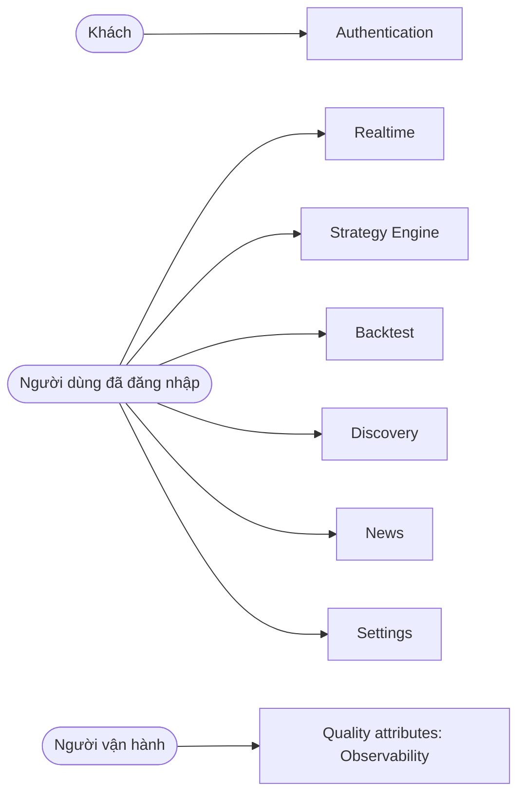

# Use Cases

Đọc file này để biết Crypto Force phải làm gì khi nhìn từ bên ngoài, ai dùng hệ thống, và tìm file use case theo vùng chức năng.

Crypto Force giúp người nghiên cứu giao dịch tìm chiến lược đáng thử: quan sát thị trường, biến quan sát thành tín hiệu, backtest trên dữ liệu quá khứ, đánh giá, so sánh và tự động tìm chiến lược mới. Hệ thống chỉ phân tích và mô phỏng; không kết nối tài khoản sàn và không đặt lệnh thật [[1]](#ref-1).

## Actor

| Actor | Mục tiêu |
| --- | --- |
| Khách | Xem Landing, tạo tài khoản, đăng nhập |
| Người dùng đã đăng nhập | Xem thị trường, tạo strategy, chạy backtest, tìm strategy tốt hơn, xem tin tức kèm sentiment |
| Người vận hành | Theo dõi trạng thái của Continuous Strategy Loop và job |
| Hệ thống bên ngoài | Binance (dữ liệu thị trường), Google (đăng nhập), hộp thư của người dùng (link xác minh, link reset) |

## Danh sách file

| File | Vùng chức năng |
| --- | --- |
| [market-data.md](market-data.md) | Xem lịch sử thị trường trên Realtime: multi-chart, pair, timeframe, nến, volume, MA, trạng thái tải và lỗi |
| [authentication.md](authentication.md) | Sign in, Continue with Google, Create account và Verify email, Reset password, phiên và Sign out, bảo mật, accessibility của Auth |
| [quality-attributes.md](quality-attributes.md) | Quality attribute scenario toàn hệ thống: modifiability, scalability, performance, realtime, reliability, observability |
| [sources/project-brief.md](sources/project-brief.md) | Đề bài gốc: mục tiêu, module, architectural drivers, MVP |
| [sources/system-description.md](sources/system-description.md) | Mô tả domain: Market, Strategy, Backtest, Evaluation, Leaderboard, Search, News |

Vùng chức năng chưa có file use case được mô tả theo giao diện trong [hành vi sản phẩm theo UI](../design/prototype/docs/requirements/README.md).

## References

1. [System Description](sources/system-description.md)
