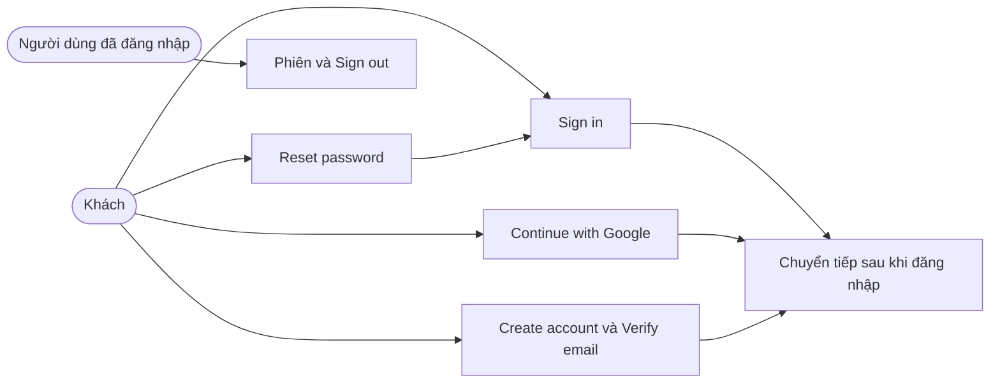
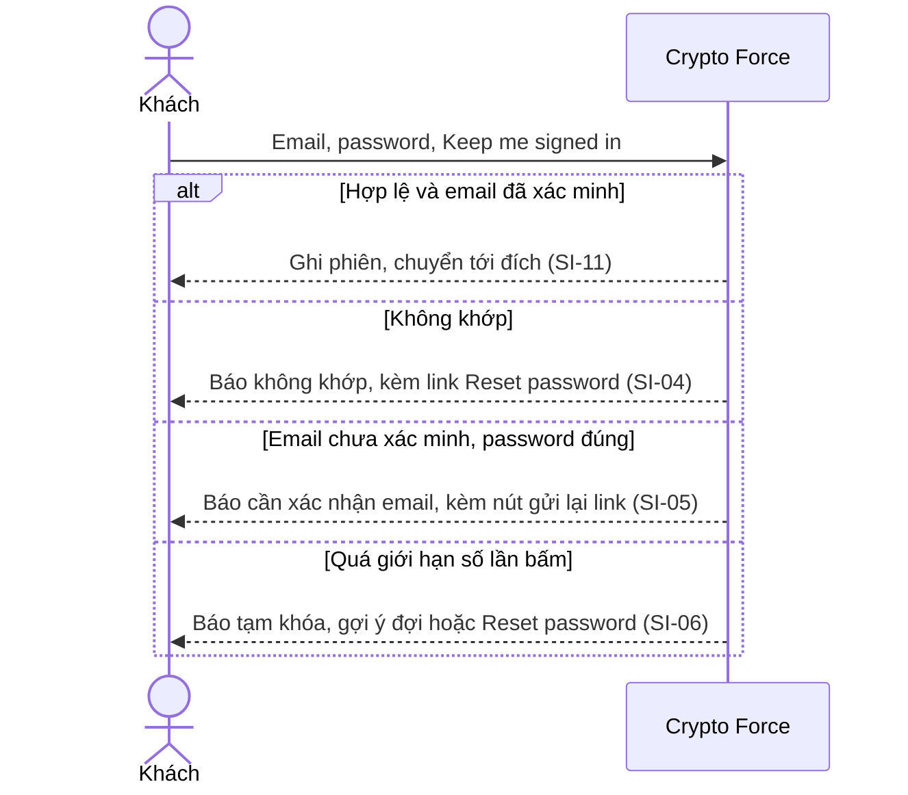
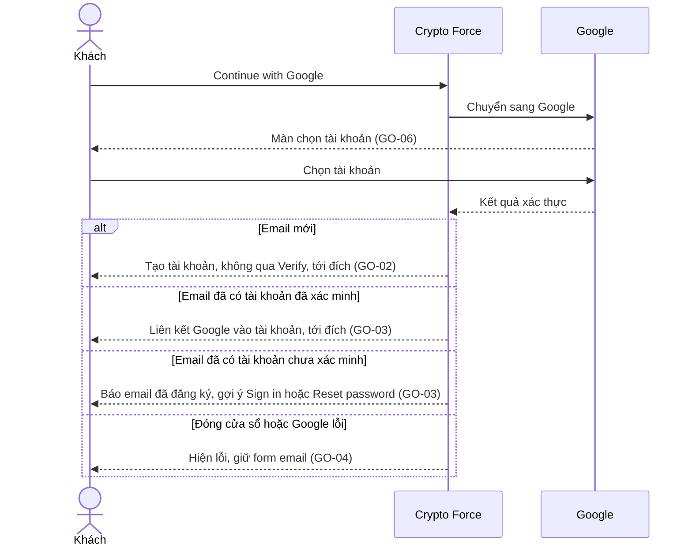
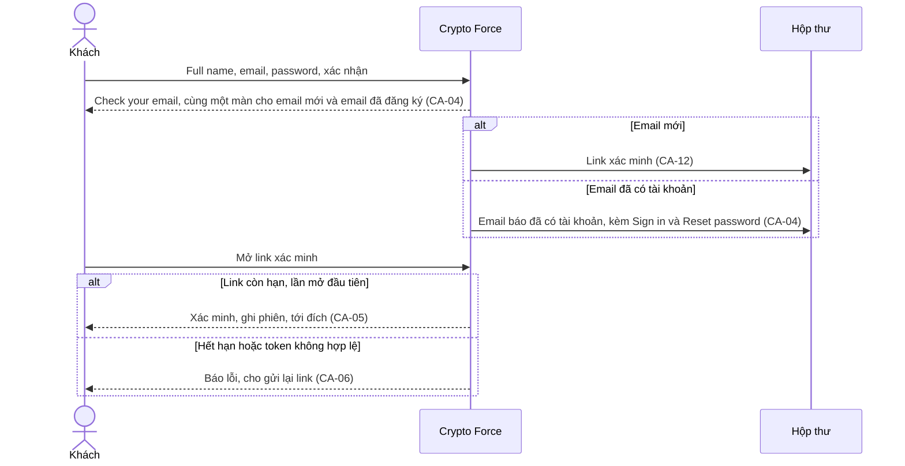
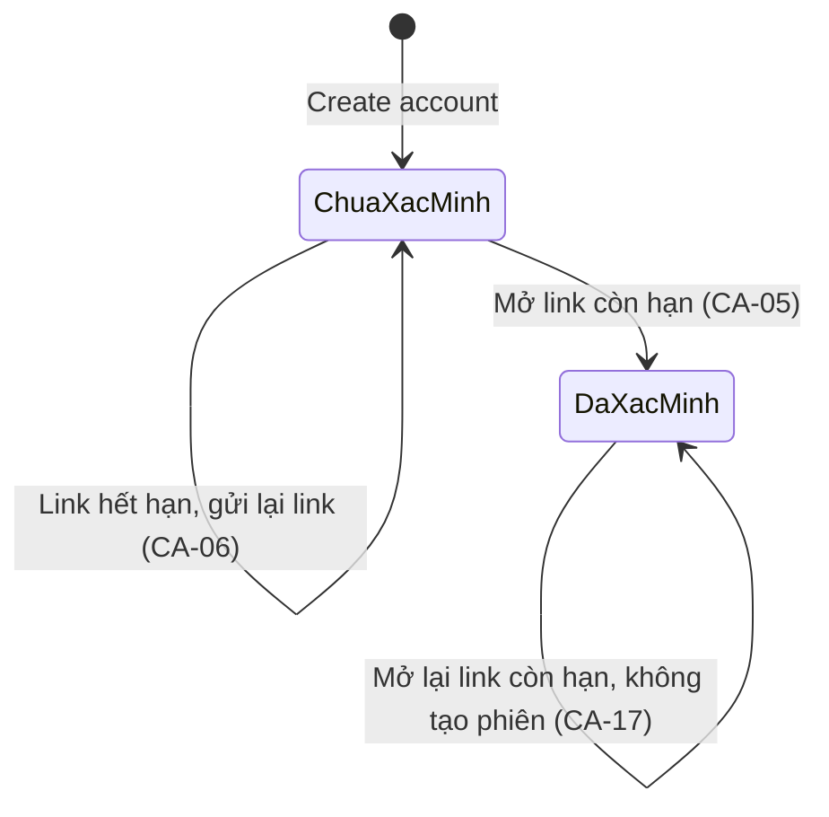
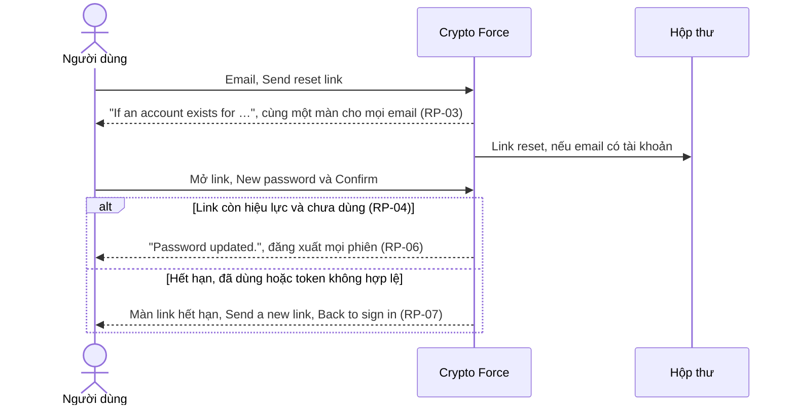
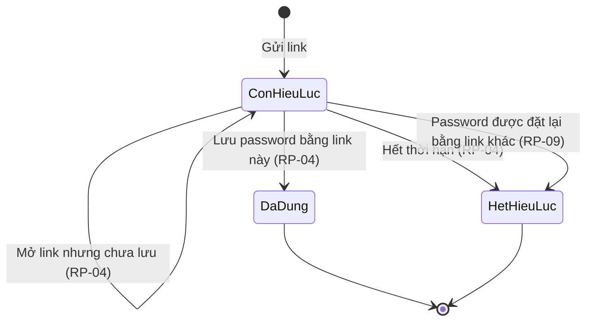

# Authentication

Đọc file này để biết người dùng đăng nhập, tạo tài khoản, xác minh email, đặt lại password và kết thúc phiên ra sao, kèm số đo của từng rule và gap so với OWASP ASVS.

## Tổng quan

Actor chính là khách (chưa có phiên) và người dùng đã đăng nhập. Hệ thống bên ngoài mà người dùng thấy là hộp thư của họ và Google. Mọi bước Sign in, Create account, Verify email và Reset password nằm trên cùng một màn hình Auth; chuyển bước không làm mất email đã nhập (RD-08).

Ngoài phạm vi: đổi password, đổi email, xem và kết thúc từng phiên, xóa tài khoản. Các chức năng này thuộc Settings.

Product owner duyệt toàn bộ requirement có ID trong Requirement Readiness của test scope TS-001 ngày 2026-11-17 [[8]](#ref-8); rule có trạng thái `Confirmed` mà cột Nguồn chỉ ghi chuẩn hoặc thư viện dựa vào lần duyệt này.



| Tiền tố | Nhóm | Nguồn |
| --- | --- | --- |
| `RD` | Chuyển tiếp sau khi đăng nhập | [Chuyển tiếp sau khi đăng nhập](#chuyển-tiếp-sau-khi-đăng-nhập) |
| `CM` | Quy tắc dùng chung cho mọi bước | [Quy tắc dùng chung](#quy-tắc-dùng-chung) |
| `SI` | Sign in | [Sign in](#sign-in) |
| `GO` | Continue with Google | [Continue with Google](#continue-with-google) |
| `CA` | Create account và Verify email | [Create account và Verify email](#create-account-và-verify-email) |
| `RP` | Reset password | [Reset password](#reset-password) |
| `SS` | Phiên và Sign out | [Phiên và Sign out](#phiên-và-sign-out) |
| `SEC` | Bảo mật quan sát được qua HTTP và email | [Bảo mật](#bảo-mật) |
| `ASVS` | Mục ASVS L1 không có hành vi riêng trong các nhóm trên; số giữ theo mục gốc | [Bảo mật](#bảo-mật) |
| `A11Y` | Accessibility | [Accessibility](#accessibility) |
| `AG` | Gap so với baseline | [Gap analysis](#gap-analysis) |

## Quy tắc dùng chung

| ID | Rule | Giá trị | Đo tại | Nguồn | Trạng thái |
| --- | --- | --- | --- | --- | --- |
| CM-01 | Email được bỏ khoảng trắng ở đầu và cuối, không phân biệt chữ hoa chữ thường; địa chỉ có `+tag` (ví dụ `an+test@example.com`) là một địa chỉ riêng | — | — | Product owner | Confirmed |
| CM-02 | Password dài 8 đến 128 ký tự, đếm theo Unicode code point; không bắt buộc chữ hoa, số hay ký tự đặc biệt; được kiểm đúng như người dùng nhập, không bị cắt bớt. Ví dụ: 8 emoji `😀` là 8 ký tự | 8–128 code point | Độ dài password người dùng gửi | Tối thiểu 8 và cách đếm theo code point: NIST SP 800-63B [[1, §5.1.1.2]](#ref-1); tối đa 128: product owner | Confirmed |
| CM-03 | Lỗi server hoặc mất mạng hiện thông báo chung kèm gợi ý thử lại, ví dụ "We couldn’t sign you in right now. Check your connection and try again."; mỗi bước dùng câu riêng | — | — | Product owner | Confirmed |
| CM-04 | Email đúng định dạng khi có đúng một `@`, phần trước `@` không rỗng, phần domain có ít nhất một dấu chấm nằm giữa hai phần không rỗng, và không có khoảng trắng bên trong. Ví dụ sai: `an@example`, `an@@example.com`, `an example@example.com` | — | — | Product owner | Confirmed |
| CM-05 | Link và phiên hết hiệu lực tại đúng mốc thời hạn: link hiệu lực 3.600 giây mở đúng 3.600 giây sau khi gửi là link hết hạn | 0 giây dung sai | Từ lúc gửi (hoặc tạo phiên) tới lúc mở link (hoặc gửi request) | Product owner | Confirmed |
| CM-06 | Request gửi email bị chặn bởi giới hạn số lần (Create account, Resend the link, gửi lại link xác minh ở Sign in, Send reset link): Auth giữ nguyên bước hiện tại, hiện lỗi kèm gợi ý đợi rồi thử lại; không chuyển sang Check your email hay "If an account exists for …"; nút Resend the link không đổi thành "Sent again". Nội dung giống nhau cho email đã và chưa đăng ký | — | — | Product owner | Confirmed |

## Chuyển tiếp sau khi đăng nhập

Mọi cách đăng nhập (Sign in, Create account → Verify email, Reset password → Sign in, Continue with Google) dùng chung quy tắc chọn đích đến. Đích đến được truyền qua URL của Auth.

| ID | Rule | Giá trị | Đo tại | Nguồn | Trạng thái |
| --- | --- | --- | --- | --- | --- |
| RD-01 | Không có hành động đang chờ thì sau khi đăng nhập tới Realtime | — | — | Product owner | Confirmed |
| RD-02 | Đến Auth từ màn chặn của một màn hình workspace thì sau khi đăng nhập về đúng màn hình đó, giữ ngữ cảnh đang có | — | — | Product owner | Confirmed |
| RD-03 | Đến Auth từ Backtest this idea trên Landing thì sau khi đăng nhập tới Strategy Engine, ý tưởng đã điền sẵn | — | — | Product owner | Confirmed |
| RD-04 | Có hành động đang chờ thì Auth hiện một dòng báo trước đích đến | — | — | Product owner | Confirmed |
| RD-05 | Đích đến chờ bị xóa khi đăng nhập thành công hoặc khi Sign out | — | — | Product owner | Confirmed |
| RD-06 | Chỉ nhận đích là đường dẫn nội bộ của ứng dụng. Đích ngoài ứng dụng (URL tuyệt đối, dạng `//host`) và đích là một route của Auth (`/sign-in`, `/sign-up`, `/sign-up/verify`, `/forgot-password`, `/reset-password`) bị thay bằng Realtime | — | — | Product owner; ASVS 5.0 [[4, 3.7.2]](#ref-4) | Confirmed |
| RD-07 | Người dùng đã đăng nhập mà mở Auth thì được chuyển thẳng tới đích; ngoại lệ là link reset password, mở được khi đang đăng nhập | — | — | Product owner | Confirmed |
| RD-08 | Chuyển giữa các bước của Auth không làm mất email đã nhập | — | — | Product owner | Confirmed |

## Sign in

Trigger: khách chọn Sign in. Precondition: khách chưa có phiên. Thành công: trình duyệt có phiên và người dùng ở đích đến. Thất bại: không có phiên, Auth hiện lỗi tại form.

1. Người dùng nhập email và password; có thể bật/tắt hiện password và chọn **Keep me signed in on this device**.
2. Người dùng bấm Sign in; Auth kiểm form.
3. Crypto Force kiểm email và password, ghi phiên, rồi chuyển tới đích đến.



| ID | Điều kiện | Phản hồi người dùng thấy | Nguồn | Trạng thái |
| --- | --- | --- | --- | --- |
| SI-01 | Email trống | "Enter your email address." | Product owner | Confirmed |
| SI-02 | Email sai định dạng | "That doesn’t look like an email address. Check for a missing @ or domain." | Product owner | Confirmed |
| SI-03 | Password trống | "Enter your password." | Product owner | Confirmed |
| SI-04 | Email và password không khớp, kể cả tài khoản chưa xác minh mà nhập password sai | Báo lỗi không khớp kèm link Reset password | Product owner | Confirmed |
| SI-05 | Email chưa được xác minh và password đúng | Báo cần xác nhận email trước, kèm nút gửi lại link xác minh; không ghi phiên | Product owner | Confirmed |
| SI-12 | Tài khoản chỉ đăng nhập bằng Google mà nhập password | Thông báo giống khi email và password không khớp (SI-04) | Product owner | Confirmed |

| ID | Rule | Giá trị | Đo tại | Nguồn | Trạng thái |
| --- | --- | --- | --- | --- | --- |
| SI-06 | Từ một địa chỉ IP, lần bấm Sign in thứ 4 cách lần được chấp nhận cuối dưới 10 giây bị tạm khóa. Mọi lần bấm đều được đếm, kể cả lần đúng; bộ đếm về 0 khi ngưng bấm từ 10 giây trở lên. Trong lúc khóa, Auth báo đợi giây lát rồi thử lại, hoặc Reset password. Khóa hết 10 giây sau lần được chấp nhận cuối; lần bấm trong lúc khóa vẫn hiện thông báo khóa và không kéo dài thời gian khóa. Response bị chặn có status 429 và header `X-Retry-After` là số giây còn lại, làm tròn lên | 3 lần bấm / 10 giây / IP | Từ lần bấm được chấp nhận cuối tới lần bấm mới, cùng IP | Mặc định của Better Auth 1.7.25, product owner duyệt; ASVS 5.0 [[2, 6.1.1, 6.3.1]](#ref-2) | Confirmed |
| SI-07 | Sửa password sau một lần sai thì ẩn thông báo lỗi, trừ khi đang khóa | — | — | Product owner | Confirmed |
| SI-08 | Ô password che ký tự và có nút bật/tắt hiện password | — | — | Product owner; ASVS 5.0 [[2, 6.2.6]](#ref-2) | Confirmed |
| SI-09 | Keep me signed in bật (mặc định): phiên hiệu lực 7 ngày; request cách lần gia hạn cuối từ 1 ngày trở lên gia hạn phiên thêm 7 ngày; không quá thời hạn tuyệt đối (SS-05). Phiên tạo bởi Continue with Google và bởi link xác minh email có cùng thời hạn | 7 ngày; gia hạn sau 1 ngày | Từ lần gia hạn cuối tới request mới | Product owner | Confirmed |
| SI-10 | Keep me signed in tắt: cookie phiên không có `Max-Age` hay `Expires`; phiên phía server hết hạn 1 ngày sau khi tạo và không tự gia hạn | 1 ngày | Từ lúc tạo phiên | Product owner; mặc định của Better Auth 1.7.25 | Confirmed |
| SI-11 | Hợp lệ thì ghi phiên, rồi chuyển tới đích đến | — | — | Product owner | Confirmed |

Giới hạn số lần bấm Sign in tính theo IP, không theo tài khoản, để người khác không cố ý nhập sai nhằm khóa tài khoản của một người dùng. Mọi giới hạn số lần trong file này (SI-06, GO-08, SEC-07) dùng cùng cách tính: bộ đếm riêng cho mỗi chức năng và mỗi IP, bộ đếm về 0 khi request mới cách request được chấp nhận cuối từ độ dài cửa sổ trở lên, và request bị chặn không được đếm.

## Continue with Google

Trigger: khách chọn Continue with Google. Thành công: có phiên, tới đích đến. Thất bại: Auth hiện lỗi và giữ form email.



| ID | Rule | Giá trị | Đo tại | Nguồn | Trạng thái |
| --- | --- | --- | --- | --- | --- |
| GO-01 | Nút Continue with Google chỉ hiện khi môi trường đã cấu hình Google OAuth | — | — | Product owner | Confirmed |
| GO-02 | Email chưa có tài khoản thì tạo tài khoản mới, không qua bước Verify vì Google đã xác minh email | — | — | Product owner | Confirmed |
| GO-03 | Email đã có tài khoản email/password và đã xác minh thì Google được liên kết vào tài khoản đó; tài khoản đã liên kết một tài khoản Google khác thì liên kết thêm và giữ liên kết cũ. Tài khoản chưa xác minh email thì không đăng nhập: Auth báo email đã được đăng ký và gợi ý Sign in bằng password hoặc Reset password | — | — | Product owner | Confirmed |
| GO-04 | Người dùng đóng cửa sổ Google, Google báo lỗi, hoặc callback không thuộc request Continue with Google đã bắt đầu ở cùng trình duyệt: Auth hiện lỗi, giữ form email, không tạo phiên, không liên kết tài khoản | — | — | Product owner | Confirmed |
| GO-05 | Đăng nhập bằng Google xong thì chuyển tới đích đến | — | — | Product owner | Confirmed |
| GO-06 | Mỗi lần bấm nút, Google hiện màn chọn tài khoản | — | — | Product owner | Confirmed |
| GO-07 | Reset password không đánh dấu email là đã xác minh; chủ hộp thư lấy lại tài khoản chưa xác minh bằng Reset password rồi xác nhận email | — | — | Product owner | Confirmed |
| GO-08 | Bắt đầu Continue with Google dùng cùng giới hạn với Sign in (SI-06) nhưng bộ đếm riêng; callback của Google bị chặn khi vượt giới hạn | Bắt đầu: như giới hạn Sign in; callback: 100 request / 10 giây / IP | Từ request được chấp nhận cuối tới request mới, cùng IP và cùng chức năng | Mặc định của Better Auth 1.7.25, product owner duyệt; ASVS 5.0 [[2, 6.1.3, 6.3.4]](#ref-2) | Confirmed |
| GO-09 | Tài khoản Google được xác định theo provider và định danh `sub`, không theo email | — | — | Product owner; ASVS 5.0 [[2, 6.8.1]](#ref-2) | Confirmed |
| GO-10 | Phiên Crypto Force độc lập với phiên Google: Sign out không đăng xuất khỏi Google, phiên Google kết thúc không làm kết thúc phiên Crypto Force | — | — | Product owner; ASVS 5.0 [[3, 7.1.3, 7.6.1]](#ref-3) | Confirmed |


## Create account và Verify email

Trigger: khách chọn tab Create account. Thành công: email được xác minh, trình duyệt mở link có phiên và ở đích đến. Thất bại: lỗi tại trường, hoặc màn link không hợp lệ kèm nút gửi lại link.

1. Người dùng nhập Full name, email, password và tick xác nhận rằng Crypto Force chỉ mô phỏng, đồng ý Terms và Privacy Policy (CA-01).
2. Người dùng bấm Create account; trường không đạt báo lỗi tại trường (CA-02).
3. Hợp lệ thì Auth chuyển sang Check your email, hiện email vừa nhập (CA-03).
4. Người dùng mở link trong email; Crypto Force xác minh email, ghi phiên và chuyển tới đích đến (CA-05).





| ID | Điều kiện | Phản hồi người dùng thấy | Nguồn | Trạng thái |
| --- | --- | --- | --- | --- |
| CA-02 | Full name trống hoặc chỉ có khoảng trắng; email trống hoặc sai định dạng; password ngắn hơn 8 ký tự; chưa tick xác nhận | Lỗi tại trường: "Enter your full name.", lỗi email như ở Sign in (SI-01, SI-02), "Use at least 8 characters.", "Please confirm to create your account." | Product owner | Confirmed |
| CA-06 | Link xác minh hết hạn, hoặc token trong link bị sửa hay không hợp lệ | Báo lỗi và cho gửi lại link; không tạo phiên; trạng thái tài khoản không đổi | Product owner | Confirmed |

| ID | Rule | Giá trị | Đo tại | Nguồn | Trạng thái |
| --- | --- | --- | --- | --- | --- |
| CA-01 | Form Create account gồm Full name, email, password và checkbox xác nhận | — | — | Product owner | Confirmed |
| CA-03 | Hợp lệ thì chuyển sang Check your email, hiện email vừa nhập | — | — | Product owner | Confirmed |
| CA-04 | Email đã có tài khoản cũng tới Check your email, để form không tiết lộ email nào đã đăng ký; chủ tài khoản nhận email báo đã có tài khoản, kèm link Sign in và Reset password | — | — | Product owner | Confirmed |
| CA-05 | Link xác minh xác minh tài khoản, ghi phiên trên trình duyệt mở link, rồi chuyển tới đích đến | — | — | Product owner | Confirmed |
| CA-07 | Resend the link: nút đổi thành "Sent again" và bị vô hiệu | — | — | Product owner | Confirmed |
| CA-08 | Use a different email: quay lại form Create account | — | — | Product owner | Confirmed |
| CA-09 | I've confirmed, continue: trình duyệt đã có phiên thì tới đích đến; chưa có phiên thì mở Sign in với email điền sẵn | — | — | Product owner | Confirmed |
| CA-10 | Nút I've confirmed, continue ghi rõ tên đích đến | — | — | Product owner | Confirmed |
| CA-11 | Tab Sign in và Create account điều khiển được bằng phím mũi tên, Home và End | — | — | Product owner | Confirmed |
| CA-12 | Link xác minh hết hiệu lực | 3.600 giây | Từ lúc gửi email tới lúc mở link | Product owner; ASVS 5.0 [[2, 6.4.1]](#ref-2) | Confirmed |
| CA-13 | Full name dài hơn 100 ký tự báo "Use 100 characters or fewer."; password dài hơn 128 ký tự báo "Use 128 characters or fewer.". Độ dài đếm theo Unicode code point | 100 và 128 code point | Độ dài giá trị người dùng nhập | Product owner; NIST SP 800-63B [[1, §5.1.1.2]](#ref-1) | Confirmed |
| CA-15 | Tải lại trang Check your email thì quay về Create account, vì email không được lưu trong URL | — | — | Product owner | Confirmed |
| CA-16 | Email báo đã có tài khoản gửi tới tài khoản chưa xác minh thì hướng dẫn Reset password rồi xác nhận email | — | — | Product owner | Confirmed |
| CA-17 | Phiên chỉ được tạo ở lần mở link xác minh đầu tiên; phần mềm quét email mở link trước thì email vẫn được xác minh nhưng người dùng phải tự Sign in. Link còn hạn của email đã xác minh không báo lỗi, không tạo phiên: Auth mở Sign in, hoặc chuyển thẳng tới đích nếu đã có phiên | — | — | Product owner | Confirmed |
| CA-14 | Password nằm trong danh sách 3.000 password phổ biến hoặc đã bị lộ trong một vụ rò rỉ dữ liệu bị từ chối với "This password is too common or has appeared in a data breach. Choose a different one.". Khi dịch vụ kiểm password bị lộ lỗi hoặc không trả lời trong thời gian chờ, chỉ kiểm danh sách 3.000 password, chấp nhận password không có trong danh sách và ghi log cảnh báo | 3.000 password; chờ tối đa 3 giây | Từ lúc gửi form tới lúc nhận kết quả kiểm | Product owner; ASVS 5.0 [[2, 6.2.4, 6.2.12]](#ref-2); 3 giây chưa dựa trên số liệu đo | Confirmed |

## Reset password

Trigger: người dùng chọn **Forgot password?** ở Sign in. Thành công: password mới được lưu, mọi phiên cũ kết thúc, người dùng quay về Sign in. Thất bại: màn link hết hạn hoặc đã dùng.

1. Người dùng nhập email và chọn Send reset link (RP-01).
2. Email hợp lệ thì Auth luôn hiện "If an account exists for …" (RP-03).
3. Người dùng mở link trong email, nhập New password và Confirm, rồi lưu (RP-05).
4. Crypto Force lưu password, đăng xuất mọi phiên và hiện "Password updated." (RP-06).





| ID | Rule | Giá trị | Đo tại | Nguồn | Trạng thái |
| --- | --- | --- | --- | --- | --- |
| RP-01 | Từ Sign in, người dùng chọn Forgot password?, nhập email và chọn Send reset link | — | — | Product owner | Confirmed |
| RP-02 | Email trống hoặc sai định dạng báo lỗi như ở Sign in (SI-01, SI-02) | — | — | Product owner | Confirmed |
| RP-03 | Email hợp lệ luôn hiện "If an account exists for …", để không tiết lộ email có tồn tại hay không | — | — | Product owner | Confirmed |
| RP-04 | Link reset hết hiệu lực sau thời hạn và chỉ dùng được một lần; link được tính là đã dùng khi password được lưu, nên mở link mà chưa lưu thì mở lại vẫn tới form Choose a new password | 3.600 giây | Từ lúc gửi email tới lúc mở link hoặc bấm lưu | Product owner; ASVS 5.0 [[2, 6.4.1]](#ref-2) | Confirmed |
| RP-05 | New password theo quy tắc password của Create account (CM-02, CA-13, CA-14); Confirm không khớp báo "The two passwords don’t match."; một trong hai ô trống báo "Fill in both fields."; lỗi hiện ngay khi gõ | — | — | Product owner | Confirmed |
| RP-06 | Lưu thành công thì hiện "Password updated." và nút Sign in quay về form Sign in; mọi phiên của tài khoản bị đăng xuất, kể cả phiên trên trình duyệt đang mở link | — | — | Product owner; ASVS 5.0 [[3, 7.4.3]](#ref-3) | Confirmed |
| RP-07 | Link hết hạn, đã dùng, hoặc token bị sửa hay không hợp lệ: màn báo link hết hạn hoặc đã dùng, có Send a new link (quay lại bước nhập email) và Back to sign in. Link hết hiệu lực sau khi form đã mở thì bấm lưu không đổi password và hiện màn này | — | — | Product owner | Confirmed |
| RP-08 | Link reset mang theo đích đến đang chờ, và mở được cả khi trình duyệt đang đăng nhập | — | — | Product owner | Confirmed |
| RP-09 | Gửi link mới không làm link cũ hết hiệu lực; khi password được đặt lại bằng một link, mọi link reset còn hạn khác của tài khoản hết hiệu lực | — | — | Product owner | Confirmed |

## Phiên và Sign out

Landing và Auth là public; mọi màn hình workspace yêu cầu đăng nhập. Trigger của Sign out: người dùng chọn Sign out trong menu tài khoản hoặc drawer mobile. Điều kiện riêng của workspace khi Sign out (backtest đang chạy, thay đổi chưa lưu) nằm trong [Workspace](../design/prototype/docs/requirements/workspace.md#sign-out).

```mermaid
sequenceDiagram
    actor U as Người dùng
    participant S as Crypto Force
    U->>S: Mở màn hình workspace
    alt Không có phiên
        S-->>U: Màn chặn "Sign in to open {tên màn hình}" (SS-03)
    else Không kiểm được phiên
        S-->>U: Lỗi tải kèm nút thử lại (SS-07)
    else Có phiên
        S-->>U: Nội dung màn hình
    end
    U->>S: Sign out
    alt Thành công
        S-->>U: Xóa phiên, đích chờ, dữ liệu đã tải; mở Landing (SS-01)
    else Không gửi được yêu cầu
        S-->>U: Vẫn đăng nhập, toast báo thử lại (SS-02)
    end
```

| ID | Rule | Giá trị | Đo tại | Nguồn | Trạng thái |
| --- | --- | --- | --- | --- | --- |
| SS-01 | Sign out xóa phiên, xóa đích đến đang chờ, xóa dữ liệu của tài khoản đã tải trong trình duyệt và mở Landing; phiên đã kết thúc không dùng lại được | — | — | Product owner; ASVS 5.0 [[3, 7.4.1, 7.4.4]](#ref-3) | Confirmed |
| SS-02 | Không gửi được yêu cầu Sign out (mất mạng, lỗi server): người dùng vẫn đăng nhập, ở lại màn hình hiện tại, toast báo Sign out chưa thành công để thử lại | — | — | Product owner | Confirmed |
| SS-03 | Không có phiên thì màn hình workspace hiện màn chặn phủ toàn viewport "Sign in to open {tên màn hình}", kèm Sign in to continue và Back to home; Sign in to continue ghi nhớ màn hình đó (RD-02) | — | — | Product owner | Confirmed |
| SS-04 | Phiên kết thúc khi màn hình workspace đang mở (Sign out ở tab khác, đặt password mới, phiên hết hạn): màn chặn hiện tại màn hình đang mở khi người dùng chuyển màn hình hoặc quay lại tab | — | — | Product owner | Confirmed |
| SS-05 | Phiên bị từ chối sau thời hạn tuyệt đối dù vẫn được dùng đều; không có idle timeout | 30 ngày | Từ lúc tạo phiên | NIST SP 800-63B, mức tái xác thực tối đa của AAL1 [[1]](#ref-1); ADR-002 [[5, ADR-002]](#ref-5) | Confirmed |
| SS-06 | Mở link xác minh khi trình duyệt đang đăng nhập bằng tài khoản khác: giữ phiên hiện tại, báo "{email} is verified. You’re still signed in as {email hiện tại}." | — | — | Product owner | Confirmed |
| SS-07 | Không kiểm được phiên (mất mạng, lỗi server) khi mở màn hình workspace: hiện lỗi tải kèm nút thử lại | — | — | Product owner; ADR-001 [[5, ADR-001]](#ref-5) | Confirmed |
| SS-08 | Không giới hạn số phiên đồng thời của một tài khoản | — | — | Mặc định của Better Auth 1.7.25, product owner duyệt; ASVS 5.0 [[3, 7.1.2]](#ref-3) | Confirmed |

## Bảo mật

Các rule dưới đây quan sát được từ bên ngoài: qua response HTTP, cookie, email, hoặc hành vi khi gửi request lặp lại. Mức bảo mật là OWASP ASVS 5.0 L1 cộng một số mục L2 [[5, ADR-002]](#ref-5).

| ID | Rule | Giá trị | Đo tại | Nguồn | Trạng thái |
| --- | --- | --- | --- | --- | --- |
| SEC-01 | Cookie phiên có `HttpOnly`, `SameSite=Lax`, và `Secure` ở production | — | — | ASVS 5.0 [[4, 3.3.1, 3.3.2, 3.3.4]](#ref-4) | Confirmed |
| SEC-02 | Request và callback URL không thuộc origin của ứng dụng bị từ chối; link trong email xác minh, email reset và email báo đã có tài khoản luôn dùng origin của ứng dụng, dù header `Host`, `X-Forwarded-Host` hay `Origin` của request là gì | — | — | ASVS 5.0 [[4, 3.5.1, 3.7.2]](#ref-4) | Confirmed |
| SEC-03 | Create account và Reset password trả cùng nội dung và status dù email đã có tài khoản hay chưa; thời gian phản hồi có thể khác nhau (rủi ro chấp nhận) | — | — | Product owner; ADR-002 [[5, ADR-002]](#ref-5) | Confirmed |
| SEC-04 | Bộ đếm của các giới hạn số lần không về 0 khi hệ thống khởi động lại | — | — | Product owner | Confirmed |
| SEC-05 | Client không vượt qua giới hạn số lần bằng cách tự đặt header `X-Forwarded-For`; kiểm trên môi trường deploy có reverse proxy | — | — | Product owner | Confirmed |
| SEC-06 | Môi trường development không gửi email thật khi chưa cấu hình dịch vụ email: nội dung email, gồm link, được in ra console; production không khởi động khi thiếu cấu hình email | — | — | Product owner | Confirmed |
| SEC-07 | Gửi lại link xác minh và gửi link reset bị chặn khi vượt giới hạn; Create account bị chặn khi vượt giới hạn. Response bị chặn có status 429 và `X-Retry-After` là số giây còn lại, làm tròn lên | 3 request / 60 giây / IP; Create account 3 request / 10 giây / IP | Từ request được chấp nhận cuối tới request mới, cùng IP và cùng chức năng | Mặc định của Better Auth 1.7.25, product owner duyệt | Confirmed |
| SEC-08 | Mọi response của API có `X-Content-Type-Options: nosniff`, `Referrer-Policy: no-referrer` và CSP `frame-ancestors 'none'`; response của chức năng Auth có thêm `Cache-Control: no-store`; trang có token trong URL (Choose a new password) không gửi token qua header `Referer` | — | — | ASVS 5.0 [[4, 3.4.4, 3.4.5, 3.4.6]](#ref-4) | Confirmed |
| SEC-09 | Gửi email lỗi thì response cho người dùng giống khi gửi thành công | — | — | Product owner | Confirmed |
| SEC-10 | Trước khi deploy public: giới hạn email theo địa chỉ, giới hạn tổng số email mỗi ngày dưới quota của dịch vụ email kèm cảnh báo cho người vận hành, dọn tài khoản chưa xác minh | 3 email / địa chỉ / giờ; dọn sau 7 ngày | Từ email đầu tiên trong giờ; từ lúc tạo tài khoản chưa xác minh | Tài liệu Security tại commit `d6c0541`; product owner xếp yêu cầu này ngoài phạm vi TS-001 (2026-11-17); hai giá trị chưa được xác nhận riêng | Proposed |
| ASVS-6.2.7 | Ô password cho dán, cho trình duyệt và password manager điền | — | — | ASVS 5.0 [[2, 6.2.7]](#ref-2) | Confirmed |
| ASVS-6.3.2 | Không có tài khoản mặc định như root, admin, sa | — | — | ASVS 5.0 [[2, 6.3.2]](#ref-2) | Confirmed |
| ASVS-7.2.2 | Token phiên được sinh động, không phải secret tĩnh | — | — | ASVS 5.0 [[3, 7.2.2]](#ref-3) | Confirmed |
| ASVS-7.2.3 | Token phiên duy nhất, sinh bằng CSPRNG | 128 bit entropy tối thiểu | Token phiên trong cookie | ASVS 5.0 [[3, 7.2.3]](#ref-3) | Confirmed |
| ASVS-7.2.4 | Đăng nhập thì cấp token phiên mới và hủy token đang có | — | — | ASVS 5.0 [[3, 7.2.4]](#ref-3) | Confirmed |
| ASVS-3.4.2 | `Access-Control-Allow-Origin` cố định hoặc kiểm theo allowlist | — | — | ASVS 5.0 [[4, 3.4.2]](#ref-4) | Confirmed |

## Accessibility

| ID | Rule | Giá trị | Đo tại | Nguồn | Trạng thái |
| --- | --- | --- | --- | --- | --- |
| A11Y-01 | Lỗi form hiện dưới trường, trường có `aria-describedby` và `aria-invalid`, focus chuyển tới trường lỗi đầu tiên, form có danh sách lỗi | — | — | Prototype README tại commit `dbbaafe`, mục Lỗi form; product owner duyệt 2026-11-17 | Confirmed |
| A11Y-02 | Quét accessibility tự động 6 màn hình Auth (Sign in, Create account, Check your email, Forgot password, Choose a new password, màn link hết hạn), kể cả trạng thái lỗi, không có vi phạm mức `serious` hoặc `critical` | 0 vi phạm `serious` hoặc `critical` | Kết quả quét của từng màn hình | Product owner; Test Strategy [[6]](#ref-6) | Confirmed |

## Gap analysis

Baseline độc lập: OWASP ASVS 5.0 [[2]](#ref-2) [[3]](#ref-3) [[4]](#ref-4), mức L1 cộng các mục L2 đã chọn [[5, ADR-002]](#ref-5). Phần áp dụng là V6 Authentication, V7 Session Management và các mục 3.3, 3.4, 3.5, 3.7 của V3 Web Frontend Security: 70 mục. Kết quả đối chiếu từng mục nằm trong Baseline Comparison của test scope TS-001 [[7]](#ref-7): 39 mục đủ, 1 mục một phần, 30 mục không áp dụng.

| ID | Gap | Baseline | Quyết định | Trạng thái |
| --- | --- | --- | --- | --- |
| AG-01 | Spec không nêu hành vi cho 6 mục L1: dán password, tài khoản mặc định, token phiên sinh động, entropy của token, cấp token mới khi đăng nhập, CORS | ASVS 6.2.7, 6.3.2, 7.2.2, 7.2.3, 7.2.4, 3.4.2 | Thêm rule lấy trực tiếp từ mục ASVS (ASVS-6.2.7, ASVS-6.3.2, ASVS-7.2.2, ASVS-7.2.3, ASVS-7.2.4, ASVS-3.4.2) | Closed |
| AG-02 | Đường xác thực Google chưa có giới hạn số lần và chưa nói cách xác định tài khoản, thời hạn phiên so với phiên Google | ASVS 6.1.3, 6.3.4, 6.8.1, 7.1.3, 7.6.1 | Giới hạn của Google (GO-08), xác định theo provider và `sub` (GO-09), phiên độc lập với Google (GO-10) | Closed |
| AG-03 | Chưa ghi số phiên đồng thời | ASVS 7.1.2 | Không giới hạn số phiên đồng thời (SS-08) | Closed |
| AG-04 | Link xác minh tạo phiên bằng request GET, không có bước xác nhận; phần mềm quét email có thể tạo phiên trước người dùng | ASVS 3.5.3, 7.6.2 | Chấp nhận rủi ro: đổi sang bước xác nhận bằng POST tốn công hơn lợi ích ở mức đã chọn [[5, ADR-002]](#ref-5) | Accepted |
| AG-05 | Không có MFA, idle timeout, CSP đầy đủ, cookie tiền tố `__Host-`, danh sách từ theo ngữ cảnh | ASVS 6.3.3, 7.3.1, 3.4.3, 3.3.3, 6.1.2, 6.2.11 | Chấp nhận rủi ro, lý do từng mục ghi trong ADR-002 [[5, ADR-002]](#ref-5) | Accepted |
| AG-06 | Thời gian phản hồi có thể khác nhau giữa email đã và chưa đăng ký | ASVS 6.3.8 (L3) | Chấp nhận rủi ro; nội dung và status đã giống nhau (SEC-03) | Accepted |

## References

1. <a id="ref-1"></a>[NIST SP 800-63B: Digital Identity Guidelines, Authentication and Lifecycle Management](https://pages.nist.gov/800-63-3/sp800-63b.html)
2. <a id="ref-2"></a>OWASP ASVS 5.0, V6 Authentication. <https://raw.githubusercontent.com/OWASP/ASVS/master/5.0/en/0x15-V6-Authentication.md>
3. <a id="ref-3"></a>OWASP ASVS 5.0, V7 Session Management. <https://raw.githubusercontent.com/OWASP/ASVS/master/5.0/en/0x16-V7-Session-Management.md>
4. <a id="ref-4"></a>OWASP ASVS 5.0, V3 Web Frontend Security. <https://raw.githubusercontent.com/OWASP/ASVS/master/5.0/en/0x12-V3-Web-Frontend-Security.md>
5. <a id="ref-5"></a>[Architectural Decisions](../architecture/30-decisions.md)
6. <a id="ref-6"></a>[Test Strategy](../testing/test-strategy.md)
7. <a id="ref-7"></a>[Baseline Comparison](../testing/test-scopes/TS-001-auth/01-requirement-analysis/output/02-baseline-comparison.md)
8. <a id="ref-8"></a>[Requirement Readiness](../testing/test-scopes/TS-001-auth/01-requirement-analysis/output/01-requirement-readiness.md)
