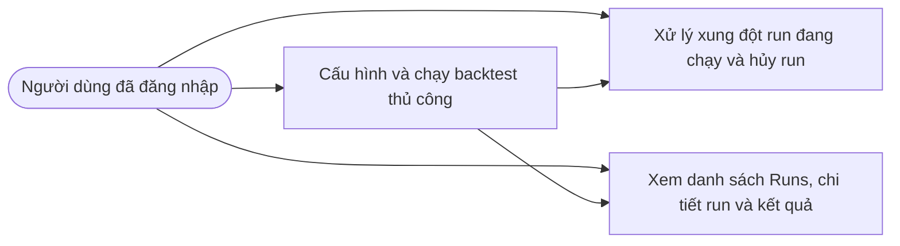
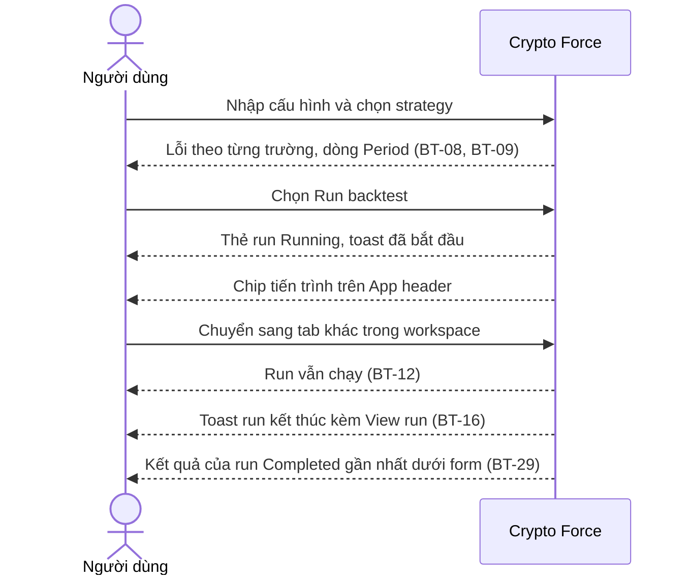
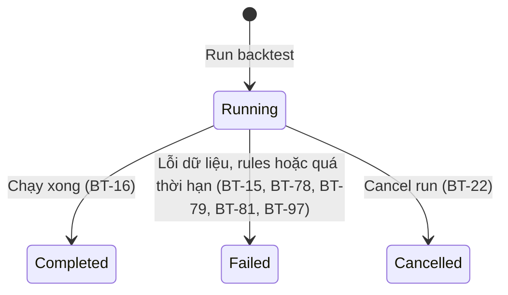
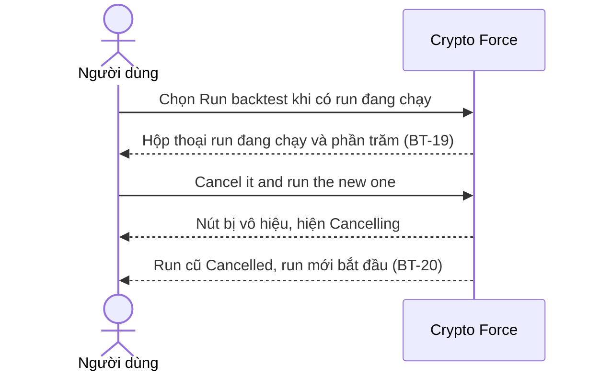
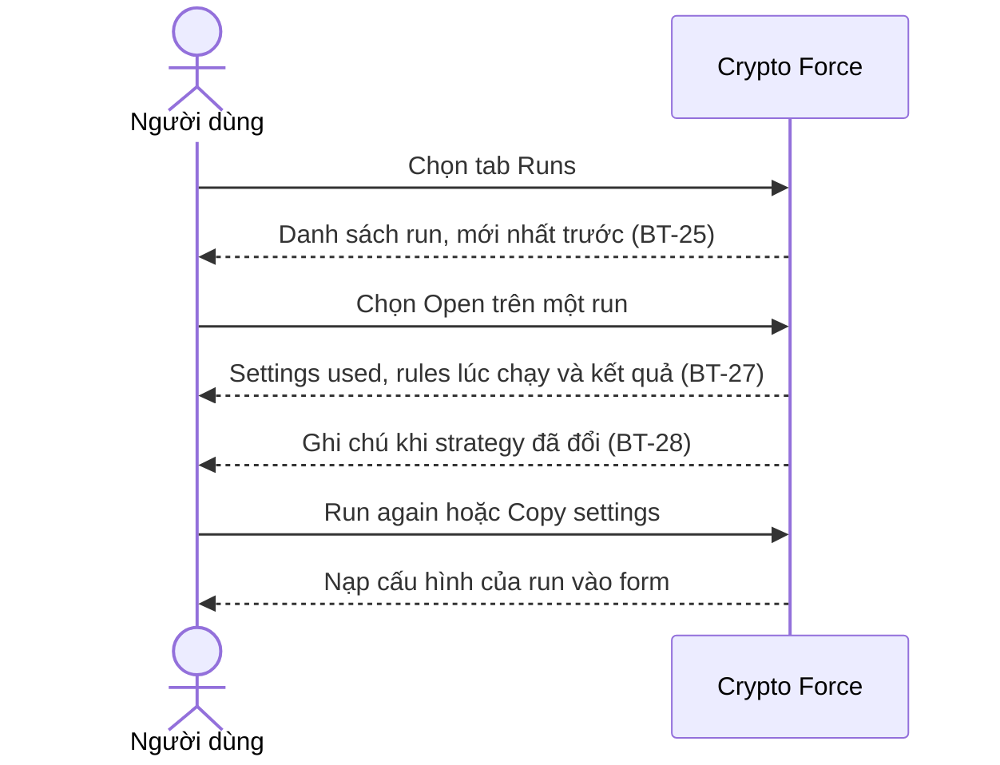

# Backtest

Đọc file này để biết hành vi cấu hình và chạy một backtest thủ công, xử lý run đang chạy, hủy run, và xem lại danh sách run, chi tiết run và kết quả khi nhìn từ bên ngoài.

## Tổng quan

Actor là người dùng đã đăng nhập. Backtest trả lời câu hỏi: nếu dùng strategy này trong quá khứ thì kết quả sẽ thế nào [[1, §10]](#ref-1). Người dùng chọn pair, timeframe, khoảng thời gian, vốn, strategy, phí và slippage, chạy backtest, rồi đọc kết quả gồm return, drawdown, trades, chi phí và chart [[2, Đọc kết quả]](#ref-2). Backtest có hai view: **Set up & run** và **Runs (N)** [[2]](#ref-2).

Trong phạm vi: cấu hình và chạy backtest thủ công, hộp thoại khi đã có run đang chạy, theo dõi và hủy run, danh sách Runs, chi tiết run, ghi chú khi strategy đã đổi so với lúc chạy, chart, bảng trades và chi phí giao dịch.

Ngoài phạm vi: các lượt backtest bên trong Discovery Search, cách leaderboard chọn và xếp candidate, và panel thông báo của App header. Cách tính Score và cách composite bỏ phiếu nằm trong file này vì mỗi run dùng chúng [[1, §8]](#ref-1).

| Tiền tố | Nhóm | Nguồn |
| --- | --- | --- |
| `BT` | Backtest: cấu hình, chạy, theo dõi, hủy run, danh sách Runs, chi tiết run, kết quả, cách mô phỏng và chấm điểm một run | [[2]](#ref-2) |

## Quy tắc dùng chung

Các rule dưới đây quyết định cách mô phỏng và chấm điểm một run. Card Assumptions của kết quả ghi các rule ảnh hưởng trực tiếp tới kết quả (BT-72).

| ID | Rule | Giá trị | Đo tại | Nguồn | Trạng thái |
| --- | --- | --- | --- | --- | --- |
| BT-64 | Score của một run Completed bằng 0,4 × R + 0,4 × D + 0,2 × W, làm tròn 1 chữ số thập phân; R = 50 + net return %, D = 100 − 2 × trị tuyệt đối của max drawdown %, W = win rate % (bằng 0 khi run không có trade); R và D giới hạn trong 0 đến 100 | 0 đến 100 điểm | Cột Score của run trên leaderboard Discovery | Agent chốt theo ủy quyền của product owner, 2026-11-28: Score kết hợp return, max drawdown và win rate như mô tả của Discovery; theo ví dụ của Project Brief [[1, §10]](#ref-1), B (+25 %, −8 %) được 74,6 điểm và xếp trên A (+30 %, −45 %) được 47 điểm khi cùng win rate 55 %; với cùng net return, run có drawdown lớn hơn có điểm thấp hơn cho tới drawdown 50 %, từ đó D bằng 0 | Confirmed |
| BT-65 | Composite dùng Majority Vote trả về tín hiệu có nhiều phiếu nhất trong BUY, SELL, HOLD; khi từ hai tín hiệu trở lên cùng có nhiều phiếu nhất thì trả HOLD | — | — | Agent chốt theo ủy quyền của product owner, 2026-11-28: không vào lệnh khi các block không đồng ý [[1, §8]](#ref-1) | Confirmed |
| BT-100 | Composite Weighted có đúng một weight cho mỗi block đã chọn | — | — | Agent chốt theo ủy quyền của product owner, 2026-11-28: weight của block không được chọn không ảnh hưởng tín hiệu | Confirmed |
| BT-66 | Khi lưu composite Weighted, Crypto Force chia mỗi weight cho tổng weights để tổng bằng 1; tổng weights bằng 0 thì không lưu được | 1,00 | Tổng weights của composite hiển thị trong drawer sau khi lưu | Agent chốt theo ủy quyền của product owner, 2026-11-28: weights đọc được như tỷ lệ đóng góp của từng block | Confirmed |
| BT-95 | Composite Weighted tính tổng có trọng số với BUY bằng +1, SELL bằng −1, HOLD bằng 0; tổng từ +0,3 trở lên là BUY, từ −0,3 trở xuống là SELL, còn lại là HOLD | ±0,3 | Ngưỡng của tổng có trọng số | Agent chốt theo ủy quyền của product owner, 2026-11-28: ngưỡng ví dụ của Project Brief [[1, §8]](#ref-1) | Confirmed |
| BT-67 | Mỗi lệnh dùng toàn bộ giá trị tài khoản tại lúc vào lệnh, sau khi trừ phí vào lệnh | 100 % trừ phí vào lệnh | Giá trị lệnh so với giá trị tài khoản lúc vào lệnh | Agent chốt theo ủy quyền của product owner, 2026-11-28: giả định của prototype "full capital per trade" | Confirmed |
| BT-68 | Tại mỗi thời điểm có tối đa một lệnh mở; tín hiệu cùng chiều khi đang có lệnh bị bỏ qua | 1 lệnh | Số lệnh đang mở tại một nến | Agent chốt theo ủy quyền của product owner, 2026-11-28: vốn mỗi lệnh là toàn bộ tài khoản (BT-67) | Confirmed |
| BT-69 | Tín hiệu ngược chiều với lệnh đang mở đóng lệnh đó, rồi mở lệnh ngược chiều ở cùng giá khi chiều đó được phép (BT-70, BT-71) | — | — | Agent chốt theo ủy quyền của product owner, 2026-11-28: tín hiệu ngược chiều nghĩa là ý tưởng đã đổi chiều | Confirmed |
| BT-93 | Lệnh vào và ra theo tín hiệu khớp ở giá mở của nến ngay sau nến tạo tín hiệu, cộng slippage theo hướng bất lợi | — | — | Agent chốt theo ủy quyền của product owner, 2026-11-28: tín hiệu chỉ biết khi nến đóng cửa, nên khớp ở giá đóng của chính nến đó là dùng dữ liệu tương lai (BT-48) | Confirmed |
| BT-70 | Strategy tạo trong Strategy Engine không có rule SHORT chỉ mở lệnh LONG | — | — | Agent chốt theo ủy quyền của product owner, 2026-11-28: chiều lệnh đi theo rules của strategy; composite theo cách riêng (BT-71) | Confirmed |
| BT-71 | Composite mở LONG khi tín hiệu là BUY và mở SHORT khi tín hiệu là SELL | — | — | Agent chốt theo ủy quyền của product owner, 2026-11-28: composite không có rule SHORT riêng | Confirmed |
| BT-94 | Lệnh SHORT trên pair spot được mô phỏng không tính phí vay | — | — | Agent chốt theo ủy quyền của product owner, 2026-11-28: Project Brief không có phí vay; card Assumptions ghi rõ giả định này (BT-72) | Confirmed |
| BT-72 | Card Assumptions ghi chiều lệnh được phép, vốn mỗi lệnh, giá khớp lệnh, thứ tự stop loss và take profit trong cùng nến, việc SHORT không tính phí vay, số nến thiếu và ngày bắt đầu giao dịch khi khác ngày From | — | — | Agent chốt theo ủy quyền của product owner, 2026-11-28: người dùng đọc được giả định đã tạo ra kết quả | Confirmed |
| BT-73 | Sau khi xử lý giá mở vượt mức (BT-74), nếu lệnh vẫn mở và nến chạm cả stop loss và take profit, lệnh đóng ở stop loss | — | — | Agent chốt theo ủy quyền của product owner, 2026-11-28: giá mở xảy ra trước biến động trong nến. Khi không biết thứ tự chạm hai mức trong nến, chọn stop loss để tính bảo thủ | Confirmed |
| BT-74 | Khi giá mở của nến đã vượt qua stop loss hoặc take profit, lệnh đóng ở giá mở của nến đó | — | — | Agent chốt theo ủy quyền của product owner, 2026-11-28: giá không khớp được ở mức mà thị trường đã nhảy qua | Confirmed |
| BT-99 | Lệnh đóng ở stop loss, ở take profit hoặc ở giá mở vượt mức cũng trừ slippage theo hướng bất lợi | — | — | Agent chốt theo ủy quyền của product owner, 2026-11-28: mọi lần khớp đều chịu slippage, nên chi phí của từng trade đủ cho bảng chi phí (BT-31) | Confirmed |
| BT-75 | Lệnh còn mở khi hết khoảng thời gian đóng ở giá đóng cửa của nến cuối, có tính phí và slippage, và dòng trade ghi "Closed at end of period" | — | — | Agent chốt theo ủy quyền của product owner, 2026-11-28: mọi trade trong kết quả đều có P/L đã chốt | Confirmed |
| BT-76 | Nến khởi động của indicator lấy trước ngày From, và không có lệnh nào mở trong các nến đó | — | — | Agent chốt theo ủy quyền của product owner, 2026-11-28: indicator có đủ dữ liệu ngay từ nến đầu tiên của khoảng thời gian | Confirmed |
| BT-96 | Khi trước ngày From không đủ nến khởi động, run bắt đầu giao dịch từ nến đầu tiên có đủ dữ liệu cho indicator, và card Assumptions ghi ngày đó | — | — | Agent chốt theo ủy quyền của product owner, 2026-11-28: không dùng indicator thiếu mẫu, và người dùng biết vì sao trade đầu tiên đến muộn | Confirmed |
| BT-98 | Nến khởi động không tính vào giới hạn số nến (BT-77), phần trăm tiến trình (BT-83) và số nến dự kiến của ngưỡng thiếu nến (BT-79) | — | — | Agent chốt theo ủy quyền của product owner, 2026-11-28: các con số này mô tả khoảng From đến To mà người dùng chọn | Confirmed |
| BT-77 | Một run xử lý tối đa số nến trong khoảng From đến To; form báo lỗi khi vượt | 500.000 nến | Số nến của pair và timeframe từ From tới To | Agent chốt theo ủy quyền của product owner, 2026-11-28: khoảng 347 ngày với timeframe 1m, đủ cho nghiên cứu và giới hạn thời gian chạy | Confirmed |

## Cấu hình và chạy backtest thủ công

- Trigger: người dùng mở Backtest, hoặc chọn **Backtest** trên một strategy ở màn hình khác.
- Precondition: người dùng đã đăng nhập; không có backtest thủ công nào đang chạy.
- Thành công: run mới chạy xong ở trạng thái Completed, và kết quả hiển thị dưới form.
- Thất bại: form còn lỗi thì **Run backtest** không dùng được (BT-08); run lỗi dữ liệu, rules không hợp lệ hoặc quá thời hạn kết thúc ở trạng thái Failed kèm lý do (BT-15, BT-78, BT-79, BT-81, BT-97).

| Bước | Actor | Hành động |
| --- | --- | --- |
| 1 | Người dùng | Chọn pair, timeframe, From, To, vốn, strategy, phí và slippage |
| 2 | Crypto Force | Kiểm tra từng trường. Lỗi hiện ngay dưới trường kèm dòng tổng "Fix N field(s) above to run the backtest". Khi From và To hợp lệ, dòng Period nhắc lại khoảng thời gian và số ngày |
| 3 | Người dùng | Chọn **Run backtest** |
| 4 | Crypto Force | Tạo run mới với mã tăng dần, trạng thái Running, hiện toast báo người dùng có thể làm việc ở tab khác. Dưới form hiện thẻ run với thanh tiến trình, phần trăm và **Cancel run**. App header hiện chip "Backtest NN%" |
| 5 | Crypto Force | Khi run kết thúc, thẻ run hiển thị Completed hoặc Failed, và toast kèm **View run** hiện ở màn hình workspace đang mở |
| 6 | Crypto Force | Tab Set up & run hiển thị kết quả của run Completed gần nhất ngay dưới form |

| ID | Rule | Giá trị | Đo tại | Nguồn | Trạng thái |
| --- | --- | --- | --- | --- | --- |
| BT-01 | Người dùng chọn pair trong tập BTCUSDT, ETHUSDT, SOLUSDT | 3 pair | Số lựa chọn trong ô Pair | [[2, Cấu hình một lần chạy]](#ref-2) | Inferred |
| BT-02 | Người dùng chọn timeframe trong tập 1m, 5m, 15m, 1h, 4h, 1d | 6 timeframe | Số lựa chọn trong ô Timeframe | Agent chốt theo ủy quyền của product owner, 2026-11-28: cùng tập timeframe với Realtime và Project Brief [[1, §5]](#ref-1) | Confirmed |
| BT-03 | Ngày To phải sau ngày From | — | — | [[2, Cấu hình một lần chạy]](#ref-2) | Inferred |
| BT-04 | Ngày To không được sau ngày hiện tại tính theo UTC | — | — | [[2, Cấu hình một lần chạy]](#ref-2); Agent chốt theo ủy quyền của product owner, 2026-11-28: nến Binance dùng giờ UTC, nên ngày trong form là ngày UTC | Confirmed |
| BT-05 | Vốn tối thiểu 1 USD | 1 USD | Giá trị trong ô Capital (USD) | [[2, Cấu hình một lần chạy]](#ref-2) | Inferred |
| BT-06 | Phí là số từ 0 đến 1 phần trăm | 0 đến 1 % | Giá trị trong ô Fee (%) | [[2, Cấu hình một lần chạy]](#ref-2) | Inferred |
| BT-07 | Slippage là số nguyên từ 0 đến 100 bps | 0 đến 100 bps | Giá trị trong ô Slippage (bps), với 1 bps bằng 0,01 % | [[2, Cấu hình một lần chạy]](#ref-2) | Inferred |
| BT-62 | Phí tính trên cả lần vào lệnh và lần ra lệnh | 2 lần phí | Số dòng phí của một trade trong bảng Trades và Effect of trading costs | [[2, Cấu hình một lần chạy]](#ref-2) | Inferred |
| BT-08 | **Run backtest** không dùng được khi form còn trường lỗi | — | — | [[2, Cấu hình một lần chạy]](#ref-2) | Inferred |
| BT-09 | Khi From và To hợp lệ, dòng Period hiển thị hai ngày theo dạng "01 May 2025 → 15 May 2025" và số ngày | — | — | [[2, Cấu hình một lần chạy]](#ref-2) | Inferred |
| BT-10 | Ô Strategy liệt kê MA Crossover (built-in) và mọi item trong Strategy Library | — | — | [[2, Chọn strategy để backtest]](#ref-2) | Inferred |
| BT-11 | Mỗi run giữ bản sao cấu hình và rules của strategy tại thời điểm chạy | — | — | [[2, Snapshot cấu hình của run]](#ref-2) | Confirmed |
| BT-12 | Backtest tiếp tục chạy khi người dùng chuyển sang tab khác trong workspace | — | — | [[2, Theo dõi backtest đang chạy]](#ref-2) | Confirmed |
| BT-46 | Run bắt đầu, hoàn tất, lỗi hoặc đã hủy được thông báo cho trình đọc màn hình mà không chuyển focus | — | — | Product owner duyệt đề xuất của agent, 2026-11-28 theo WCAG 2.2 SC 4.1.3 (mức AA) [[3]](#ref-3): người dùng trình đọc màn hình biết run đã kết thúc khi đang ở màn hình khác | Confirmed |
| BT-47 | Một lần bấm **Run backtest** tạo tối đa một run | 1 run | Số run mới sau một lần bấm | Product owner duyệt đề xuất của agent, 2026-11-28: bấm hai lần không được tạo hai run, vì mỗi người dùng chỉ có một run thủ công chạy tại một thời điểm (BT-18) | Confirmed |
| BT-63 | **Run backtest** không dùng được trong lúc yêu cầu chạy đang gửi | — | — | Product owner duyệt đề xuất của agent, 2026-11-28: người dùng thấy yêu cầu đang được xử lý và không bấm lặp | Confirmed |
| BT-48 | Tín hiệu và lệnh tại một nến chỉ dùng dữ liệu tới hết nến đó, không dùng nến sau | — | — | Product owner duyệt đề xuất của agent, 2026-11-28 theo mục look-ahead bias trong Review Focus của plan [[4, Review Focus]](#ref-4): kết quả backtest không được dùng dữ liệu tương lai | Confirmed |
| BT-83 | Phần trăm tiến trình bằng số nến đã mô phỏng chia cho tổng số nến của run, làm tròn xuống | 0 đến 100 % | Chip và thanh tiến trình của run | Agent chốt theo ủy quyền của product owner, 2026-11-28: phần trăm phản ánh khối lượng việc đã làm | Confirmed |
| BT-84 | Phần trăm tiến trình của một run không giảm | — | — | Agent chốt theo ủy quyền của product owner, 2026-11-28: thanh tiến trình đi lùi làm người dùng nghĩ run bị lỗi | Confirmed |

| ID | Điều kiện | Phản hồi người dùng thấy | Nguồn | Trạng thái |
| --- | --- | --- | --- | --- |
| BT-13 | Người dùng mở Backtest từ Library hoặc từ toast sau khi lưu strategy | Strategy được chọn sẵn kèm ghi chú nguồn, ví dụ "Loaded {tên} from your library" | [[2, Chọn strategy để backtest]](#ref-2) | Inferred |
| BT-14 | Strategy được chuyển sang không có trong Library | Ô Strategy có thêm lựa chọn "{tên} (unsaved)", ghi chú nói rõ strategy chưa có trong Library, và run dùng rules đi kèm khi chuyển sang | [[2, Chọn strategy để backtest]](#ref-2) | Inferred |
| BT-15 | Ngày From sớm hơn ngày pair được niêm yết trên Binance | Run kết thúc ở trạng thái Failed, lý do lỗi ghi ngày niêm yết | [[2, Trạng thái của một run]](#ref-2) | Inferred |
| BT-16 | Run đang chạy kết thúc ở trạng thái Completed hoặc Failed | Toast "Backtest {mã} finished" hoặc "Backtest {mã} failed" kèm **View run** hiện ở màn hình workspace đang mở | Product owner duyệt report Task 8, 2026-11-28 [[5, Files changed]](#ref-5); toast thay cho panel thông báo trong Phase 1 [[4, Decisions]](#ref-4) | Confirmed |
| BT-17 | Người dùng đổi cấu hình sau run đang hiển thị | Banner "Inputs changed since this run" với **Run again** và **Revert inputs**; kết quả bị làm mờ | [[2, Đọc kết quả]](#ref-2) | Inferred |
| BT-78 | Binance không trả dữ liệu nến khi run đang chạy | Run kết thúc ở trạng thái Failed, lý do "Market data is unavailable. Try again later." | Agent chốt theo ủy quyền của product owner, 2026-11-28: người dùng biết lỗi đến từ nguồn dữ liệu và có thể chạy lại | Confirmed |
| BT-79 | Số nến thiếu trong khoảng thời gian vượt ngưỡng 5 % số nến dự kiến | Run kết thúc ở trạng thái Failed, lý do ghi số nến thiếu | Agent chốt theo ủy quyền của product owner, 2026-11-28: kết quả trên dữ liệu thiếu nhiều không đáng tin | Confirmed |
| BT-80 | Số nến thiếu từ 1 nến tới ngưỡng 5 % số nến dự kiến | Run vẫn Completed; card Assumptions ghi số nến thiếu | Agent chốt theo ủy quyền của product owner, 2026-11-28: Binance có lúc bảo trì, thiếu ít nến không làm sai kết quả | Confirmed |
| BT-81 | Run ở trạng thái Running quá thời hạn 10 phút | Run kết thúc ở trạng thái Failed, lý do "The backtest timed out." | Agent chốt theo ủy quyền của product owner, 2026-11-28: đo từ lúc run vào trạng thái Running; run hợp lệ dài nhất là 500.000 nến (BT-77), quá 10 phút là dấu hiệu lỗi; xem lại thời hạn khi có kết quả benchmark ([OQ-066](../open-questions.md#oq-066)) | Confirmed |
| BT-82 | Run không mở được lệnh nào | Run Completed kèm banner "No trades were opened in this period"; win rate và per trade hiển thị "—" | Agent chốt theo ủy quyền của product owner, 2026-11-28: không có trade thì không có tỷ lệ thắng | Confirmed |
| BT-97 | Rules của strategy chuyển sang Backtest không hợp lệ, ví dụ strategy chưa lưu hoặc candidate của Discovery | Run kết thúc ở trạng thái Failed, lý do "The strategy rules are not valid:" kèm rule bị lỗi | Agent chốt theo ủy quyền của product owner, 2026-11-28: strategy chưa lưu không qua bước kiểm tra khi lưu (SE-41, SE-42) | Confirmed |

## Xử lý xung đột run đang chạy và hủy run

- Trigger: người dùng chọn **Run backtest** khi đã có backtest thủ công đang chạy, hoặc chọn **Cancel run**.
- Precondition: có một run ở trạng thái Running.
- Thành công: người dùng xem run đang chạy, hủy nó để chạy run mới, hoặc giữ nguyên.
- Thất bại: run chưa dừng sau thời hạn hủy thì báo lỗi và run cũ chạy tiếp (BT-86). Hộp thoại luôn giữ cấu hình vừa nhập.

| Bước | Actor | Hành động |
| --- | --- | --- |
| 1 | Người dùng | Chọn **Run backtest** khi có run đang chạy |
| 2 | Crypto Force | Mở hộp thoại "A backtest is already running", ghi run nào đang chạy và đã được bao nhiêu phần trăm, với **Close**, **View running run** và **Cancel it and run the new one** |
| 3 | Người dùng | Chọn **Cancel it and run the new one** |
| 4 | Crypto Force | Vô hiệu các nút và hiện "Cancelling…". Khi run cũ đã dừng, bắt đầu run mới với cấu hình vừa nhập |

| ID | Rule | Giá trị | Đo tại | Nguồn | Trạng thái |
| --- | --- | --- | --- | --- | --- |
| BT-18 | Chỉ một backtest thủ công chạy tại một thời điểm, không có hàng đợi | 1 run | Số run ở trạng thái Running cùng lúc | [[2, Khi đã có backtest đang chạy]](#ref-2) | Confirmed |
| BT-19 | Hộp thoại xung đột ghi mã run đang chạy và phần trăm tiến trình của run đó | — | — | [[2, Khi đã có backtest đang chạy]](#ref-2) | Inferred |
| BT-20 | **Cancel it and run the new one** chỉ bắt đầu run mới sau khi run cũ đã kết thúc: Cancelled, hoặc Completed hoặc Failed khi run xong trước lúc hủy có hiệu lực | — | — | [[2, Khi đã có backtest đang chạy]](#ref-2); Agent chốt theo ủy quyền của product owner, 2026-11-28: trường hợp run xong trước lúc hủy theo luồng run kết thúc trước khi hủy có hiệu lực (BT-85) | Confirmed |
| BT-21 | Hộp thoại xung đột không có lựa chọn chờ run cũ chạy xong | — | — | [[2, Khi đã có backtest đang chạy]](#ref-2) | Confirmed |
| BT-22 | Run bị hủy hiển thị "Cancelled before it finished. Nothing was kept from this run." và không giữ kết quả | — | — | [[2, Trạng thái của một run]](#ref-2) | Inferred |

| ID | Điều kiện | Phản hồi người dùng thấy | Nguồn | Trạng thái |
| --- | --- | --- | --- | --- |
| BT-23 | Người dùng chọn **Close** trong hộp thoại xung đột | Hộp thoại đóng, form giữ nguyên cấu hình vừa nhập, run cũ tiếp tục chạy | [[2, Khi đã có backtest đang chạy]](#ref-2) | Inferred |
| BT-24 | Người dùng Sign out khi có run đang chạy | Hộp thoại "A backtest is still running" với **Stay signed in** và **Sign out anyway**; Sign out không dừng run | [[6, Sign out]](#ref-6) | Inferred |
| BT-85 | Run kết thúc trước khi yêu cầu hủy có hiệu lực | Run giữ trạng thái Completed hoặc Failed; toast "Backtest {mã} finished before it could be cancelled"; run mới của **Cancel it and run the new one** vẫn bắt đầu | Agent chốt theo ủy quyền của product owner, 2026-11-28: kết quả đã có không bị bỏ, và chỗ chạy đã trống | Confirmed |
| BT-86 | Run chưa dừng sau thời hạn hủy 30 giây, tính từ lúc người dùng chọn **Cancel run** hoặc **Cancel it and run the new one** | Toast lỗi "Could not cancel the backtest. Try again."; yêu cầu hủy bị bỏ, run cũ chạy tiếp, run mới không bắt đầu, và người dùng chọn hủy lại được | Agent chốt theo ủy quyền của product owner, 2026-11-28: chỉ một backtest thủ công chạy tại một thời điểm (BT-18) | Confirmed |

## Xem danh sách Runs, chi tiết run và kết quả

- Trigger: người dùng chọn tab **Runs (N)**, chip "Backtest NN%", **View run** trong toast, hoặc một run trong drawer của Library.
- Precondition: người dùng đã đăng nhập.
- Thành công: người dùng thấy cấu hình và rules mà run đã dùng, và với run Completed thì thấy toàn bộ kết quả.
- Thất bại: danh sách Runs không tải được thì hiển thị lỗi có thao tác thử lại (BT-34).

| Bước | Actor | Hành động |
| --- | --- | --- |
| 1 | Người dùng | Chọn tab **Runs (N)** |
| 2 | Crypto Force | Liệt kê run thủ công, mới nhất trước. Mỗi dòng có tên strategy, pair, timeframe, khoảng thời gian, mã run, thời điểm bắt đầu, version của strategy, trạng thái và kết quả, hoặc phần trăm nếu đang chạy |
| 3 | Người dùng | Chọn **Open** trên một run |
| 4 | Crypto Force | Hiển thị chi tiết run: trạng thái, mã run, thời điểm bắt đầu và kết thúc, Settings used, Strategy rules at run time, và với run Completed thì toàn bộ kết quả |
| 5 | Người dùng | Chọn **Run again with these settings**, **Retry with these settings** (run Failed) hoặc **Copy settings to a new backtest** |
| 6 | Crypto Force | Nạp cấu hình của run vào form; Run again và Retry chạy ngay, Copy settings không chạy |

| ID | Rule | Giá trị | Đo tại | Nguồn | Trạng thái |
| --- | --- | --- | --- | --- | --- |
| BT-25 | View Runs liệt kê run thủ công theo thời điểm bắt đầu, mới nhất trước | — | — | [[2, Xem danh sách Runs]](#ref-2) | Inferred |
| BT-26 | Chi tiết một run nằm trong view Runs, không phải một tab riêng | — | — | [[2]](#ref-2) | Confirmed |
| BT-27 | Chi tiết run hiển thị Settings used gồm strategy và version, pair, timeframe, khoảng thời gian, vốn, phí và slippage | — | — | [[2, Xem chi tiết một run]](#ref-2) | Inferred |
| BT-28 | Chi tiết run báo khi strategy đã có version mới, đã đổi tên hoặc đã bị xóa khỏi Library | — | — | [[2, Snapshot cấu hình của run]](#ref-2) | Inferred |
| BT-29 | Tab Set up & run hiển thị kết quả của run Completed gần nhất ngay dưới form, kèm tiêu đề run và mã run | — | — | [[2]](#ref-2) [[7]](#ref-7) | Inferred |
| BT-30 | Bảng Trades cho chọn số dòng mỗi trang; đổi số dòng quay về trang 1 | 10, 25 hoặc 50 dòng | Số dòng của bảng Trades trên một trang | [[2, Đọc kết quả]](#ref-2) | Inferred |
| BT-31 | Trong Effect of trading costs, gross P/L trừ phí và trừ slippage bằng net P/L | 0,01 USD | Chênh lệch giữa gross P/L − phí − slippage và net P/L hiển thị | Product owner duyệt đề xuất của agent, 2026-11-28: số tiền hiển thị làm tròn tới cent, nên sai số làm tròn tối đa 1 cent | Confirmed |
| BT-32 | Chart Price and trades có **Full screen**; bấm lại hoặc nhấn Esc để thoát | — | — | [[2, Đọc kết quả]](#ref-2) | Inferred |
| BT-87 | Khi tài khoản còn tồn tại, Crypto Force không tự xóa run theo thời gian và người dùng không xóa được từng run | — | — | Agent chốt theo ủy quyền của product owner, 2026-11-28: run là bằng chứng để tái lập kết quả nghiên cứu; Project Brief yêu cầu không ghi đè kết quả cũ [[1, §21]](#ref-1); giới hạn lưu trữ xem lại khi có số đo dung lượng | Confirmed |
| BT-88 | Tab khác của cùng người dùng hiển thị trạng thái mới của run trong thời hạn đồng bộ | 5 giây | Từ lúc run đổi trạng thái tới lúc tab kia hiển thị trạng thái đó | Agent chốt theo ủy quyền của product owner, 2026-11-28: chip tiến trình cập nhật mỗi giây; 5 giây đủ cho tab không ở trên cùng | Confirmed |
| BT-89 | Reload hoặc mở lại trang hiển thị trạng thái hiện tại của run, và tiến trình không về 0 | — | — | Agent chốt theo ủy quyền của product owner, 2026-11-28: run chạy ở Crypto Force, không phụ thuộc trang đang mở (BT-12) | Confirmed |
| BT-91 | Chi tiết run ghi phiên bản engine và khoảng nến đã dùng (thời điểm nến đầu, nến cuối và số nến) | — | — | Agent chốt theo ủy quyền của product owner, 2026-11-28: đủ thông tin để chạy lại cho cùng kết quả | Confirmed |
| BT-92 | Chi tiết run ghi chú "The engine changed since this run" khi phiên bản engine hiện tại khác phiên bản của run | — | — | Agent chốt theo ủy quyền của product owner, 2026-11-28: sửa engine có thể đổi kết quả mà strategy không đổi | Confirmed |

| ID | Điều kiện | Phản hồi người dùng thấy | Nguồn | Trạng thái |
| --- | --- | --- | --- | --- |
| BT-33 | Chưa có run nào | "No runs yet" kèm **Set up a backtest** | [[2, Xem danh sách Runs]](#ref-2) | Inferred |
| BT-34 | Crypto Force không tải được danh sách Runs | Thông báo lỗi và nút **Retry**; trong lúc tải hiển thị khung chờ | Product owner duyệt đề xuất của agent, 2026-11-28 cho UI Phase 1: phân biệt đang tải, lỗi và danh sách trống | Confirmed |
| BT-35 | Chạy lại run có strategy không còn trong Library | Form dùng bản rules của run đó, kèm ghi chú "Loaded {tên} from run {mã}. It isn't in your library, so this run's copy of its rules is used." | [[2, Snapshot cấu hình của run]](#ref-2) | Inferred |
| BT-90 | Mở link run của người dùng khác hoặc run không tồn tại | Thông báo "Run not found" giống nhau ở cả hai trường hợp | Agent chốt theo ủy quyền của product owner, 2026-11-28: không để lộ việc run của người khác tồn tại | Confirmed |

## Gap analysis

Baseline độc lập, đối chiếu ngày 2026-11-28:

- Bộ use case do subagent viết cho ba mục tiêu chạy backtest, theo dõi hoặc hủy run và xem lại run, chỉ nhận mục tiêu và actor, không đọc file nào trong repo.
- WCAG 2.2 mức A và AA, các SC 1.3.1, 3.3.1, 3.3.3 và 4.1.3 cho form, bảng Trades và thông báo trạng thái của run [[3]](#ref-3).
- Yêu cầu về độ đúng của backtest trong bộ use case độc lập: look-ahead, phí hai chiều, stop loss và take profit trong cùng nến, lệnh còn mở khi hết khoảng, nến khởi động và khả năng chạy lại.

| ID | Gap | Baseline | Quyết định | Trạng thái |
| --- | --- | --- | --- | --- |
| BT-36 | Chưa có công thức Score kết hợp return, max drawdown và win rate | Không có, gap từ rà soát bản nháp | Score theo return, max drawdown và win rate (BT-64) | Closed |
| BT-37 | Chưa chốt Majority Vote khi hòa có luôn là HOLD | Không có, gap từ rà soát bản nháp | Tín hiệu nhiều phiếu nhất, hòa trả HOLD (BT-65) | Closed |
| BT-38 | Chưa chốt weights của composite có theo đúng danh sách block và có tổng bằng 1 | Không có, gap từ rà soát bản nháp | Một weight cho mỗi block (BT-100), chuẩn hóa tổng weights bằng 1 (BT-66), ngưỡng của Weighted (BT-95) | Closed |
| BT-39 | Chưa chốt vốn mỗi lệnh và việc mở nhiều lệnh cùng lúc | Bộ use case độc lập | Vốn mỗi lệnh (BT-67), một lệnh mở (BT-68), tín hiệu ngược chiều (BT-69), giá khớp lệnh (BT-93) | Closed |
| BT-40 | Chưa chốt LONG và SHORT áp dụng cho mọi strategy hay theo rules của từng strategy | Bộ use case độc lập | Chiều lệnh theo rules (BT-70), composite hai chiều (BT-71), SHORT không tính phí vay (BT-94), ghi trong Assumptions (BT-72) | Closed |
| BT-41 | Chỉ có một lỗi run (ngày trước khi niêm yết); thiếu dữ liệu, timeout và rules không hợp lệ chưa có thông báo | Bộ use case độc lập, WCAG 2.2 SC 3.3.1 và 3.3.3 | Nguồn dữ liệu lỗi (BT-78), thiếu nến nhiều (BT-79), thiếu nến ít (BT-80), quá thời hạn (BT-81), rules không hợp lệ (BT-97) | Closed |
| BT-42 | Run có 0 trade chưa có trạng thái hoặc cảnh báo riêng | Bộ use case độc lập | Run 0 trade (BT-82) | Closed |
| BT-43 | Chưa chốt phần trăm tiến trình tính theo tiêu chí nào | Bộ use case độc lập | Phần trăm theo số nến (BT-83), không giảm (BT-84) | Closed |
| BT-44 | Chưa chốt thông báo khi Cancel không thành công và việc run mới có được chạy | Bộ use case độc lập | Run xong trước khi hủy (BT-85), hủy quá thời hạn (BT-86) | Closed |
| BT-45 | Chưa chốt Runs được giữ bao lâu, bao nhiêu run, và có cho xóa run | Bộ use case độc lập | Không tự xóa và không xóa run (BT-87) | Closed |
| BT-49 | Trạng thái run chỉ hiện bằng hình, chưa có yêu cầu thông báo cho công nghệ hỗ trợ | WCAG 2.2 SC 4.1.3 | Thông báo trạng thái run (BT-46) | Closed |
| BT-50 | Bấm Run backtest hai lần có thể tạo hai run | Bộ use case độc lập | Một lần bấm tạo tối đa một run (BT-47) | Closed |
| BT-51 | Chưa có yêu cầu không dùng dữ liệu tương lai khi tạo tín hiệu | Bộ use case độc lập | Tín hiệu chỉ dùng dữ liệu tới hết nến (BT-48) | Closed |
| BT-52 | Chưa chốt cách đóng lệnh khi một nến chạm cả stop loss và take profit, hoặc khi nến mở vượt qua stop loss | Bộ use case độc lập | Stop loss trước (BT-73), nến mở vượt stop loss hoặc take profit (BT-74), slippage khi đóng ở mức (BT-99) | Closed |
| BT-53 | Chưa chốt cách xử lý lệnh còn mở khi hết khoảng thời gian | Bộ use case độc lập | Đóng ở nến cuối (BT-75) | Closed |
| BT-54 | Chưa chốt nến khởi động của indicator nằm trước ngày From hay trong khoảng thời gian | Bộ use case độc lập | Nến khởi động trước From (BT-76), thiếu nến khởi động (BT-96), không tính vào giới hạn (BT-98) | Closed |
| BT-55 | Chưa có giới hạn số nến mỗi run và thông báo khi khoảng thời gian quá dài | Bộ use case độc lập | Giới hạn số nến (BT-77) | Closed |
| BT-56 | Form Backtest không có timeframe 1d trong khi Realtime có | Bộ use case độc lập | Thêm 1d vào ô Timeframe (BT-02) | Closed |
| BT-57 | Chưa có thời hạn đồng bộ trạng thái run giữa hai tab và sau khi reload | Bộ use case độc lập | Đồng bộ giữa tab (BT-88), reload (BT-89) | Closed |
| BT-58 | Chưa có hành vi khi mở link run của người dùng khác | Bộ use case độc lập | Run not found (BT-90) | Closed |
| BT-59 | Run chưa giữ phiên bản engine và khoảng dữ liệu nến để chạy lại cho ra cùng kết quả | Bộ use case độc lập | Phiên bản engine và khoảng nến (BT-91), ghi chú engine đổi (BT-92) | Closed |
| BT-60 | Chưa có so sánh song song một run với lần chạy lại bằng version hiện tại của strategy | Bộ use case độc lập | Không so sánh song song trong MVP; ghi chú strategy đã đổi (BT-28) và Run again with these settings đủ để so sánh. Agent chốt theo ủy quyền của product owner, 2026-11-28 | Accepted |
| BT-61 | Chưa xuất được danh sách trades ra file | Bộ use case độc lập | Không xuất file trong MVP; bảng Trades xem được trên màn hình. Agent chốt theo ủy quyền của product owner, 2026-11-28 | Accepted |

## References

1. [Project Brief](sources/project-brief.md)
2. [Backtest](../design/prototype/docs/requirements/backtest.md)
3. W3C, *Web Content Accessibility Guidelines (WCAG) 2.2*, W3C Recommendation, 12/12/2024. <https://www.w3.org/TR/WCAG22/>
4. [Strategy and Backtest Implementation Plan](../build/01-prototype-to-implementation/strategy-backtest/implementation/README.md)
5. [Task 8 Report: Prototype Parity for Strategy Engine, Strategy Library, and Backtest](../build/01-prototype-to-implementation/strategy-backtest/implementation/reports/task-08-prototype-parity.md)
6. [Workspace](../design/prototype/docs/requirements/workspace.md)
7. Màn Backtest của prototype, [`Backtest.dc.html`](../design/prototype/screens/Backtest.dc.html)
