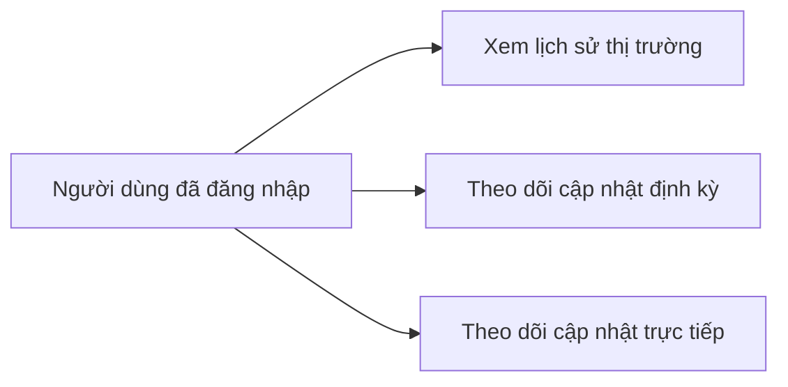
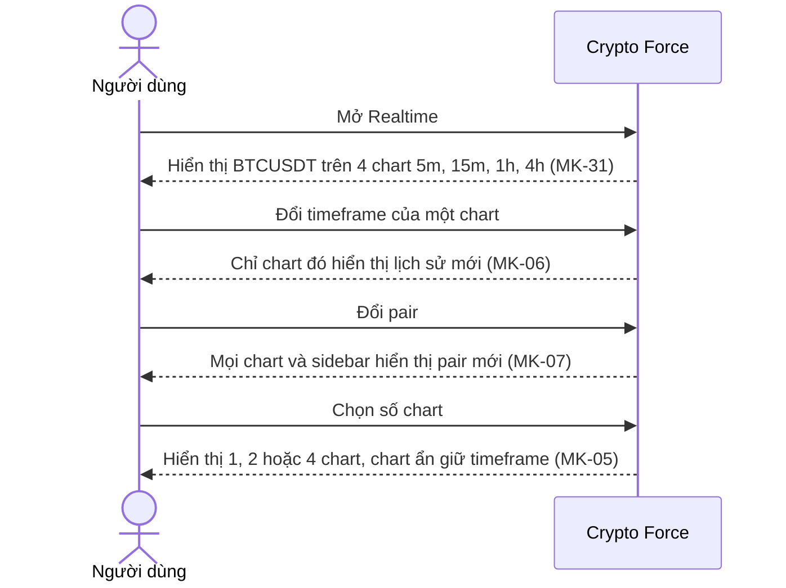
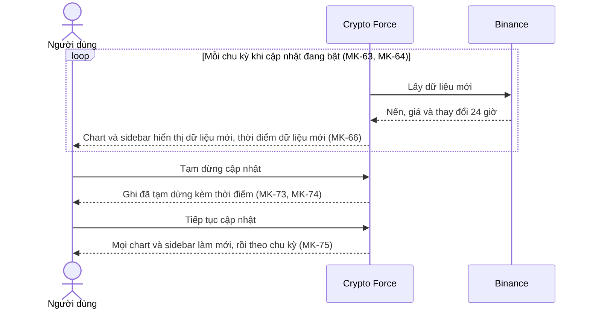
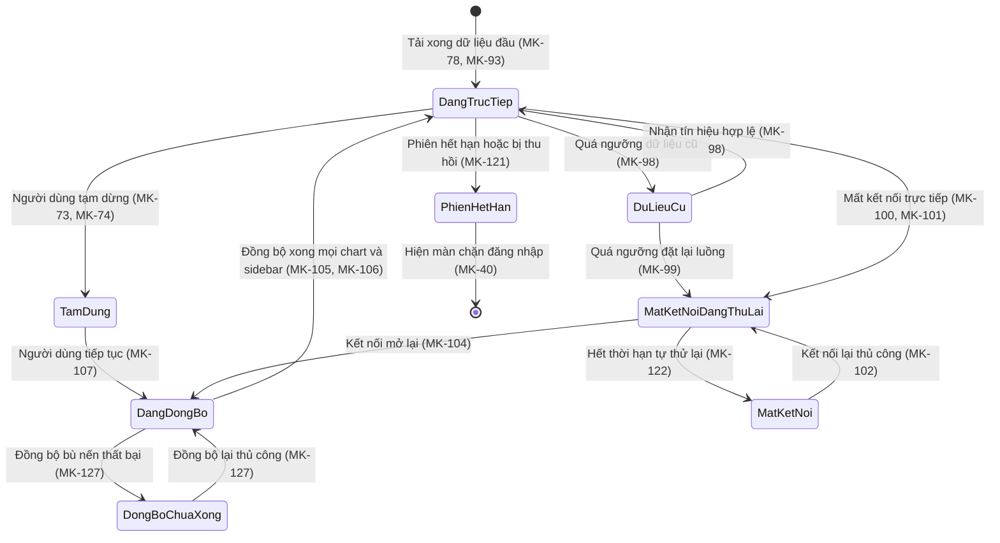

# Market Data

Đọc file này để biết hành vi xem thị trường trên Realtime qua ba vòng: tải lịch sử, cập nhật định kỳ và cập nhật trực tiếp kèm phục hồi kết nối.

## Tổng quan

Actor là người dùng đã đăng nhập. Người dùng xem giá của một pair trên 1, 2 hoặc 4 chart nến. Mỗi chart có timeframe riêng, volume và MA(20). Sidebar là bảng thông tin cạnh các chart, hiển thị giá, thay đổi 24 giờ của pair và trạng thái dữ liệu [[1]](#ref-1) [[2, §4 và §5]](#ref-2).

Use case xem lịch sử thị trường mô tả lần tải đầu tiên và các thao tác đổi lựa chọn. Use case theo dõi cập nhật định kỳ mô tả vòng làm mới theo chu kỳ cố định dùng làm baseline so sánh [[5, flow 2]](#ref-5). Use case theo dõi cập nhật trực tiếp mô tả cập nhật theo dữ liệu mới từ nguồn, xử lý dữ liệu cũ, mất kết nối và phục hồi đồng bộ [[5, flow 3]](#ref-5) [[9]](#ref-9). Ngoài phạm vi tài liệu này: tín hiệu BUY/SELL, chọn strategy làm nguồn tín hiệu, chuyển pair từ màn hình tìm kiếm, tìm lịch sử theo khoảng ngày và tải thêm lịch sử cũ hơn [[1]](#ref-1).

| Tiền tố | Nhóm | Nguồn |
| --- | --- | --- |
| `MK` | Xem lịch sử thị trường, cập nhật định kỳ và cập nhật trực tiếp | [[1]](#ref-1) [[5]](#ref-5) |



## Xem lịch sử thị trường

- Trigger: người dùng mở Realtime.
- Precondition: người dùng đã đăng nhập.
- Thành công: mỗi chart hiển thị nến, volume và MA của pair và timeframe đang chọn, kèm thời điểm của dữ liệu.
- Thất bại: chart hoặc sidebar không tải được dữ liệu hiển thị trạng thái lỗi riêng và thao tác thử lại. Phần còn lại của màn hình vẫn dùng được.



| Bước | Actor | Hành động |
| --- | --- | --- |
| 1 | Người dùng | Mở Realtime |
| 2 | Crypto Force | Hiển thị lựa chọn mặc định. Mỗi chart hiển thị tối đa 500 nến gần nhất, volume và MA, kèm thời điểm của dữ liệu. Sidebar hiển thị giá và thay đổi 24 giờ |
| 3 | Người dùng | Đổi timeframe của một chart |
| 4 | Crypto Force | Chỉ chart đó thay lịch sử theo timeframe mới. Các chart khác giữ dữ liệu |
| 5 | Người dùng | Đổi pair |
| 6 | Crypto Force | Mọi chart và sidebar thay dữ liệu theo pair mới, giữ timeframe của từng chart |
| 7 | Người dùng | Chọn số chart |
| 8 | Crypto Force | Hiển thị số chart đã chọn. Chart được hiện lại dùng timeframe đã chọn trước đó |

Bước 3 đến bước 8 không theo thứ tự cố định. Người dùng lặp lại các bước này trong cùng phiên.

| ID | Rule | Giá trị | Đo tại | Nguồn | Trạng thái |
| --- | --- | --- | --- | --- | --- |
| MK-01 | Chart hiển thị MA theo giá đóng cửa | 20 nến | Số nến trong mỗi mẫu trung bình | [[1]](#ref-1) | Confirmed |
| MK-02 | Chart có attribution TradingView đọc được | — | — | [[1]](#ref-1) | Confirmed |
| MK-04 | Người dùng chọn số chart hiển thị | 1, 2 hoặc 4 chart | Số card trên Realtime | [[1]](#ref-1) | Confirmed |
| MK-05 | Chart ẩn giữ timeframe khi hiện lại | — | — | [[1]](#ref-1) | Confirmed |
| MK-06 | Đổi timeframe chỉ thay dữ liệu của chart tương ứng | — | — | [[1]](#ref-1) | Confirmed |
| MK-07 | Mọi chart dùng chung pair đang chọn | — | — | [[1]](#ref-1) | Confirmed |
| MK-08 | Giá và thay đổi trong ngày không phụ thuộc timeframe chart | 24 giờ | Khoảng thời gian của phần trăm thay đổi | [[1]](#ref-1) | Confirmed |
| MK-09 | Sidebar lấy MA và volume theo chart đầu tiên, kèm nhãn timeframe | — | — | Agent đề xuất cho UI mock | Dropped (product owner, 2026-11-20: thay bằng MK-60) |
| MK-10 | Người dùng thấy trạng thái đang tải khi chưa nhận được lịch sử | — | — | Product owner, 2026-11-20: agent đề xuất để phân biệt đang tải với lịch sử rỗng | Confirmed |
| MK-11 | Lịch sử rỗng có thông báo riêng | — | — | Product owner, 2026-11-20: agent đề xuất để người dùng phân biệt không có nến với lỗi tải | Confirmed |
| MK-12 | Chart tải lỗi có thao tác thử lại riêng | — | — | Product owner, 2026-11-20: agent đề xuất để lỗi của một chart không chặn các chart khác | Confirmed |
| MK-13 | Từ vòng cập nhật định kỳ, làm mới lỗi giữ dữ liệu cũ kèm thông báo lỗi | — | — | Product owner, 2026-11-20: vòng tải lịch sử không có thao tác làm mới dữ liệu đã tải thành công | Confirmed |
| MK-14 | Hệ thống chỉ hiển thị dữ liệu thuộc lựa chọn hiện tại | — | — | Product owner, 2026-11-20: agent đề xuất để tránh gắn dữ liệu cũ vào nhãn mới | Confirmed |
| MK-15 | MA chưa đủ mẫu hiển thị chưa đủ dữ liệu thay vì số không | — | — | Product owner, 2026-11-20: thiếu dữ liệu không được hiển thị như một giá trị chỉ báo | Confirmed |
| MK-16 | Load history làm mới lịch sử của chart được chọn | — | — | Agent đề xuất cho bản nháp tương tác tải lịch sử | Dropped (product owner, 2026-11-20: thay bằng MK-61) |
| MK-23 | Volume hiển thị theo đơn vị base asset của pair, ví dụ BTC với BTCUSDT | — | — | Product owner, 2026-11-20: volume theo base so sánh được giữa các nến của cùng pair khi giá thay đổi | Confirmed |
| MK-24 | Mỗi nến đang hiển thị có điểm MA khi lịch sử của pair có đủ 19 nến trước nến đó | 20 nến | Số nến trong mẫu, tính cả nến trước nến đầu tiên đang hiển thị | Product owner, 2026-11-20: đường MA phủ toàn bộ chart, chỉ thiếu khi lịch sử thật không đủ | Confirmed |
| MK-25 | Lịch sử nến gồm nến đang mở của timeframe | — | — | Product owner, 2026-11-20: người dùng thấy giá gần nhất mà không trễ một nến | Confirmed |
| MK-26 | Nến đang mở có nhãn chữ “đang mở”, không chỉ phân biệt bằng màu | — | — | Product owner, 2026-11-20: tránh đọc giá tạm thành giá đóng cửa | Confirmed |
| MK-27 | Mỗi chart hiển thị thời điểm của dữ liệu của chart đó | — | — | Product owner, 2026-11-20: chart không tự cập nhật trong vòng tải lịch sử, các chart tải ở thời điểm khác nhau | Confirmed |
| MK-28 | MA tính cả nến đang mở; điểm MA của nến đang mở có nhãn giá trị tạm | 20 nến | Số nến trong mẫu, tính cả nến đang mở | Product owner, 2026-11-20: MA khớp với nến cuối người dùng thấy | Confirmed |
| MK-29 | Mỗi chart hiển thị MA và volume của chính chart đó, kèm timeframe của chart | — | — | Product owner, 2026-11-20: thông tin phụ thuộc timeframe nằm cạnh chart tương ứng | Confirmed |
| MK-30 | Người dùng chọn timeframe của chart trong tập 1m, 5m, 15m, 1h, 4h, 1d | 6 timeframe | Số lựa chọn trong ô timeframe của mỗi chart | Product owner, 2026-11-20: theo Project Brief §5; prototype thiếu 1d | Confirmed |
| MK-31 | Khi mở Realtime, màn hình hiển thị BTCUSDT với 4 chart theo timeframe 5m, 15m, 1h, 4h | 4 chart | Số chart và timeframe lúc mở Realtime | Product owner, 2026-11-20: theo kịch bản demo của Project Brief §29 | Confirmed |
| MK-32 | Người dùng chọn pair trong tập BTCUSDT, ETHUSDT, SOLUSDT | 3 pair | Số lựa chọn trong ô pair | Product owner, 2026-11-20: giữ các pair của UI Realtime | Confirmed |
| MK-33 | Mỗi chart hiển thị tối đa 500 nến gần nhất của pair và timeframe | 500 nến | Số nến trên một chart sau khi tải xong | Agent đề xuất, product owner xác nhận 2026-11-20: 1m khoảng 8 giờ, 1d khoảng 16 tháng, đủ cho MA(20); chưa có số đo tải, xem lại khi đo hiệu năng | Confirmed |
| MK-34 | Chart chưa nhận được dữ liệu sau thời hạn chờ thì chuyển sang trạng thái lỗi có thao tác thử lại | 10 giây | Từ lúc chart bắt đầu tải tới lúc hiển thị trạng thái lỗi | Agent đề xuất, product owner xác nhận 2026-11-20: đủ để chắc có sự cố mà người dùng không chờ mãi; xem lại khi đo hiệu năng | Confirmed |
| MK-35 | Chart chỉ hiển thị nến có trong lịch sử, không tạo nến để lấp khoảng trống | — | — | Product owner, 2026-11-20: không hiển thị dữ liệu không có thật | Confirmed |
| MK-36 | MA tính trên 20 nến có thật gần nhất, kể cả khi lịch sử có khoảng trống | 20 nến | Số nến trong mỗi mẫu trung bình | Product owner, 2026-11-20: MA không dùng nến không có thật | Confirmed |
| MK-37 | Reload hoặc mở lại Realtime trả về lựa chọn mặc định, không giữ pair và timeframe đã chọn | — | — | Product owner, 2026-11-20: chưa có nguồn yêu cầu nhớ lựa chọn | Confirmed |
| MK-38 | Thao tác thử lại không dùng được trong lúc chart đang tải lại | — | — | Product owner, 2026-11-20: tránh gửi lặp yêu cầu tải | Confirmed |
| MK-39 | Thông báo lỗi không hiển thị stack trace, payload hoặc địa chỉ của nguồn dữ liệu | — | — | Product owner, 2026-11-20: người dùng không cần chi tiết kỹ thuật và chi tiết này không được lộ ra ngoài | Confirmed |
| MK-41 | Đặt con trỏ hoặc chạm vào một nến hiển thị thời gian, open, high, low, close, volume và MA của nến đó | — | — | Product owner, 2026-11-20: cách đọc giá trị của một nến | Confirmed |
| MK-42 | Người dùng phóng to, thu nhỏ và kéo chart trong các nến đã tải | 500 nến | Số nến tối đa có thể xem trên một chart | Product owner, 2026-11-20: xem chi tiết trong lịch sử đã tải (MK-61, MK-33) | Confirmed |
| MK-43 | Thời gian trên chart theo múi giờ của thiết bị, màn hình ghi múi giờ đang dùng | — | — | Product owner, 2026-11-20: người dùng biết mốc giờ của nến | Confirmed |
| MK-44 | Giá hiển thị theo số chữ số thập phân của pair, giá khác 0 không hiển thị thành 0 | — | — | Product owner, 2026-11-20: giá của các pair có độ lớn khác nhau | Confirmed |
| MK-45 | Lịch sử có nến sai (high nhỏ hơn low, trùng thời gian mở, sai thứ tự) thì chart hiển thị trạng thái lỗi, không vẽ nến | — | — | Product owner, 2026-11-20: không vẽ dữ liệu sai | Confirmed |
| MK-46 | Mọi điều khiển của Realtime dùng được bằng bàn phím | — | — | Product owner, 2026-11-20; đối chiếu nguyên văn ngày 2026-11-20, WCAG 2.2 SC 2.1.1, SC 2.4.7 [[3]](#ref-3) | Confirmed |
| MK-47 | Mỗi chart có mô tả bằng chữ gồm pair, timeframe, giá đóng cửa và MA của nến cuối | — | — | Product owner, 2026-11-20; đối chiếu nguyên văn ngày 2026-11-20, WCAG 2.2 SC 1.1.1 [[3]](#ref-3) | Confirmed |
| MK-48 | Trạng thái đang tải, rỗng và lỗi của chart được thông báo cho screen reader mà không chuyển focus | — | — | Product owner, 2026-11-20; đối chiếu nguyên văn ngày 2026-11-20, WCAG 2.2 SC 4.1.3 [[3]](#ref-3) | Confirmed |
| MK-49 | Nến tăng và nến giảm phân biệt được không chỉ bằng màu | — | — | Product owner, 2026-11-20; đối chiếu nguyên văn ngày 2026-11-20, WCAG 2.2 SC 1.4.1 [[3]](#ref-3) | Confirmed |
| MK-50 | Ở chiều rộng màn hình hẹp, trang không cuộn ngang | 320 CSS px | Chiều rộng viewport | Product owner, 2026-11-20; đối chiếu nguyên văn ngày 2026-11-20, WCAG 2.2 SC 1.4.10 [[3]](#ref-3) | Confirmed |
| MK-51 | OHLCV của mỗi nến đã đóng trên chart khớp với nguồn dữ liệu cho cùng pair, timeframe và thời gian mở | 0 nến lệch | Số nến lệch khi đối chiếu với nguồn | Product owner, 2026-11-20: dữ liệu chart đúng với nguồn dữ liệu thị trường | Confirmed |
| MK-52 | Nến trên chart có thời gian mở tăng dần, không trùng và đúng mốc của timeframe | 0 nến | Số nến trùng, sai thứ tự hoặc lệch mốc | Product owner, 2026-11-20: dữ liệu chart đúng với nguồn dữ liệu thị trường | Confirmed |
| MK-58 | Điều khiển đang có focus bàn phím có chỉ báo focus nhìn thấy được | — | — | Product owner, 2026-11-20; đối chiếu nguyên văn ngày 2026-11-20, WCAG 2.2 SC 2.4.7 [[3]](#ref-3) | Confirmed |
| MK-59 | Ở chiều rộng màn hình hẹp, các chart xếp thành một cột | 320 CSS px | Chiều rộng viewport | Product owner, 2026-11-20; prototype Realtime xếp một cột trên màn hình hẹp | Confirmed |
| MK-60 | Sidebar không hiển thị MA và volume; sidebar chỉ hiển thị thông tin của pair và trạng thái dữ liệu | — | — | Product owner, 2026-11-20: MA và volume phụ thuộc timeframe, một sidebar cho nhiều chart làm người dùng đọc nhầm timeframe | Confirmed |
| MK-61 | Realtime không có thao tác tải thêm lịch sử nến | — | — | Product owner, 2026-11-20: không nguồn yêu cầu nào cần xem lịch sử cũ trên Realtime; đổi sang timeframe lớn hơn cho khoảng thời gian dài hơn | Confirmed |

## Luồng thay thế và ngoại lệ

| ID | Điều kiện | Phản hồi người dùng thấy | Nguồn | Trạng thái |
| --- | --- | --- | --- | --- |
| MK-17 | Người dùng đổi pair trong lúc dữ liệu trước đang tải | Hệ thống hiển thị dữ liệu của pair mới, không gắn dữ liệu pair trước vào nhãn mới | Product owner, 2026-11-20: agent đề xuất để giữ đúng ngữ cảnh dữ liệu | Confirmed |
| MK-18 | Thông tin giá và thay đổi trong ngày tải lỗi | Sidebar báo lỗi và cho thử lại, các chart vẫn dùng được | Product owner, 2026-11-20: agent đề xuất để tách lỗi giữa các nguồn thông tin | Confirmed |
| MK-19 | Dữ liệu chart đầu tiên đang tải | Phần MA và volume trong sidebar có trạng thái đang tải riêng | Agent đề xuất để không hiển thị giá trị từ timeframe cũ | Dropped (product owner, 2026-11-20: thay bằng MK-62) |
| MK-62 | Dữ liệu của một chart đang tải | Dòng MA và volume của chart đó có trạng thái đang tải, không hiển thị giá trị của timeframe cũ | Product owner, 2026-11-20: MA và volume chuyển từ sidebar sang từng chart | Confirmed |
| MK-40 | Phiên đăng nhập hết hạn trong lúc xem Realtime | Màn chặn đăng nhập; sau khi đăng nhập, người dùng quay về Realtime theo quy tắc quay về màn hình workspace (RD-02) | Product owner, 2026-11-20; [[4]](#ref-4) | Confirmed |

## Theo dõi cập nhật định kỳ

- Trigger: chart hoặc sidebar đã hiển thị dữ liệu, cập nhật định kỳ đang bật.
- Precondition: người dùng đã đăng nhập và đang mở Realtime.
- Thành công: sau mỗi chu kỳ, chart và sidebar hiển thị dữ liệu mới nhất mà nguồn trả về, kèm thời điểm của dữ liệu.
- Thất bại: chart hoặc sidebar giữ dữ liệu đã hiển thị, kèm thông báo lỗi, và thử lại ở chu kỳ sau (MK-13, MK-80).



| Bước | Actor | Hành động |
| --- | --- | --- |
| 1 | Người dùng | Xem Realtime với dữ liệu đã tải |
| 2 | Crypto Force | Sau mỗi chu kỳ, mỗi chart và sidebar hiển thị dữ liệu mới. Thời điểm dữ liệu của chart đổi theo lần làm mới. Vùng đang xem của chart giữ nguyên |
| 3 | Crypto Force | Khi nến đang mở đã đóng, lần làm mới sau hiển thị nến đó là nến đã đóng và thêm nến đang mở mới. Chart giữ tối đa 500 nến gần nhất |
| 4 | Người dùng | Tạm dừng cập nhật |
| 5 | Crypto Force | Ngừng làm mới mọi chart và sidebar, ghi đã tạm dừng kèm thời điểm tạm dừng |
| 6 | Người dùng | Tiếp tục cập nhật |
| 7 | Crypto Force | Làm mới mọi chart và sidebar, sau đó làm mới theo chu kỳ |

Bước 2 và bước 3 lặp lại tới khi người dùng rời Realtime. Các thao tác của use case xem lịch sử thị trường (đổi pair, đổi timeframe, chọn số chart) vẫn dùng được trong lúc cập nhật định kỳ.

| ID | Rule | Giá trị | Đo tại | Nguồn | Trạng thái |
| --- | --- | --- | --- | --- | --- |
| MK-63 | Khi cập nhật định kỳ đang bật, mỗi chart đang hiển thị bắt đầu một lần làm mới lịch sử nến sau mỗi chu kỳ | 5 giây | Giữa hai lần bắt đầu làm mới liên tiếp của cùng chart | Agent đề xuất: dữ liệu của cùng pair và timeframe chỉ đổi tối đa một lần mỗi 5 giây [[6, ADR-006]](#ref-6). Chu kỳ ngắn hơn nhận lại cùng dữ liệu; chu kỳ dài hơn làm dữ liệu cũ hơn và làm baseline so với WebSocket yếu đi [[5]](#ref-5) | Confirmed (product owner, 2026-11-22) |
| MK-64 | Khi cập nhật định kỳ đang bật, sidebar bắt đầu một lần làm mới giá và thay đổi 24 giờ sau mỗi chu kỳ | 5 giây | Giữa hai lần bắt đầu làm mới liên tiếp của sidebar | Agent đề xuất: cùng chu kỳ với chart (MK-63) để giá trên sidebar và nến cuối có cùng độ mới | Confirmed (product owner, 2026-11-22) |
| MK-65 | Chart hoặc sidebar không bắt đầu lần làm mới mới khi lần làm mới trước của nó chưa kết thúc | — | — | Baseline độc lập ngày 2026-11-22: không gửi chồng yêu cầu khi nguồn trả chậm | Confirmed (product owner, 2026-11-22) |
| MK-66 | Mỗi lần làm mới thành công đổi thời điểm dữ liệu của chart (MK-27) sang thời điểm của dữ liệu mới | — | — | Agent đề xuất: thời điểm dữ liệu phản ánh lần làm mới thành công gần nhất | Confirmed (product owner, 2026-11-22) |
| MK-67 | Sau mỗi lần làm mới, chart hiển thị tối đa 500 nến gần nhất; khi có nến mới, nến cũ nhất rời chart | 500 nến | Số nến trên chart sau mỗi lần làm mới | MK-33; agent đề xuất cho OQ-085: giữ cùng giới hạn với lần tải đầu, MA vẫn đủ mẫu (MK-24) | Confirmed (product owner, 2026-11-22) |
| MK-68 | Làm mới không đổi vùng đang xem mà người dùng đã phóng to, thu nhỏ hoặc kéo (MK-42) | — | — | Baseline độc lập ngày 2026-11-22: dữ liệu mới không được làm người dùng mất vị trí đang xem | Confirmed (product owner, 2026-11-22) |
| MK-69 | Khi vùng đang xem chứa nến cuối, nến mới sau lần làm mới nằm trong vùng đang xem | — | — | Baseline độc lập ngày 2026-11-22: người dùng đang xem giá mới nhất thấy nến mới mà không phải kéo chart | Confirmed (product owner, 2026-11-22) |
| MK-70 | Làm mới không chuyển focus bàn phím | — | — | Baseline độc lập ngày 2026-11-22; WCAG 2.2 SC 2.4.7 [[3]](#ref-3): người dùng bàn phím không mất vị trí sau mỗi chu kỳ | Confirmed (product owner, 2026-11-22) |
| MK-71 | Làm mới không ẩn giá trị của nến mà người dùng đang chỉ vào (MK-41) | — | — | Baseline độc lập ngày 2026-11-22: thông tin nến đang đọc không biến mất sau mỗi chu kỳ | Confirmed (product owner, 2026-11-22) |
| MK-72 | Lần làm mới thành công không tạo thông báo cho screen reader | — | — | Baseline độc lập ngày 2026-11-22; WCAG 2.2 SC 4.1.3 [[3]](#ref-3): chỉ thông báo thay đổi trạng thái, không thông báo mỗi lần giá đổi | Confirmed (product owner, 2026-11-22) |
| MK-73 | Người dùng tạm dừng và tiếp tục cập nhật định kỳ của mọi chart và sidebar bằng một điều khiển | — | — | WCAG 2.2 SC 2.2.2, mức A, đối chiếu nguyên văn ngày 2026-11-22 [[3]](#ref-3); prototype có switch Live updates [[7]](#ref-7) | Confirmed (product owner, 2026-11-22) |
| MK-74 | Khi cập nhật đang tạm dừng, màn hình ghi đã tạm dừng kèm thời điểm tạm dừng | — | — | Prototype ghi "Paused at {giờ}" [[7]](#ref-7) | Confirmed (product owner, 2026-11-22) |
| MK-75 | Khi người dùng tiếp tục cập nhật, mọi chart và sidebar bắt đầu làm mới mà không chờ hết chu kỳ | 1 giây | Từ lúc người dùng tiếp tục tới lúc lần làm mới bắt đầu | WCAG Understanding SC 2.2.2: thông tin realtime nên chuyển tới dữ liệu hiện tại khi tiếp tục [[8]](#ref-8); 1 giây do agent đề xuất: ngắn hơn nhiều so với chu kỳ 5 giây (MK-63), nên người dùng không phải chờ chu kỳ kế tiếp | Confirmed (product owner, 2026-11-22) |
| MK-76 | Khi tab trình duyệt bị ẩn, Realtime không bắt đầu lần làm mới nào | — | — | Baseline độc lập ngày 2026-11-22; agent đề xuất: không tạo request khi người dùng không xem | Confirmed (product owner, 2026-11-22) |
| MK-77 | Khi tab trình duyệt hiện lại và cập nhật đang bật, mọi chart và sidebar bắt đầu làm mới | 1 giây | Từ lúc tab hiện lại tới lúc lần làm mới bắt đầu | Baseline độc lập ngày 2026-11-22; 1 giây do agent đề xuất, cùng giá trị với MK-75 | Confirmed (product owner, 2026-11-22) |
| MK-78 | Mở hoặc reload Realtime bắt đầu với cập nhật định kỳ đang bật | — | — | Agent đề xuất, cùng cách với việc reload trả về lựa chọn mặc định (MK-37) | Confirmed (product owner, 2026-11-22) |
| MK-79 | Chart không thay dữ liệu đang hiển thị bằng dữ liệu có thời điểm dữ liệu cũ hơn | — | — | Baseline độc lập ngày 2026-11-22: màn hình không quay về trạng thái cũ hơn | Confirmed (product owner, 2026-11-22) |

| ID | Điều kiện | Phản hồi người dùng thấy | Nguồn | Trạng thái |
| --- | --- | --- | --- | --- |
| MK-80 | Lần làm mới lỗi khi chart hoặc sidebar đang hiển thị dữ liệu | Dữ liệu và thời điểm dữ liệu giữ nguyên, kèm thông báo lỗi (MK-13). Lần làm mới thành công sau đó bỏ thông báo lỗi | MK-13; agent đề xuất: chu kỳ sau tự thử lại, không cần thao tác của người dùng | Confirmed (product owner, 2026-11-22) |
| MK-81 | Lần làm mới không nhận được dữ liệu trong thời hạn chờ của chart (MK-34) | Chart xử lý như lần làm mới lỗi (MK-80) | MK-34; agent đề xuất: dùng chung một thời hạn chờ cho lần tải đầu và lần làm mới | Confirmed (product owner, 2026-11-22) |
| MK-82 | Chart chưa có dữ liệu và đang ở trạng thái lỗi (MK-12) | Chart giữ trạng thái lỗi và thao tác thử lại; cập nhật định kỳ không tự tải lại chart đó | Agent đề xuất: giữ focus và thông báo ổn định cho thao tác thử lại (MK-38, MK-48) | Confirmed (product owner, 2026-11-22) |
| MK-83 | Người dùng đổi pair hoặc timeframe trong lúc một lần làm mới đang chạy | Chart chỉ hiển thị dữ liệu của lựa chọn mới (MK-14, MK-17), rồi làm mới theo chu kỳ của lựa chọn mới | Chỉ hiển thị dữ liệu của lựa chọn hiện tại (MK-14, MK-17) | Confirmed (product owner, 2026-11-22) |
| MK-84 | Phiên đăng nhập hết hạn khi một lần làm mới đang chạy | Màn chặn đăng nhập (MK-40). Realtime không làm mới tới khi người dùng đăng nhập lại | Luồng phiên hết hạn khi xem Realtime (MK-40) | Confirmed (product owner, 2026-11-22) |
| MK-85 | Người dùng tạm dừng trong lúc một lần làm mới đang chạy | Kết quả của lần làm mới đó vẫn hiển thị; không có lần làm mới mới tới khi người dùng tiếp tục | Agent đề xuất: dữ liệu đã nhận vẫn đúng với lựa chọn hiện tại (MK-14) | Confirmed (product owner, 2026-11-22) |

## Theo dõi cập nhật trực tiếp

- Trigger: chart hoặc sidebar đã hiển thị dữ liệu ban đầu và chế độ cập nhật trực tiếp đang bật.
- Precondition: người dùng đã đăng nhập, đang mở Realtime và có kết nối trực tiếp hợp lệ với Crypto Force.
- Thành công: khi nguồn có dữ liệu mới, chart và sidebar tự cập nhật trực tiếp kèm thời điểm dữ liệu; khi gián đoạn kết nối, hệ thống giữ dữ liệu gần nhất, tự kết nối lại, bù đủ nến đóng bị thiếu và chỉ báo đang trực tiếp sau khi đồng bộ xong.
- Thất bại: kết nối trực tiếp gián đoạn hoặc đồng bộ lại thất bại; màn hình giữ dữ liệu gần nhất kèm thời điểm dữ liệu, hiển thị trạng thái mất kết nối hoặc đồng bộ chưa xong và thao tác kết nối lại hoặc đồng bộ lại thủ công.

```mermaid
sequenceDiagram
    actor U as Người dùng
    participant S as Crypto Force
    participant B as Binance
    B->>S: Cập nhật nến đang mở và giá mới
    S-->>U: Cập nhật chart, MA và sidebar (MK-93, MK-94)
    B->>S: Đóng nến hiện tại và mở nến mới
    S-->>U: Chốt nến, mở nến mới, giữ cửa sổ nến (MK-95, MK-67)
    U->>S: Đổi timeframe, đổi pair hoặc chọn số chart
    S-->>U: Chỉ thay luồng của phần chịu tác động (MK-96, MK-97)
    U->>S: Tạm dừng rồi tiếp tục cập nhật
    S-->>U: Giữ dữ liệu khi tạm dừng; đồng bộ bù dữ liệu khi tiếp tục (MK-73, MK-107)
    B--xS: Gián đoạn kết nối trực tiếp
    S-->>U: Giữ dữ liệu gần nhất, báo mất kết nối và đang thử lại (MK-100, MK-101)
    B->>S: Kết nối mở lại
    S-->>U: Báo đang đồng bộ, chưa báo trực tiếp (MK-104)
    S->>B: Lấy nến đóng bị thiếu và giá mới nhất
    B-->>S: Nến bị thiếu, nến đang mở và giá
    S-->>U: Bù đủ nến, cập nhật sidebar, báo trực tiếp trở lại (MK-105, MK-106)
```



Phiên hết hạn hoặc bị thu hồi từ bất kỳ trạng thái nào cũng chuyển sang trạng thái phiên hết hạn và dừng cập nhật (MK-121, MK-129). Khi tab ẩn rồi hiện lại trong lúc cập nhật trực tiếp đang bật và có dữ liệu bị bỏ lỡ, màn hình đi qua trạng thái đang đồng bộ rồi quay về đang trực tiếp (MK-126).

| Bước | Actor | Hành động |
| --- | --- | --- |
| 1 | Người dùng | Mở Realtime và chờ dữ liệu ban đầu của các chart và sidebar hiển thị |
| 2 | Crypto Force | Hiển thị trạng thái đang trực tiếp kèm thời điểm dữ liệu của từng chart |
| 3 | Binance | Phát cập nhật giá và nến mới cho pair và các timeframe đang hiển thị |
| 4 | Crypto Force | Cập nhật nến đang mở, volume, MA, thời điểm dữ liệu của chart tương ứng và giá, thay đổi 24 giờ trên sidebar mà không đổi vùng đang xem hay chuyển focus |
| 5 | Binance | Đóng nến hiện tại và mở nến kế tiếp của một timeframe |
| 6 | Crypto Force | Chuyển nến vừa đóng thành nến đã đóng, mở nến đang mở mới và giữ giới hạn số nến hiển thị trên chart đó |
| 7 | Người dùng | Đổi timeframe của một chart, đổi pair hoặc chọn số chart |
| 8 | Crypto Force | Chỉ thay luồng dữ liệu của phần chịu tác động; các chart còn lại tiếp tục nhận cập nhật trực tiếp |
| 9 | Người dùng | Tạm dừng rồi tiếp tục cập nhật trực tiếp |
| 10 | Crypto Force | Giữ dữ liệu và ghi thời điểm tạm dừng khi tạm dừng; chuyển sang đang đồng bộ, bù dữ liệu bị bỏ lỡ rồi quay về đang trực tiếp khi tiếp tục |
| 11 | Binance | Kết nối trực tiếp bị gián đoạn rồi mở lại |
| 12 | Crypto Force | Giữ dữ liệu gần nhất, báo mất kết nối kèm thời điểm và đang thử lại; khi kết nối mở lại thì báo đang đồng bộ, bù đủ nến đóng bị thiếu và giá sidebar rồi quay về trạng thái đang trực tiếp |

Bước 3 đến bước 12 không theo thứ tự cố định và lặp lại trong suốt phiên tới khi người dùng rời Realtime hoặc phiên kết thúc. Các quy tắc của vòng tải lịch sử về hiển thị nến, MA, volume, định dạng giá và accessibility vẫn áp dụng.

| ID | Rule | Giá trị | Đo tại | Nguồn | Trạng thái |
| --- | --- | --- | --- | --- | --- |
| MK-93 | Khi cập nhật trực tiếp đang bật và kết nối đang hoạt động, nến đang mở, volume, MA và thời điểm dữ liệu của mỗi chart đang hiển thị tự cập nhật theo dữ liệu mới từ nguồn mà không chờ chu kỳ cố định | — | — | Project Brief [[2, §4 và §17]](#ref-2); tách khỏi chu kỳ cố định của vòng cập nhật định kỳ (MK-63) | Confirmed (product owner, 2026-11-23) |
| MK-94 | Khi cập nhật trực tiếp đang bật và kết nối đang hoạt động, giá gần nhất và thay đổi 24 giờ trên sidebar tự cập nhật theo dữ liệu mới của pair đang chọn | — | — | Project Brief [[2, §4]](#ref-2); giữ sự độc lập của thông tin 24 giờ với timeframe chart (MK-08) | Confirmed (product owner, 2026-11-23) |
| MK-95 | Khi một nến đang mở đóng trên nguồn dữ liệu, chart chuyển nến đó thành nến đã đóng (bỏ nhãn đang mở và nhãn giá trị tạm của MA) và thêm nến đang mở kế tiếp, giữ giới hạn số nến trên chart (MK-67) | — | — | Nến đang mở (MK-25, MK-26, MK-28) và giới hạn cửa sổ nến (MK-67); baseline độc lập ngày 2026-11-23 | Confirmed (product owner, 2026-11-23) |
| MK-96 | Khi người dùng đổi timeframe của một chart trong lúc cập nhật trực tiếp đang bật, chỉ chart đó tải lịch sử mới và chuyển sang luồng của timeframe mới; các chart khác và sidebar tiếp tục nhận cập nhật trực tiếp | 0 cập nhật bị rơi | Các chart khác đang hiển thị trong lúc một chart đổi timeframe | Đổi timeframe độc lập từng chart (MK-06) [[2, §5]](#ref-2); baseline độc lập ngày 2026-11-23 | Confirmed (product owner, 2026-11-23) |
| MK-97 | Khi người dùng đổi pair trong lúc cập nhật trực tiếp đang bật, mọi chart đang hiển thị và sidebar tải lịch sử ban đầu rồi chuyển sang cập nhật trực tiếp của pair mới; dữ liệu trực tiếp của pair cũ không hiển thị trên pair mới | 0 cập nhật pair cũ | Các chart và sidebar sau khi người dùng chọn pair mới | Chỉ hiển thị dữ liệu của lựa chọn hiện tại (MK-07, MK-14, MK-17); baseline độc lập ngày 2026-11-23 | Confirmed (product owner, 2026-11-23) |
| MK-98 | Khi cập nhật trực tiếp đang bật nhưng không nhận được cập nhật hoặc tín hiệu sống hợp lệ quá ngưỡng dữ liệu cũ, màn hình giữ dữ liệu gần nhất và hiển thị trạng thái dữ liệu cũ kèm thời điểm dữ liệu gần nhất | 15 giây | Từ lúc nhận tín hiệu hợp lệ gần nhất tới lúc hiển thị trạng thái dữ liệu cũ | Agent đề xuất: dài hơn chu kỳ 5 giây của vòng cập nhật định kỳ (MK-63) để tránh báo giả khi thị trường yên ngắn, ngắn hơn mốc 30 giây kết nối lại (QA-06); baseline độc lập đề xuất 10 giây | Confirmed (product owner, 2026-11-23) |
| MK-99 | Khi trạng thái dữ liệu cũ kéo dài quá ngưỡng đặt lại luồng mà không có tín hiệu hợp lệ mới, hệ thống tự đặt lại kết nối trực tiếp và chuyển sang trạng thái mất kết nối, đang thử lại | 30 giây | Từ lúc nhận tín hiệu hợp lệ gần nhất tới lúc bắt đầu kết nối lại | Agent đề xuất: gấp đôi ngưỡng dữ liệu cũ (MK-98) và khớp mốc đặt lại của baseline độc lập ngày 2026-11-23 | Confirmed (product owner, 2026-11-23) |
| MK-100 | Khi mất kết nối trực tiếp trong lúc cập nhật trực tiếp đang bật, mọi chart và sidebar giữ dữ liệu gần nhất kèm thời điểm dữ liệu, không xóa trắng màn hình | — | — | Prototype Realtime [[7, Mất kết nối]](#ref-7); giữ dữ liệu cũ khi lỗi (MK-13) | Confirmed (product owner, 2026-11-23) |
| MK-101 | Khi mất kết nối trực tiếp trong lúc cập nhật trực tiếp đang bật, màn hình hiển thị trạng thái mất kết nối kèm thời điểm mất kết nối và cho biết hệ thống đang tự thử kết nối lại | — | — | Prototype Realtime [[7, Mất kết nối]](#ref-7); Project Brief [[2, §17]](#ref-2) | Confirmed (product owner, 2026-11-23) |
| MK-102 | Khi đang ở trạng thái mất kết nối hoặc đang thử kết nối lại, người dùng có thao tác kết nối lại thủ công để bắt đầu một lần thử kết nối mới và thấy trạng thái đang kết nối lại | — | — | Prototype Realtime [[7, Mất kết nối]](#ref-7) | Confirmed (product owner, 2026-11-23) |
| MK-103 | Thao tác kết nối lại thủ công không dùng được trong lúc một lần kết nối thủ công đang chạy | — | — | Agent đề xuất: tránh gửi lặp yêu cầu kết nối, tương tự khóa thử lại khi đang tải (MK-38) | Confirmed (product owner, 2026-11-23) |
| MK-104 | Khi kết nối trực tiếp mở lại sau gián đoạn, màn hình chuyển sang trạng thái đang đồng bộ dữ liệu và chưa hiển thị trạng thái đang trực tiếp cho tới khi dữ liệu của mọi chart đang hiển thị và sidebar đồng bộ xong | — | — | Mục tiêu phân biệt kết nối đã mở lại với dữ liệu đã đồng bộ xong [[9, mục 5]](#ref-9); baseline độc lập ngày 2026-11-23 | Confirmed (product owner, 2026-11-23) |
| MK-105 | Sau khi kết nối mở lại, hệ thống tự bù mọi nến đã đóng bị thiếu trong khoảng gián đoạn, cập nhật nến đang mở cho từng chart đang hiển thị và cập nhật sidebar mà không tạo nến giả cho khoảng trống thật của thị trường (MK-35) | 0 nến đóng bị thiếu | Đối chiếu nến đã đóng trên từng chart đang hiển thị sau đồng bộ với nguồn dữ liệu | Project Brief [[2, §17]](#ref-2); dữ liệu khớp nguồn (MK-51, MK-52) và không lấp khoảng trống thật (MK-35) | Confirmed (product owner, 2026-11-23) |
| MK-106 | Khi mọi chart đang hiển thị và sidebar đã đồng bộ xong sau gián đoạn, màn hình chuyển về trạng thái đang trực tiếp và bỏ cảnh báo mất kết nối hoặc dữ liệu cũ | — | — | Prototype Realtime [[7, Mất kết nối]](#ref-7); mục tiêu phân biệt đồng bộ xong [[9, mục 5]](#ref-9) | Confirmed (product owner, 2026-11-23) |
| MK-107 | Khi người dùng tiếp tục cập nhật trực tiếp sau khi tạm dừng (MK-73, MK-74), màn hình chuyển sang trạng thái đang đồng bộ, bắt đầu bù dữ liệu bị bỏ lỡ trong thời hạn tiếp tục rồi quay về trạng thái đang trực tiếp | 1 giây | Từ lúc người dùng chọn tiếp tục tới lúc quá trình đồng bộ bắt đầu | W3C Understanding SC 2.2.2 [[8]](#ref-8); giữ cùng mốc 1 giây với vòng cập nhật định kỳ (MK-75); baseline độc lập ngày 2026-11-23 | Confirmed (product owner, 2026-11-23) |
| MK-108 | Khi người dùng đã tạm dừng cập nhật trực tiếp (MK-73), màn hình giữ trạng thái đã tạm dừng và không hiện cảnh báo mất kết nối; việc kết nối lại và đồng bộ diễn ra khi người dùng chọn tiếp tục | — | — | Agent đề xuất giải quyết [OQ-035](../open-questions.md#oq-035): tránh cảnh báo gây nhiễu khi người dùng chủ động đóng băng màn hình | Confirmed (product owner, 2026-11-23) |
| MK-109 | Khi người dùng đổi pair, đổi timeframe hoặc tăng số chart trong lúc cập nhật trực tiếp đang tạm dừng, hệ thống tải dữ liệu lịch sử mới nhất cho lựa chọn mới và vẫn giữ trạng thái đã tạm dừng tới khi người dùng chọn tiếp tục | — | — | Baseline độc lập ngày 2026-11-23: tránh hiển thị chart trống hoặc lệch lựa chọn khi đang tạm dừng | Confirmed (product owner, 2026-11-23) |
| MK-110 | Khi chart nhận cập nhật có cùng pair, timeframe và thời gian mở với một nến đang hiển thị, chart cập nhật tại chỗ nếu nến đang mở hoặc chốt nến nếu đã đóng, không tạo nến thứ hai | 0 nến trùng | Danh sách nến trên chart sau khi áp dụng cập nhật trực tiếp và đồng bộ | Tính duy nhất của thời gian mở (MK-52); baseline độc lập ngày 2026-11-23 | Confirmed (product owner, 2026-11-23) |
| MK-111 | Cập nhật nến hoặc giá có thời điểm cũ hơn trạng thái mới nhất đã hiển thị của cùng chart hoặc sidebar không thay thế dữ liệu mới hơn và không gắn vào cuối trục thời gian | 0 lần lùi dữ liệu | So sánh thời điểm dữ liệu trước và sau mỗi cập nhật trực tiếp trên chart và sidebar | Mở rộng quy tắc không quay về dữ liệu cũ hơn (MK-79) cho cả chart và sidebar trong luồng trực tiếp; baseline độc lập ngày 2026-11-23 | Confirmed (product owner, 2026-11-23) |
| MK-112 | Mọi trạng thái kết nối và đồng bộ trên Realtime (đang trực tiếp, đã tạm dừng, dữ liệu cũ, mất kết nối đang thử lại, mất kết nối, đang đồng bộ, đồng bộ chưa xong) có nhãn chữ riêng, không chỉ phân biệt bằng màu | — | — | WCAG 2.2 SC 1.4.1 mức A, đối chiếu nguyên văn ngày 2026-11-20 [[3]](#ref-3); baseline độc lập ngày 2026-11-23 | Confirmed (product owner, 2026-11-23) |
| MK-113 | Thay đổi trạng thái kết nối hoặc đồng bộ được thông báo cho screen reader mà không chuyển focus bàn phím; cập nhật giá và nến bình thường không tạo thông báo (MK-72) và các lần tự thử kết nối lại trong cùng trạng thái không tạo thông báo lặp | 1 thông báo mỗi lần đổi trạng thái | Vùng status hoặc alert của Realtime khi chuyển trạng thái kết nối hoặc đồng bộ | WCAG 2.2 SC 4.1.3 mức AA, đối chiếu định nghĩa nguyên văn ngày 2026-11-23 [[3]](#ref-3); thông báo trạng thái và giữ focus (MK-48, MK-70, MK-72); baseline độc lập ngày 2026-11-23 | Confirmed (product owner, 2026-11-23) |
| MK-114 | Cập nhật trực tiếp không đổi vùng đang xem mà người dùng đã phóng to, thu nhỏ hoặc kéo về quá khứ (MK-42) | — | — | Kế thừa quy tắc giữ vùng đang xem (MK-68); baseline độc lập ngày 2026-11-23 | Confirmed (product owner, 2026-11-23) |
| MK-115 | Khi vùng đang xem chứa nến cuối, nến mới từ cập nhật trực tiếp nằm trong vùng đang xem | — | — | Kế thừa quy tắc theo nến cuối (MK-69); baseline độc lập ngày 2026-11-23 | Confirmed (product owner, 2026-11-23) |
| MK-116 | Cập nhật trực tiếp không chuyển focus bàn phím | — | — | Kế thừa quy tắc giữ focus bàn phím (MK-70); WCAG 2.2 SC 2.4.7 [[3]](#ref-3) | Confirmed (product owner, 2026-11-23) |
| MK-117 | Cập nhật trực tiếp không ẩn giá trị của nến mà người dùng đang chỉ vào (MK-41) | — | — | Kế thừa quy tắc giữ thông tin nến đang đọc (MK-71); baseline độc lập ngày 2026-11-23 | Confirmed (product owner, 2026-11-23) |
| MK-118 | Yêu cầu mở mới kết nối cập nhật trực tiếp không có phiên hợp lệ hoặc có phiên đã hết hạn, bị thu hồi bị từ chối và không nhận dữ liệu thị trường | 0 cập nhật thị trường | Phản hồi từ chối ở bước bắt tay và toàn bộ khung dữ liệu trên kết nối mở mới không có phiên hợp lệ | Yêu cầu đăng nhập của Realtime (MK-40); baseline độc lập ngày 2026-11-23 | Confirmed (product owner, 2026-11-23) |
| MK-119 | Kênh cập nhật trực tiếp chỉ chấp nhận kết nối từ origin hợp lệ của ứng dụng | 0 kết nối từ origin ngoài danh sách | Bước bắt tay kết nối trực tiếp khi gửi header Origin ngoài danh sách hợp lệ | Agent đề xuất mở rộng sang OWASP ASVS 5.0 V4.4.2 mức L2 (tra cứu chỉ mục kho OWASP/ASVS ngày 2026-11-23, cần đọc file nguyên văn trước Bước 11) [[10]](#ref-10); đồng bộ quy tắc origin của Authentication (SEC-02) [[4]](#ref-4) | Confirmed (product owner, 2026-11-23) |
| MK-120 | Trên môi trường production, kênh cập nhật trực tiếp chỉ dùng kết nối được mã hóa | 0 kết nối không mã hóa | Giao thức kết nối trực tiếp quan sát từ trình duyệt trên môi trường production | Agent đề xuất áp dụng OWASP ASVS 5.0 V4.4.1 mức L1 (tra cứu chỉ mục kho OWASP/ASVS ngày 2026-11-23, cần đọc file nguyên văn trước Bước 11) [[10]](#ref-10) | Confirmed (product owner, 2026-11-23) |
| MK-121 | Khi phiên đăng nhập hết hạn hoặc bị thu hồi trong lúc một hoặc nhiều tab đang mở kết nối trực tiếp, hệ thống dừng gửi cập nhật mới và dừng tự kết nối lại trên mọi tab | 5 giây | Từ lúc phiên hết hạn hoặc bị thu hồi tới lúc không còn cập nhật mới và không còn lượt tự kết nối lại trên mọi tab | Agent đề xuất theo baseline độc lập ngày 2026-11-23: không tiếp tục đẩy dữ liệu cho phiên đã kết thúc | Confirmed (product owner, 2026-11-23) |
| MK-122 | Khi mất kết nối trực tiếp, hệ thống tự thử kết nối lại trong thời hạn thử tự động trước khi chuyển sang trạng thái mất kết nối hoàn toàn và giữ thao tác kết nối lại thủ công (MK-102) | 120 giây | Từ thời điểm mất kết nối tới lúc dừng tự thử lại khi chưa kết nối được | Agent đề xuất theo baseline độc lập ngày 2026-11-23: tránh thử lặp vô hạn khi mất mạng kéo dài, người dùng vẫn bấm kết nối lại thủ công bất kỳ lúc nào | Confirmed (product owner, 2026-11-23) |
| MK-123 | Khi người dùng mở nhiều tab Realtime cùng lúc trong cùng phiên, mỗi tab giữ lựa chọn pair, số chart, timeframe, vùng xem và trạng thái tạm dừng độc lập với các tab khác | 0 lần ghi đè trạng thái chéo tab | Lựa chọn, vùng xem và trạng thái tạm dừng ở tab A khi thao tác trên tab B | Baseline độc lập ngày 2026-11-23 | Confirmed (product owner, 2026-11-23) |

| ID | Điều kiện | Phản hồi người dùng thấy | Nguồn | Trạng thái |
| --- | --- | --- | --- | --- |
| MK-124 | Người dùng đổi pair hoặc timeframe liên tiếp trước khi lần tải trước hoàn tất | Chỉ dữ liệu lịch sử và cập nhật trực tiếp của lựa chọn cuối cùng được hiển thị; cập nhật của lựa chọn cũ bị loại bỏ (MK-14, MK-96, MK-97) | Baseline độc lập ngày 2026-11-23 | Confirmed (product owner, 2026-11-23) |
| MK-125 | Hai chart trên cùng màn hình chọn cùng một timeframe | Cả hai chart nhận cùng dữ liệu nến OHLCV cập nhật trực tiếp và giữ vùng phóng to, thu nhỏ, kéo độc lập | Baseline độc lập ngày 2026-11-23 | Confirmed (product owner, 2026-11-23) |
| MK-126 | Tab trình duyệt bị ẩn rồi hiện lại | Khi cập nhật trực tiếp đang bật: nếu dữ liệu còn mới và không bỏ lỡ nến thì tiếp tục trực tiếp; nếu có gián đoạn hoặc bỏ lỡ nến thì bắt đầu đồng bộ trong thời hạn tiếp tục cập nhật (MK-107), bù đủ nến đóng bị thiếu (MK-105) rồi quay về trực tiếp. Khi trước đó người dùng đã tạm dừng: giữ nguyên trạng thái tạm dừng | Kế thừa tab hiện lại (MK-77) và đồng bộ sau gián đoạn (MK-104, MK-105); baseline độc lập ngày 2026-11-23 | Confirmed (product owner, 2026-11-23) |
| MK-127 | Kết nối trực tiếp mở lại nhưng bước đồng bộ bù nến bị thiếu của một hoặc nhiều chart thất bại | Chart đó không nối dữ liệu khi còn khoảng trống, hiển thị cảnh báo đồng bộ chưa xong kèm thao tác đồng bộ lại thủ công; các chart đã đồng bộ xong tiếp tục trực tiếp | Baseline độc lập ngày 2026-11-23 | Confirmed (product owner, 2026-11-23) |
| MK-128 | Cập nhật trực tiếp chứa dữ liệu nến hoặc giá không hợp lệ (giá không dương, high nhỏ hơn low, volume âm, lệch mốc timeframe) | Loại bỏ cập nhật sai trước khi vẽ và giữ dữ liệu hợp lệ trước đó; nếu không nhận được tín hiệu hợp lệ quá ngưỡng dữ liệu cũ thì chuyển sang trạng thái dữ liệu cũ (MK-98), và nếu kéo dài quá ngưỡng đặt lại luồng thì tự đặt lại kết nối rồi đồng bộ lại (MK-99, MK-104) | Không vẽ dữ liệu sai (MK-45, MK-52); baseline độc lập ngày 2026-11-23 | Confirmed (product owner, 2026-11-23) |
| MK-129 | Phiên đăng nhập hết hạn hoặc bị thu hồi trong lúc đang xem cập nhật trực tiếp | Dừng cập nhật và dừng tự kết nối lại trong thời hạn cưỡng chế phiên (MK-121), hiển thị màn chặn đăng nhập (MK-40) | Phiên hết hạn (MK-40) và cưỡng chế dừng kênh trực tiếp (MK-121) | Confirmed (product owner, 2026-11-23) |
| MK-130 | Nguồn dữ liệu Binance không khả dụng hoặc từ chối truy cập trong lúc cập nhật trực tiếp | Giữ dữ liệu gần nhất, hiển thị thông báo nguồn dữ liệu tạm thời không khả dụng mà không lộ chi tiết kỹ thuật (MK-39) và tự đồng bộ lại khi nguồn hoạt động trở lại (MK-104 đến MK-106) | Không lộ chi tiết kỹ thuật (MK-39); baseline độc lập ngày 2026-11-23 | Confirmed (product owner, 2026-11-23) |
| MK-131 | Chart chưa tải được dữ liệu ban đầu và đang ở trạng thái lỗi (MK-12) | Giữ trạng thái lỗi và thao tác thử lại riêng; cập nhật trực tiếp chỉ áp dụng sau khi chart tải xong lịch sử ban đầu (MK-82) | Giữ nhất quán với chart chưa có dữ liệu (MK-82) và lịch sử đầy đủ cho MA (MK-24) | Confirmed (product owner, 2026-11-23) |
| MK-132 | Người dùng reload trình duyệt trong lúc đang ở trạng thái trực tiếp, tạm dừng, dữ liệu cũ hoặc mất kết nối | Realtime tải lại từ lựa chọn mặc định (MK-37) với cập nhật trực tiếp đang bật (MK-78) | Nhất quán với reload về mặc định (MK-37, MK-78); baseline độc lập ngày 2026-11-23 | Confirmed (product owner, 2026-11-23) |

## Gap analysis

Baseline độc lập, đối chiếu ngày 2026-11-20:

- Bộ use case do subagent viết, chỉ nhận mục tiêu và actor, không đọc spec, prototype, code hoặc test. Áp dụng các mục trong phạm vi vòng tải lịch sử.
- WCAG 2.2 mức AA, các SC 1.1.1, 1.4.1, 1.4.10, 2.1.1, 2.4.7, 4.1.3 cho chart và trạng thái dữ liệu [[3]](#ref-3).

Baseline độc lập cho cập nhật định kỳ, đối chiếu ngày 2026-11-22:

- Bộ use case do subagent viết cho mục tiêu làm mới định kỳ, chỉ nhận mục tiêu và actor, không đọc spec, prototype, code hoặc test.
- WCAG 2.2 SC 2.2.2 (mức A) và SC 4.1.3 (mức AA) cho nội dung tự cập nhật [[3]](#ref-3) [[8]](#ref-8).

Baseline độc lập cho cập nhật trực tiếp, đối chiếu ngày 2026-11-23:

- Bộ use case do subagent viết cho mục tiêu cập nhật trực tiếp, đổi pair/timeframe, mất kết nối, dữ liệu cũ và phục hồi đồng bộ, chỉ nhận mục tiêu và actor, không đọc file nào trong repo.
- WCAG 2.2 SC 1.4.1 (mức A), SC 2.1.1 (mức A), SC 2.2.2 (mức A), SC 2.4.7 (mức AA) và SC 4.1.3 (mức AA) cho trạng thái kết nối và nội dung tự cập nhật [[3]](#ref-3) [[8]](#ref-8).
- OWASP ASVS 5.0 mục V4.4 (4.4.1 mức L1; 4.4.2 đến 4.4.4 mức L2) cho bảo mật kênh kết nối trực tiếp, tra cứu qua chỉ mục kho `OWASP/ASVS` bản 5.0 ngày 2026-11-23 (cần đọc file nguyên văn trước khi khóa test bảo mật) [[10]](#ref-10). Quyết định bảo mật Auth/Session (ADR-002) chưa bao phủ V4.4 [[6, ADR-002]](#ref-6); product owner đã duyệt mở rộng sang V4.4.1 và V4.4.2 ngày 2026-11-23.

Gap MK-86 đến MK-91 được đóng hoặc chấp nhận bằng rule do agent đề xuất; product owner duyệt các rule này ngày 2026-11-22. Phân tích đầy đủ của vòng cập nhật định kỳ nằm trong [REST Polling Requirement Gap Analysis](../testing/test-scopes/TS-002-market-data/rest-polling-requirement-gap-analysis.md). Gap MK-133 đến MK-141 thuộc vòng cập nhật trực tiếp; product owner duyệt các rule và quyết định chấp nhận ngày 2026-11-23 (trừ gap mở MK-138). Phân tích đầy đủ nằm trong [WebSocket Requirement Gap Analysis](../testing/test-scopes/TS-002-market-data/websocket-requirement-gap-analysis.md).

| ID | Gap | Baseline | Quyết định | Trạng thái |
| --- | --- | --- | --- | --- |
| MK-03 | Chưa chốt ý nghĩa thao tác tải thêm lịch sử | Không có, gap từ rà soát bản nháp | Bỏ thao tác tải thêm lịch sử (MK-61). Lý do: nhu cầu chưa có nguồn, chi phí nối nến và tính lại MA cao | Accepted |
| MK-20 | MA khi thiếu nến chưa được chốt | Không có, gap từ rà soát bản nháp | MA thiếu mẫu (MK-15), MA phủ chart (MK-24), MA gồm nến đang mở (MK-28) | Closed |
| MK-21 | Ý nghĩa MA và volume trong sidebar chưa được chốt | Không có, gap từ rà soát bản nháp | Sidebar không có MA và volume (MK-60), MA và volume theo từng chart (MK-29), volume theo base asset (MK-23) | Closed |
| MK-22 | Cách hiển thị nến đang mở chưa được chốt | Không có, gap từ rà soát bản nháp | Có nến đang mở (MK-25), nhãn đang mở (MK-26), thời điểm dữ liệu (MK-27) | Closed |
| MK-53 | Muốn thấy nến mới, người dùng phải reload và mất lựa chọn đã chọn | Bộ use case độc lập | Chart và sidebar tự làm mới theo chu kỳ (MK-63, MK-64); reload vẫn về mặc định (MK-37) | Closed |
| MK-54 | Thiếu cách đọc giá trị một nến, zoom và kéo chart | Bộ use case độc lập | Giá trị nến (MK-41), zoom và kéo (MK-42) | Closed |
| MK-55 | Thiếu múi giờ, độ chính xác giá và thời điểm dữ liệu theo từng chart | Bộ use case độc lập | Múi giờ (MK-43), số thập phân (MK-44), thời điểm theo chart (MK-27) | Closed |
| MK-56 | Thiếu hành vi với nến sai và tiêu chí dữ liệu khớp nguồn | Bộ use case độc lập | Nến sai (MK-45), OHLCV khớp nguồn (MK-51), thời gian mở đúng (MK-52) | Closed |
| MK-57 | Thiếu yêu cầu accessibility và màn hình hẹp cho chart | WCAG 2.2 AA | Bàn phím (MK-46), focus (MK-58), mô tả chữ (MK-47), thông báo trạng thái (MK-48), không chỉ dùng màu (MK-49), không cuộn ngang (MK-50), một cột (MK-59) | Closed |
| MK-86 | Chart và sidebar tự cập nhật nhưng người dùng không tạm dừng được | WCAG 2.2 SC 2.2.2 | Tạm dừng và tiếp tục (MK-73), trạng thái tạm dừng (MK-74), làm mới khi tiếp tục (MK-75) | Closed |
| MK-87 | Thiếu hành vi khi tab ẩn, phiên hết hạn, đổi lựa chọn hoặc tạm dừng trong lúc làm mới | Bộ use case độc lập ngày 2026-11-22 | Tab ẩn và hiện lại (MK-76, MK-77), đổi lựa chọn (MK-83), phiên hết hạn (MK-84), tạm dừng (MK-85) trong lúc làm mới | Closed |
| MK-88 | Làm mới có thể làm mất vùng đang xem, focus hoặc thông tin nến đang đọc | Bộ use case độc lập ngày 2026-11-22 | Giữ vùng đang xem (MK-68), nến mới trong vùng xem (MK-69), giữ focus (MK-70), giữ thông tin nến (MK-71) | Closed |
| MK-89 | Thiếu hành vi khi làm mới lỗi, quá thời hạn chờ, nhận dữ liệu cũ hơn hoặc không chồng yêu cầu | Bộ use case độc lập ngày 2026-11-22 | Không chồng yêu cầu (MK-65), không nhận dữ liệu cũ hơn (MK-79), làm mới lỗi (MK-80), quá thời hạn chờ (MK-81), chart chưa có dữ liệu (MK-82) | Closed |
| MK-90 | Nhiều lần làm mới lỗi liên tiếp không có nhãn dữ liệu bị trễ và không giãn chu kỳ thử lại | Bộ use case độc lập ngày 2026-11-22 | Thông báo lỗi (MK-80) và thời điểm dữ liệu (MK-27) đã cho biết dữ liệu cũ. Chu kỳ người dùng thấy không đổi khi lỗi; giới hạn tải lên nguồn khi lỗi thuộc thiết kế [[6, ADR-008]](#ref-6) | Accepted |
| MK-91 | Mất mạng rồi có lại, hoặc máy ngủ rồi thức, không có trạng thái riêng | Bộ use case độc lập ngày 2026-11-22 | Lần làm mới kế tiếp lấy lại 500 nến gần nhất (MK-67), nên không thiếu nến đóng (MK-51); trong lúc mất mạng, chart báo lỗi làm mới (MK-80) | Accepted |
| MK-92 | Timeframe lớn có thể không cần chu kỳ 5 giây | Bộ use case độc lập ngày 2026-11-22 | [OQ-086](../open-questions.md#oq-086) | Open |
| MK-133 | Thiếu trạng thái dữ liệu cũ và tự đặt lại luồng khi kết nối còn mở nhưng ngừng có dữ liệu mới | Bộ use case độc lập ngày 2026-11-23 | Ngưỡng dữ liệu cũ (MK-98) và ngưỡng đặt lại luồng (MK-99) | Closed |
| MK-134 | Thiếu phân biệt kết nối đã mở lại với dữ liệu đã đồng bộ xong, và hành vi khi đồng bộ bù nến thất bại | Bộ use case độc lập ngày 2026-11-23 | Đang đồng bộ (MK-104), bù nến thiếu (MK-105), trực tiếp sau đồng bộ (MK-106), cảnh báo đồng bộ chưa xong (MK-127) | Closed |
| MK-135 | Chưa chốt có báo mất kết nối khi người dùng đã tạm dừng cập nhật trực tiếp hay không | Bộ use case độc lập ngày 2026-11-23 | Giữ trạng thái tạm dừng và không hiện cảnh báo mất kết nối (MK-108); OQ-035 chuyển sang Resolved | Closed |
| MK-136 | Thiếu hành vi cho nến trùng, cập nhật đến muộn không đúng thứ tự, dữ liệu sai trong luồng trực tiếp và đổi lựa chọn khi đang tạm dừng | Bộ use case độc lập ngày 2026-11-23 | Đổi lựa chọn khi tạm dừng (MK-109), không tạo nến trùng (MK-110), không lùi dữ liệu (MK-111), loại bỏ cập nhật sai (MK-128) | Closed |
| MK-137 | Thiếu yêu cầu xác thực phiên, kiểm origin, mã hóa kênh trực tiếp và thời hạn dừng cập nhật khi phiên hết hạn | OWASP ASVS 5.0 V4.4; bộ use case độc lập ngày 2026-11-23 | Từ chối mở mới khi thiếu phiên (MK-118), kiểm origin (MK-119), mã hóa trên production (MK-120), dừng trong thời hạn cưỡng chế phiên (MK-121) | Closed |
| MK-138 | Chưa chốt giới hạn số tab cập nhật trực tiếp đồng thời mỗi tài khoản và hành vi trên tab vượt giới hạn | Bộ use case độc lập ngày 2026-11-23 | [OQ-087](../open-questions.md#oq-087) | Open |
| MK-139 | Thiếu quy định không chỉ dùng màu cho trạng thái kết nối và tiết chế thông báo screen reader khi tự thử kết nối lại | WCAG 2.2 SC 1.4.1, SC 4.1.3; bộ use case độc lập ngày 2026-11-23 | Nhãn chữ cho trạng thái kết nối (MK-112), thông báo theo chuyển trạng thái (MK-113) | Closed |
| MK-140 | Lệch đồng hồ thiết bị người dùng có thể gây báo dữ liệu cũ sai hoặc lệch mốc đóng nến | Bộ use case độc lập ngày 2026-11-23 | Ngưỡng dữ liệu cũ đo theo khoảng thời gian trôi qua kể từ tín hiệu hợp lệ gần nhất (MK-98), không trừ trực tiếp đồng hồ thiết bị với mốc giờ của sàn; kiểm soát đồng hồ thuộc phần thiết kế đồng bộ thời gian và kiểm chứng hiệu năng của hệ thống | Accepted |
| MK-141 | Prototype hiển thị số ms độ trễ trên thanh trạng thái; baseline độc lập nêu nút nhảy về nến cuối, giảm chuyển động và đếm ngược đóng nến | Bộ use case độc lập ngày 2026-11-23 | Không hiển thị số ms độ trễ trên UI vì lệch đồng hồ thiết bị dễ gây hiểu nhầm (đo qua observability và benchmark); nhảy về nến cuối dùng thao tác kéo chart đã có (MK-42, MK-69); Realtime chưa có hiệu ứng nhấp nháy theo tick và đếm ngược đóng nến | Accepted |

## References

1. <a id="ref-1"></a>[Phạm vi flow REST đầu tiên](../build/01-prototype-to-implementation/market-data/work/step-01-rest-scope/plan.md)
2. <a id="ref-2"></a>[Project Brief](sources/project-brief.md)
3. <a id="ref-3"></a>W3C, *Web Content Accessibility Guidelines (WCAG) 2.2*, W3C Recommendation, 12/12/2024. <https://www.w3.org/TR/WCAG22/>
4. <a id="ref-4"></a>[Authentication](authentication.md)
5. <a id="ref-5"></a>[Market Data sẽ thêm dòng nào vào CV?](../build/01-prototype-to-implementation/market-data/cv-goal.md)
6. <a id="ref-6"></a>[Architectural Decisions](../architecture/30-decisions.md)
7. <a id="ref-7"></a>[Realtime](../design/prototype/docs/requirements/realtime.md)
8. <a id="ref-8"></a>W3C, *Understanding SC 2.2.2: Pause, Stop, Hide (Level A)*, cập nhật 04/10/2026, đọc ngày 2026-11-22. <https://www.w3.org/WAI/WCAG22/Understanding/pause-stop-hide.html>
9. <a id="ref-9"></a>[Những thứ cần đạt được trong lúc build Market Data](../build/01-prototype-to-implementation/market-data/goal.md)
10. <a id="ref-10"></a>OWASP ASVS 5.0, V4 API and Web Service (V4.4 WebSocket), tra cứu qua kết quả tìm kiếm kho OWASP/ASVS ngày 2026-11-23 (chưa đọc file nguyên văn). <https://raw.githubusercontent.com/OWASP/ASVS/master/5.0/en/0x13-V4-API-and-Web-Service.md>
