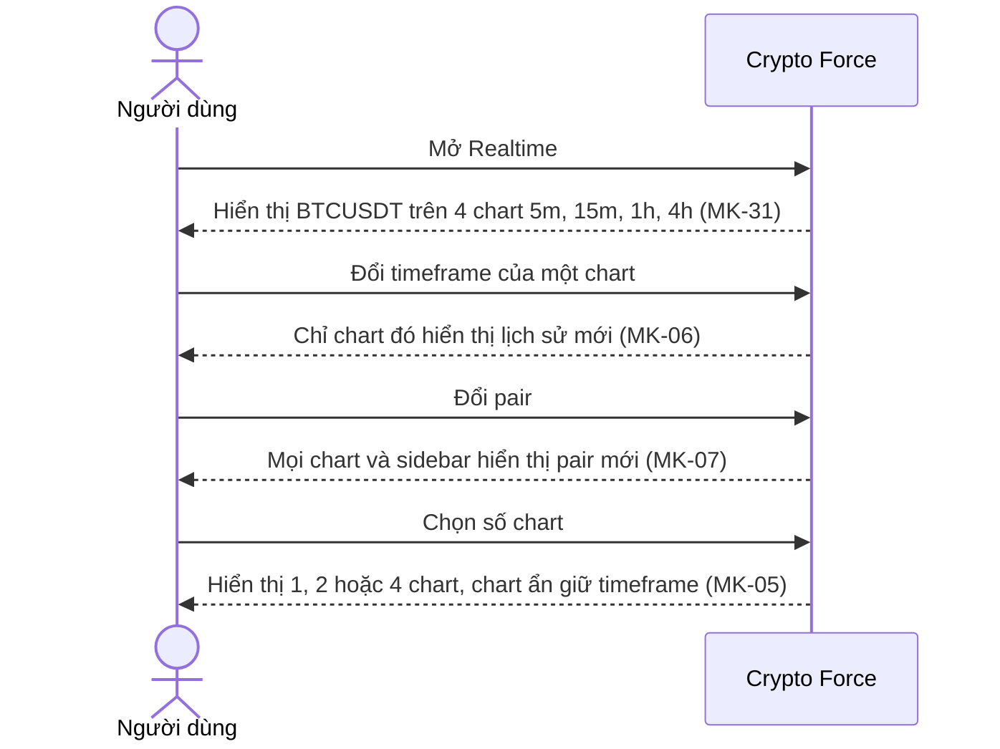

# Market Data

Đọc file này để biết hành vi xem lịch sử thị trường trên Realtime trong vòng tải lịch sử, trước khi có cập nhật trực tiếp.

## Tổng quan

Actor là người dùng đã đăng nhập. Người dùng xem lịch sử giá của một pair trên 1, 2 hoặc 4 chart nến. Mỗi chart có timeframe riêng, volume và MA(20). Sidebar là bảng thông tin cạnh các chart, hiển thị giá, thay đổi 24 giờ của pair và trạng thái dữ liệu [[1]](#ref-1) [[2, §4 và §5]](#ref-2).

Trong vòng này, chart không tự cập nhật sau khi tải xong. Ngoài phạm vi tài liệu này: cập nhật trực tiếp, phục hồi kết nối, tín hiệu BUY/SELL, chọn strategy làm nguồn tín hiệu, tìm lịch sử theo khoảng ngày và tải thêm lịch sử cũ hơn [[1]](#ref-1).

| Tiền tố | Nhóm | Nguồn |
| --- | --- | --- |
| `MK` | Xem lịch sử thị trường | [[1]](#ref-1) |

## Xem lịch sử thị trường

- Trigger: người dùng mở Realtime.
- Precondition: người dùng đã đăng nhập.
- Thành công: mỗi chart hiển thị nến, volume và MA của pair và timeframe đang chọn, kèm thời điểm của dữ liệu.
- Thất bại: chart hoặc sidebar không tải được dữ liệu hiển thị trạng thái lỗi riêng và thao tác thử lại. Phần còn lại của màn hình vẫn dùng được.

| Bước | Actor | Hành động |
| --- | --- | --- |
| 1 | Người dùng | Mở Realtime |
| 2 | Crypto Force | Hiển thị lựa chọn mặc định. Mỗi chart hiển thị tối đa 500 nến gần nhất, volume và MA, kèm thời điểm của dữ liệu. Sidebar hiển thị giá và thay đổi 24 giờ |
| 3 | Người dùng | Đổi timeframe của một chart |
| 4 | Crypto Force | Chỉ chart đó thay lịch sử theo timeframe mới. Các chart khác giữ dữ liệu |
| 5 | Người dùng | Đổi pair |
| 6 | Crypto Force | Mọi chart và sidebar thay dữ liệu theo pair mới, giữ timeframe của từng chart |
| 7 | Người dùng | Chọn số chart |
| 8 | Crypto Force | Hiển thị số chart đã chọn. Chart được hiện lại dùng timeframe đã chọn trước đó |

Bước 3 đến bước 8 không theo thứ tự cố định. Người dùng lặp lại các bước này trong cùng phiên.

| ID | Rule | Giá trị | Đo tại | Nguồn | Trạng thái |
| --- | --- | --- | --- | --- | --- |
| MK-01 | Chart hiển thị MA theo giá đóng cửa | 20 nến | Số nến trong mỗi mẫu trung bình | [[1]](#ref-1) | Confirmed |
| MK-02 | Chart có attribution TradingView đọc được | — | — | [[1]](#ref-1) | Confirmed |
| MK-04 | Người dùng chọn số chart hiển thị | 1, 2 hoặc 4 chart | Số card trên Realtime | [[1]](#ref-1) | Confirmed |
| MK-05 | Chart ẩn giữ timeframe khi hiện lại | — | — | [[1]](#ref-1) | Confirmed |
| MK-06 | Đổi timeframe chỉ thay dữ liệu của chart tương ứng | — | — | [[1]](#ref-1) | Confirmed |
| MK-07 | Mọi chart dùng chung pair đang chọn | — | — | [[1]](#ref-1) | Confirmed |
| MK-08 | Giá và thay đổi trong ngày không phụ thuộc timeframe chart | 24 giờ | Khoảng thời gian của phần trăm thay đổi | [[1]](#ref-1) | Confirmed |
| MK-09 | Sidebar lấy MA và volume theo chart đầu tiên, kèm nhãn timeframe | — | — | Agent đề xuất cho UI mock | Dropped (product owner, 2026-11-20: thay bằng MK-60) |
| MK-10 | Người dùng thấy trạng thái đang tải khi chưa nhận được lịch sử | — | — | Product owner, 2026-11-20: agent đề xuất để phân biệt đang tải với lịch sử rỗng | Confirmed |
| MK-11 | Lịch sử rỗng có thông báo riêng | — | — | Product owner, 2026-11-20: agent đề xuất để người dùng phân biệt không có nến với lỗi tải | Confirmed |
| MK-12 | Chart tải lỗi có thao tác thử lại riêng | — | — | Product owner, 2026-11-20: agent đề xuất để lỗi của một chart không chặn các chart khác | Confirmed |
| MK-13 | Từ vòng cập nhật định kỳ, làm mới lỗi giữ dữ liệu cũ kèm thông báo lỗi | — | — | Product owner, 2026-11-20: vòng tải lịch sử không có thao tác làm mới dữ liệu đã tải thành công | Confirmed |
| MK-14 | Hệ thống chỉ hiển thị dữ liệu thuộc lựa chọn hiện tại | — | — | Product owner, 2026-11-20: agent đề xuất để tránh gắn dữ liệu cũ vào nhãn mới | Confirmed |
| MK-15 | MA chưa đủ mẫu hiển thị chưa đủ dữ liệu thay vì số không | — | — | Product owner, 2026-11-20: thiếu dữ liệu không được hiển thị như một giá trị chỉ báo | Confirmed |
| MK-16 | Load history làm mới lịch sử của chart được chọn | — | — | Agent đề xuất cho bản nháp tương tác tải lịch sử | Dropped (product owner, 2026-11-20: thay bằng MK-61) |
| MK-23 | Volume hiển thị theo đơn vị base asset của pair, ví dụ BTC với BTCUSDT | — | — | Product owner, 2026-11-20: volume theo base so sánh được giữa các nến của cùng pair khi giá thay đổi | Confirmed |
| MK-24 | Mỗi nến đang hiển thị có điểm MA khi lịch sử của pair có đủ 19 nến trước nến đó | 20 nến | Số nến trong mẫu, tính cả nến trước nến đầu tiên đang hiển thị | Product owner, 2026-11-20: đường MA phủ toàn bộ chart, chỉ thiếu khi lịch sử thật không đủ | Confirmed |
| MK-25 | Lịch sử nến gồm nến đang mở của timeframe | — | — | Product owner, 2026-11-20: người dùng thấy giá gần nhất mà không trễ một nến | Confirmed |
| MK-26 | Nến đang mở có nhãn chữ “đang mở”, không chỉ phân biệt bằng màu | — | — | Product owner, 2026-11-20: tránh đọc giá tạm thành giá đóng cửa | Confirmed |
| MK-27 | Mỗi chart hiển thị thời điểm của dữ liệu của chart đó | — | — | Product owner, 2026-11-20: chart không tự cập nhật trong vòng tải lịch sử, các chart tải ở thời điểm khác nhau | Confirmed |
| MK-28 | MA tính cả nến đang mở; điểm MA của nến đang mở có nhãn giá trị tạm | 20 nến | Số nến trong mẫu, tính cả nến đang mở | Product owner, 2026-11-20: MA khớp với nến cuối người dùng thấy | Confirmed |
| MK-29 | Mỗi chart hiển thị MA và volume của chính chart đó, kèm timeframe của chart | — | — | Product owner, 2026-11-20: thông tin phụ thuộc timeframe nằm cạnh chart tương ứng | Confirmed |
| MK-30 | Người dùng chọn timeframe của chart trong tập 1m, 5m, 15m, 1h, 4h, 1d | 6 timeframe | Số lựa chọn trong ô timeframe của mỗi chart | Product owner, 2026-11-20: theo Project Brief §5; prototype thiếu 1d | Confirmed |
| MK-31 | Khi mở Realtime, màn hình hiển thị BTCUSDT với 4 chart theo timeframe 5m, 15m, 1h, 4h | 4 chart | Số chart và timeframe lúc mở Realtime | Product owner, 2026-11-20: theo kịch bản demo của Project Brief §29 | Confirmed |
| MK-32 | Người dùng chọn pair trong tập BTCUSDT, ETHUSDT, SOLUSDT | 3 pair | Số lựa chọn trong ô pair | Product owner, 2026-11-20: giữ các pair của UI Realtime | Confirmed |
| MK-33 | Mỗi chart hiển thị tối đa 500 nến gần nhất của pair và timeframe | 500 nến | Số nến trên một chart sau khi tải xong | Agent đề xuất, product owner xác nhận 2026-11-20: 1m khoảng 8 giờ, 1d khoảng 16 tháng, đủ cho MA(20); chưa có số đo tải, xem lại khi đo hiệu năng | Confirmed |
| MK-34 | Chart chưa nhận được dữ liệu sau thời hạn chờ thì chuyển sang trạng thái lỗi có thao tác thử lại | 10 giây | Từ lúc chart bắt đầu tải tới lúc hiển thị trạng thái lỗi | Agent đề xuất, product owner xác nhận 2026-11-20: đủ để chắc có sự cố mà người dùng không chờ mãi; xem lại khi đo hiệu năng | Confirmed |
| MK-35 | Chart chỉ hiển thị nến có trong lịch sử, không tạo nến để lấp khoảng trống | — | — | Product owner, 2026-11-20: không hiển thị dữ liệu không có thật | Confirmed |
| MK-36 | MA tính trên 20 nến có thật gần nhất, kể cả khi lịch sử có khoảng trống | 20 nến | Số nến trong mỗi mẫu trung bình | Product owner, 2026-11-20: MA không dùng nến không có thật | Confirmed |
| MK-37 | Reload hoặc mở lại Realtime trả về lựa chọn mặc định, không giữ pair và timeframe đã chọn | — | — | Product owner, 2026-11-20: chưa có nguồn yêu cầu nhớ lựa chọn | Confirmed |
| MK-38 | Thao tác thử lại không dùng được trong lúc chart đang tải lại | — | — | Product owner, 2026-11-20: tránh gửi lặp yêu cầu tải | Confirmed |
| MK-39 | Thông báo lỗi không hiển thị stack trace, payload hoặc địa chỉ của nguồn dữ liệu | — | — | Product owner, 2026-11-20: người dùng không cần chi tiết kỹ thuật và chi tiết này không được lộ ra ngoài | Confirmed |
| MK-41 | Đặt con trỏ hoặc chạm vào một nến hiển thị thời gian, open, high, low, close, volume và MA của nến đó | — | — | Product owner, 2026-11-20: cách đọc giá trị của một nến | Confirmed |
| MK-42 | Người dùng phóng to, thu nhỏ và kéo chart trong các nến đã tải | 500 nến | Số nến tối đa có thể xem trên một chart | Product owner, 2026-11-20: xem chi tiết trong lịch sử đã tải (MK-61, MK-33) | Confirmed |
| MK-43 | Thời gian trên chart theo múi giờ của thiết bị, màn hình ghi múi giờ đang dùng | — | — | Product owner, 2026-11-20: người dùng biết mốc giờ của nến | Confirmed |
| MK-44 | Giá hiển thị theo số chữ số thập phân của pair, giá khác 0 không hiển thị thành 0 | — | — | Product owner, 2026-11-20: giá của các pair có độ lớn khác nhau | Confirmed |
| MK-45 | Lịch sử có nến sai (high nhỏ hơn low, trùng thời gian mở, sai thứ tự) thì chart hiển thị trạng thái lỗi, không vẽ nến | — | — | Product owner, 2026-11-20: không vẽ dữ liệu sai | Confirmed |
| MK-46 | Mọi điều khiển của Realtime dùng được bằng bàn phím | — | — | Product owner, 2026-11-20; số SC chưa đối chiếu nguyên văn, WCAG 2.2 SC 2.1.1, SC 2.4.7 [[3]](#ref-3) | Confirmed |
| MK-47 | Mỗi chart có mô tả bằng chữ gồm pair, timeframe, giá đóng cửa và MA của nến cuối | — | — | Product owner, 2026-11-20; số SC chưa đối chiếu nguyên văn, WCAG 2.2 SC 1.1.1 [[3]](#ref-3) | Confirmed |
| MK-48 | Trạng thái đang tải, rỗng và lỗi của chart được thông báo cho screen reader mà không chuyển focus | — | — | Product owner, 2026-11-20; số SC chưa đối chiếu nguyên văn, WCAG 2.2 SC 4.1.3 [[3]](#ref-3) | Confirmed |
| MK-49 | Nến tăng và nến giảm phân biệt được không chỉ bằng màu | — | — | Product owner, 2026-11-20; số SC chưa đối chiếu nguyên văn, WCAG 2.2 SC 1.4.1 [[3]](#ref-3) | Confirmed |
| MK-50 | Ở chiều rộng màn hình hẹp, trang không cuộn ngang | 320 CSS px | Chiều rộng viewport | Product owner, 2026-11-20; số SC chưa đối chiếu nguyên văn, WCAG 2.2 SC 1.4.10 [[3]](#ref-3) | Confirmed |
| MK-51 | OHLCV của mỗi nến đã đóng trên chart khớp với nguồn dữ liệu cho cùng pair, timeframe và thời gian mở | 0 nến lệch | Số nến lệch khi đối chiếu với nguồn | Product owner, 2026-11-20: dữ liệu chart đúng với nguồn dữ liệu thị trường | Confirmed |
| MK-52 | Nến trên chart có thời gian mở tăng dần, không trùng và đúng mốc của timeframe | 0 nến | Số nến trùng, sai thứ tự hoặc lệch mốc | Product owner, 2026-11-20: dữ liệu chart đúng với nguồn dữ liệu thị trường | Confirmed |
| MK-58 | Điều khiển đang có focus bàn phím có chỉ báo focus nhìn thấy được | — | — | Product owner, 2026-11-20; số SC chưa đối chiếu nguyên văn, WCAG 2.2 SC 2.4.7 [[3]](#ref-3) | Confirmed |
| MK-59 | Ở chiều rộng màn hình hẹp, các chart xếp thành một cột | 320 CSS px | Chiều rộng viewport | Product owner, 2026-11-20; prototype Realtime xếp một cột trên màn hình hẹp | Confirmed |
| MK-60 | Sidebar không hiển thị MA và volume; sidebar chỉ hiển thị thông tin của pair và trạng thái dữ liệu | — | — | Product owner, 2026-11-20: MA và volume phụ thuộc timeframe, một sidebar cho nhiều chart làm người dùng đọc nhầm timeframe | Confirmed |
| MK-61 | Realtime không có thao tác tải thêm lịch sử nến | — | — | Product owner, 2026-11-20: không nguồn yêu cầu nào cần xem lịch sử cũ trên Realtime; đổi sang timeframe lớn hơn cho khoảng thời gian dài hơn | Confirmed |

## Luồng thay thế và ngoại lệ

| ID | Điều kiện | Phản hồi người dùng thấy | Nguồn | Trạng thái |
| --- | --- | --- | --- | --- |
| MK-17 | Người dùng đổi pair trong lúc dữ liệu trước đang tải | Hệ thống hiển thị dữ liệu của pair mới, không gắn dữ liệu pair trước vào nhãn mới | Product owner, 2026-11-20: agent đề xuất để giữ đúng ngữ cảnh dữ liệu | Confirmed |
| MK-18 | Thông tin giá và thay đổi trong ngày tải lỗi | Sidebar báo lỗi và cho thử lại, các chart vẫn dùng được | Product owner, 2026-11-20: agent đề xuất để tách lỗi giữa các nguồn thông tin | Confirmed |
| MK-19 | Dữ liệu chart đầu tiên đang tải | Phần MA và volume trong sidebar có trạng thái đang tải riêng | Agent đề xuất để không hiển thị giá trị từ timeframe cũ | Dropped (product owner, 2026-11-20: thay bằng MK-62) |
| MK-62 | Dữ liệu của một chart đang tải | Dòng MA và volume của chart đó có trạng thái đang tải, không hiển thị giá trị của timeframe cũ | Product owner, 2026-11-20: MA và volume chuyển từ sidebar sang từng chart | Confirmed |
| MK-40 | Phiên đăng nhập hết hạn trong lúc xem Realtime | Màn chặn đăng nhập; sau khi đăng nhập, người dùng quay về Realtime theo quy tắc quay về màn hình workspace (RD-02) | Product owner, 2026-11-20; [[4]](#ref-4) | Confirmed |

## Gap analysis

Baseline độc lập, đối chiếu ngày 2026-11-20:

- Bộ use case do subagent viết, chỉ nhận mục tiêu và actor, không đọc spec, prototype, code hoặc test. Áp dụng các mục trong phạm vi vòng tải lịch sử.
- WCAG 2.2 mức AA, các SC 1.1.1, 1.4.1, 1.4.10, 2.1.1, 2.4.7, 4.1.3 cho chart và trạng thái dữ liệu [[3]](#ref-3).

| ID | Gap | Baseline | Quyết định | Trạng thái |
| --- | --- | --- | --- | --- |
| MK-03 | Chưa chốt ý nghĩa thao tác tải thêm lịch sử | Không có, gap từ rà soát bản nháp | Bỏ thao tác tải thêm lịch sử (MK-61). Lý do: nhu cầu chưa có nguồn, chi phí nối nến và tính lại MA cao | Accepted |
| MK-20 | MA khi thiếu nến chưa được chốt | Không có, gap từ rà soát bản nháp | MA thiếu mẫu (MK-15), MA phủ chart (MK-24), MA gồm nến đang mở (MK-28) | Closed |
| MK-21 | Ý nghĩa MA và volume trong sidebar chưa được chốt | Không có, gap từ rà soát bản nháp | Sidebar không có MA và volume (MK-60), MA và volume theo từng chart (MK-29), volume theo base asset (MK-23) | Closed |
| MK-22 | Cách hiển thị nến đang mở chưa được chốt | Không có, gap từ rà soát bản nháp | Có nến đang mở (MK-25), nhãn đang mở (MK-26), thời điểm dữ liệu (MK-27) | Closed |
| MK-53 | Muốn thấy nến mới, người dùng phải reload và mất lựa chọn đã chọn | Bộ use case độc lập | Rủi ro chấp nhận đến vòng cập nhật định kỳ; reload về mặc định (MK-37) | Accepted |
| MK-54 | Thiếu cách đọc giá trị một nến, zoom và kéo chart | Bộ use case độc lập | Giá trị nến (MK-41), zoom và kéo (MK-42) | Closed |
| MK-55 | Thiếu múi giờ, độ chính xác giá và thời điểm dữ liệu theo từng chart | Bộ use case độc lập | Múi giờ (MK-43), số thập phân (MK-44), thời điểm theo chart (MK-27) | Closed |
| MK-56 | Thiếu hành vi với nến sai và tiêu chí dữ liệu khớp nguồn | Bộ use case độc lập | Nến sai (MK-45), OHLCV khớp nguồn (MK-51), thời gian mở đúng (MK-52) | Closed |
| MK-57 | Thiếu yêu cầu accessibility và màn hình hẹp cho chart | WCAG 2.2 AA | Bàn phím (MK-46), focus (MK-58), mô tả chữ (MK-47), thông báo trạng thái (MK-48), không chỉ dùng màu (MK-49), không cuộn ngang (MK-50), một cột (MK-59) | Closed |

## References

1. [Phạm vi flow REST đầu tiên](../build/01-prototype-to-implementation/market-data/work/step-01-rest-scope/plan.md)
2. [Project Brief](sources/project-brief.md)
3. W3C, *Web Content Accessibility Guidelines (WCAG) 2.2*, W3C Recommendation, 12/12/2024. <https://www.w3.org/TR/WCAG22/>
4. [Authentication](authentication.md)
