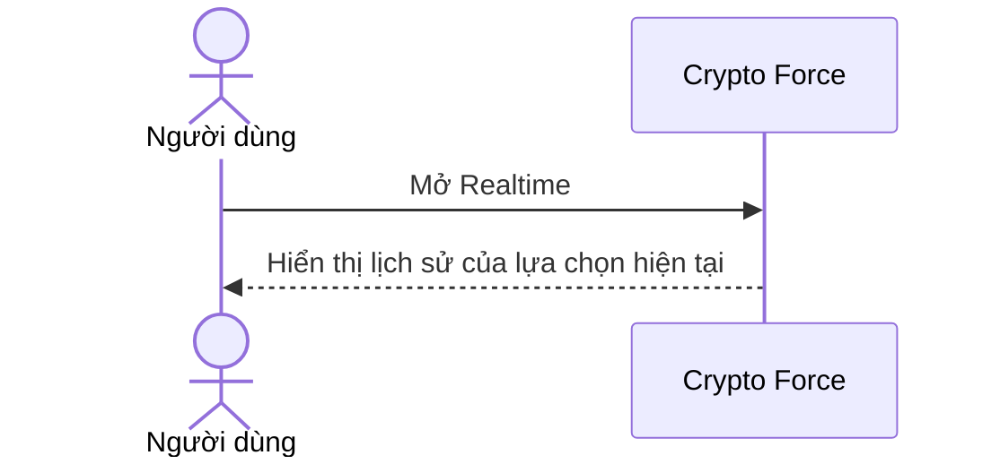

# Market Data

Đọc file này để biết bản nháp hành vi xem thị trường trên Realtime trong flow tải lịch sử.

## Tổng quan

Actor là người dùng đã đăng nhập. Phạm vi gồm nến, volume và MA(20) trên Realtime [[1]](#ref-1). Dữ liệu minh họa có nhãn riêng. Tài liệu này chưa mô tả cập nhật trực tiếp, phục hồi kết nối hoặc strategy.

| Tiền tố | Nhóm | Nguồn |
| --- | --- | --- |
| `MK` | Xem lịch sử thị trường | [[1]](#ref-1) |

## Xem lịch sử thị trường

- Trigger: người dùng mở Realtime.
- Precondition: người dùng đã đăng nhập.
- Thành công: hệ thống hiển thị chart của lựa chọn hiện tại.
- Thất bại: hệ thống báo không tải được dữ liệu.

| Bước | Actor | Hành động |
| --- | --- | --- |
| 1 | Người dùng | Mở Realtime |
| 2 | Crypto Force | Hiển thị nến, volume và MA theo lựa chọn hiện tại |

| ID | Rule | Giá trị | Đo tại | Nguồn | Trạng thái |
| --- | --- | --- | --- | --- | --- |
| MK-01 | Chart hiển thị MA theo giá đóng cửa | 20 nến | Số nến trong mỗi mẫu trung bình | [[1]](#ref-1) | Confirmed |
| MK-02 | Chart có attribution TradingView đọc được | — | — | [[1]](#ref-1) | Confirmed |
| MK-04 | Người dùng chọn số chart hiển thị | 1, 2 hoặc 4 chart | Số card trên Realtime | [[1]](#ref-1) | Confirmed |
| MK-05 | Chart ẩn giữ timeframe khi hiện lại | — | — | [[1]](#ref-1) | Confirmed |
| MK-06 | Đổi timeframe chỉ thay dữ liệu của chart tương ứng | — | — | [[1]](#ref-1) | Confirmed |
| MK-07 | Mọi chart dùng chung pair đang chọn | — | — | [[1]](#ref-1) | Confirmed |
| MK-08 | Giá và thay đổi trong ngày không phụ thuộc timeframe chart | 24 giờ | Khoảng thời gian của phần trăm thay đổi | [[1]](#ref-1) | Confirmed |
| MK-09 | Sidebar lấy MA và volume theo chart đầu tiên, kèm nhãn timeframe | — | — | Agent đề xuất để thống nhất nguồn thông tin với chart đang xem | Proposed |
| MK-10 | Người dùng thấy trạng thái đang tải khi chưa nhận được lịch sử | — | — | Agent đề xuất để phân biệt đang tải với lịch sử rỗng | Proposed |
| MK-11 | Lịch sử rỗng có thông báo riêng | — | — | Agent đề xuất để người dùng phân biệt không có nến với lỗi tải | Proposed |
| MK-12 | Chart tải lỗi có thao tác thử lại riêng | — | — | Agent đề xuất để lỗi của một chart không chặn các chart khác | Proposed |
| MK-13 | Refresh lỗi giữ dữ liệu cũ kèm thông báo lỗi | — | — | Agent đề xuất để người dùng còn đọc được dữ liệu trước lỗi | Proposed |
| MK-14 | Hệ thống chỉ hiển thị dữ liệu thuộc lựa chọn hiện tại | — | — | Agent đề xuất để tránh gắn dữ liệu cũ vào nhãn mới | Proposed |
| MK-15 | MA chưa đủ mẫu hiển thị chưa đủ dữ liệu thay vì số không | — | — | Agent đề xuất để không biến thiếu dữ liệu thành giá trị chỉ báo | Proposed |
| MK-16 | Load history làm mới lịch sử của chart được chọn | — | — | Agent đề xuất cho bản nháp tương tác tải lịch sử | Proposed |

## Luồng thay thế và ngoại lệ

| ID | Điều kiện | Phản hồi người dùng thấy | Nguồn | Trạng thái |
| --- | --- | --- | --- | --- |
| MK-17 | Người dùng đổi pair trong lúc dữ liệu trước đang tải | Hệ thống hiển thị dữ liệu của pair mới, không gắn dữ liệu pair trước vào nhãn mới | Agent đề xuất để giữ đúng ngữ cảnh dữ liệu | Proposed |
| MK-18 | Thông tin giá và thay đổi trong ngày tải lỗi | Sidebar báo lỗi và cho thử lại, các chart vẫn dùng được | Agent đề xuất để tách lỗi giữa các nguồn thông tin | Proposed |
| MK-19 | Dữ liệu chart đầu tiên đang tải | Phần MA và volume trong sidebar có trạng thái đang tải riêng | Agent đề xuất để không hiển thị giá trị từ timeframe cũ | Proposed |

## Gap analysis

Chưa thực hiện đối chiếu baseline độc lập để kết luận requirements đầy đủ. Phạm vi phân tích tiếp theo nằm trong kế hoạch tổng quan [[2]](#ref-2).

| ID | Gap | Baseline | Quyết định | Trạng thái |
| --- | --- | --- | --- | --- |
| MK-03 | Chưa chốt ý nghĩa thao tác tải thêm lịch sử | Chưa đối chiếu | [OQ-032](../open-questions.md#oq-032) | Open |
| MK-20 | MA khi thiếu nến chưa được chốt | Chưa đối chiếu | [OQ-082](../open-questions.md#oq-082) | Open |
| MK-21 | Ý nghĩa MA và volume trong sidebar chưa được chốt | Chưa đối chiếu | [OQ-083](../open-questions.md#oq-083) | Open |
| MK-22 | Cách hiển thị nến đang mở chưa được chốt | Chưa đối chiếu | [OQ-084](../open-questions.md#oq-084) | Open |

## References

1. [Phạm vi flow REST đầu tiên](../build/01-prototype-to-implementation/market-data/work/step-01-rest-scope/plan.md)
2. [Kế hoạch triển khai Market Data ở mức tổng quan](../build/01-prototype-to-implementation/market-data/abstract-implementation-plan.md)
