# Project Brief

Đọc file này để biết bài toán gốc, mục tiêu, các module và yêu cầu kiến trúc mà Crypto Force phải đáp ứng.

**Crypto Force – Nền tảng phân tích, kết hợp và đánh giá chiến lược giao dịch Crypto**

## 1. Bối cảnh bài toán

Thị trường cryptocurrency như Bitcoin, Ethereum... hoạt động liên tục 24/7. Giá của các tài sản thay đổi theo thời gian và thường được biểu diễn bằng **biểu đồ nến – Candlestick Chart**.

Ví dụ với cặp giao dịch **BTC/USDT**, một cây nến 5 phút chứa:

- Open: giá BTC ở đầu 5 phút.
- High: giá cao nhất trong 5 phút.
- Low: giá thấp nhất trong 5 phút.
- Close: giá cuối 5 phút.
- Volume: khối lượng giao dịch trong 5 phút.

```text
BTCUSDT – khung 5 phút

09:00
Open   = 118,000
High   = 118,200
Low    = 117,900
Close  = 118,150
Volume = 125 BTC
```

Các trader thường sử dụng nhiều phương pháp phân tích kỹ thuật như Moving Average – MA, RSI, Bollinger Bands, Support/Resistance, Smart Money Concepts – SMC, Wyckoff... để tìm thời điểm thích hợp để **Buy, Sell hoặc không giao dịch**.

Tuy nhiên, một strategy đơn lẻ thường không hoạt động tốt trong mọi điều kiện thị trường:

```text
MA:
Tốt khi thị trường có xu hướng.
Kém khi thị trường đi ngang.

RSI:
Có thể hữu ích khi phát hiện quá mua/quá bán.
Nhưng có thể tạo nhiều tín hiệu sai khi thị trường đang có trend mạnh.

Support/Resistance:
Có thể tìm vùng giá quan trọng.
Nhưng việc xác định vùng hỗ trợ/kháng cự có thể phụ thuộc vào thuật toán.
```

Vì vậy, câu hỏi chính của project là:

> Có thể xây dựng một hệ thống cho phép bổ sung nhiều strategy khác nhau, tự động kết hợp chúng thành các strategy phức hợp, đánh giá hiệu quả và liên tục tìm ra những tổ hợp strategy tốt nhất hay không?

## 2. Mục tiêu tổng thể

Xây dựng nền tảng **Crypto Force** có khả năng:

1. Nhận dữ liệu thị trường cryptocurrency từ Binance.
2. Hiển thị biểu đồ giá realtime.
3. Theo dõi đồng thời tối đa 4 khung thời gian.
4. Cho phép bổ sung các strategy phân tích kỹ thuật.
5. Cho phép kết hợp nhiều strategy thành một chiến lược tổng hợp.
6. Backtest các chiến lược trên dữ liệu lịch sử.
7. Xếp hạng các strategy dựa trên hiệu quả giao dịch.
8. Tự động tìm kiếm các combination strategy tốt hơn.
9. Visualize tín hiệu và giao dịch lên biểu đồ.
10. Thu thập tin tức liên quan đến coin/pair.
11. Phân tích sentiment của tin tức bằng mô hình Machine Learning.
12. Thiết kế hệ thống sao cho có thể mở rộng trong tương lai mà không phải sửa đổi toàn bộ hệ thống.

**Trọng tâm của project là Kiến trúc phần mềm, không phải tìm ra strategy đầu tư tốt nhất.**

## 3. Một ví dụ tổng thể

Giả sử người dùng chọn:

```text
Pair: BTCUSDT

Timeframes:
5m
15m
1h
4h
```

Dashboard hiển thị 4 biểu đồ:

```text
+------------------+------------------+
| BTCUSDT - 5m     | BTCUSDT - 15m    |
| Candlestick      | Candlestick      |
+------------------+------------------+
| BTCUSDT - 1h     | BTCUSDT - 4h     |
| Candlestick      | Candlestick      |
+------------------+------------------+
```

Người dùng có thể đổi `5m → 1m`, `15m → 30m`, `1h → 2h`, `4h → 1d` mà không phải reload toàn bộ hệ thống.

Sau đó người dùng bật MA, RSI, Bollinger Bands, Support/Resistance. Hệ thống có thể tạo:

```text
Strategy A: MA + RSI
Strategy B: MA + Bollinger
Strategy C: RSI + Support/Resistance
Strategy D: MA + RSI + Support/Resistance
Strategy E: MA + RSI + Bollinger + Support/Resistance
```

Sau khi backtest, hệ thống có thể đưa ra **Leaderboard**:

| Rank | Strategy | Profit | Win Rate | Max Drawdown |
| --- | --- | ---: | ---: | ---: |
| 1 | MA + RSI + SR | +18.2% | 61% | -6.1% |
| 2 | MA + Bollinger | +15.7% | 58% | -8.4% |
| 3 | RSI + SR | +13.1% | 64% | -7.2% |

## 4. Module 1 – Realtime Market Data

Hệ thống cần lấy dữ liệu giá crypto từ Binance. Có hai loại dữ liệu chính.

### Historical Data

Dữ liệu trong quá khứ, ví dụ BTCUSDT từ 01/07 đến 30/07 ở các khung 1 phút, 5 phút, 15 phút, 1 giờ, 4 giờ, 1 ngày.

Dữ liệu này phù hợp cho backtesting, tính indicator, huấn luyện ML và phân tích lịch sử.

### Realtime Data

Dữ liệu giá đang thay đổi tại thời điểm hiện tại:

```text
09:10:01 BTC = 118,021
09:10:02 BTC = 118,028
09:10:03 BTC = 118,017
...
```

Frontend cần nhận cập nhật mà không liên tục gọi `GET /price`. Kiến trúc tham khảo:

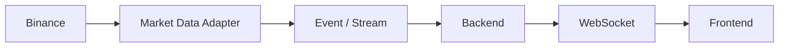

### Yêu cầu kiến trúc

Không để frontend phụ thuộc trực tiếp vào cấu trúc dữ liệu Binance. Không nên `Frontend → Binance API`, mà nên:

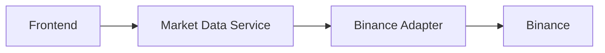

Nhờ đó sau này có thể bổ sung `BinanceAdapter`, `OKXAdapter`, `BybitAdapter`, `CoinbaseAdapter` mà frontend không phải thay đổi.

## 5. Module 2 – Multi-Timeframe Chart

Hệ thống phải hỗ trợ tối đa **4 chart trên một màn hình**, ví dụ BTCUSDT với Chart 1 → 5m, Chart 2 → 15m, Chart 3 → 1h, Chart 4 → 4h.

Mỗi chart phải có thể thay đổi timeframe riêng:

```text
Chart 1
Pair: BTCUSDT
Timeframe: [1m] [5m] [15m] [1h] [4h] [1d]
```

Nếu người dùng đổi `5m → 1h` thì chỉ Chart 1 cần đổi dữ liệu.

Chart có thể visualize: Candlestick, Volume, MA, Bollinger Bands, vùng Support, vùng Resistance, Buy Signal, Sell Signal, điểm Entry, Stop Loss, Take Profit.

```text
       Resistance
----------------------------
          SELL ↓
             ▌
          ▌  ▌
       ▌  ▌  ▌
    ▌  ▌  ▌
------ MA -------------------
       ↑ BUY
----------------------------
       Support
```

## 6. Module 3 – Strategy Engine

Đây là module quan trọng nhất của hệ thống. Một **strategy** nhận dữ liệu thị trường và tạo ra một tín hiệu, có thể chuẩn hóa thành `BUY / SELL / HOLD` hoặc `LONG / SHORT / NONE`.

```text
interface Strategy {
    analyze(context)
    return: BUY | SELL | HOLD
}
```

`context` có thể chứa price, volume, candles, timeframe, indicators, market state, sentiment...

### Strategy ví dụ 1 – Moving Average

Moving Average – MA là giá trung bình của một khoảng thời gian: MA20 là trung bình giá của 20 candles gần nhất, MA50 là của 50 candles gần nhất.

```text
Nếu MA20 cắt lên MA50 → BUY
Nếu MA20 cắt xuống MA50 → SELL

MAStrategy
    fastPeriod = 20
    slowPeriod = 50
```

Về kiến trúc, `MAStrategy` chỉ nên chịu trách nhiệm về logic MA, không nên chứa code gọi Binance, lưu database, vẽ chart hay gửi notification.

### Strategy ví dụ 2 – RSI

RSI có giá trị từ 0 đến 100.

```text
RSI < 30 → Oversold → BUY
RSI > 70 → Overbought → SELL

RSIStrategy
   period = 14
   buyThreshold = 30
   sellThreshold = 70
```

Như vậy có thể thử `RSI(14, 30, 70)`, `RSI(14, 25, 75)`, `RSI(21, 30, 70)`.

### Strategy ví dụ 3 – Bollinger Bands

Bollinger Bands tạo ba đường: Upper Band, Middle Band, Lower Band.

```text
Price < Lower Band → BUY
Price > Upper Band → SELL
```

Hoặc strategy khác: `Price breakout Upper Band → BUY`. Như vậy cùng một indicator có thể sinh ra nhiều strategy khác nhau.

### Strategy ví dụ 4 – Support/Resistance

Support là vùng giá mà giá trước đây thường ngừng giảm. Resistance là vùng mà giá trước đây thường gặp khó khăn khi tăng tiếp.

```text
         Resistance 120K
----------------------------
        /\       /
       /  \     /
      /    \   /
     /      \ /
----------------------------
         Support 110K
```

```text
Price gần Support → BUY
Price gần Resistance → SELL
```

Hoặc: `Price breakout Resistance → BUY`.

### Strategy nâng cao – SMC, Wyckoff

Không bắt buộc xây dựng đầy đủ các phương pháp phức tạp này; mục tiêu là kiến trúc có khả năng hỗ trợ chúng.

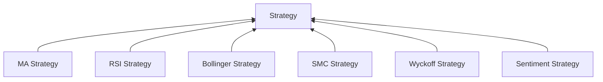

Thêm một strategy mới không được yêu cầu sửa toàn bộ Strategy Engine. Đây chính là yêu cầu về **Extensibility – khả năng mở rộng hệ thống**.

## 7. Module 4 – Strategy Plugin

Hệ thống phải cho phép bổ sung strategy mới dễ dàng. Ví dụ ban đầu `strategies/` có MA, RSI, Bollinger; sau đó phát triển thêm `SupportResistance`. Lý tưởng nhất, Strategy Engine chỉ cần đăng ký:

```text
register(SupportResistance)
```

thay vì phải sửa:

```text
if strategy == MA ...
else if strategy == RSI ...
else if strategy == Bollinger ...
else if strategy == SR ...
```

Các architectural/design pattern có thể cân nhắc: Strategy Pattern, Plugin Architecture, Factory, Registry, Dependency Injection. Không bắt buộc dùng đúng một pattern cụ thể, nhưng phải giải thích được:

> Vì sao kiến trúc có thể thêm strategy mới mà ảnh hưởng tối thiểu đến code hiện tại?

## 8. Module 5 – Composite Strategy

Đây là phần trung tâm của bài toán. Với MA, RSI, Bollinger, SupportResistance, có thể tạo `MA + RSI`, `MA + Bollinger`, `MA + SR`, `RSI + Bollinger`, `RSI + SR`, `MA + RSI + SR`...

Câu hỏi quan trọng là:

> Khi các strategy đưa ra tín hiệu khác nhau thì kết hợp thế nào?

### Majority Vote

```text
MA  → BUY
RSI → BUY
SR  → HOLD

BUY = 2, HOLD = 1 → BUY
```

Một trường hợp khác:

```text
MA  → BUY
RSI → SELL
SR  → BUY
→ BUY
```

### Weighted Combination

Không nhất thiết strategy nào cũng có trọng số giống nhau, ví dụ `MA = 0.2`, `RSI = 0.3`, `SR = 0.5`. Nếu encode `BUY = +1`, `HOLD = 0`, `SELL = -1` và MA → BUY, RSI → SELL, SR → BUY:

```text
Score = MA × 0.2 + RSI × 0.3 + SR × 0.5
      = 1×0.2 + (-1)×0.3 + 1×0.5
      = 0.4
```

Quy định:

```text
score > 0.3  → BUY
score < -0.3 → SELL
còn lại      → HOLD
```

Đây chỉ là một ví dụ; phương pháp combination có thể được thiết kế riêng.

## 9. Module 6 – Strategy Search Engine

Nếu có nhiều strategy, số tổ hợp tăng rất nhanh. Chỉ với 4 strategy MA, RSI, BB, SR đã có thể tạo `MA + RSI`, `MA + BB`, `MA + SR`, `RSI + BB`, `RSI + SR`, `BB + SR`, `MA + RSI + BB`, `MA + RSI + SR`...

Nếu mỗi strategy lại có nhiều parameter:

```text
MA:  10/20, 20/50, 50/200
RSI: 14/30/70, 14/20/80, 21/30/70
```

không gian tìm kiếm sẽ lớn hơn rất nhiều. Hệ thống cần cung cấp một **Strategy Search Engine**.

### Cách tìm kiếm 1 – Random Search

Cách đơn giản nhất: random một tổ hợp.

```text
Loop 1: MA + RSI
Loop 2: BB + SR
Loop 3: MA + RSI + SR
Loop 4: MA + BB + SR
...
```

Mỗi combination được xử lý qua:

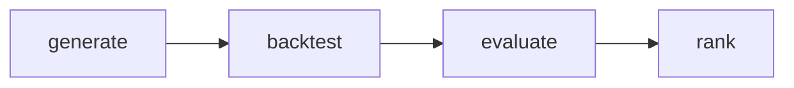

### Cách tìm kiếm 2 – Domain-guided Search

Thay vì random hoàn toàn, có thể dựa trên đặc điểm domain. Ví dụ phân nhóm:

| Nhóm | Strategy |
| --- | --- |
| Trend | MA, MACD |
| Momentum | RSI, Stochastic |
| Volatility | Bollinger, ATR |
| Structure | Support/Resistance, SMC, Wyckoff |
| Information | News Sentiment |

Có thể đặt rule: một composite strategy phải lấy 1 Trend Strategy + 1 Momentum Strategy + 1 Structure Strategy. Ví dụ `MA + RSI + Support Resistance` thay vì `MA10 + MA20 + MA50`.

Cần giải thích được:

> Domain knowledge đã được đưa vào quá trình search như thế nào?

### Cách tìm kiếm nâng cao

Phần mở rộng, không bắt buộc: Genetic Algorithm, Bayesian Optimization, Evolutionary Search, Reinforcement Learning, LLM-generated Strategy, Agent-based Search, AlphaEvolve-style optimization, Loop Engineering.

## 10. Module 7 – Backtesting Engine

Backtesting nghĩa là giả lập:

> Nếu sử dụng strategy này trong quá khứ thì kết quả sẽ như thế nào?

```text
Dữ liệu:
01/01 BTC = $80,000
...
01/03 BTC = $95,000

Strategy tạo:
05/01 BUY  @82,000
12/01 SELL @86,000
22/01 BUY  @88,000
31/01 SELL @87,000
```

Backtesting Engine sẽ giả lập các giao dịch này:

| Trade | Buy | Sell | Kết quả |
| --- | --- | --- | --- |
| 1 | 82K | 86K | Profit |
| 2 | 88K | 87K | Loss |

### Không chỉ đánh giá Profit

Strategy không được đánh giá chỉ bằng Total Profit. Ví dụ:

- **Strategy A**: Profit = +30%, nhưng từng có lúc -45%.
- **Strategy B**: Profit = +25%, nhưng Max Drawdown chỉ -8%.

Strategy B có thể ổn định hơn Strategy A. Hệ thống nên cung cấp các metrics như Total Return, Profit/Loss, Win Rate, Number of Trades, Maximum Drawdown, Profit Factor, Sharpe Ratio.

Nguyên tắc kiến trúc: **Strategy Evaluation phải tách biệt khỏi Strategy Implementation.**

## 11. Module 8 – Leaderboard

Sau mỗi lần backtest, kết quả được đưa vào Leaderboard.

| Rank | Strategy | Return | Win Rate | MDD | Trades |
| --- | --- | ---: | ---: | ---: | ---: |
| 1 | MA+RSI+SR | 24.2% | 62% | -7.1% | 81 |
| 2 | MA+BB | 21.7% | 55% | -8.4% | 105 |
| 3 | RSI+SR | 18.4% | 64% | -6.7% | 52 |
| 4 | MA | 9.1% | 48% | -14.2% | 140 |

Có thể cho phép sort by Return, Win Rate, Max Drawdown, Sharpe, hoặc định nghĩa **Overall Score**, ví dụ:

```text
Score = 0.5 × Return + 0.2 × WinRate + 0.3 × RiskScore
```

Cách tính score phải được trình bày rõ.

### Top-K Strategies

Hệ thống không nhất thiết giữ tất cả strategy tốt nhất lên màn hình. Ví dụ với `Top K = 10`, Leaderboard luôn hiển thị Top 10 strategies hiện tại. Một candidate mới `MA20 + RSI14 + SR` được backtest; nếu score `82.1` cao hơn strategy đứng thứ 10 (`78.4`) thì strategy mới được đưa vào Leaderboard.

## 12. Module 9 – Continuous Strategy Loop

Hệ thống có thể chạy một vòng loop ngầm:

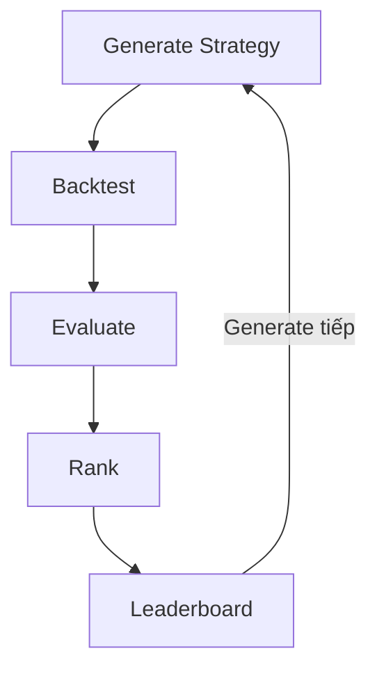

Ví dụ:

```text
#182 MA20 + RSI14       Score = 71
#183 MA20 + Bollinger   Score = 68
#184 MA50 + RSI21 + SR  Score = 84 → New Top Strategy
#185 ...
```

Loop có thể chạy 100 candidate, hoặc 1 giờ, hoặc đến khi không cải thiện sau 50 iterations. Phải thiết kế **Stop Condition**; không được để `while(true)` chạy vô hạn mà không kiểm soát.

### Vì sao Loop quan trọng đối với Kiến trúc phần mềm?

Một implementation kém có thể viết tất cả trong một function:

```text
for 100000 strategies:
    calculate indicator
    backtest
    save DB
    update UI
```

Implementation tốt nên tách:

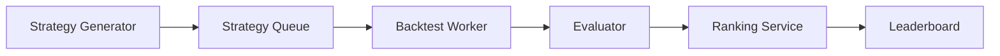

Qua đó có thể chạy nhiều worker, retry khi worker lỗi, pause loop, resume loop, theo dõi tiến trình, thay search algorithm và scale trong tương lai.

## 13. Visualization

### Visualization Strategy

Không chỉ hiển thị `Profit = +20%` mà phải cho phép người dùng hiểu strategy đã làm gì.

```text
BTCUSDT 15m

          SELL
            ↓
       ▌▌
    ▌  ▌▌
 ▌  ▌
 ▌
 ↑
BUY

MA -------------------
Support =============
```

Khi người dùng click `Strategy: MA20 + RSI14 + SupportResistance`, chart hiển thị MA20, RSI signals, Support zones, Buy points, Sell points.

### Trade Detail

Người dùng có thể xem bảng:

| # | Entry Time | Entry | Exit Time | Exit | Result |
| --- | --- | ---: | --- | ---: | ---: |
| 1 | 01/07 08:00 | 108K | 01/07 15:00 | 110K | +1.85% |
| 2 | 02/07 10:00 | 111K | 02/07 18:00 | 110K | -0.90% |
| 3 | 04/07 07:00 | 109K | 05/07 12:00 | 114K | +4.58% |

Click Trade #3 thì chart có thể highlight điểm `ENTRY ↑` và `EXIT ↓`.

## 14. Module 10 – News Crawler

Giá cryptocurrency không chỉ phụ thuộc vào biểu đồ; tin tức cũng có thể tác động đến thị trường, ví dụ: Bitcoin ETF news, Federal Reserve interest rates, Crypto regulation, Exchange hacked, New blockchain upgrade, Institutional adoption.

Hệ thống cần có module **News Collector** có nhiệm vụ thu thập dữ liệu từ các nguồn phù hợp, sau đó chuẩn hóa thành:

```text
News
  id
  title
  content
  source
  publishedAt
  crawledAt
  relatedCoins
  url
```

Ví dụ:

```text
title: Bitcoin rises after ...
publishedAt: 2026-07-28 08:15
relatedCoins: BTC
source: XXX
```

### News không được gắn cứng với một crawler

Không nên thiết kế `Trading System → Website A Crawler`. Nên có:

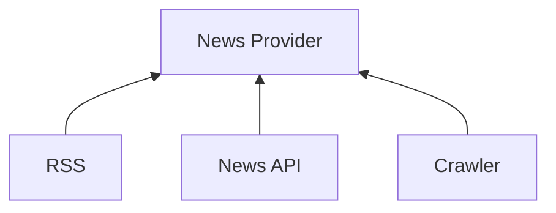

Các provider trả về cùng một format chuẩn, ví dụ `NewsItem`. Nhờ đó việc thay nguồn dữ liệu không ảnh hưởng đến các module phía sau.

## 15. Module 11 – Sentiment Analysis

Sau khi có news, Machine Learning Service có thể phân loại:

| Tin | Sentiment |
| --- | --- |
| "Bitcoin surges after institutional adoption..." | POSITIVE |
| "Major exchange suffers security breach..." | NEGATIVE |
| "Bitcoin network upgrade scheduled..." | NEUTRAL |

Kết quả lưu:

```text
News
  sentiment: POSITIVE
  score: 0.82
```

### Sentiment có thể trở thành một Strategy

Đây là một điểm kiến trúc thú vị. Ban đầu có MA, RSI, BB, SR; sau này có thể có `NewsSentimentStrategy`:

```text
Average sentiment trong 1 giờ > 0.7  → BUY
Average sentiment < -0.7             → SELL
```

Sau đó hệ thống có thể tìm `MA + RSI + News Sentiment` hoặc `Support Resistance + News Sentiment`. Như vậy kiến trúc không còn giới hạn ở Technical Analysis.

## 16. Kiến trúc tổng thể gợi ý

Một kiến trúc logic có thể gồm:

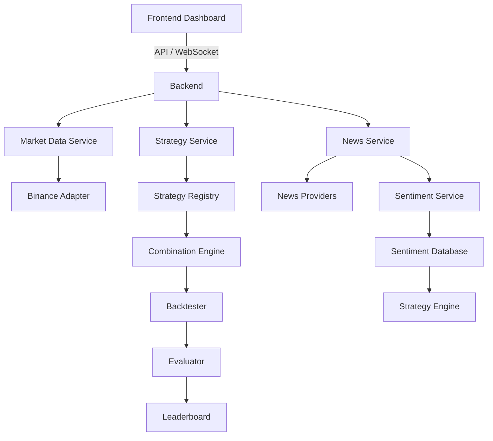

Đây chỉ là kiến trúc tham khảo; có thể đề xuất kiến trúc khác nếu giải thích được lựa chọn.

## 17. Architectural Drivers

Những vấn đề kiến trúc phần mềm mà project phải giải quyết.

### Modifiability

Có thể thêm `MACD Strategy` mà không phải sửa 20 module.

### Scalability

Ban đầu có 10 strategies, sau này có 100,000 candidate strategies: hệ thống có thể thay đổi kiến trúc như thế nào?

### Realtime

Khi Binance có dữ liệu mới, luồng `Market Data → Indicator → Strategy → UI` làm sao cập nhật với độ trễ thấp?

### Reliability

Nếu Binance mất kết nối (`Connection lost`), hệ thống xử lý ra sao? Reconnect? Retry? Có mất candles không?

### Performance

Có 1.000 strategy cần backtest: nên chạy tuần tự 1, 2, 3... 1000, hay sử dụng Job Queue + Workers?

### Maintainability

Strategy Search không được phụ thuộc chặt vào Backtesting implementation. Ví dụ có thể thay Random Search bằng Genetic Search mà Backtester vẫn giữ nguyên.

### Observability

Hệ thống nên biết:

- Loop đang chạy hay dừng?
- Đã thử bao nhiêu strategy?
- Backtest mất bao lâu?
- Có bao nhiêu job lỗi?
- Strategy nào đang đứng Top 1?

## 18. Một luồng hoàn chỉnh của hệ thống

Ví dụ người dùng chọn BTCUSDT, 5m:

1. **Market Data**: Binance → BTC candles.
2. **Strategy Generator**: sinh candidate `MA20 + RSI14 + SupportResistance`.
3. **Backtester**: chạy trên BTCUSDT, 01/01 → 01/07, 5m.
4. **Trade Simulation**: sinh 82 trades.
5. **Evaluator**: tính Return = 18.2%, Win Rate = 61%, MDD = -6.1%.
6. **Ranking**: tính Score = 81.4.
7. Candidate hiện tại đứng Rank #2.
8. Frontend nhận event `LEADERBOARD_UPDATED`.
9. Leaderboard tự cập nhật, không cần refresh trang.

## 19. Các Event có thể xuất hiện

Nếu sử dụng event-driven architecture, có thể định nghĩa: `MarketPriceUpdated`, `CandleClosed`, `StrategyGenerated`, `BacktestStarted`, `BacktestCompleted`, `StrategyEvaluated`, `LeaderboardUpdated`, `NewsCollected`, `SentimentAnalyzed`.

Ví dụ Backtest Worker không cần gọi trực tiếp `LeaderboardService.update()` mà có thể publish `StrategyEvaluatedEvent`; Ranking Service nhận event đó. Điều này giúp giảm coupling giữa các module.

## 20. Database

Có thể có các nhóm dữ liệu:

| Nhóm | Dữ liệu |
| --- | --- |
| Market Data | Candles, Pair, Timeframe, Timestamp, Open, High, Low, Close, Volume |
| Strategy | StrategyDefinition, Parameters, Version, CreatedAt |
| Experiment | Combination, Dataset, Timeframe, Parameters, Result |
| Trades | Entry, Exit, Profit, Strategy |
| News | Title, Content, Source, PublishedAt, RelatedCoin, Sentiment |

Leaderboard có thể lưu trực tiếp hoặc tính từ Experiment Results; cần giải thích lựa chọn.

## 21. Strategy phải có Version

```text
MA-RSI Strategy v1: MA20, MA50, RSI14
MA-RSI Strategy v2: MA10, MA30, RSI21
```

Không nên overwrite kết quả cũ. Cần đảm bảo `Experiment #122` luôn biết chính xác nó đã sử dụng strategy nào. Đây là vấn đề **Reproducibility**.

## 22. Phạm vi tối thiểu (MVP)

| Hạng mục | Tối thiểu |
| --- | --- |
| Market | Binance data, Candlestick chart, Realtime update, Tối đa 4 timeframe |
| Strategy | Ít nhất 4 strategy đơn lẻ, ví dụ MA, RSI, Bollinger, Support/Resistance |
| Combination | Có khả năng tạo composite strategy |
| Backtest | Có khả năng giả lập giao dịch trên historical data |
| Evaluation | Return, Win Rate, Max Drawdown, Number of Trades |
| Search | Ít nhất một phương pháp: Random Search |
| Leaderboard | Top-K strategies |
| Visualization | Chart có Buy/Sell, Entry/Exit |
| News | Có pipeline Collect → Store → Analyze sentiment |

## 23. Phần mở rộng

| Hạng mục | Hướng mở rộng |
| --- | --- |
| Search | Genetic Algorithm, Evolutionary Search, Bayesian Optimization, LLM Strategy Generator |
| Trading | Long/Short, Stop Loss, Take Profit, Trailing Stop, Position Sizing |
| Market | Multiple Coins, Multiple Exchanges |
| ML | Sentiment, Price Prediction, Market Regime Detection |
| Architecture | Redis, Kafka/RabbitMQ, Worker Pool, Microservices, CQRS, Event Sourcing, Plugin Architecture |

Chỉ dùng công nghệ phức tạp khi chỉ ra được nó giải quyết vấn đề kiến trúc nào.

## 24. Mục tiêu đúng của project

Project không phải là "viết MA + RSI để kiếm tiền", mà là:

> Thiết kế một hệ thống mà hôm nay có MA + RSI, ngày mai có thể thêm SMC, Wyckoff, Sentiment hoặc một strategy hoàn toàn mới mà kiến trúc cũ vẫn hoạt động.

Tương tự, hôm nay hệ thống dùng Random Search, ngày mai có thể thay bằng Genetic Algorithm mà Backtester, Evaluator, Leaderboard, Visualization không cần viết lại. Đây mới là vấn đề của **Software Architecture**.

## 25. Câu hỏi kiến trúc trung tâm

Kiến trúc phải trả lời được các câu hỏi:

1. Strategy mới được thêm vào hệ thống như thế nào? Ví dụ `MACDStrategy` được thêm mà sửa những component nào?
2. Search algorithm mới được thêm như thế nào? Từ Random Search sang Genetic Search có ảnh hưởng Backtesting Engine không?
3. Market Data Provider mới được thêm như thế nào? Từ Binance sang Binance + OKX có phải sửa frontend không?
4. Nếu số backtest tăng từ 100 lên 100.000 thì kiến trúc thay đổi thế nào?
5. Nếu News Service bị lỗi thì Chart có còn chạy không?
6. Nếu Sentiment Model thay đổi thì Strategy Engine có bị ảnh hưởng không?
7. Nếu Binance WebSocket disconnect thì hệ thống phục hồi như thế nào?
8. Làm sao kiểm tra một kết quả trên Leaderboard được tạo ra bởi version strategy nào?

## 26. Scenario kiểm tra kiến trúc

### Khả năng mở rộng

Hệ thống hiện có MA, RSI, Bollinger và Support/Resistance; cần bổ sung MACD. Kiến trúc tốt chỉ cần:

```text
class MACDStrategy implements Strategy
StrategyRegistry.register(MACDStrategy)
```

Thiết kế coupling cao có thể phải sửa Controller, Backtester, UI, Database, Combination Engine, Evaluator. Đây là một minh chứng trực quan cho chất lượng kiến trúc.

### Khả năng thay đổi

Hiện tại có `RandomStrategyGenerator`, cần thêm `DomainGuidedStrategyGenerator`:

```text
interface StrategyGenerator {
    generate()
}
```

với các implementation `RandomGenerator`, `DomainGuidedGenerator`, `GeneticGenerator`. Các component phía sau chỉ nhận `CandidateStrategy` và không cần biết candidate được sinh ra bằng cách nào.

### Scalability

Giả sử 1 Backtest Worker mất 2 giây / candidate, 10.000 candidate cần 20.000 giây. Hệ thống nên cho phép mở rộng:

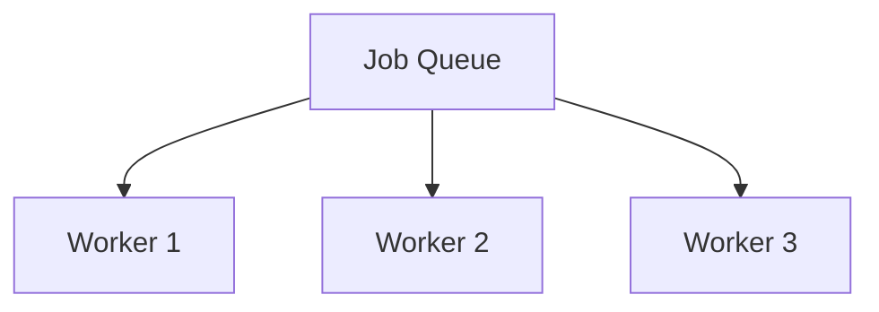

Đây là lý do Queue, Worker, Event có thể quan trọng trong kiến trúc này.

## 27. Các Anti-pattern nên tránh

### God Service

Không nên có một `TradingService` vừa get Binance data, calculate RSI, crawl news, run ML, backtest, rank, save database, send WebSocket.

### Hard-coded Strategy

Không nên:

```text
if MA && RSI ...
else if MA && Bollinger ...
else if RSI && Bollinger ...
```

### Frontend chứa business logic

Không nên để React/Vue tính trading strategy, backtest, profit, ranking.

### Strategy truy cập trực tiếp Database

Không nên `RSIStrategy → MySQL`. Strategy nên nhận data cần thiết thông qua abstraction thích hợp.

### Crawler phụ thuộc chặt vào ML

Không nên `Crawler → BERT model`. Crawler chỉ cần collect news; Sentiment Service xử lý analyze news.

## 28. Deliverables

1. **Source Code**: repository hoàn chỉnh.
2. **README**: hướng dẫn Install, Run, Architecture, Demo.
3. **Architecture Document**: tối thiểu mô tả System Context, Container/Module decomposition, Component responsibilities, Data Flow, Realtime Flow, Strategy Flow, Search/Backtest Flow.
4. **Architectural Decisions**, ví dụ:
   - ADR-001: Tại sao dùng WebSocket?
   - ADR-002: Tại sao dùng Plugin Architecture cho Strategy?
   - ADR-003: Tại sao dùng Queue cho Backtesting?
   - ADR-004: Tại sao tách Sentiment Service?
5. **Demo** tối thiểu: Realtime chart, Multi timeframe, Thêm/chọn strategy, Generate combination, Backtest, Leaderboard, Trade visualization, News, Sentiment.

## 29. Demo scenario đề xuất

1. Mở BTCUSDT với `5m | 15m | 1h | 4h`: 4 chart realtime.
2. Chọn MA, RSI, Bollinger, Support Resistance.
3. Bấm `START SEARCH`.
4. Màn hình hiển thị:
   ```text
   Candidates tested: 125
   Current: MA20 + RSI14 + SR
   Backtesting...
   ```
5. Leaderboard thay đổi: `#1 MA20 + RSI14 + SR`, `#2 MA50 + BB`, `#3 RSI + SR`.
6. Click Top #1, chart hiển thị Buy, Sell, MA, Support, Resistance.
7. Hiển thị Trades = 81, Win Rate = 61%, Return = 18.2%, MDD = -6.1%.
8. Chuyển sang News: BTC News – Positive 42%, Neutral 38%, Negative 20%.
9. Thêm `SentimentStrategy` vào search space.
10. Chạy lại loop: `MA + RSI + Sentiment`, `MA + SR + Sentiment`...

Qua demo này có thể thấy hầu hết các component kiến trúc hoạt động cùng nhau.

## 30. Mục tiêu cốt lõi

Project không nhằm chứng minh rằng `MA + RSI + SMC` có thể kiếm tiền thật. Mục tiêu là xây dựng một **software architecture có khả năng thử nghiệm các ý tưởng như vậy một cách có hệ thống**.

Hệ thống phải chuyển bài toán "Tôi có một strategy mới." thành:

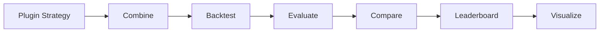

và có thể lặp lại quá trình:

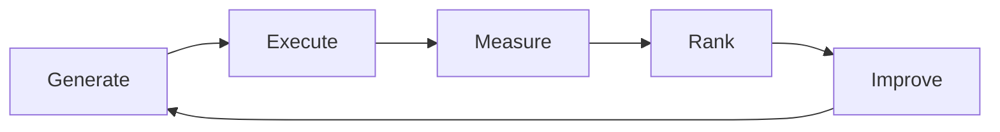

Do đó, bản chất project là sự kết hợp của: **Realtime System + Plugin Architecture + Data Pipeline + Event-driven Architecture + Experiment Platform + Verification Loop.**

Framework, database, message queue, mô hình ML và thuật toán tìm kiếm được tự do lựa chọn. Điều quan trọng nhất cần chứng minh là:

> Kiến trúc được thiết kế như thế nào để các thành phần có thể thay đổi, mở rộng và hoạt động độc lập trong khi toàn bộ hệ thống vẫn duy trì được tính đúng đắn, khả năng quan sát và khả năng phát triển lâu dài.
