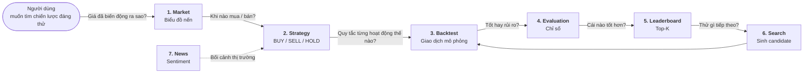
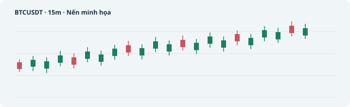
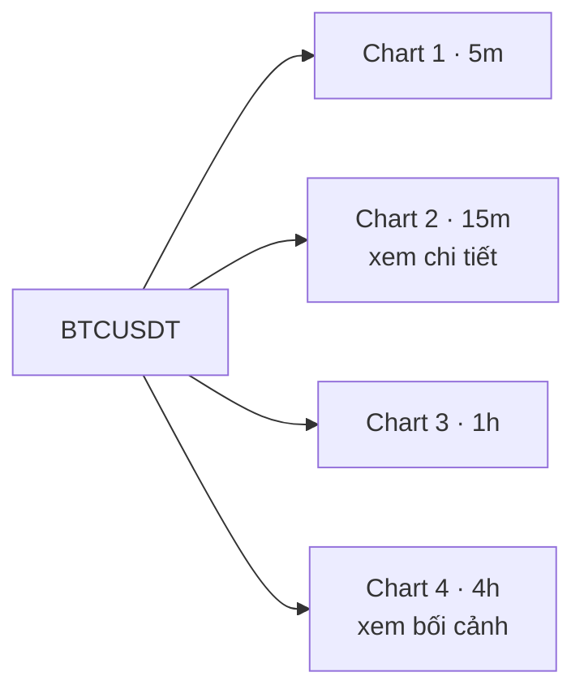
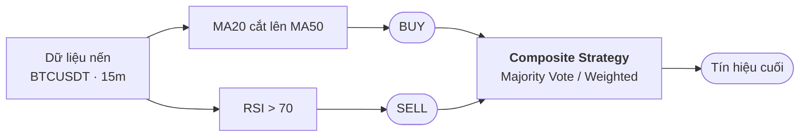
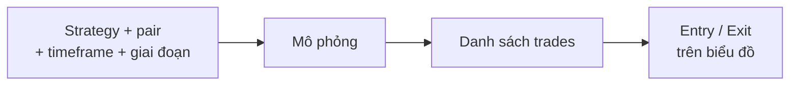
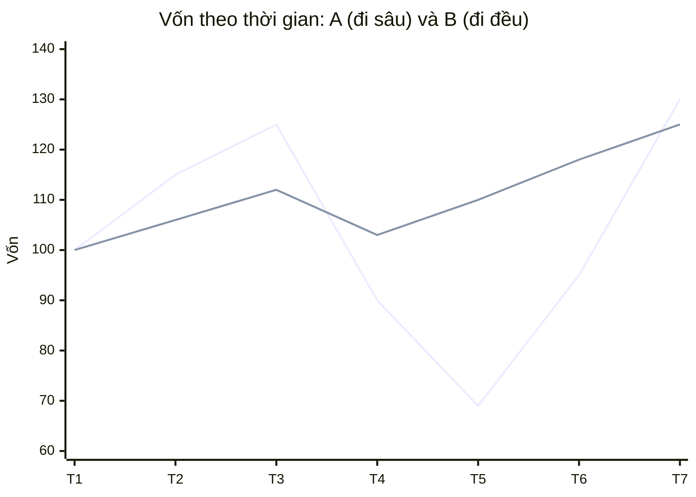
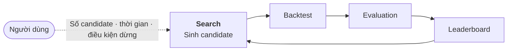
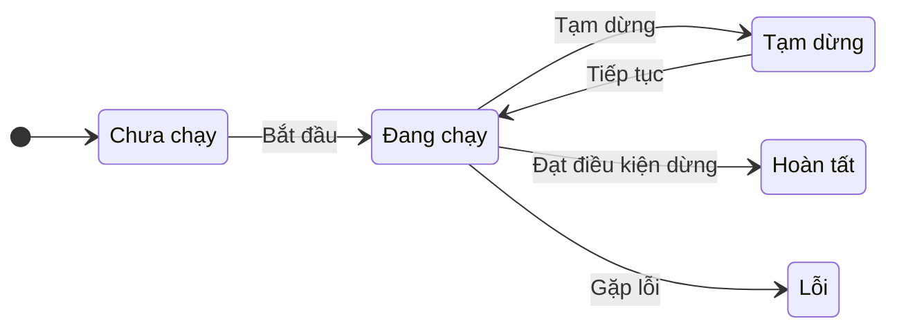
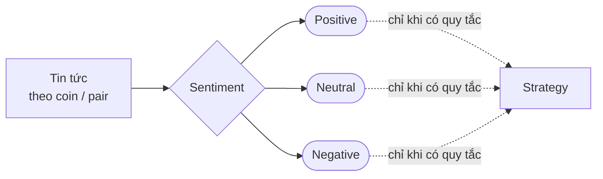

# System Description

Đọc file này để biết Crypto Force dùng để làm gì, giải quyết nhu cầu nào của người dùng và vì sao từng tính năng tồn tại.

Crypto Force giúp người nghiên cứu giao dịch tìm chiến lược đáng thử. Hệ thống chỉ phân tích, mô phỏng và so sánh; không đặt lệnh thật.

Ví dụ xuyên suốt: thử chiến lược MA + RSI trên BTCUSDT, khung 15 phút.

## 1. Market: quan sát thị trường

Chỉ nhìn giá hiện tại thì không thấy xu hướng và mức dao động.

Tối đa 4 biểu đồ, mỗi biểu đồ một timeframe riêng; đổi timeframe một biểu đồ không ảnh hưởng biểu đồ khác.

## 2. Strategy: biến quan sát thành tín hiệu

Nhận xét bằng mắt không lặp lại được; khi các Strategy mâu thuẫn, Composite Strategy gộp tín hiệu theo một quy tắc cố định.

## 3. Backtest: thử trên dữ liệu quá khứ

Vài tín hiệu đúng không chứng minh chiến lược tốt. Backtest chạy quy tắc liên tục qua cả giai đoạn lịch sử.

| Giao dịch | Entry | Exit | Kết quả |
|---|---|---|---|
| #1 | $82, 000 | $86, 000 | Lãi |
| #2 | $88, 000 | $87, 000 | Lỗ |

## 4. Evaluation: hiệu quả và rủi ro

Đếm lệnh thắng chưa đủ; cần nhìn cả lợi nhuận lẫn rủi ro.

| Chỉ số | Câu hỏi người dùng |
|---|---|
| Total Return | Vốn tăng/giảm bao nhiêu? |
| Win Rate | Bao nhiêu % lệnh có lãi? |
| Maximum Drawdown | Sụt giảm lớn nhất bao nhiêu? |
| Number of Trades | Dựa trên bao nhiêu lệnh? |

Return cao hơn chưa chắc tốt hơn. Hai chiến lược cùng bắt đầu với 100 đơn vị vốn:

| Strategy | Return | Max Drawdown | Người dùng trải qua |
|---|---|---|---|
| A | +30% | -45% (125 → 69) | Có lúc mất gần nửa vốn trước khi hồi lại |
| B | +25% | -8% (112 → 103) | Lãi ít hơn một chút nhưng gần như không sụt sâu |

## 5. Leaderboard: so sánh nhiều chiến lược

Đặt kết quả cạnh nhau, sắp xếp theo Return, Win Rate, MDD hoặc điểm tổng hợp; giữ Top-K.

| Hạng | Strategy | Return | Win rate | MDD |
|---|---|---|---|---|
| 1 | MA + RSI + SR | 24.2% | 62% | -7.1% |
| 2 | MA + BB | 21.7% | 55% | -8.4% |
| 3 | RSI + SR | 18.4% | 64% | -6.7% |

## 6. Search: tự động tìm chiến lược để thử

Quá nhiều tổ hợp và tham số để thử thủ công.

Người dùng theo dõi trạng thái phiên Search để phân biệt "chưa tìm thấy candidate tốt hơn", "đang tạm dừng" và "gặp lỗi":

Candidate đứng đầu chỉ là tốt nhất theo dữ liệu đã thử, không chắc có lợi nhuận thật.

## 7. News: bổ sung bối cảnh

