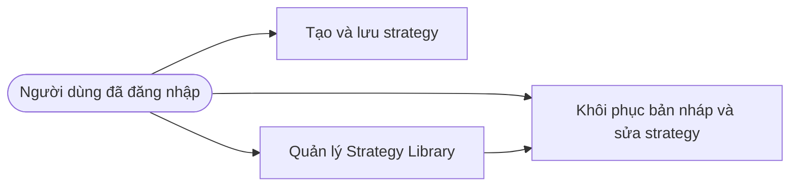
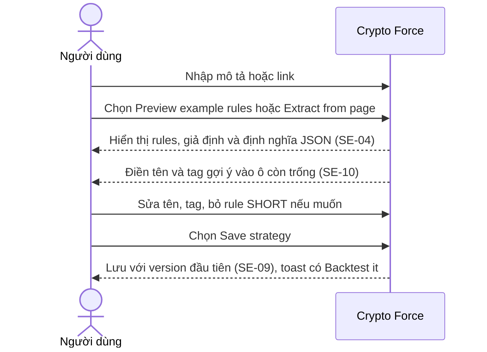
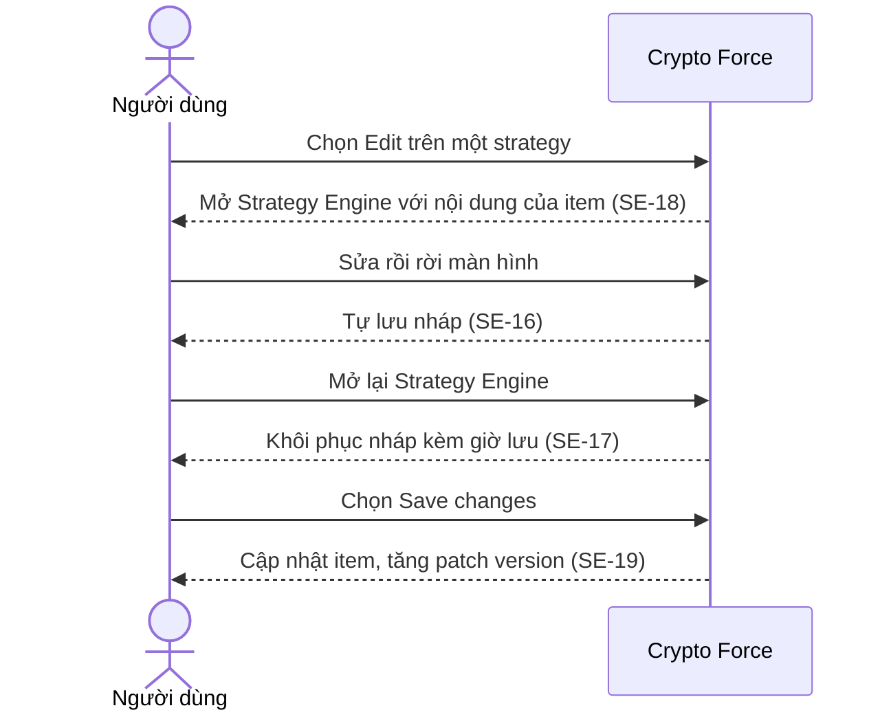
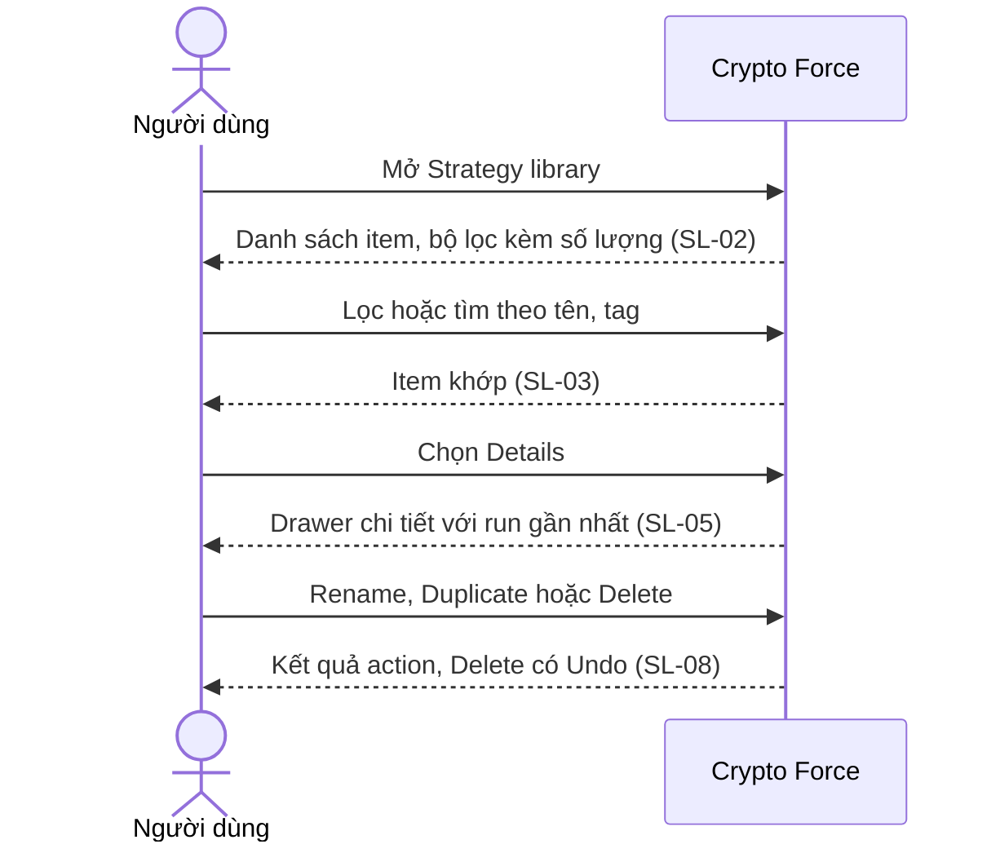

# Strategy Engine và Strategy Library

Đọc file này để biết hành vi tạo, xem trước, lưu, khôi phục nháp, sửa và quản lý strategy trong Strategy Engine và Strategy Library khi nhìn từ bên ngoài.

## Tổng quan

Actor là người dùng đã đăng nhập. Người dùng mô tả một ý tưởng giao dịch bằng lời hoặc dán link tới bài viết về strategy, xem trước bộ rules và các giả định, rồi lưu strategy vào Library với tên, tag và version [[1, Lưu strategy]](#ref-1). Library chứa hai loại item: strategy tạo trong Strategy Engine và composite tạo trong Composite builder trên Discovery [[1]](#ref-1).

Trong phạm vi: tạo strategy từ mô tả hoặc link, xem trước rules, lưu, khôi phục nháp, sửa strategy đã lưu, xem danh sách Library, lọc, tìm, xem chi tiết trong drawer, đổi tên, nhân bản, xóa có Undo và chọn signal source cho Realtime.

Ngoài phạm vi: Composite builder trên Discovery, đưa điều kiện sentiment từ News vào strategy, tín hiệu trực tiếp trên Realtime, và cơ chế bên trong biến mô tả hoặc link thành rules.

| Tiền tố | Nhóm | Nguồn |
| --- | --- | --- |
| `SE` | Strategy Engine: tạo, xem trước, lưu, nháp và sửa strategy | [[1, Tạo strategy từ mô tả hoặc link]](#ref-1) |
| `SL` | Strategy Library: danh sách, drawer chi tiết và các action trên item | [[1, Xem Strategy library]](#ref-1) |

## Quy tắc dùng chung

| ID | Rule | Giá trị | Đo tại | Nguồn | Trạng thái |
| --- | --- | --- | --- | --- | --- |
| SE-36 | Toast có Undo (bỏ rule SHORT, bỏ tag, xóa mô tả, xóa item) tự đóng sau thời hạn hiển thị | 8 giây | Từ lúc toast hiện tới lúc toast tự đóng | [[2, Phản hồi dùng chung]](#ref-2) | Inferred |
| SE-37 | Preview của Strategy Engine chỉ tạo rules từ các indicator MA, RSI, Bollinger Bands và Support / Resistance; phần mô tả dùng indicator khác nằm trong danh sách "Not converted" (SE-39) | 4 indicator | Số loại indicator trong rules của preview | Agent chốt theo ủy quyền của product owner, 2026-11-28: bốn strategy tối thiểu của MVP [[3, §22]](#ref-3); danh sách này đổi khi product owner thêm strategy mới | Confirmed |
| SE-38 | Giá trị mà mô tả hoặc link không nêu được điền giá trị mặc định và mang nhãn "(assumed)"; Crypto Force không hỏi lại người dùng | — | — | Agent chốt theo ủy quyền của product owner, 2026-11-28: người dùng thấy mọi giả định trong một lần preview; muốn đổi thì thêm giá trị vào mô tả rồi preview lại (SE-44) | Confirmed |
| SE-39 | Phần mô tả không chuyển thành rule được liệt kê trong preview dưới nhãn "Not converted" | — | — | Agent chốt theo ủy quyền của product owner, 2026-11-28: người dùng biết phần nào của ý tưởng không có trong strategy | Confirmed |
| SE-44 | Người dùng không sửa trực tiếp tham số của rule hay định nghĩa JSON; muốn đổi rule thì sửa mô tả hoặc link và preview lại | — | — | Agent chốt theo ủy quyền của product owner, 2026-11-28: mô tả là nguồn duy nhất của rules, nên rules và mô tả không lệch nhau | Confirmed |
| SE-47 | Mỗi lần lưu khi sửa chỉ tăng patch version; Crypto Force không phân biệt major và minor version | — | — | Agent chốt theo ủy quyền của product owner, 2026-11-28: run giữ đúng version đã dùng (BT-11), nên số patch đủ để tái lập kết quả | Confirmed |

## Tạo và lưu strategy

- Trigger: người dùng mở Strategy Engine, hoặc chọn **New strategy** trong Library.
- Precondition: người dùng đã đăng nhập.
- Thành công: strategy mới nằm trong Library với version đầu tiên (SE-09), và toast sau khi lưu có link **Backtest it** mở Backtest với strategy đó [[1, Lưu strategy]](#ref-1).
- Thất bại: Crypto Force báo lỗi và không lưu khi tên trống (SE-35) hoặc trùng (SE-08), preview thiếu rule vào lệnh (SE-41) hoặc cách thoát lệnh (SE-42), Library đã đầy (SL-27) hoặc lưu thất bại (SE-51). Preview lỗi được mô tả trong bảng luồng ngoại lệ bên dưới.

| Bước | Actor | Hành động |
| --- | --- | --- |
| 1 | Người dùng | Chọn cách nhập **Describe it** hoặc **Import from a link**, rồi nhập mô tả hoặc dán link |
| 2 | Người dùng | Chọn **Preview example rules** (mô tả) hoặc **Extract from page** (link) |
| 3 | Crypto Force | Hiển thị trạng thái đang xử lý, rồi hiển thị preview gồm bảng rules, danh sách giả định và định nghĩa JSON. Card Validation & actions hiện ra |
| 4 | Crypto Force | Điền tên và tag gợi ý vào ô Name và Tags khi các ô này còn trống |
| 5 | Người dùng | Xem rules, sửa tên và tag, bỏ rule SHORT mẫu nếu strategy chỉ đi LONG |
| 6 | Người dùng | Chọn **Save strategy** |
| 7 | Crypto Force | Lưu strategy, đặt item lên đầu Library, xóa bản nháp, chuyển Strategy Engine sang trạng thái đang sửa item vừa lưu và hiện toast có link **Backtest it** |

| ID | Rule | Giá trị | Đo tại | Nguồn | Trạng thái |
| --- | --- | --- | --- | --- | --- |
| SE-01 | Mô tả strategy dài tối đa 1.000 ký tự | 1.000 ký tự | Bộ đếm ký tự dưới ô mô tả | [[1, Tạo strategy từ mô tả hoặc link]](#ref-1) | Inferred |
| SE-02 | Link hợp lệ bắt đầu bằng `http://` hoặc `https://` và có domain | — | — | [[1, Tạo strategy từ mô tả hoặc link]](#ref-1) | Inferred |
| SE-03 | Đổi cách nhập, sửa mô tả hoặc sửa link sau khi đã preview thì bỏ preview; người dùng phải preview lại trước khi lưu | — | — | [[1, Tạo strategy từ mô tả hoặc link]](#ref-1) | Inferred |
| SE-04 | Preview gồm bảng rules (Go long, Short, Risk, Timeframe, Pairs), danh sách giả định và định nghĩa JSON có Show, Hide và Copy | — | — | [[1, Review rules trước khi lưu]](#ref-1) | Inferred |
| SE-05 | Dòng Timeframe và dòng Pairs của bảng rules mang nhãn "(assumed)" | — | — | [[4]](#ref-4) | Inferred |
| SE-06 | **Remove short example** bỏ rule SHORT mẫu, và Undo trong toast đưa rule đó trở lại | — | — | [[1, Review rules trước khi lưu]](#ref-1) | Inferred |
| SE-07 | Tên strategy dài tối đa 60 ký tự | 60 ký tự | Số ký tự trong ô Name | [[1, Lưu strategy]](#ref-1) | Inferred |
| SE-35 | Tên strategy không được trống | — | — | [[1, Lưu strategy]](#ref-1) | Inferred |
| SE-08 | Tên strategy không trùng tên item khác trong Library, không phân biệt hoa thường | — | — | [[1, Lưu strategy]](#ref-1) | Inferred |
| SE-09 | Strategy tạo mới có version 1.0.0 | 1.0.0 | Version của item sau lần lưu đầu tiên | [[1, Lưu strategy]](#ref-1) | Inferred |
| SE-10 | Sau khi preview, ô Name và ô Tags còn trống được điền tên và tag gợi ý của preview; ô đã có nội dung giữ nguyên | — | — | Product owner duyệt report Task 8, 2026-11-28 [[5, Files changed]](#ref-5) | Confirmed |
| SE-41 | Lưu bị chặn khi preview không có rule vào lệnh | — | — | Agent chốt theo ủy quyền của product owner, 2026-11-28: strategy không có rule vào lệnh không tạo được trade nào | Confirmed |
| SE-42 | Lưu bị chặn khi preview không có cách thoát lệnh (rule thoát, stop loss hoặc take profit) | — | — | Agent chốt theo ủy quyền của product owner, 2026-11-28: lệnh không có cách thoát chỉ đóng khi hết khoảng thời gian backtest | Confirmed |
| SE-43 | Preview có giả định "(assumed)" hoặc không có stop loss chỉ hiện cảnh báo, không chặn lưu | — | — | Agent chốt theo ủy quyền của product owner, 2026-11-28: đây là lựa chọn hợp lệ của người dùng, không phải lỗi | Confirmed |
| SE-52 | Lưu strategy là chấp nhận các giả định đang hiển thị; Crypto Force không có thao tác xác nhận riêng từng giả định | — | — | Agent chốt theo ủy quyền của product owner, 2026-11-28: người dùng không sửa trực tiếp rule (SE-44), nên lưu là bước xác nhận duy nhất | Confirmed |
| SE-45 | Import from a link nhận mọi trang `http://` hoặc `https://` công khai có nội dung chữ; không giới hạn domain | — | — | Agent chốt theo ủy quyền của product owner, 2026-11-28: danh sách domain cố định chặn các nguồn hợp lệ mà người dùng có | Confirmed |
| SE-40 | Preview chưa xong sau thời hạn chờ thì báo lỗi có **Retry** và giữ nguyên mô tả hoặc link | 60 giây | Từ lúc chọn Preview example rules hoặc Extract from page tới lúc hiện lỗi | Agent chốt theo ủy quyền của product owner, 2026-11-28: đủ cho một lần đọc trang và tạo rules; người dùng không chờ không giới hạn | Confirmed |
| SE-32 | Một lần bấm **Save strategy** tạo tối đa một item | 1 item | Số item mới trong Library sau một lần bấm | Product owner duyệt đề xuất của agent, 2026-11-28: bấm hai lần không được tạo hai item trùng nội dung | Confirmed |
| SE-27 | Trạng thái đang tạo preview, lỗi preview và kết quả lưu được thông báo cho trình đọc màn hình mà không chuyển focus | — | — | Product owner duyệt đề xuất của agent, 2026-11-28 theo WCAG 2.2 SC 4.1.3 (mức AA) [[6]](#ref-6): người dùng trình đọc màn hình biết kết quả mà không phải tìm trên trang | Confirmed |

| ID | Điều kiện | Phản hồi người dùng thấy | Nguồn | Trạng thái |
| --- | --- | --- | --- | --- |
| SE-11 | Chọn **Preview example rules** khi mô tả trống | Toast lỗi yêu cầu mô tả strategy, kèm ví dụ gồm entry, exit và stop loss; không có preview | [[1, Tạo strategy từ mô tả hoặc link]](#ref-1) | Inferred |
| SE-12 | Chọn **Extract from page** khi link sai định dạng (SE-02) | Lỗi "Enter a full link starting with https://" ngay dưới ô link; không có preview | [[1, Tạo strategy từ mô tả hoặc link]](#ref-1) | Inferred |
| SE-13 | Trang của link không chứa strategy | Toast lỗi gợi ý kiểm tra link hoặc dán nội dung vào Describe it | [[1, Tạo strategy từ mô tả hoặc link]](#ref-1) | Inferred |
| SE-14 | Crypto Force không tạo được preview vì lỗi | Card Strategy preview hiển thị thông báo lỗi và nút **Retry**; mô tả hoặc link giữ nguyên | Product owner duyệt đề xuất của agent, 2026-11-28 cho UI Phase 1: lỗi của preview không làm mất nội dung đã nhập | Confirmed |
| SE-15 | Library đã có tên gợi ý của preview | Ô Name nhận tên gợi ý kèm số đầu tiên còn trống, ví dụ `RSI_BB_LB_LONG_SL2_TP4 2` | Agent chốt theo ủy quyền của product owner, 2026-11-28, product owner duyệt qua report Task 8: dùng cùng cách đặt tên với Duplicate để tên gợi ý không vi phạm tên không trùng (SE-08) [[5, Files changed]](#ref-5) | Confirmed |
| SE-46 | Trang của link cần đăng nhập, có paywall hoặc không phải trang chữ | Toast lỗi nêu lý do và gợi ý dán nội dung vào Describe it; link giữ nguyên | Agent chốt theo ủy quyền của product owner, 2026-11-28: người dùng biết cách đi tiếp khi trang không đọc được | Confirmed |
| SE-53 | Link trỏ tới, hoặc chuyển hướng tới, localhost, địa chỉ IP nội bộ hoặc địa chỉ không công khai | Lỗi "Enter a public link" ngay dưới ô link; Crypto Force không mở địa chỉ đó | Agent chốt theo ủy quyền của product owner, 2026-11-28: Crypto Force chỉ đọc trang công khai (SE-45) và không truy cập mạng nội bộ | Confirmed |
| SE-51 | Lưu strategy thất bại vì mất mạng hoặc lỗi máy chủ | Toast lỗi "Could not save the strategy. Check your connection and try again."; nội dung và nháp giữ nguyên, **Save strategy** dùng lại được | Agent chốt theo ủy quyền của product owner, 2026-11-28: nháp tự lưu (SE-16) giữ nội dung, người dùng chỉ cần lưu lại | Confirmed |

## Khôi phục bản nháp và sửa strategy

- Trigger: người dùng mở lại Strategy Engine sau khi rời đi với thay đổi chưa lưu, hoặc chọn **Edit** trên một strategy trong Library.
- Precondition: người dùng đã đăng nhập; với Edit, strategy đó còn trong Library.
- Thành công: nội dung chưa lưu được khôi phục, hoặc thay đổi được lưu vào đúng item đang sửa với patch version mới.
- Thất bại: người dùng bỏ nháp hoặc bỏ thay đổi; item trong Library giữ nguyên.

| Bước | Actor | Hành động |
| --- | --- | --- |
| 1 | Người dùng | Chọn **Edit** trên một strategy trong Library |
| 2 | Crypto Force | Mở Strategy Engine với cách nhập, mô tả hoặc link, tag, tên và rule SHORT của item; preview bật sẵn. Banner "Editing {tên} · v{version}" nhắc rằng run cũ giữ cấu hình đã chạy |
| 3 | Người dùng | Sửa nội dung rồi rời màn hình mà chưa lưu |
| 4 | Crypto Force | Tự lưu nháp trong trình duyệt mỗi khi nội dung khác bản gốc |
| 5 | Người dùng | Mở lại Strategy Engine trong cùng ngữ cảnh (cùng sửa item đó) |
| 6 | Crypto Force | Khôi phục nháp kèm banner "Restored your unsaved changes from {giờ}", với **Discard draft** và **Keep** |
| 7 | Người dùng | Chọn **Save changes** |
| 8 | Crypto Force | Cập nhật item, tăng patch version, cập nhật Updated và xóa nháp |

| ID | Rule | Giá trị | Đo tại | Nguồn | Trạng thái |
| --- | --- | --- | --- | --- | --- |
| SE-16 | Strategy Engine tự lưu nháp trong trình duyệt mỗi khi nội dung khác bản gốc | — | — | [[1, Bản nháp]](#ref-1) | Confirmed |
| SE-17 | Mở lại Strategy Engine trong cùng ngữ cảnh (cùng tạo mới, hoặc cùng sửa một item) khôi phục nháp kèm giờ lưu nháp | — | — | [[1, Bản nháp]](#ref-1) | Inferred |
| SE-18 | **Edit** trên một strategy mở Strategy Engine với nội dung của item đó | — | — | [[1, Sửa một item trong Library]](#ref-1) | Confirmed |
| SE-19 | Lưu khi đang sửa cập nhật đúng item đó và tăng patch version, không tạo item mới | 1 patch version | Version trước và sau khi lưu, ví dụ 1.0.0 thành 1.0.1 | [[1, Lưu strategy]](#ref-1) | Confirmed |
| SE-48 | Sau khi phiên hết hạn, cùng tài khoản đăng nhập lại trên cùng trình duyệt khôi phục được nháp Strategy Engine và Composite builder | — | — | Agent chốt theo ủy quyền của product owner, 2026-11-28: nháp gắn với tài khoản (SE-54) nên không mất khi phiên hết hạn | Confirmed |
| SE-54 | Nháp của Strategy Engine và Composite builder gắn với tài khoản đã tạo ra nó; tài khoản khác đăng nhập trên cùng trình duyệt không thấy nháp đó | — | — | Agent chốt theo ủy quyền của product owner, 2026-11-28: nội dung nháp của một người không lộ sang người khác dùng chung máy | Confirmed |
| SE-55 | Sign out xóa nháp của Strategy Engine và Composite builder của tài khoản khỏi trình duyệt | — | — | Agent chốt theo ủy quyền của product owner, 2026-11-28: Sign out xóa dữ liệu của tài khoản đã tải trong trình duyệt [[7, Phiên và Sign out]](#ref-7) | Confirmed |

| ID | Điều kiện | Phản hồi người dùng thấy | Nguồn | Trạng thái |
| --- | --- | --- | --- | --- |
| SE-20 | Chọn **Stop editing** khi có thay đổi chưa lưu | Hộp thoại "Discard changes to {tên}?" với **Keep editing** và **Discard changes**; Discard bỏ thay đổi và nháp, item trong Library giữ nguyên | [[1, Sửa một item trong Library]](#ref-1) | Inferred |
| SE-21 | Người dùng đến Strategy Engine kèm ý tưởng từ Landing trong khi có nháp | Nháp không được khôi phục; mô tả là ý tưởng từ Landing | [[1, Bản nháp]](#ref-1) | Inferred |
| SE-49 | Lưu khi item đã được lưu hoặc đổi tên từ tab khác sau lúc bắt đầu sửa | Không lưu; thông báo "This strategy changed in another tab" kèm **Reload** | Agent chốt theo ủy quyền của product owner, 2026-11-28: không ghi đè thay đổi của tab khác, kể cả tên mới, mà người dùng chưa thấy | Confirmed |
| SE-50 | Lưu khi item đã bị xóa ở tab khác | Không lưu; thông báo "This strategy is no longer in your library" kèm **Save as new strategy** | Agent chốt theo ủy quyền của product owner, 2026-11-28: người dùng giữ được nội dung đang sửa | Confirmed |
| SE-56 | Người dùng chọn Sign out khi có nháp Strategy Engine hoặc Composite builder chưa lưu | Hộp thoại "You have an unsaved strategy or composite draft" báo rằng Sign out xóa nháp, với **Stay signed in** và **Sign out anyway** | Agent chốt theo ủy quyền của product owner, 2026-11-28: Sign out xóa nháp (SE-55), nên người dùng cần được cảnh báo trước như khi có backtest đang chạy | Confirmed |

## Quản lý Strategy Library

- Trigger: người dùng chọn **Strategy library** hoặc **View all** trên Strategy Engine.
- Precondition: người dùng đã đăng nhập.
- Thành công: người dùng tìm được item, xem chi tiết và thực hiện action (Backtest, Edit, Rename, Duplicate, Delete, Use as signal source).
- Thất bại: Library không tải được thì hiển thị lỗi có thao tác thử lại (SL-13).

| Bước | Actor | Hành động |
| --- | --- | --- |
| 1 | Người dùng | Mở Strategy library |
| 2 | Crypto Force | Hiển thị bộ lọc All, Strategies, Composites kèm số lượng, ô tìm, signal source hiện tại và danh sách item. Mỗi item có loại, nguồn, version, thời điểm cập nhật, tag và kết quả run gần nhất hoặc "Not backtested yet" |
| 3 | Người dùng | Lọc theo loại hoặc tìm theo tên hay tag |
| 4 | Người dùng | Chọn **Details** hoặc tên item |
| 5 | Crypto Force | Mở drawer với version, nguồn, Updated, Created, rules, mô tả hoặc link nguồn, và run gần nhất. Drawer đóng bằng nút Close, phím Esc hoặc chọn ra ngoài |
| 6 | Người dùng | Chọn một action trong drawer: Backtest, Edit, Use as signal source, Rename, Duplicate hoặc Delete |
| 7 | Crypto Force | Thực hiện action và hiện toast xác nhận |

| ID | Rule | Giá trị | Đo tại | Nguồn | Trạng thái |
| --- | --- | --- | --- | --- | --- |
| SL-01 | Strategy Engine hiển thị các item lưu gần nhất kèm link **View all (N)** | 3 item | Số dòng trong bảng Your library trên Strategy Engine | [[1, Xem Strategy library]](#ref-1) | Inferred |
| SL-02 | Bộ lọc All, Strategies, Composites hiển thị số item của từng loại | — | — | [[1, Xem Strategy library]](#ref-1) | Inferred |
| SL-03 | Ô tìm khớp tên hoặc tag, không phân biệt hoa thường | — | — | [[1, Xem Strategy library]](#ref-1) | Inferred |
| SL-04 | Item mới lưu đứng đầu danh sách | — | — | [[1, Xem Strategy library]](#ref-1) | Inferred |
| SL-05 | Drawer chi tiết hiển thị các backtest run gần nhất của item, mỗi run là link mở chi tiết run | 5 run | Số run trong mục Backtest runs của drawer | [[1, Xem chi tiết một item]](#ref-1) | Inferred |
| SL-06 | Đổi tên dùng cùng validation với ô Name khi lưu và không tăng version | — | — | [[1, Đổi tên]](#ref-1) | Inferred |
| SL-07 | **Duplicate** tạo bản sao ngay sau item gốc, tên "{tên} (copy)" kèm số khi trùng | — | — | [[1, Nhân bản]](#ref-1) | Inferred |
| SL-20 | Bản sao có version đầu tiên | 1.0.0 | Version của bản sao trong drawer | [[1, Nhân bản]](#ref-1) | Inferred |
| SL-21 | Sau Duplicate, drawer chuyển sang bản sao và mở sẵn ô đổi tên | — | — | [[1, Nhân bản]](#ref-1) | Inferred |
| SL-08 | Xóa item cần xác nhận trong hộp thoại | — | — | [[1, Xóa]](#ref-1) | Inferred |
| SL-19 | Undo trong toast sau khi xóa đưa item về đúng vị trí cũ | — | — | [[1, Xóa]](#ref-1) | Inferred |
| SL-09 | Drawer của item chưa có run ghi rằng mỗi run giữ bản sao cấu hình đã chạy, nên sửa item sau đó không đổi kết quả cũ; rule giữ bản sao nằm trong [Backtest](backtest.md#cấu-hình-và-chạy-backtest-thủ-công) | — | — | [[4]](#ref-4) [[8, Snapshot cấu hình của run]](#ref-8) | Inferred |
| SL-10 | Item đang là signal source của Realtime mang nhãn "Realtime signal source" | — | — | [[1, Đặt làm signal source]](#ref-1) | Inferred |
| SL-22 | Trong drawer của item đang là signal source, nút hiển thị "Current signal source" và không dùng được | — | — | [[1, Đặt làm signal source]](#ref-1) | Inferred |
| SL-23 | Xóa item đang có run chạy được phép, và run đó chạy tiếp với bản sao cấu hình của nó | — | — | Agent chốt theo ủy quyền của product owner, 2026-11-28: run giữ bản sao cấu hình (BT-11), nên xóa item không ảnh hưởng run | Confirmed |
| SL-24 | Hộp thoại xóa ghi rằng item đang có run chạy khi item có run Running | — | — | Agent chốt theo ủy quyền của product owner, 2026-11-28: người dùng biết run vẫn chạy sau khi xóa | Confirmed |
| SL-25 | Sau khi toast có Undo đóng, item đã xóa không khôi phục được | — | — | Agent chốt theo ủy quyền của product owner, 2026-11-28: xóa đã cần xác nhận (SL-08), nên không cần thùng rác | Confirmed |
| SL-26 | Mỗi người dùng lưu tối đa số item trong Library | 200 item | Số item trong Library của một người dùng | Agent chốt theo ủy quyền của product owner, 2026-11-28: đủ cho một người nghiên cứu, giữ danh sách và tìm kiếm trong giới hạn của một trang | Confirmed |

| ID | Điều kiện | Phản hồi người dùng thấy | Nguồn | Trạng thái |
| --- | --- | --- | --- | --- |
| SL-11 | Library chưa có item | Hướng dẫn kèm **Create a strategy** và **Build a composite** | [[1, Xem Strategy library]](#ref-1) | Inferred |
| SL-12 | Bộ lọc và ô tìm không khớp item nào | "Nothing matches" kèm **Clear search and filters** | [[1, Xem Strategy library]](#ref-1) | Inferred |
| SL-13 | Crypto Force không tải được Library | Thông báo lỗi và nút **Retry** thay cho danh sách; trong lúc tải hiển thị khung chờ | Product owner duyệt đề xuất của agent, 2026-11-28 cho UI Phase 1: phân biệt đang tải, lỗi và Library trống | Confirmed |
| SL-14 | Xóa item đang là signal source của Realtime | Hộp thoại xác nhận cảnh báo thêm rằng Realtime sẽ quay về MA Crossover | [[1, Xóa]](#ref-1) | Inferred |
| SL-27 | Lưu strategy, lưu composite hoặc Duplicate khi Library đã đủ số item tối đa (SL-26) | Không tạo item; thông báo "Your library is full (200 items). Delete an item to save a new one." | Agent chốt theo ủy quyền của product owner, 2026-11-28: người dùng biết giới hạn và cách giải phóng chỗ | Confirmed |
| SL-28 | Mở link item của người dùng khác hoặc item không tồn tại | Thông báo "Strategy not found" giống nhau ở cả hai trường hợp | Agent chốt theo ủy quyền của product owner, 2026-11-28: không để lộ việc item của người khác tồn tại | Confirmed |

## Gap analysis

Baseline độc lập, đối chiếu ngày 2026-11-28:

- Bộ use case do subagent viết cho ba mục tiêu tạo strategy, tiếp tục hoặc sửa strategy và quản lý Library, chỉ nhận mục tiêu và actor, không đọc file nào trong repo.
- WCAG 2.2 mức A và AA, các SC 2.2.1, 3.3.1, 3.3.3, 3.3.4, 3.3.7 và 4.1.3 cho form, toast có Undo, nội dung đã nhập và thông báo trạng thái [[6]](#ref-6).

| ID | Gap | Baseline | Quyết định | Trạng thái |
| --- | --- | --- | --- | --- |
| SE-22 | Chưa có cách phân tích mô tả và link thành rules; preview luôn là bộ rules mẫu | Bộ use case độc lập | Indicator được hỗ trợ (SE-37), giả định có nhãn (SE-38), phần không chuyển được (SE-39), lưu là chấp nhận giả định (SE-52) | Closed |
| SE-23 | Chưa chốt lỗi validation nào chặn việc lưu và lỗi nào chỉ là cảnh báo | WCAG 2.2 SC 3.3.1 và 3.3.3 | Chặn lưu khi thiếu rule vào lệnh (SE-41) hoặc cách thoát lệnh (SE-42); cảnh báo không chặn (SE-43) | Closed |
| SE-24 | Người dùng không sửa được tham số của từng rule hoặc định nghĩa JSON | Bộ use case độc lập | Không sửa trực tiếp rule hay JSON (SE-44) | Closed |
| SE-25 | Chưa có danh sách domain được hỗ trợ khi import và cách xử lý trang cần đăng nhập hoặc có paywall | Bộ use case độc lập | Không giới hạn domain (SE-45), trang không đọc được (SE-46), địa chỉ không công khai (SE-53) | Closed |
| SE-26 | Mỗi lần lưu khi sửa chỉ tăng patch version, không phân biệt đổi logic với đổi tham số | Không có, gap từ rà soát bản nháp | Chỉ tăng patch version (SE-47) | Closed |
| SE-28 | Trạng thái preview và kết quả lưu chỉ hiện bằng hình, chưa có yêu cầu thông báo cho công nghệ hỗ trợ | WCAG 2.2 SC 4.1.3 | Thông báo trạng thái cho trình đọc màn hình (SE-27) | Closed |
| SE-29 | Chưa có hành vi khi hai tab cùng sửa một strategy, hoặc strategy bị xóa ở tab khác trong lúc đang sửa | Bộ use case độc lập | Item đã lưu ở tab khác (SE-49), item đã bị xóa ở tab khác (SE-50) | Closed |
| SE-30 | Chưa có hành vi khi lưu strategy thất bại vì mất mạng hoặc lỗi máy chủ | Bộ use case độc lập | Lưu thất bại (SE-51) | Closed |
| SE-33 | Bấm Save hai lần có thể tạo hai item | Bộ use case độc lập | Một lần bấm tạo tối đa một item (SE-32) | Closed |
| SE-34 | Chưa có thời hạn chờ khi tạo preview từ mô tả hoặc link, và thông báo khi quá thời hạn | Bộ use case độc lập | Thời hạn chờ preview (SE-40) | Closed |
| SE-31 | Phiên hết hạn trong lúc đang nhập strategy | Bộ use case độc lập | Khôi phục nháp cho cùng tài khoản (SE-48), nháp gắn với tài khoản (SE-54), Sign out xóa nháp (SE-55) sau khi cảnh báo (SE-56) | Closed |
| SL-15 | Chưa chốt hành vi khi xóa item đang có run chạy | Bộ use case độc lập | Cho xóa item có run chạy (SL-23), hộp thoại ghi run đang chạy (SL-24) | Closed |
| SL-16 | Undo của thao tác xóa chỉ có trong thời gian toast hiển thị, người dùng không kéo dài được | WCAG 2.2 SC 2.2.1 | Không khôi phục sau khi toast đóng (SL-25); xóa cần xác nhận trước (SL-08) | Accepted |
| SL-17 | Chưa có giới hạn số item trong Library của một người dùng | Bộ use case độc lập | Giới hạn số item (SL-26), thông báo khi đầy (SL-27) | Closed |
| SL-18 | Chưa có hành vi khi mở link strategy của người dùng khác | Bộ use case độc lập | Not found cho item của người khác (SL-28) | Closed |

## References

1. [Strategy Engine và Strategy library](../design/prototype/docs/requirements/strategy-engine.md)
2. [Workspace](../design/prototype/docs/requirements/workspace.md)
3. [Project Brief](sources/project-brief.md)
4. Màn Strategy Engine của prototype, [`Strategy.dc.html`](../design/prototype/screens/Strategy.dc.html)
5. [Task 8 Report: Prototype Parity for Strategy Engine, Strategy Library, and Backtest](../build/01-prototype-to-implementation/strategy-backtest/implementation/reports/task-08-prototype-parity.md)
6. W3C, *Web Content Accessibility Guidelines (WCAG) 2.2*, W3C Recommendation, 12/12/2024. <https://www.w3.org/TR/WCAG22/>
7. [Authentication](authentication.md)
8. [Backtest](../design/prototype/docs/requirements/backtest.md)
