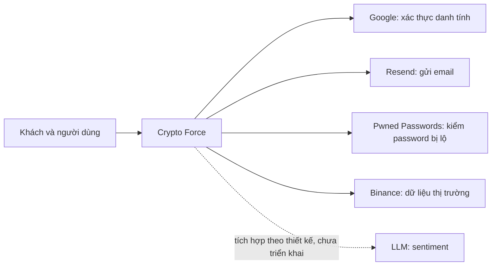
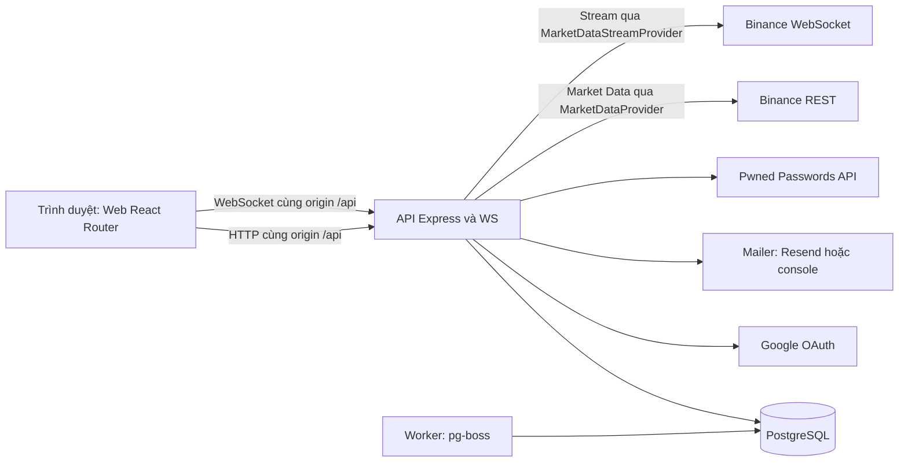

# System Context & Architecture Overview

Đọc file này để biết bối cảnh hệ thống, bức tranh kiến trúc tổng thể và ranh giới của hệ thống.

## Drivers

| Driver | Cơ chế đáp ứng |
| --- | --- |
| Truy cập workspace gắn với tài khoản và phiên (SS-03, SS-04, SS-07) | Web kiểm phiên trước khi tải workspace; API sở hữu dữ liệu xác thực [[1]](#ref-1) |
| Phân tích thị trường, xây dựng và đánh giá strategy | Ranh giới Web/API, Worker và engine thuần tính toán; phần triển khai của từng container nêu bên dưới [[2]](#ref-2) |
| Cập nhật thị trường trực tiếp không tăng tải kết nối nguồn theo số client (QA-05, QA-06, QA-15) | API giữ kết nối trực tiếp tới Binance qua `MarketDataStreamProvider` và fan-out tới trình duyệt qua WebSocket cùng origin (ADR-009 đến ADR-011) [[10]](#ref-10) |
| Tách tính toán nền khỏi request phục vụ UI | Worker process riêng và queue PostgreSQL; chưa có pipeline nghiệp vụ được đăng ký [[2]](#ref-2) |

## Thành phần

### Bối cảnh

### Container

Các kết nối nét liền trong sơ đồ là cơ chế đã có trong source; kết nối nét đứt là tích hợp theo thiết kế đã duyệt (chưa triển khai trong source). Việc một integration có code không khẳng định dịch vụ đó đã được cấu hình trên môi trường deploy.

| Container/package | Trách nhiệm | Phần đã triển khai |
| --- | --- | --- |
| Web | Render UI, điều hướng, giữ server state và duy trì kết nối WebSocket phía client | Landing, Auth, màn 404, workspace layout/header, lớp chặn phiên và Realtime tải lịch sử qua REST kèm cập nhật trực tiếp qua WebSocket (đệm sự kiện, hợp nhất và REST backfill); các tab nghiệp vụ khác là placeholder |
| API | HTTP/WebSocket boundary, orchestration, truy cập dữ liệu và gọi provider dữ liệu thị trường | Better Auth, health, cấu hình Auth công khai, security headers, logging, error handling, Market Data REST qua Binance adapter có cache và Market Data WebSocket qua `MarketDataWsGateway`, `MarketDataStreamHub`, `WsSessionService` và `BinanceStreamProvider` [[10]](#ref-10) |
| PostgreSQL | Persistence của ứng dụng và queue | Schema ứng dụng gồm dữ liệu tài khoản/phiên và rate limit; pg-boss quản lý schema queue riêng |
| Worker | Thực thi job nền ngoài vòng đời HTTP request | Khởi động/dừng pg-boss; chưa đăng ký job handler |
| `packages/shared` | Contracts và validation dùng chung | Schema Auth, environment, Market Data REST, metadata pair và schema khung thông điệp WebSocket [[3]](#ref-3) |
| `packages/engine` | Tính toán domain tất định, không I/O | Entry point chưa export module tính toán |

Nguồn hiện trạng: bootstrap API/Worker, route config và entry point engine [[3]](#ref-3). Worker không nằm trên đường xử lý request Auth hoặc Market Data hiện tại.

Web dùng SPA cho ứng dụng và prerender Landing; cấu hình render nằm tại `apps/web/react-router.config.ts`. Trong development, Vite proxy `/api` (kèm `ws: true`) tới API; khi deploy cần reverse proxy định tuyến cùng origin cho cả HTTP và WebSocket của `/api`. Cookie và ràng buộc reverse proxy nằm trong Security [[4]](#ref-4).

### Web và App shell

| Nhóm route | Cơ chế |
| --- | --- |
| Landing `/` và route không tồn tại | Public; không nằm dưới workspace layout |
| `/sign-in`, `/sign-up`, `/sign-up/verify`, `/forgot-password`, `/reset-password` | Auth layout đọc session và cấu hình Google; xử lý đích `next` qua `getSafeNext` |
| `/realtime`, `/strategy`, `/discovery`, `/backtest`, `/news` | Workspace layout kiểm session trước loader con, cấp user cho AppHeader và render Outlet |

Route config và layout nằm tại `apps/web/app/routes.ts`, `routes/auth-layout.tsx` và `routes/workspace-layout.tsx`. AppHeader dùng chung trong workspace; các control phụ thuộc Search, backtest và thị trường được bổ sung theo flow tương ứng [[5]](#ref-5).

## Ranh giới trách nhiệm

Trình duyệt trao đổi dữ liệu với API qua HTTP và WebSocket cùng origin; API giữ credential dịch vụ ngoài, kết nối tới Binance và kết nối database. Package shared không sở hữu persistence; engine không sở hữu I/O. Worker và API là process riêng, không dùng việc API trả được HTTP để suy ra Worker sẵn sàng [[2]](#ref-2).

Kiểm phiên ở Web phục vụ điều hướng và hiển thị, không thay thế authorization của API. Quyết định middleware trước loader con nằm trong ADR về màn chặn workspace [[6, ADR-001]](#ref-6). Trạng thái truy cập và vòng đời process, kết nối WebSocket được mô tả trong System States & Lifecycle [[7]](#ref-7).

## Quyết định

| Hạng mục | Quyết định |
| --- | --- |
| Ranh giới runtime | Web, API và Worker tách biệt; PostgreSQL cung cấp persistence cho backend |
| Ranh giới package | Shared cung cấp contract HTTP và WebSocket; engine chứa tính toán domain, không phụ thuộc hạ tầng I/O [[2]](#ref-2) |
| Dữ liệu và contract | ERD, constraints và migration nằm trong Database [[8]](#ref-8); endpoint HTTP và giao thức WebSocket nằm trong API Contracts [[9]](#ref-9) |

## Rủi ro

- `/api/health` chỉ chứng minh Express trả được response, không kiểm PostgreSQL, Worker, kết nối Binance WebSocket hoặc dịch vụ ngoài; không dùng nó để kết luận toàn hệ thống sẵn sàng.
- Các flow nghiệp vụ và backend của Strategy/Backtest thuộc increment sau [[5]](#ref-5).

## References

1. [Authentication](../UCs/authentication.md)
2. [Project: Crypto Force](../../AGENTS.md) và [Project Brief](../UCs/sources/project-brief.md)
3. [API bootstrap](../../apps/api/src/index.ts), [Worker bootstrap](../../apps/worker/src/index.ts), [Web routes](../../apps/web/app/routes.ts), [Engine entry point](../../packages/engine/src/index.ts) và [Shared exports](../../packages/shared/src/index.ts)
4. [Security](23-security.md)
5. [Prototype → Implementation Roadmap](../build/01-prototype-to-implementation/draft/implementation-plan/roadmap.md)
6. [Architectural Decisions](30-decisions.md)
7. [System States & Lifecycle](20-state-machine.md)
8. [Data Model & Persistence](21-database.md)
9. [API & Realtime Communication Contracts](22-api-endpoints.md)
10. [Market Data & Realtime Updates](10-market-data.md)
