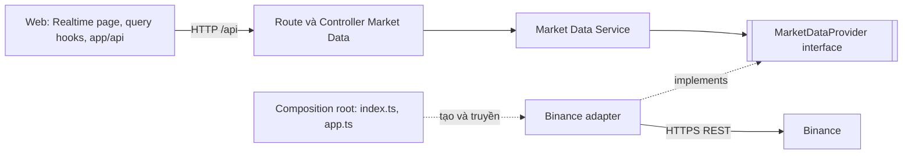
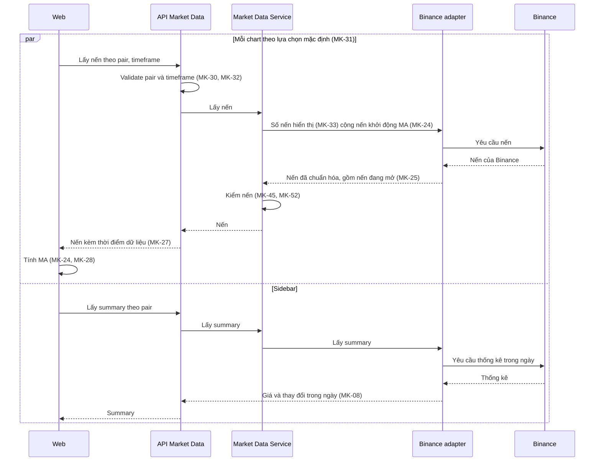
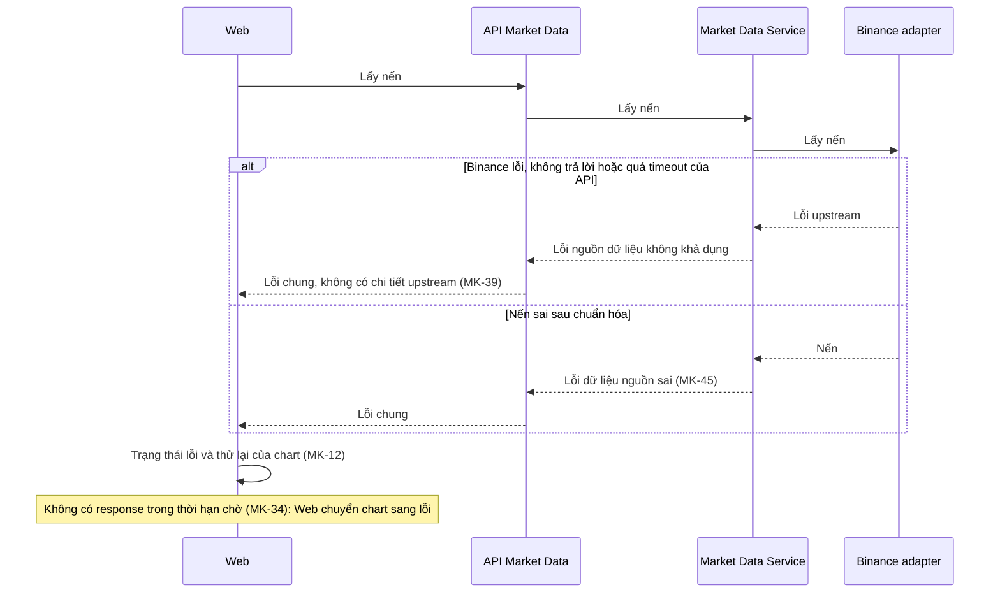

# Market Data & Realtime Updates

Đọc file này để biết cách hệ thống lấy và cập nhật historical, realtime market data, hỗ trợ nhiều timeframe và xử lý khi mất kết nối.

> **Trạng thái:** thiết kế cho vòng REST tải lịch sử, chưa triển khai. Web hiện dùng dữ liệu mock qua MSW; `apps/api` chưa có code Market Data [[1]](#ref-1). Cập nhật định kỳ và WebSocket được thiết kế ở vòng sau, file này giữ chỗ cho các phần đó.

## Drivers

| Driver | Cơ chế đáp ứng |
| --- | --- |
| Thêm provider thứ hai mà frontend không đổi (QA-09) | Service chỉ phụ thuộc interface `MarketDataProvider`; adapter chuẩn hóa dữ liệu provider sang kiểu domain. Provider được truyền từ composition root ([Provider và cách thay thế](#provider-và-cách-thay-thế), ADR-003) |
| Mở Realtime với các chart mặc định trong thời gian mục tiêu (QA-10, MK-31) | Mỗi chart và sidebar gửi request riêng, chạy song song ([Mở Realtime](#mở-realtime)) |
| Đổi timeframe chỉ tải lại chart tương ứng (QA-11, MK-06) | Request và cache phía Web theo khóa pair và timeframe của từng chart |
| Lịch sử gồm nến đang mở, giới hạn số nến trên chart (MK-25, MK-33) | Provider trả số nến gần nhất theo yêu cầu, gồm nến đang mở |
| Mỗi chart hiển thị thời điểm dữ liệu của nó (MK-27) | Response lịch sử nến có `dataTime` ([Contract nến](#contract-nến-và-chuẩn-hóa)); Web hiển thị |
| Giá hiển thị theo số chữ số thập phân của pair (MK-44) | Metadata pair trong `packages/shared` có số chữ số thập phân của giá (ADR-005) |
| MA phủ mọi nến đang hiển thị, tính cả nến đang mở (MK-01, MK-24, MK-28, MK-36) | API trả thêm các nến khởi động MA trước cửa sổ hiển thị; Web tính MA (ADR-004) |
| Không vẽ nến sai, thời gian mở đúng (MK-45, MK-52) | Service kiểm nến sau khi chuẩn hóa; vi phạm trả lỗi dữ liệu nguồn ([Xử lý lỗi](#xử-lý-lỗi)) |
| OHLCV khớp nguồn (MK-51) | Adapter chỉ đổi kiểu và tên trường, không làm tròn hoặc tính lại giá trị OHLCV; test chuẩn hóa của adapter so với response mẫu của provider |
| Không lấp khoảng trống (MK-35) | Adapter và service không tạo nến; chỉ trả nến provider có |
| Giá và thay đổi trong ngày không phụ thuộc timeframe; lỗi sidebar tách khỏi chart (MK-08, MK-18) | Thao tác summary riêng trên provider và request riêng từ Web |
| Thời hạn chờ trước khi báo lỗi, thử lại riêng từng chart (MK-12, MK-34) | Web đo thời hạn chờ; API đặt timeout gọi provider ngắn hơn để trả lỗi có phân loại trước ([Xử lý lỗi](#xử-lý-lỗi)) |
| Lỗi không lộ chi tiết kỹ thuật (MK-39) | Response lỗi chỉ có mã và thông điệp chung; chi tiết upstream chỉ nằm trong log |
| Chỉ hiển thị dữ liệu của lựa chọn hiện tại (MK-14, MK-17) | Web gắn dữ liệu với khóa pair và timeframe của request; response của khóa cũ không hiển thị cho khóa mới |
| Chỉ chọn pair và timeframe được hỗ trợ (MK-30, MK-32) | API validate pair và timeframe bằng schema dùng chung trước khi gọi provider. Schema hiện có chưa khớp rule, xem [Rủi ro và giới hạn](#rủi-ro-và-giới-hạn) |
| Phiên hết hạn khi xem Realtime (MK-40) | Endpoint Market Data yêu cầu phiên và trả 401 khi phiên không hợp lệ; Web chuyển sang màn chặn workspace (ADR-001). Contract trong API Contracts [[4]](#ref-4) |
| Hiển thị, accessibility và màn hình hẹp (MK-02, MK-10, MK-11, MK-15, MK-26, MK-38, MK-41 đến MK-43, MK-46 đến MK-50, MK-58 đến MK-62) | Thuộc Web; không cần cơ chế backend ngoài nến và thời điểm dữ liệu |

## Thành phần và ranh giới

| Thành phần | Vị trí đề xuất | Trách nhiệm | Không làm |
| --- | --- | --- | --- |
| Web Market Data | `apps/web/app/api/market-data.ts`, `hooks/useMarketData.ts`, `pages/Realtime` (đã có, dùng mock) | Gọi API theo pair và timeframe, đo thời hạn chờ, tính MA, hiển thị trạng thái | Gọi Binance; biết provider nào đang dùng |
| Route và Controller | `apps/api/src/api/routes/market-data.route.ts`, `api/controllers/market-data.controller.ts` | Validate query bằng schema của `packages/shared`, gọi service, trả response | Gọi provider trực tiếp |
| Market Data Service | `apps/api/src/services/market-data.service.ts` | Tính số nến cần lấy, gọi provider, kiểm nến, phân loại lỗi, ghi log ngữ cảnh | Phụ thuộc Express hoặc kiểu dữ liệu của Binance |
| `MarketDataProvider` | `apps/api/src/providers/market-data/market-data-provider.ts` | Interface và kiểu domain mà mọi provider trả về | Chứa logic của một provider cụ thể |
| Binance adapter | `apps/api/src/providers/market-data/binance.provider.ts` | Gọi Binance, áp timeout, chuẩn hóa response sang kiểu domain | Kiểm nghiệp vụ; tạo nến thiếu; import Express, `services/`, `repositories/`, `database/` |
| Composition root | `apps/api/src/index.ts`, `app.ts`, `api/routes/index.ts` | Tạo provider từ cấu hình và truyền qua `AppDependencies`, `ApiRouterDependencies` | — |

`providers/` là layer mới ngang hàng với `repositories/`: repository là đầu ra tới PostgreSQL, provider là đầu ra tới API bên ngoài. Chuẩn hóa dữ liệu Binance nằm trong adapter, không nằm trong `mappers/`, để kiểu dữ liệu của Binance không ra khỏi adapter. Ranh giới import cần thêm vào `eslint.config.js` cùng lúc với folder [[2, Dependency rules]](#ref-2):

| Layer | Import `providers/` | Bị `providers/` import |
| --- | --- | --- |
| Route, Controller | Không; đi qua Service | Không |
| Service | Có, chỉ file interface; không import file adapter | Không |
| Repository, `database/` | Không | Không |
| `configs/` | — | Có, để đọc cấu hình provider |

`providers/` cũng không import Express. Interface và adapter nằm cùng folder, nên rule cho Service chặn theo tên file adapter, không chặn cả folder.

## Provider và cách thay thế

Interface gồm hai thao tác. Kiểu domain nằm trong [Contract nến và chuẩn hóa](#contract-nến-và-chuẩn-hóa).

| Thao tác | Input | Output | Driver |
| --- | --- | --- | --- |
| Lấy nến | Pair, timeframe, số nến gần nhất | Danh sách nến đã chuẩn hóa theo thời gian mở tăng dần, gồm nến đang mở và dấu hiệu nến đang mở | MK-25, MK-33 |
| Lấy summary | Pair | Giá gần nhất và thay đổi trong ngày | MK-08 |

Khi thêm hoặc đổi provider:

| Phần | Thay đổi |
| --- | --- |
| Adapter mới trong `providers/market-data/` | Viết mới: gọi provider, timeout, chuẩn hóa sang kiểu domain |
| Composition root | Chọn adapter theo cấu hình |
| Service, Controller, Route, contract `packages/shared` | Không đổi |
| Web | Không đổi (QA-09) |

Kiểm chứng ranh giới không cần provider thật thứ hai. Integration test tạo app với một provider giả lập cài cùng interface và trả dữ liệu cố định, kể cả dữ liệu sai và lỗi. Test chứng minh service và API hoạt động chỉ dựa trên interface. Test riêng cho adapter Binance kiểm phần chuẩn hóa với response mẫu của Binance.

## Contract nến và chuẩn hóa

Kiểu domain là kiểu mà mọi provider trả cho Service và API trả cho Web. Schema Zod của các kiểu này nằm trong `packages/shared` và là nguồn duy nhất của contract; endpoint trong API Contracts tham chiếu kiểu này [[4]](#ref-4).

### Nến

| Trường | Kiểu | Ý nghĩa | Driver |
| --- | --- | --- | --- |
| `openTime` | integer, epoch millisecond UTC | Thời gian mở của nến; khóa của nến trong một lịch sử | MK-52 |
| `open`, `high`, `low`, `close` | JSON number, dương | Giá theo quote asset, giữ nguyên giá trị của provider | MK-51 |
| `volume` | JSON number, không âm | Volume theo base asset | MK-23, MK-51 |
| `isClosed` | boolean | `false` cho nến đang mở; chỉ nến cuối có thể là `false` | MK-25, MK-26, MK-28 |

Giá và volume dùng JSON number, vì engine tính bằng float64 và Web vẽ bằng number. Adapter đổi chuỗi thập phân của provider sang number, không làm tròn. Số chữ số thập phân khi hiển thị lấy từ metadata pair, không suy ra từ giá trị (ADR-005).

### Lịch sử nến

| Trường | Kiểu | Ý nghĩa | Driver |
| --- | --- | --- | --- |
| `pair`, `timeframe` | Enum dùng chung | Lặp lại lựa chọn của request để Web bỏ response không khớp | MK-14, MK-17 |
| `candles` | Mảng nến, `openTime` tăng dần, không trùng | Nến khởi động MA, sau đó là nến hiển thị | MK-24, MK-33, MK-52 |
| `warmupCount` | integer, không âm | Số nến đầu mảng chỉ dùng tính MA, Web không vẽ | MK-24, ADR-004 |
| `dataTime` | integer, epoch millisecond UTC | Thời điểm API nhận response của provider | MK-27 |

Service yêu cầu provider số nến hiển thị (MK-33) cộng số nến khởi động (mẫu của MK-24 trừ một). Khi provider trả ít nến hơn, Service đặt `warmupCount` bằng số nến vượt quá số nến hiển thị, tối thiểu là 0. Như vậy chart vẫn hiển thị đủ nến có thật và MA thiếu mẫu ở các nến đầu (MK-15, MK-24).

### Summary

| Trường | Kiểu | Ý nghĩa | Driver |
| --- | --- | --- | --- |
| `pair` | Enum dùng chung | Lặp lại lựa chọn của request | MK-17 |
| `lastPrice` | JSON number, dương | Giá gần nhất | MK-08 |
| `change24hPercent` | JSON number | Phần trăm thay đổi trong 24 giờ gần nhất | MK-08 |

### Chuẩn hóa từ Binance

Adapter Binance đọc REST API Spot [[8]](#ref-8):

| Kiểu domain | Nguồn Binance | Quy tắc |
| --- | --- | --- |
| Nến | `GET /api/v3/klines`, mảng 12 phần tử; dùng vị trí 0 đến 6: thời gian mở, open, high, low, close, volume, thời gian đóng. Giá và volume là chuỗi, thời gian là integer millisecond | Đổi chuỗi sang number. `isClosed` là `true` khi thời gian đóng nhỏ hơn `dataTime`. Bỏ các trường còn lại |
| Summary | `GET /api/v3/ticker/24hr`, `lastPrice`, `priceChangePercent` | Đổi chuỗi sang number |
| `dataTime` | Đồng hồ của API lúc nhận response | Không dùng thời gian của Binance |

Adapter không kiểm nghiệp vụ. Service kiểm nến sau chuẩn hóa ([Xử lý lỗi](#xử-lý-lỗi)).

## Luồng xử lý

### Mở Realtime

Đổi timeframe đi qua cùng luồng lấy nến cho một chart (MK-06, QA-11). Đổi pair chạy lại toàn bộ luồng với pair mới; Web bỏ response của pair cũ (MK-17).

### Xử lý lỗi

| Nhóm lỗi | Nguồn | Nơi phát hiện | Người dùng thấy |
| --- | --- | --- | --- |
| Input không hợp lệ | Pair hoặc timeframe ngoài tập hỗ trợ | Route, Controller | Không xảy ra từ UI; request ngoài UI nhận lỗi validate |
| Nguồn dữ liệu không khả dụng | Lỗi mạng, response lỗi, quá timeout của API | Adapter | Lỗi của chart hoặc sidebar kèm thử lại (MK-12, MK-18) |
| Dữ liệu nguồn sai | Nến vi phạm MK-45 hoặc MK-52 | Service | Lỗi của chart, không vẽ nến (MK-45) |
| Lỗi không lường trước | Bug trong API | Error handler chung | Lỗi của chart kèm thử lại |

Lỗi đã phân loại là `AppError`; error handler hiện có chỉ trả `code` và `message` của `AppError`, lỗi khác trả lỗi chung [[3]](#ref-3). Mã HTTP và `code` của từng nhóm nằm trong API Contracts [[4]](#ref-4).

Timeout gọi provider của API phải ngắn hơn thời hạn chờ của chart (MK-34). Khi đó API kịp trả lỗi có phân loại và log trước khi Web tự hết hạn. Giá trị timeout là cấu hình của API.

## Observability

Mục tiêu là phân biệt ba nguyên nhân khi chart chậm hoặc lỗi: upstream, xử lý backend và phía client.

| Bằng chứng | Nơi ghi | Trường |
| --- | --- | --- |
| Request HTTP | `pino-http` hiện có trong `app.ts` [[5]](#ref-5) | Method, URL, status, thời gian response |
| Kết quả Market Data | Một log của service cho mỗi request | Pair, timeframe, số nến yêu cầu và nhận, thời gian gọi provider, tổng thời gian service, kết quả, nhóm lỗi |
| Chi tiết lỗi upstream | Log của service, mức warn | Status hoặc lỗi mạng của provider; không đưa vào response (MK-39) |
| Nến sai | Log của service, mức error | Pair, timeframe, loại vi phạm, thời gian mở của nến sai |
| Thời gian phía client | Test hiệu năng của Web | Từ thao tác tới lúc chart có nến (QA-10, QA-11) |

Cách đọc: thời gian provider gần bằng tổng thời gian thì nguyên nhân ở upstream. Tổng thời gian service lớn hơn nhiều thời gian provider thì nguyên nhân ở backend. Thời gian client lớn hơn nhiều thời gian response thì nguyên nhân ở client hoặc mạng. Vòng REST chưa thêm hệ thống metric riêng. Vòng WebSocket mở rộng bảng này cho kết nối và độ trễ event (QA-05, QA-06).

## Quyết định

| Hạng mục | Quyết định |
| --- | --- |
| Vị trí provider và cách truyền | Layer `providers/` trong `apps/api`, truyền từ composition root [[6, ADR-003]](#ref-6) |
| Nơi tính MA | Web tính từ nến API trả; API trả thêm nến khởi động MA [[6, ADR-004]](#ref-6) |
| Kiểm nến | Service kiểm sau chuẩn hóa, trước khi trả Web |
| Request của Web | Mỗi chart một request, summary một request riêng |
| Quyền truy cập | Endpoint Market Data yêu cầu phiên [[4]](#ref-4) |
| Số chữ số thập phân của pair | Hằng số trong metadata pair của `packages/shared` [[6, ADR-005]](#ref-6) |
| Số nến | Server quyết định; client không gửi số nến [[4]](#ref-4) |

## Rủi ro và giới hạn

- Binance giới hạn số request theo IP. Mỗi lần mở Realtime gửi một request cho mỗi chart và một request summary, chưa có cache. Thiết kế cache và cách xử lý giới hạn request thuộc bước thiết kế database và cache.
- QA-10 và QA-11 còn Proposed. Thiết kế chưa có số đo để chứng minh đạt ngưỡng.
- Interface `MarketDataProvider` nằm trong `apps/api`. Worker không dùng được interface này khi backtest cần dữ liệu thị trường (ADR-003).
- Schema nháp `packages/shared/src/schemas/market-data.schema.ts` của UI mock chưa khớp contract nến: thiếu timeframe 1d (MK-30), có `ma20` (ngược ADR-004), thiếu `isClosed`, `warmupCount` và `dataTime`. Schema được sửa ở bước build [[7]](#ref-7).
- Summary không có thời điểm dữ liệu, vì MK-27 chỉ áp dụng cho chart và MK-60 không yêu cầu thời điểm trên sidebar. Thêm trường này không phá contract hiện có.
- Mỗi request Market Data gọi `getSession` và đọc phiên từ PostgreSQL, vì cấu hình Better Auth không bật cookie cache [[9]](#ref-9). Xem lại khi đo QA-10.
- `isClosed` và `dataTime` dựa vào đồng hồ của API. Đồng hồ lệch với Binance có thể đánh dấu sai nến cuối gần thời điểm đóng.
- Thiết kế chưa mô tả cập nhật định kỳ, WebSocket và phục hồi kết nối.

## References

1. [Kế hoạch dựng frontend Realtime bằng mock](../build/01-prototype-to-implementation/market-data/work/step-02-mock-frontend/plan.md)
2. [Project Structure](../conventions/project-structure.md)
3. `apps/api/src/api/middlewares/error-handler.middleware.ts`, `apps/api/src/errors/app-error.ts` tại commit `298d585`
4. [API Contracts](22-api-endpoints.md)
5. `apps/api/src/app.ts` tại commit `298d585`
6. [Architectural Decisions](30-decisions.md)
7. `packages/shared/src/schemas/market-data.schema.ts` tại commit `298d585`
8. Binance Spot API, Market Data endpoints, đọc ngày 2026-11-20. <https://developers.binance.com/docs/binance-spot-api-docs/rest-api/market-data-endpoints>
9. `apps/api/src/configs/auth.ts` tại commit `3b9ca0e`
