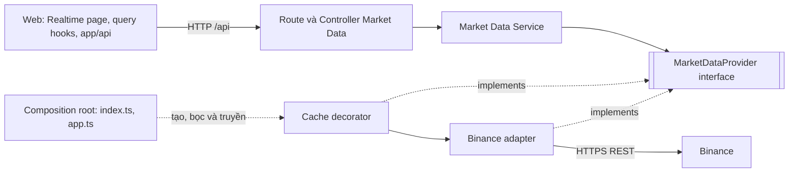
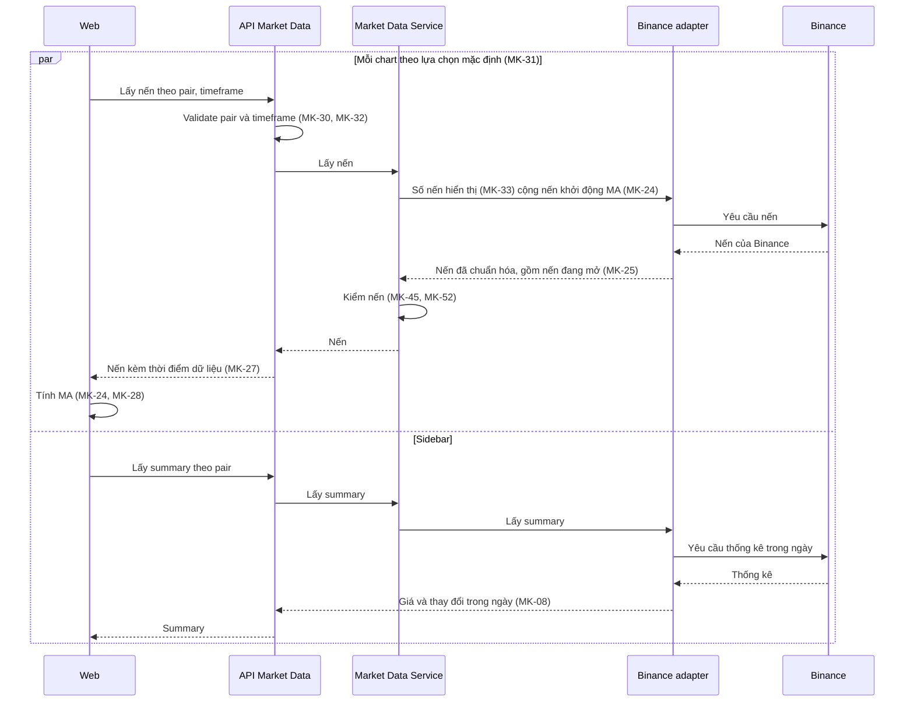
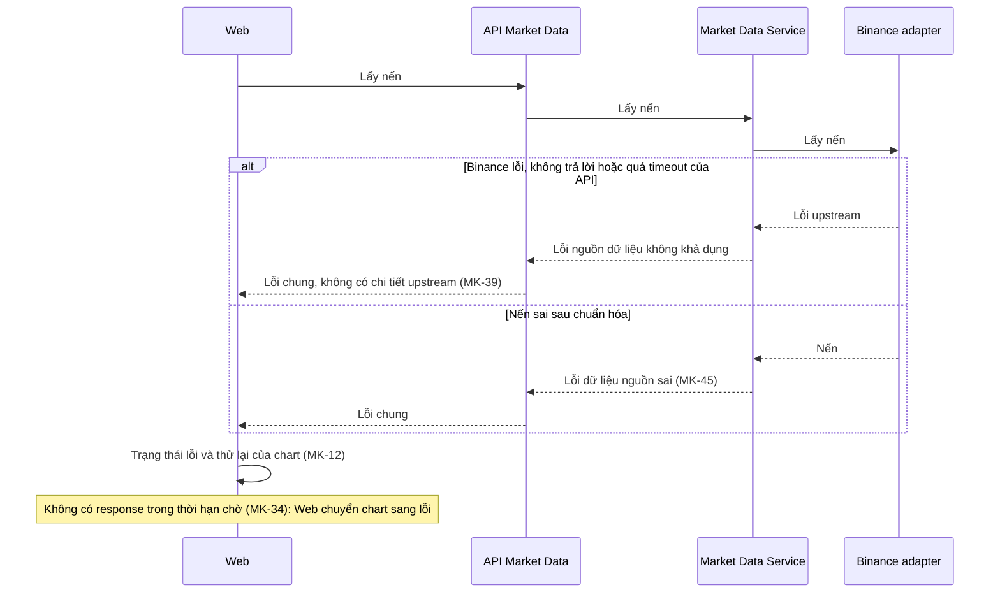

# Market Data & Realtime Updates

Đọc file này để biết cách hệ thống lấy và cập nhật historical, realtime market data, hỗ trợ nhiều timeframe và xử lý khi mất kết nối.

> **Trạng thái:** vòng REST tải lịch sử đã triển khai theo thiết kế trong file này. Web gọi API thật; API gọi Binance qua cache decorator và Binance adapter tạo tại `apps/api/src/index.ts` [[1]](#ref-1). Kết quả kiểm chứng nằm trong [Kiểm chứng REST tải lịch sử](../testing/test-scopes/TS-002-market-data/rest-verification.md#kết-quả-thực-chạy). Cập nhật định kỳ và WebSocket được thiết kế ở vòng sau, file này giữ chỗ cho các phần đó.

## Drivers

| Driver | Cơ chế đáp ứng |
| --- | --- |
| Thêm provider thứ hai mà frontend không đổi (QA-09) | Service chỉ phụ thuộc interface `MarketDataProvider`; adapter chuẩn hóa dữ liệu provider sang kiểu domain. Provider được truyền từ composition root ([Provider và cách thay thế](#provider-và-cách-thay-thế), ADR-003) |
| Mở Realtime với các chart mặc định trong thời gian mục tiêu (QA-10, MK-31) | Mỗi chart và sidebar gửi request riêng, chạy song song ([Mở Realtime](#mở-realtime)). Cache ngắn hạn trong API trả ngay khi khóa đã có dữ liệu ([Cache và giới hạn request](#cache-và-giới-hạn-request)) |
| Số request tới Binance không tăng theo số người dùng và không chạm giới hạn theo IP | Cache theo khóa, gộp request trùng, dừng gọi Binance khi bị giới hạn ([Cache và giới hạn request](#cache-và-giới-hạn-request), ADR-006) |
| Đổi timeframe chỉ tải lại chart tương ứng (QA-11, MK-06) | Request và cache phía Web theo khóa pair và timeframe của từng chart |
| Lịch sử gồm nến đang mở, giới hạn số nến trên chart (MK-25, MK-33) | Provider trả số nến gần nhất theo yêu cầu, gồm nến đang mở |
| Mỗi chart hiển thị thời điểm dữ liệu của nó (MK-27) | Response lịch sử nến có `dataTime` ([Contract nến](#contract-nến-và-chuẩn-hóa)); Web hiển thị |
| Giá hiển thị theo số chữ số thập phân của pair (MK-44) | Metadata pair trong `packages/shared` có số chữ số thập phân của giá (ADR-005) |
| MA phủ mọi nến đang hiển thị, tính cả nến đang mở (MK-01, MK-24, MK-28, MK-36) | API trả thêm các nến khởi động MA trước cửa sổ hiển thị; Web tính MA (ADR-004) |
| Không vẽ nến sai, thời gian mở đúng (MK-45, MK-52) | Service kiểm nến sau khi chuẩn hóa; vi phạm trả lỗi dữ liệu nguồn ([Xử lý lỗi](#xử-lý-lỗi)) |
| OHLCV khớp nguồn (MK-51) | Adapter chỉ đổi kiểu và tên trường, không làm tròn hoặc tính lại giá trị OHLCV; test chuẩn hóa của adapter so với response mẫu của provider |
| Không lấp khoảng trống (MK-35) | Adapter và service không tạo nến; chỉ trả nến provider có |
| Giá và thay đổi trong ngày không phụ thuộc timeframe; lỗi sidebar tách khỏi chart (MK-08, MK-18) | Thao tác summary riêng trên provider và request riêng từ Web |
| Thời hạn chờ trước khi báo lỗi, thử lại riêng từng chart (MK-12, MK-34) | Web đo thời hạn chờ; API đặt timeout gọi provider ngắn hơn để trả lỗi có phân loại trước ([Xử lý lỗi](#xử-lý-lỗi)) |
| Lỗi không lộ chi tiết kỹ thuật (MK-39) | Response lỗi chỉ có mã và thông điệp chung; chi tiết upstream chỉ nằm trong log |
| Chỉ hiển thị dữ liệu của lựa chọn hiện tại (MK-14, MK-17) | Web gắn dữ liệu với khóa pair và timeframe của request; response của khóa cũ không hiển thị cho khóa mới |
| Chỉ chọn pair và timeframe được hỗ trợ (MK-30, MK-32) | API validate pair và timeframe bằng schema strict dùng chung trước khi gọi provider |
| Phiên hết hạn khi xem Realtime (MK-40) | Endpoint Market Data yêu cầu phiên và trả 401 khi phiên không hợp lệ; Web chuyển sang màn chặn workspace (ADR-001). Contract trong API Contracts [[4]](#ref-4) |
| Hiển thị, accessibility và màn hình hẹp (MK-02, MK-10, MK-11, MK-15, MK-26, MK-38, MK-41 đến MK-43, MK-46 đến MK-50, MK-58 đến MK-62) | Thuộc Web; không cần cơ chế backend ngoài nến và thời điểm dữ liệu |

## Thành phần và ranh giới

| Thành phần | Vị trí | Trách nhiệm | Không làm |
| --- | --- | --- | --- |
| Web Market Data | `apps/web/app/api/market-data.ts`, `hooks/useMarketData.ts`, `pages/Realtime` | Gọi API theo pair và timeframe, đo thời hạn chờ, tính MA, hiển thị trạng thái | Gọi Binance; biết provider nào đang dùng |
| Route, Controller và middleware phiên | `apps/api/src/api/routes/market-data.route.ts`, `api/controllers/market-data.controller.ts`, `api/middlewares/session.middleware.ts` | Kiểm phiên, validate query bằng schema của `packages/shared`, gọi service, trả response | Gọi provider trực tiếp |
| Market Data Service | `apps/api/src/services/market-data.service.ts` | Tính số nến cần lấy, gọi provider, kiểm nến, phân loại lỗi, ghi log ngữ cảnh | Phụ thuộc Express hoặc kiểu dữ liệu của Binance |
| `MarketDataProvider` | `apps/api/src/providers/market-data/market-data-provider.ts` | Interface và kiểu domain mà mọi provider trả về | Chứa logic của một provider cụ thể |
| Binance adapter | `apps/api/src/providers/market-data/binance.provider.ts` | Gọi Binance, áp timeout, chuẩn hóa response sang kiểu domain | Kiểm nghiệp vụ; tạo nến thiếu; import Express, `services/`, `repositories/`, `database/` |
| Cache decorator | `apps/api/src/providers/market-data/cached-market-data.provider.ts` | Cài `MarketDataProvider`, bọc provider khác: cache theo khóa, gộp request trùng | Biết provider cụ thể; kiểm nghiệp vụ; cache lỗi |
| Composition root | `apps/api/src/index.ts`, `app.ts`, `api/routes/index.ts` | Tạo provider từ cấu hình và truyền qua `AppDependencies`, `ApiRouterDependencies` | — |

`providers/` là layer mới ngang hàng với `repositories/`: repository là đầu ra tới PostgreSQL, provider là đầu ra tới API bên ngoài. Chuẩn hóa dữ liệu Binance nằm trong adapter, không nằm trong `mappers/`, để kiểu dữ liệu của Binance không ra khỏi adapter. Ranh giới import cần thêm vào `eslint.config.js` cùng lúc với folder [[2, Dependency rules]](#ref-2):

| Layer | Import `providers/` | Bị `providers/` import |
| --- | --- | --- |
| Route, Controller | Không; đi qua Service | Không |
| Service | Có, chỉ file interface; không import file adapter | Không |
| Repository, `database/` | Không | Không |
| `configs/` | — | Có, để đọc cấu hình provider |

`providers/` cũng không import Express. Interface và adapter nằm cùng folder, nên rule cho Service chặn theo tên file adapter, không chặn cả folder.

## Provider và cách thay thế

Interface gồm hai thao tác. Kiểu domain nằm trong [Contract nến và chuẩn hóa](#contract-nến-và-chuẩn-hóa).

| Thao tác | Input | Output | Driver |
| --- | --- | --- | --- |
| Lấy nến | Pair, timeframe, số nến gần nhất | Danh sách nến đã chuẩn hóa theo thời gian mở tăng dần, gồm nến đang mở và dấu hiệu nến đang mở | MK-25, MK-33 |
| Lấy summary | Pair | Giá gần nhất và thay đổi trong ngày | MK-08 |

Khi thêm hoặc đổi provider:

| Phần | Thay đổi |
| --- | --- |
| Adapter mới trong `providers/market-data/` | Viết mới: gọi provider, timeout, chuẩn hóa sang kiểu domain |
| Composition root | Chọn adapter theo cấu hình |
| Service, Controller, Route, contract `packages/shared` | Không đổi |
| Web | Không đổi (QA-09) |

Kiểm chứng ranh giới không cần provider thật thứ hai. Integration test tạo app với một provider giả lập cài cùng interface và trả dữ liệu cố định, kể cả dữ liệu sai và lỗi. Test chứng minh service và API hoạt động chỉ dựa trên interface. Test riêng cho adapter Binance kiểm phần chuẩn hóa với response mẫu của Binance.

## Contract nến và chuẩn hóa

Kiểu domain là kiểu mà mọi provider trả cho Service và API trả cho Web. Schema Zod của các kiểu này nằm trong `packages/shared` và là nguồn duy nhất của contract; endpoint trong API Contracts tham chiếu kiểu này [[4]](#ref-4).

### Nến

| Trường | Kiểu | Ý nghĩa | Driver |
| --- | --- | --- | --- |
| `openTime` | integer, epoch millisecond UTC | Thời gian mở của nến; khóa của nến trong một lịch sử | MK-52 |
| `open`, `high`, `low`, `close` | JSON number, dương | Giá theo quote asset, giữ nguyên giá trị của provider | MK-51 |
| `volume` | JSON number, không âm | Volume theo base asset | MK-23, MK-51 |
| `isClosed` | boolean | `false` cho nến đang mở; chỉ nến cuối có thể là `false` | MK-25, MK-26, MK-28 |

Giá và volume dùng JSON number, vì engine tính bằng float64 và Web vẽ bằng number. Adapter đổi chuỗi thập phân của provider sang number, không làm tròn. Số chữ số thập phân khi hiển thị lấy từ metadata pair, không suy ra từ giá trị (ADR-005).

### Lịch sử nến

| Trường | Kiểu | Ý nghĩa | Driver |
| --- | --- | --- | --- |
| `pair`, `timeframe` | Enum dùng chung | Lặp lại lựa chọn của request để Web bỏ response không khớp | MK-14, MK-17 |
| `candles` | Mảng nến, `openTime` tăng dần, không trùng | Nến khởi động MA, sau đó là nến hiển thị | MK-24, MK-33, MK-52 |
| `warmupCount` | integer, không âm | Số nến đầu mảng chỉ dùng tính MA, Web không vẽ | MK-24, ADR-004 |
| `dataTime` | integer, epoch millisecond UTC | Thời điểm API nhận response của provider | MK-27 |

Service yêu cầu provider số nến hiển thị (MK-33) cộng số nến khởi động (mẫu của MK-24 trừ một). Khi provider trả ít nến hơn, Service đặt `warmupCount` bằng số nến vượt quá số nến hiển thị, tối thiểu là 0. Như vậy chart vẫn hiển thị đủ nến có thật và MA thiếu mẫu ở các nến đầu (MK-15, MK-24).

Provider phải trả tối đa `limit` nến. Adapter Binance truyền nguyên `limit` vào query upstream và từ chối response vượt giới hạn trước khi trả snapshot. Service cũng kiểm giới hạn khi nhận dữ liệu từ provider. Response vượt giới hạn là dữ liệu nguồn sai: API trả `502 / MARKET_DATA_INVALID`, không cắt phần dư. Đây là kiểm tra phòng vệ cho vi phạm contract. Response bị adapter từ chối không được cache.

### Summary

| Trường | Kiểu | Ý nghĩa | Driver |
| --- | --- | --- | --- |
| `pair` | Enum dùng chung | Lặp lại lựa chọn của request | MK-17 |
| `lastPrice` | JSON number, dương | Giá gần nhất | MK-08 |
| `change24hPercent` | JSON number | Phần trăm thay đổi trong 24 giờ gần nhất | MK-08 |

### Chuẩn hóa từ Binance

Adapter Binance đọc REST API Spot [[7]](#ref-7):

| Kiểu domain | Nguồn Binance | Quy tắc |
| --- | --- | --- |
| Nến | `GET /api/v3/klines`, mảng 12 phần tử; dùng vị trí 0 đến 6: thời gian mở, open, high, low, close, volume, thời gian đóng. Giá và volume là chuỗi, thời gian là integer millisecond | Đổi chuỗi sang number. `isClosed` là `true` khi thời gian đóng nhỏ hơn `dataTime`. Bỏ các trường còn lại |
| Summary | `GET /api/v3/ticker/24hr`, `lastPrice`, `priceChangePercent` | Đổi chuỗi sang number |
| `dataTime` | Đồng hồ của API lúc nhận response | Không dùng thời gian của Binance |

Adapter từ chối payload không parse được JSON hoặc không đọc được các trường nguồn cần dùng. Adapter báo lỗi dữ liệu nguồn có kiểu để API trả `502 / MARKET_DATA_INVALID`, không lộ payload upstream. Response lỗi không được cache. Adapter không kiểm nghiệp vụ. Service kiểm nến sau chuẩn hóa ([Xử lý lỗi](#xử-lý-lỗi)).

## Cache và giới hạn request

Vòng REST không lưu dữ liệu Market Data vào PostgreSQL ([Data Model](21-database.md), ADR-006). Cache phía server nằm trong bộ nhớ process API, trong một decorator cài cùng interface `MarketDataProvider`. Composition root bọc adapter Binance bằng decorator này. Service và adapter không biết có cache.

| Thuộc tính | Nến | Summary |
| --- | --- | --- |
| Khóa | `pair` + `timeframe` + số nến yêu cầu | `pair` |
| Thời gian sống (TTL) | 5 giây, cấu hình của API. Tính từ lúc provider resolve thành công | 5 giây, cấu hình của API. Tính từ lúc provider resolve thành công |
| Giá trị cache | Kết quả đã chuẩn hóa của provider, gồm `dataTime` và `isClosed` lúc nhận | Kết quả đã chuẩn hóa của provider |

Quy tắc:

- **Gộp request trùng (single-flight).** Khi khóa chưa có giá trị còn hạn, request đầu tiên gọi provider. Các request cùng khóa đến trong lúc đó chờ chung kết quả này.
- **Không cache lỗi.** Lỗi của provider trả cho mọi request đang chờ, rồi bị bỏ. Request sau gọi lại provider, nên thử lại của chart (MK-12) có hiệu lực ngay.
- **Mốc và biên TTL.** TTL bắt đầu khi provider bên trong resolve thành công, theo clock của API. Mốc này không phải lúc request vào và không phải `dataTime`. Giá trị còn hạn khi thời gian đã qua nhỏ hơn TTL, hết hạn khi thời gian đã qua lớn hơn hoặc bằng TTL. Upstream trả chậm không làm giảm thời gian tái sử dụng. Product owner duyệt ngày 2026-11-21.
- **Không làm mới chủ động.** Giá trị hết hạn bị thay ở request tiếp theo. Vòng REST không tự cập nhật chart (MK-27), nên không cần làm mới nền.
- **`dataTime` và `isClosed` đi cùng giá trị cache.** `dataTime` vẫn là thời điểm API nhận response của provider, không phải thời điểm request, nên chart hiển thị đúng tuổi của dữ liệu (MK-27). Nến đóng trong lúc giá trị còn hạn vẫn có `isClosed: false`, khớp với `dataTime`.
- **Không cache HTTP.** Response giữ `Cache-Control: no-store`. Cache phía Web do TanStack Query quản lý theo khóa của từng chart (MK-14, MK-17) [[4]](#ref-4).

### Giới hạn request của Binance

Binance giới hạn request weight theo IP, không theo API key. Giới hạn hiện hành nằm trong `rateLimits` của `exchangeInfo` [[9]](#ref-9):

| Dữ liệu | Giá trị đọc ngày 2026-11-20 |
| --- | --- |
| Giới hạn `REQUEST_WEIGHT` | 6000 weight mỗi phút mỗi IP |
| Weight của `klines` | 2, với mọi `limit` tới 1000. Số nến yêu cầu là 500 cộng nến khởi động, dưới 1000 |
| Weight của `ticker/24hr` cho một symbol | 2 |

Một lần mở Realtime gửi 4 request nến (MK-31) và 1 request summary, tức 10 weight khi cache trống. Không có cache, khoảng 600 lần mở Realtime mỗi phút sẽ chạm giới hạn. Có cache, mỗi khóa gọi Binance tối đa 12 lần mỗi phút. Với 3 pair (MK-32) và 6 timeframe (MK-30) có 18 khóa nến và 3 khóa summary. Khi provider trả thành công, mức trần là 21 × 12 × 2 = 504 weight mỗi phút, khoảng 8% giới hạn, không phụ thuộc số người dùng. Lỗi không được cache, nên khi Binance lỗi (5xx, timeout, 403), mỗi lần thử lại của người dùng tạo một lời gọi mới; single-flight chỉ gộp các lời gọi đồng thời cùng khóa.

Adapter Binance xử lý tín hiệu giới hạn, vì đó là hành vi riêng của Binance:

| Tín hiệu | Hành vi của adapter | Kết quả với Web |
| --- | --- | --- |
| Header weight đã dùng. Tài liệu Binance ghi mẫu `X-MBX-USED-WEIGHT-(intervalNum)(intervalLetter)`. Smoke Binance thật ngày 2026-11-21 nhận `x-mbx-used-weight-1m` và `x-mbx-used-weight` trên cả request nến và summary [[10]](#ref-10) | Ghi vào log của adapter | Không đổi |
| HTTP 429 hoặc 418 | Đọc `Retry-After` (giây). Không gọi Binance tới hết thời gian đó; mọi lời gọi trong lúc này trả lỗi nguồn không khả dụng ngay | 503 `MARKET_DATA_UNAVAILABLE` [[4]](#ref-4). Khóa có giá trị cache còn hạn được decorator trả, không tới adapter |
| HTTP 403 | Lỗi nguồn không khả dụng | 503 `MARKET_DATA_UNAVAILABLE` |

API không tự thử lại khi Binance lỗi. Thử lại là thao tác của người dùng trên từng chart (MK-12). Binance khóa IP từ 2 phút tới 3 ngày khi client tiếp tục gửi request sau 429 [[9]](#ref-9), nên adapter phải dừng gửi ngay.

## Luồng xử lý

### Mở Realtime

Đổi timeframe đi qua cùng luồng lấy nến cho một chart (MK-06, QA-11). Đổi pair chạy lại toàn bộ luồng với pair mới; Web bỏ response của pair cũ (MK-17).

### Xử lý lỗi

| Nhóm lỗi | Nguồn | Nơi phát hiện | Người dùng thấy |
| --- | --- | --- | --- |
| Input không hợp lệ | Pair hoặc timeframe ngoài tập hỗ trợ | Route, Controller | Không xảy ra từ UI; request ngoài UI nhận lỗi validate |
| Nguồn dữ liệu không khả dụng | Lỗi mạng, response lỗi, quá timeout của API | Adapter | Lỗi của chart hoặc sidebar kèm thử lại (MK-12, MK-18) |
| Dữ liệu nguồn sai | Nến vi phạm MK-45 hoặc MK-52 | Service | Lỗi của chart, không vẽ nến (MK-45) |
| Lỗi không lường trước | Bug trong API | Error handler chung | Lỗi của chart kèm thử lại |

Lỗi đã phân loại là `AppError`; error handler hiện có chỉ trả `code` và `message` của `AppError`, lỗi khác trả lỗi chung [[3]](#ref-3). Mã HTTP và `code` của từng nhóm nằm trong API Contracts [[4]](#ref-4).

Timeout gọi provider của API phải ngắn hơn thời hạn chờ của chart (MK-34). Khi đó API kịp trả lỗi có phân loại và log trước khi Web tự hết hạn. Giá trị timeout là cấu hình của API: composition root đặt 5000 ms. Nguồn: agent đề xuất theo ủy quyền của product owner, theo timeout của harness REST. Lý do: còn khoảng một nửa thời hạn chờ của chart để API trả lỗi [[1]](#ref-1). Tác động: upstream trả chậm hơn 5000 ms nhận `503 / MARKET_DATA_UNAVAILABLE`, dù chart còn chờ được tới hết thời hạn chờ (MK-34). Deadline của adapter bao phủ cả nhận response và đọc body.

Web chỉ đặt thời hạn chờ cho request nến, vì thời hạn chờ (MK-34) chỉ nói về chart. Request summary dựa vào timeout của API để kết thúc. Quyết định này do agent chốt theo ủy quyền của product owner.

## Observability

Mục tiêu là phân biệt ba nguyên nhân khi chart chậm hoặc lỗi: upstream, xử lý backend và phía client.

| Bằng chứng | Nơi ghi | Trường |
| --- | --- | --- |
| Request HTTP | `pino-http` trong `app.ts` [[5]](#ref-5) | Method, path, status, thời gian response. Chỉ bốn path tĩnh của router ứng dụng được ghi nguyên. Path dưới `/api/auth/` ghi dạng `/api/auth/{*splat}`, path khác ghi `/unmatched`, để token trong path (ví dụ link reset password) không vào log. Không ghi query, header phiên hoặc message của lỗi ngoài dự kiến |
| Kết quả Market Data | Một log của service cho mỗi request | Pair, timeframe, số nến yêu cầu và nhận, thời gian gọi provider, tổng thời gian service, kết quả, nhóm lỗi |
| Chi tiết lỗi upstream | Log của service, mức warn | Status hoặc tên/code lỗi mạng của provider, không ghi message hoặc payload; không đưa vào response (MK-39) |
| Nến sai | Log của service, mức error | Pair, timeframe, loại vi phạm, vị trí và thời gian mở của nến sai |
| Cache | Log của decorator, mức debug | Khóa, cache hit hoặc miss, request có chờ chung lời gọi provider hay không |
| Giới hạn Binance | Log của adapter; mức warn khi nhận 429 hoặc 418 | Weight đã dùng, `Retry-After` |
| Thời gian phía client | Test hiệu năng của Web | Từ thao tác tới lúc chart có nến (QA-10, QA-11) |

Cách đọc: thời gian provider gần bằng tổng thời gian thì nguyên nhân ở upstream. Tổng thời gian service lớn hơn nhiều thời gian provider thì nguyên nhân ở backend. Thời gian client lớn hơn nhiều thời gian response thì nguyên nhân ở client hoặc mạng. Vòng REST chưa thêm hệ thống metric riêng. Vòng WebSocket mở rộng bảng này cho kết nối và độ trễ event (QA-05, QA-06).

## Quyết định

| Hạng mục | Quyết định |
| --- | --- |
| Vị trí provider và cách truyền | Layer `providers/` trong `apps/api`, truyền từ composition root [[6, ADR-003]](#ref-6) |
| Nơi tính MA | Web tính từ nến API trả; API trả thêm nến khởi động MA [[6, ADR-004]](#ref-6) |
| Kiểm nến | Service kiểm sau chuẩn hóa, trước khi trả Web |
| Request của Web | Mỗi chart một request, summary một request riêng |
| Quyền truy cập | Endpoint Market Data yêu cầu phiên [[4]](#ref-4) |
| Số chữ số thập phân của pair | Hằng số trong metadata pair của `packages/shared` [[6, ADR-005]](#ref-6) |
| Số nến | Server quyết định; client không gửi số nến [[4]](#ref-4) |
| Lưu trữ và cache | Không lưu Market Data vào PostgreSQL; cache 5 giây trong process API qua decorator của provider [[6, ADR-006]](#ref-6) |
| Giới hạn Binance | Adapter dừng gọi Binance theo `Retry-After` khi nhận 429 hoặc 418; API không tự thử lại |

## Rủi ro và giới hạn

- Cache nằm trong process. Mỗi instance API có cache riêng và tự gọi Binance, nên mức trần weight nhân theo số instance trên cùng IP. Xét lại khi chạy hơn một instance API.
- Mức trần 504 weight mỗi phút chỉ đúng khi tập pair và timeframe giữ nguyên. Thêm pair hoặc timeframe phải tính lại.
- TTL 5 giây mới có số đo hit/miss trên replay local, chưa có số đo độ tươi của dữ liệu. Xem lại khi đo polling.
- Thời gian mở Realtime (QA-10) và đổi timeframe (QA-11) đã đo trên Windows local với replay 50 ms, nhưng kết quả là `Inconclusive`: mốc cuối là lúc chart áp dụng dữ liệu, chưa chứng minh canvas đã vẽ [[11]](#ref-11).
- Baseline local ở mức tải cao nhất có request lỗi do hết thời gian chờ phía máy phát tải. Máy phát tải, API, replay và PostgreSQL chạy cùng máy, nên chưa xác định nguyên nhân thuộc API hay máy đo. Chưa có ngưỡng latency, lỗi hoặc capacity REST được duyệt [[11]](#ref-11).
- Better Auth bật rate limit lưu trong database [[8]](#ref-8). Ngoài rule riêng cho Sign in, các path Auth dùng mặc định của `better-auth@1.7.25`: cửa sổ 10 giây, tối đa 100 request, đọc từ source thư viện [[1]](#ref-1). Trong baseline UI, chuỗi thao tác mở Realtime liên tục nhận Auth 429 ở bước kiểm phiên [[11]](#ref-11). `Inferred`: một người dùng thao tác bình thường khó chạm giới hạn này; xét lại khi nhiều người dùng đi ra từ cùng IP.
- Interface `MarketDataProvider` nằm trong `apps/api`. Worker không dùng được interface này khi backtest cần dữ liệu thị trường (ADR-003).
- Summary không có thời điểm dữ liệu, vì MK-27 chỉ áp dụng cho chart và MK-60 không yêu cầu thời điểm trên sidebar. Thêm trường này không phá contract hiện có.
- Mỗi request Market Data gọi `getSession` và đọc phiên từ PostgreSQL, vì cấu hình Better Auth không bật cookie cache [[8]](#ref-8). Xem lại khi đo QA-10.
- `isClosed` và `dataTime` dựa vào đồng hồ của API. Đồng hồ lệch với Binance có thể đánh dấu sai nến cuối gần thời điểm đóng.
- Thiết kế chưa mô tả cập nhật định kỳ, WebSocket và phục hồi kết nối.

## References

1. [Kết quả build REST Market Data](../build/01-prototype-to-implementation/market-data/work/step-08-rest-build/execution.md)
2. [Project Structure](../conventions/project-structure.md)
3. `apps/api/src/api/middlewares/error-handler.middleware.ts`, `apps/api/src/errors/app-error.ts` tại commit `caf7ffb`
4. [API Contracts](22-api-endpoints.md)
5. `apps/api/src/app.ts` tại commit `caf7ffb`
6. [Architectural Decisions](30-decisions.md)
7. Binance Spot API, Market Data endpoints, đọc ngày 2026-11-20. <https://developers.binance.com/docs/binance-spot-api-docs/rest-api/market-data-endpoints>
8. `apps/api/src/configs/auth.ts` tại commit `caf7ffb`
9. Binance Spot API, General API Information (Limits) và response của `GET /api/v3/exchangeInfo?symbol=BTCUSDT`, đọc ngày 2026-11-20. <https://developers.binance.com/docs/binance-spot-api-docs/rest-api/limits>
10. Evidence smoke Binance: [`upstream.json`](../testing/evidence/market-data/rest-v1-binance-smoke/upstream.json)
11. [Kiểm chứng REST tải lịch sử](../testing/test-scopes/TS-002-market-data/rest-verification.md)
