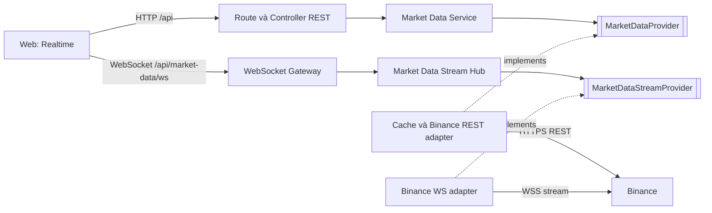
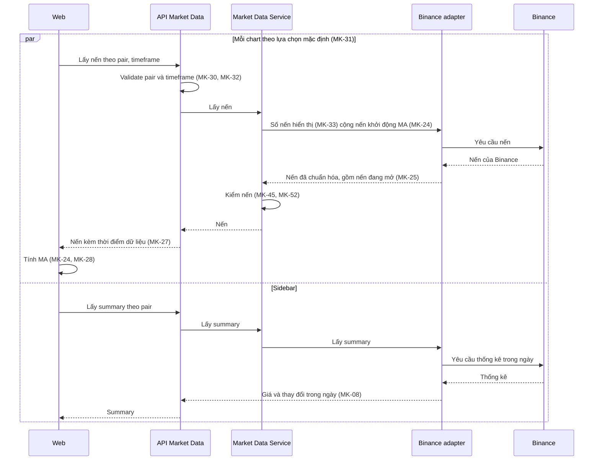
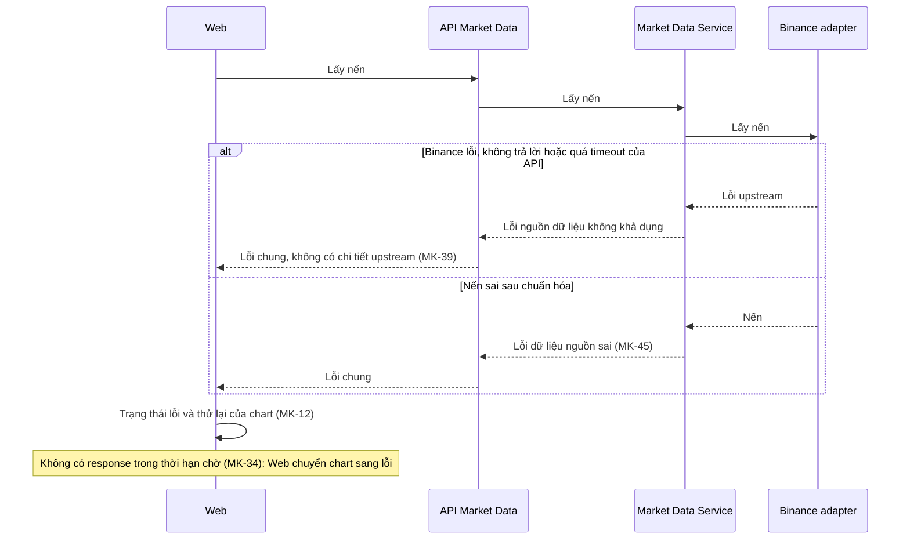
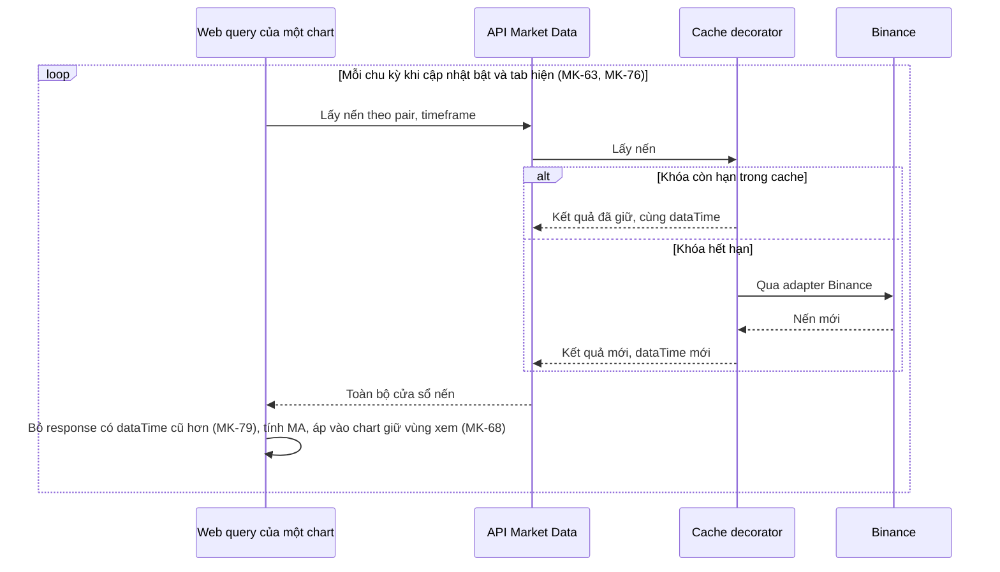
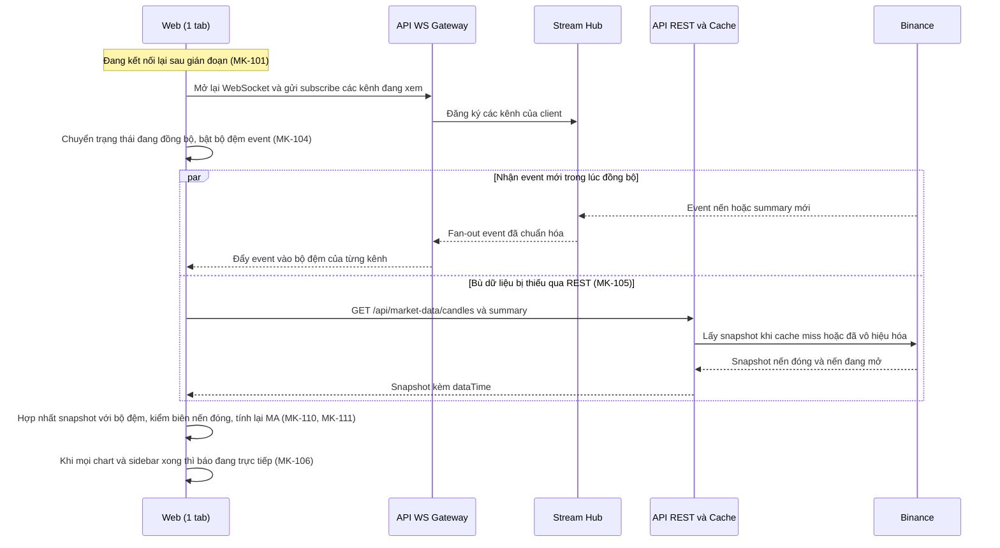

# Market Data & Realtime Updates

Đọc file này để biết cách hệ thống lấy và cập nhật historical, realtime market data, hỗ trợ nhiều timeframe và xử lý khi mất kết nối.

> **Trạng thái:** cả ba vòng của Market Data đã triển khai theo thiết kế trong file này. Vòng REST tải lịch sử và cache decorator (`apps/api/src/index.ts`) [[1]](#ref-1) đã kiểm chứng tại [Kiểm chứng REST tải lịch sử](../testing/test-scopes/TS-002-market-data/rest-verification.md#kết-quả-thực-chạy). Vòng cập nhật định kỳ (ADR-007, ADR-008) đã đóng băng làm baseline tại commit `2709f3b` và kiểm chứng tại [Kiểm chứng REST polling](../testing/test-scopes/TS-002-market-data/rest-polling-verification.md). Vòng cập nhật trực tiếp bằng WebSocket trong mục [Cập nhật trực tiếp bằng WebSocket](#cập-nhật-trực-tiếp-bằng-websocket) (ADR-009 đến ADR-011) đã triển khai tại commit `b0da661` (chế độ Trước shared subscriptions) và `6a4f308` (chế độ Sau shared subscriptions); kết quả kiểm chứng, chẩn đoán 3 nguyên nhân, smoke Binance WS thật và benchmark nằm trong [Kiểm chứng WebSocket cập nhật trực tiếp](../testing/test-scopes/TS-002-market-data/websocket-verification.md#kết-quả-thực-chạy-bước-12).

## Drivers

| Driver | Cơ chế đáp ứng |
| --- | --- |
| Thêm provider thứ hai mà frontend không đổi (QA-09) | Service chỉ phụ thuộc interface `MarketDataProvider` và `MarketDataStreamProvider`; adapter chuẩn hóa dữ liệu provider sang kiểu domain. Provider được truyền từ composition root ([Provider và cách thay thế](#provider-và-cách-thay-thế), ADR-003) |
| Mở Realtime với các chart mặc định trong thời gian mục tiêu (QA-10, MK-31) | Mỗi chart và sidebar gửi request REST riêng chạy song song ([Mở Realtime](#mở-realtime)); cache ngắn hạn trong API trả ngay khi khóa đã có dữ liệu ([Cache và giới hạn request](#cache-và-giới-hạn-request)) |
| Số request tới Binance không tăng theo số người dùng và không chạm giới hạn theo IP | Cache theo khóa, gộp request trùng, dừng gọi Binance khi bị giới hạn ([Cache và giới hạn request](#cache-và-giới-hạn-request), ADR-008) |
| Đổi timeframe chỉ tải lại chart tương ứng (QA-11, MK-06) | Request REST, cache phía Web và kênh subscribe WebSocket tách theo khóa pair và timeframe của từng chart |
| Lịch sử gồm nến đang mở, giới hạn số nến trên chart (MK-25, MK-33) | Provider trả số nến gần nhất theo yêu cầu, gồm nến đang mở |
| Mỗi chart hiển thị thời điểm dữ liệu của nó (MK-27) | Response lịch sử nến và event nến trực tiếp đều có `dataTime` ([Contract nến và chuẩn hóa](#contract-nến-và-chuẩn-hóa)); Web hiển thị |
| Giá hiển thị theo số chữ số thập phân của pair (MK-44) | Metadata pair trong `packages/shared` có số chữ số thập phân của giá (ADR-005) |
| MA phủ mọi nến đang hiển thị, tính cả nến đang mở (MK-01, MK-24, MK-28, MK-36) | API trả thêm các nến khởi động MA trước cửa sổ hiển thị; Web tính lại MA tại chỗ khi nhận lịch sử hoặc cập nhật trực tiếp (ADR-004) |
| Không vẽ nến sai, thời gian mở đúng, loại bỏ cập nhật sai (MK-45, MK-52, MK-128) | Service kiểm nến sau chuẩn hóa ở cả luồng REST và luồng WebSocket; Web kiểm lại bằng schema dùng chung và loại bỏ event sai trước khi áp dụng ([Xử lý lỗi](#xử-lý-lỗi), [Xử lý nến trùng, đến muộn, sai định dạng và client chậm](#xử-lý-nến-trùng-đến-muộn-sai-định-dạng-và-client-chậm)) |
| OHLCV khớp nguồn, không lấp khoảng trống (MK-51, MK-35) | Adapter chỉ đổi kiểu và tên trường, không làm tròn và không tạo nến cho khoảng trống thật |
| Giá và thay đổi trong ngày không phụ thuộc timeframe; lỗi sidebar tách khỏi chart (MK-08, MK-18) | Thao tác summary riêng trên provider REST và kênh `summary` riêng trên WebSocket |
| Thời hạn chờ trước khi báo lỗi, thử lại riêng từng chart (MK-12, MK-34) | Web đo thời hạn chờ cho request lịch sử nến; API đặt timeout gọi provider ngắn hơn để trả lỗi có phân loại trước ([Xử lý lỗi](#xử-lý-lỗi)) |
| Lỗi không lộ chi tiết kỹ thuật (MK-39, MK-130) | Response HTTP, thông điệp lỗi WebSocket và trạng thái nguồn không khả dụng chỉ mang mã và thông điệp chung; chi tiết upstream chỉ nằm trong log |
| Chỉ hiển thị dữ liệu của lựa chọn hiện tại, xử lý đổi liên tiếp (MK-14, MK-17, MK-124) | Web gắn request REST và event WebSocket với khóa pair và timeframe, hủy request cũ bằng `AbortController` và bỏ event của khóa cũ |
| Chỉ chọn pair và timeframe được hỗ trợ (MK-30, MK-32) | API validate query REST và thông điệp `subscribe`/`unsubscribe` WebSocket bằng schema strict trong `packages/shared` |
| Phiên hết hạn khi xem Realtime và cưỡng chế dừng kênh trực tiếp (MK-40, MK-118 đến MK-121, MK-129) | Endpoint REST trả 401; WebSocket kiểm phiên và `Origin` lúc HTTP upgrade, dùng `WSS` trên production và đóng kênh trong thời hạn cưỡng chế qua hook thu hồi cùng kiểm tra theo lô (quyết định xác thực WebSocket ADR-010, [Security](23-security.md#quyết-định)) |
| Chart và sidebar tự làm mới định kỳ làm baseline (MK-63 đến MK-65, MK-76, MK-77, QA-12, QA-13) | Query của Web làm mới theo chu kỳ bằng TTL cache ([Cập nhật định kỳ](#cập-nhật-định-kỳ), ADR-007, ADR-008) |
| Cập nhật trực tiếp nến đang mở, đóng nến và giá sidebar với độ trễ và độ mới mục tiêu (MK-93 đến MK-95, QA-05, QA-14) | Kết nối WebSocket đa kênh đẩy từng bản cập nhật nến và summary ngay khi hub nhận từ nguồn ([Cập nhật trực tiếp bằng WebSocket](#cập-nhật-trực-tiếp-bằng-websocket), ADR-009) |
| Đổi lựa chọn độc lập, nhiều chart cùng timeframe, nhiều tab độc lập (MK-96, MK-97, MK-123, MK-125) | Mỗi tab mở một kết nối WebSocket đa kênh giữ tập kênh riêng; đổi một chart chỉ `unsubscribe`/`subscribe` khóa chịu tác động; hai chart cùng timeframe dùng chung luồng trong tab nhưng giữ instance chart độc lập |
| Tải đồng thời tối đa một kết nối nguồn cho mỗi khóa (QA-15) | Hub trong API chia sẻ subscription theo bộ đếm tham chiếu trên một kết nối combined stream tới Binance, tuần tự hóa JSON một lần mỗi sự kiện và ngắt client chậm ([Shared subscriptions và fan-out](#shared-subscriptions-và-fan-out), ADR-009) |
| Dữ liệu cũ, đặt lại luồng, mất kết nối, tự thử lại có trần và kết nối lại thủ công (MK-98 đến MK-103, MK-122, QA-06) | Server gửi `heartbeat` ứng dụng khi nguồn khỏe; Web đo tuổi tín hiệu bằng đồng hồ đơn điệu tránh lệch đồng hồ thiết bị (gap kiểm soát đồng hồ MK-140), thử kết nối lại theo exponential backoff có jitter và kích hoạt lại khi có nút thủ công hoặc sự kiện `online` ([Chuyển giao lịch sử sang trực tiếp, reconnect và REST backfill](#chuyển-giao-lịch-sử-sang-trực-tiếp-reconnect-và-rest-backfill)) |
| Phân biệt đang đồng bộ, bù đủ nến đóng, toàn vẹn OHLCV và cảnh báo đồng bộ chưa xong (MK-104 đến MK-106, MK-127, QA-16, QA-17) | Subscribe và đệm sự kiện trước khi gọi REST backfill, vô hiệu hóa cache REST khi có nến đóng, hợp nhất theo `openTime`/`dataTime` và kiểm biên đóng nến trước khi báo trực tiếp (quyết định chuyển giao ADR-011) |
| Tạm dừng, tiếp tục, đổi lựa chọn khi tạm dừng và tab ẩn hiện lại (MK-73 đến MK-75, MK-78, MK-85, MK-107 đến MK-109, MK-126, MK-132) | Tạm dừng đóng sạch WebSocket nên không hiện cảnh báo mất kết nối; tiếp tục hoặc tab hiện lại sau khi bỏ lỡ dữ liệu mở lại WebSocket và chạy quy trình đồng bộ bù nến; đổi lựa chọn khi tạm dừng chỉ gọi REST |
| Không tạo nến trùng, không lùi dữ liệu trên cả chart và sidebar, chart lỗi ban đầu không tự vẽ nến lẻ (MK-13, MK-79 đến MK-82, MK-110, MK-111, MK-131) | Hợp nhất theo khóa `openTime`, so `dataTime` cho cả nến và `MarketSummary`, bỏ qua event cho chart chưa hoàn tất tải lịch sử đầu |
| Giữ vùng xem, nến cuối, focus, tooltip, giới hạn cửa sổ nến và tiết chế thông báo (MK-67 đến MK-72, MK-112 đến MK-117) | Áp dữ liệu vào cùng instance Lightweight Charts, cắt cửa sổ giữ đủ nến khởi động MA, chỉ phát thông báo screen reader khi đổi trạng thái kết nối hoặc đồng bộ |
| Giới hạn số tab cập nhật trực tiếp mỗi tài khoản (MK-142) | WebSocket Gateway giới hạn số kết nối mỗi tài khoản theo ngưỡng đã duyệt trong [Security](23-security.md#quyết-định), trả khung lỗi `CONNECTION_LIMIT_EXCEEDED` và đóng mã `4429` mà không ngắt các tab cũ |
| Hiển thị, accessibility và màn hình hẹp (MK-02, MK-10, MK-11, MK-15, MK-26, MK-38, MK-41 đến MK-43, MK-46 đến MK-50, MK-58 đến MK-62) | Thuộc Web; không cần cơ chế backend ngoài nến, summary và trạng thái kết nối |

## Thành phần và ranh giới

Sơ đồ dưới đây thể hiện mức component của luồng dữ liệu thị trường giữa Web, container API và Binance (10 node). Các đường kết nối nét liền thể hiện phần đã triển khai cho cả luồng REST và luồng WebSocket (ADR-009 đến ADR-011). Luồng kiểm phiên theo lô (`WebSocket Gateway → WsSessionService → SessionRepository → PostgreSQL`) nằm trong [Security](23-security.md#kịch-bản-chính); callback vô hiệu hóa cache REST được nối từ composition root để `MarketDataStreamHub` không import file cache decorator:

| Thành phần | Vị trí | Trách nhiệm | Không làm |
| --- | --- | --- | --- |
| Web Market Data | `apps/web/app/api/market-data.ts`, `api/market-data-ws.ts`, `utils/market-candle-merge.ts`, `hooks/useMarketData.ts`, `hooks/useRealtimeWorkspace.ts`, `pages/Realtime` | Gọi REST cho lịch sử và backfill, duy trì một kết nối WebSocket mỗi tab, đệm và hợp nhất nến, tính MA, quản lý trạng thái kết nối và đồng bộ | Gọi Binance trực tiếp; biết provider nào đang dùng |
| Route, Controller và middleware phiên | `apps/api/src/api/routes/market-data.route.ts`, `api/controllers/market-data.controller.ts`, `api/middlewares/session.middleware.ts` | Kiểm phiên, validate query bằng schema `packages/shared`, gọi service, trả HTTP response | Gọi provider hoặc truy vấn DB trực tiếp |
| WebSocket Gateway | `apps/api/src/api/ws/market-data.ws.ts` | Xử lý HTTP upgrade `/api/market-data/ws`, kiểm `Origin`, `WSS` production và phiên qua Better Auth cùng `WsSessionService`, parse khung JSON bằng schema `packages/shared`, thực thi giới hạn kết nối/tốc độ/kích thước khung, gửi `heartbeat`, đóng client chậm và thu hồi phiên | Gọi Binance; import `providers/`, `repositories/` hoặc `database/`; chứa logic nghiệp vụ nến |
| Market Data Service | `apps/api/src/services/market-data.service.ts` | Tính số nến cần lấy, gọi `MarketDataProvider`, kiểm nến, phân loại lỗi, ghi log ngữ cảnh | Phụ thuộc Express, `ws` hoặc kiểu dữ liệu của Binance |
| Market Data Stream Hub | `apps/api/src/services/market-data-stream.service.ts` | Quản lý sổ đăng ký topic chia sẻ theo bộ đếm tham chiếu, gọi `MarketDataStreamProvider`, validate event bằng schema `packages/shared`, gọi callback `onCandleClosed` được truyền từ composition root để vô hiệu hóa cache REST khi nhận nến đóng, tuần tự hóa một lần để fan-out, ghi log/metric theo `pair`/`timeframe` | Phụ thuộc Express, `ws` trực tiếp, file adapter/cache trong `providers/` hoặc kiểu dữ liệu Binance |
| WebSocket Session Service | `apps/api/src/services/ws-session.service.ts` | Điều phối kiểm hạn phiên trong bộ nhớ và gọi `SessionRepository` kiểm hiệu lực theo lô cho danh sách `sessionId` đang mở WebSocket | Import Express, `ws` hoặc `database/` trực tiếp |
| Session Repository | `apps/api/src/repositories/session.repository.ts` | Truy vấn đọc theo lô danh sách `sessionId` từ bảng `session` phục vụ `WsSessionService` | Chứa logic WebSocket, HTTP hoặc nghiệp vụ |
| `MarketDataProvider` và `MarketDataStreamProvider` | `apps/api/src/providers/market-data/market-data-provider.ts` | Interface REST và interface stream cùng kiểu domain mà mọi provider trả về | Chứa logic của một provider cụ thể |
| Binance REST adapter | `apps/api/src/providers/market-data/binance.provider.ts` | Gọi Binance REST, áp timeout, xử lý 429/418 và chuẩn hóa response sang kiểu domain | Kiểm nghiệp vụ; tạo nến thiếu; import Express, `api/`, `services/`, `repositories/`, `database/` |
| Binance WS adapter | `apps/api/src/providers/market-data/binance-stream.provider.ts` | Duy trì một kết nối combined stream tới Binance, gom `SUBSCRIBE`/`UNSUBSCRIBE` theo giới hạn tốc độ, trả lời ping/pong, xoay kết nối trước hạn 24 giờ, tự reconnect và chuẩn hóa event sang kiểu domain | Kiểm nghiệp vụ nến; quản lý subscriber của từng client; import Express, `api/`, `services/`, `repositories/`, `database/` |
| Cache decorator | `apps/api/src/providers/market-data/cached-market-data.provider.ts` | Cài `MarketDataProvider`, bọc adapter REST: cache theo khóa, single-flight, giữ lỗi nguồn trong TTL và cung cấp phương thức `invalidateCandles(pair, timeframe)` cho composition root | Biết provider cụ thể; kiểm nghiệp vụ |
| Composition root | `apps/api/src/index.ts`, `app.ts`, `api/routes/index.ts` | Tạo HTTP server, gắn Express app, tạo adapter REST/WS, cache decorator, `SessionRepository`, `WsSessionService`, `MarketDataStreamHub` (truyền callback vô hiệu hóa cache từ cache decorator), `MarketDataWsGateway` và nối hook thu hồi phiên từ `createAuth` [[8]](#ref-8) | — |

`providers/` là layer ngang hàng với `repositories/`: repository là đầu ra tới PostgreSQL, provider là đầu ra tới API bên ngoài. Chuẩn hóa dữ liệu Binance (cả REST và WebSocket) nằm trong adapter để kiểu dữ liệu của Binance không thoát khỏi adapter. Ranh giới import được kiểm bởi `app-boundaries/provider-layers` và `no-restricted-imports` trong `eslint.config.js` [[2, Dependency rules]](#ref-2) [[14]](#ref-14):

| Layer | Import `providers/` | Import `repositories/` hoặc `database/` | Bị `providers/` import |
| --- | --- | --- | --- |
| Route, Controller, WebSocket Gateway (`api/ws/`) | Không; đi qua Service / Stream Hub | Không; đi qua Service | Không |
| Service, Stream Hub, `WsSessionService` (`services/`) | Có, chỉ file `providers/market-data/market-data-provider.ts`; không import file adapter hay cache decorator | Chỉ import `repositories/`; không import `database/` hay `drizzle-orm` | Không |
| Repository (`repositories/`) | Không | Chỉ `database/` và `drizzle-orm` | Không |
| `configs/` | — | — | Có, để đọc cấu hình provider |

`providers/` không import Express hay `drizzle-orm`. Đặt `MarketDataStreamProvider` vào cùng file `market-data-provider.ts` giữ nguyên rule ESLint hiện tại cho `services/` mà không mở rộng ngoại lệ; khi thêm `apps/api/src/api/ws/`, mở rộng rule `noDatabaseAccess` trong `eslint.config.js` cho `apps/api/src/api/ws/**/*.ts` tương tự Route và Controller [[14]](#ref-14).

## Provider và cách thay thế

Interface trong `market-data-provider.ts` tách hai phần để bên chỉ cần lịch sử không phụ thuộc luồng trực tiếp:

| Interface | Thao tác | Input | Output / Callback | Driver |
| --- | --- | --- | --- | --- |
| `MarketDataProvider` *(đã triển khai)* | `getCandles` | `pair`, `timeframe`, `limit` | Danh sách nến chuẩn hóa tăng dần theo `openTime`, gồm nến đang mở và `dataTime` | MK-25, MK-33 |
| `MarketDataProvider` *(đã triển khai)* | `getSummary` | `pair` | Giá gần nhất, phần trăm thay đổi 24 giờ và `dataTime` | MK-08, MK-111 |
| `MarketDataStreamProvider` *(đã triển khai)* | `subscribe` / `unsubscribe` | Kênh `kline(pair, timeframe)` hoặc `summary(pair)` | Kích hoạt hoặc hủy luồng upstream tương ứng | MK-96, MK-97, QA-15 |
| `MarketDataStreamProvider` *(đã triển khai)* | `onCandle` / `onSummary` / `onStatus` | Handler từ Stream Hub | Event nến chuẩn hóa, event summary chuẩn hóa, hoặc trạng thái nguồn (`available` kèm cờ yêu cầu đồng bộ, `unavailable`) | MK-93, MK-94, MK-130, QA-06 |
| `MarketDataStreamProvider` *(đã triển khai)* | `close` | — | Đóng sạch kết nối upstream khi API shutdown | Vòng đời process |

Khi thêm hoặc đổi provider (cả REST lẫn WebSocket):

| Phần | Thay đổi |
| --- | --- |
| Adapter mới trong `providers/market-data/` | Viết adapter REST cài `MarketDataProvider` và adapter stream cài `MarketDataStreamProvider` |
| Composition root | Chọn cặp adapter theo cấu hình |
| Service, Stream Hub, Controller, Route, WebSocket Gateway, contract `packages/shared` | Không đổi |
| Web | Không đổi (QA-09) |

Kiểm chứng ranh giới không cần provider thật thứ hai: integration test truyền provider REST giả lập và stream provider giả lập (hoặc server WebSocket phát lại cục bộ) từ composition root, kiểm đủ trường hợp nến hợp lệ, nến sai, ngắt kết nối và phục hồi.

## Contract nến và chuẩn hóa

Kiểu domain là kiểu mà mọi provider trả cho Service/Hub và API trả cho Web (qua REST và WebSocket). Schema Zod của các kiểu này nằm trong `packages/shared` và là nguồn duy nhất của contract; chi tiết endpoint HTTP và khung WebSocket nằm trong API Contracts [[4]](#ref-4).

### Nến

| Trường | Kiểu | Ý nghĩa | Driver |
| --- | --- | --- | --- |
| `openTime` | integer, epoch millisecond UTC | Thời gian mở của nến; khóa của nến trong một lịch sử | MK-52, MK-110 |
| `open`, `high`, `low`, `close` | JSON number, dương | Giá theo quote asset, giữ nguyên giá trị của provider | MK-51 |
| `volume` | JSON number, không âm | Volume theo base asset | MK-23, MK-51 |
| `isClosed` | boolean | `false` cho nến đang mở; khi chốt nến đổi sang `true` | MK-25, MK-26, MK-28, MK-95 |

Giá và volume dùng JSON number, vì engine tính bằng float64 và Web vẽ bằng number. Adapter đổi chuỗi thập phân của provider sang number, không làm tròn. Số chữ số thập phân khi hiển thị lấy từ metadata pair, không suy ra từ giá trị (ADR-005).

### Lịch sử nến

| Trường | Kiểu | Ý nghĩa | Driver |
| --- | --- | --- | --- |
| `pair`, `timeframe` | Enum dùng chung | Lặp lại lựa chọn của request để Web bỏ response không khớp | MK-14, MK-17 |
| `candles` | Mảng nến, `openTime` tăng dần, không trùng | Nến khởi động MA, sau đó là nến hiển thị | MK-24, MK-33, MK-52 |
| `warmupCount` | integer, không âm | Số nến đầu mảng chỉ dùng tính MA, Web không vẽ | MK-24, ADR-004 |
| `dataTime` | integer, epoch millisecond UTC | Thời điểm API nhận response của provider | MK-27, MK-79 |

Service yêu cầu provider số nến hiển thị (MK-33) cộng số nến khởi động (mẫu của MK-24 trừ một). Khi provider trả ít nến hơn, Service đặt `warmupCount` bằng số nến vượt quá số nến hiển thị, tối thiểu là 0. Như vậy chart vẫn hiển thị đủ nến có thật và MA thiếu mẫu ở các nến đầu (MK-15, MK-24).

Provider phải trả tối đa `limit` nến. Adapter Binance truyền nguyên `limit` vào query upstream và từ chối response vượt giới hạn trước khi trả snapshot. Service cũng kiểm giới hạn khi nhận dữ liệu từ provider. Response vượt giới hạn là dữ liệu nguồn sai: API trả `502 / MARKET_DATA_INVALID`, không cắt phần dư. Response bị adapter từ chối không được cache.

### Summary

| Trường | Kiểu | Ý nghĩa | Driver |
| --- | --- | --- | --- |
| `pair` | Enum dùng chung | Lặp lại lựa chọn của request | MK-17 |
| `lastPrice` | JSON number, dương | Giá gần nhất | MK-08, MK-94 |
| `change24hPercent` | JSON number | Phần trăm thay đổi trong 24 giờ gần nhất | MK-08, MK-94 |
| `dataTime` | integer, epoch millisecond UTC | Thời điểm API nhận dữ liệu summary từ provider (REST hoặc WebSocket), giúp Web chặn ghi đè dữ liệu cũ hơn trên sidebar | MK-111 |

### Chuẩn hóa từ Binance

Adapter Binance REST đọc REST API Spot [[7]](#ref-7); adapter Binance WebSocket đọc Binance Spot WebSocket Streams tại `wss://stream.binance.com:9443/stream` (cấu hình được qua `env` cho replay server khi kiểm thử) [[15]](#ref-15):

| Kiểu domain | Nguồn Binance | Quy tắc |
| --- | --- | --- |
| Nến REST *(đã triển khai)* | `GET /api/v3/klines`, mảng 12 phần tử; dùng vị trí 0 đến 6: thời gian mở, open, high, low, close, volume, thời gian đóng | Đổi chuỗi sang number. `isClosed` là `true` khi thời gian đóng nhỏ hơn `dataTime`. Bỏ các trường còn lại |
| Summary REST *(đã triển khai)* | `GET /api/v3/ticker/24hr`, `lastPrice`, `priceChangePercent` | Đổi chuỗi sang number. Gắn `dataTime` bằng đồng hồ API lúc nhận response để sidebar so sánh mốc dữ liệu (MK-111) [[17]](#ref-17) |
| Nến WebSocket *(đã triển khai)* | Combined stream `<symbol>@kline_<interval>` (`e: "kline"`, `E`, `s`, `k: { t, o, h, l, c, v, x }`) | Đổi chuỗi `o, h, l, c, v` sang number; `openTime = k.t`, `isClosed = k.x`, `dataTime` là đồng hồ API lúc nhận frame, `sourceTime = E` (chỉ phục vụ đo độ trễ và log) |
| Summary WebSocket *(đã triển khai)* | Combined stream `<symbol>@ticker` (`e: "24hrTicker"`, `E`, `s`, `c`, `P`) | Đổi chuỗi `c` sang `lastPrice`, `P` sang `change24hPercent`; gắn `dataTime` là đồng hồ API lúc nhận frame, `sourceTime = E` |
| `dataTime` | Đồng hồ của API lúc nhận response hoặc frame | Không trừ trực tiếp đồng hồ máy người dùng với mốc giờ của sàn (MK-140) |

Adapter từ chối payload không parse được JSON hoặc thiếu trường bắt buộc. Ở luồng REST, adapter ném `MarketDataProviderError('invalid')` để API trả `502 / MARKET_DATA_INVALID` và không cache. Ở luồng WebSocket, adapter loại bỏ frame lỗi, ghi log `warn` kèm tên stream mà không ghi nguyên payload, và không phát sự kiện cho Hub (MK-39, MK-128).

## Cache và giới hạn request

Hệ thống không lưu dữ liệu Market Data vào PostgreSQL ([Data Model](21-database.md), quyết định giữ lỗi nguồn trong cache ADR-008). Cache phía server nằm trong bộ nhớ process API, trong một decorator cài cùng interface `MarketDataProvider`. Composition root bọc adapter REST Binance bằng decorator này.

| Thuộc tính | Nến | Summary |
| --- | --- | --- |
| Khóa | `pair` + `timeframe` + số nến yêu cầu | `pair` |
| Thời gian sống (TTL) | 5 giây, cấu hình của API. Tính từ lúc provider resolve thành công | 5 giây, cấu hình của API. Tính từ lúc provider resolve thành công |
| Giá trị cache | Kết quả đã chuẩn hóa của provider, gồm `dataTime` và `isClosed` lúc nhận | Kết quả đã chuẩn hóa của provider, gồm `dataTime` |

Quy tắc:

- **Gộp request trùng (single-flight).** Khi khóa chưa có giá trị còn hạn, request đầu tiên gọi provider. Các request cùng khóa đến trong lúc đó chờ chung kết quả này.
- **Giữ lỗi nguồn trong TTL.** Lỗi nguồn không khả dụng và lỗi dữ liệu nguồn sai được trả cho mọi request đang chờ, rồi được giữ theo khóa trong cùng TTL, tính từ lúc provider bên trong reject. Request cùng khóa trong TTL nhận lại lỗi đó mà không gọi provider, kể cả thử lại của chart (MK-12). Lỗi không lường trước không được giữ (ADR-008).
- **Mốc và biên TTL.** TTL bắt đầu khi provider bên trong resolve thành công, theo clock của API. Giá trị còn hạn khi thời gian đã qua nhỏ hơn TTL, hết hạn khi thời gian đã qua lớn hơn hoặc bằng TTL.
- **Vô hiệu hóa khi có nến đóng (ADR-011).** Khi `MarketDataStreamHub` nhận một nến có `isClosed: true` cho `(pair, timeframe)`, hub gọi callback `onCandleClosed` (được composition root nối tới `invalidateCandles(pair, timeframe)` của cache decorator). Như vậy, một client vừa reconnect ngay sau mốc đóng nến không nhận snapshot cũ từ cache vẫn đánh dấu nến đó là đang mở.
- **Không làm mới chủ động và không cache HTTP.** Cache REST chỉ tải dữ liệu khi nhận request; HTTP response giữ `Cache-Control: no-store` [[4]](#ref-4).

### Giới hạn request của Binance

Binance giới hạn REST request weight theo IP và giới hạn kết nối/thông điệp WebSocket theo IP [[9]](#ref-9) [[15]](#ref-15):

| Kênh Binance | Giới hạn | Áp dụng trong hệ thống |
| --- | --- | --- |
| REST `REQUEST_WEIGHT` | 6000 weight mỗi phút mỗi IP (`klines` = 2, `ticker/24hr` một symbol = 2) | Với tập pair (MK-32) và timeframe (MK-30) hiện tại, mức trần REST của một instance API là 504 weight/phút cả khi thành công lẫn khi lỗi (ADR-008). Ở vòng WebSocket, REST chỉ gọi khi tải đầu, đổi lựa chọn và backfill nên mức dùng thực tế thấp hơn nhiều |
| WebSocket số stream mỗi kết nối | Tối đa 1024 stream mỗi kết nối [[15]](#ref-15) | Toàn bộ các khóa kline và ticker trên tập pair (MK-32) và tập timeframe (MK-30) đều dùng chung một kết nối combined stream tới Binance, nhỏ hơn rất nhiều giới hạn 1024 stream (QA-15) |
| WebSocket số lần mở kết nối | Tối đa 300 lần mở kết nối mỗi 5 phút mỗi IP [[15]](#ref-15) | Adapter dùng exponential backoff có jitter khi reconnect để không lặp mở kết nối dồn dập |
| WebSocket tốc độ lệnh điều khiển | Tối đa 5 thông điệp đến mỗi giây trên một kết nối [[15]](#ref-15) | Adapter gom lệnh `SUBSCRIBE`/`UNSUBSCRIBE` theo cửa sổ micro-batch và giới hạn nhịp gửi không vượt mức cho phép |
| Thời lượng một kết nối WebSocket | Tối đa 24 giờ, sau đó Binance tự ngắt (có thể gửi sự kiện `serverShutdown`) [[15]](#ref-15) | Adapter chủ động mở kết nối thay thế ở mốc **23 giờ 50 phút** (product owner duyệt ngày 2026-11-23: chừa 10 phút chuyển tiếp không gián đoạn trước giới hạn cứng 24 giờ của Binance; tác động: tạo thêm 1 kết nối song song ngắn trong lúc bàn giao rồi đóng kết nối cũ) |

Adapter REST xử lý tín hiệu giới hạn của Binance:

| Tín hiệu | Hành vi của adapter | Kết quả với Web |
| --- | --- | --- |
| Header weight (`x-mbx-used-weight-1m`, đã xác nhận qua smoke Binance thật ngày 2026-11-21 [[10]](#ref-10)) | Ghi vào log của adapter | Không đổi |
| HTTP 429 hoặc 418 | Đọc `Retry-After` (giây), dừng gọi Binance tới hết thời gian đó và trả lỗi nguồn không khả dụng ngay | 503 `MARKET_DATA_UNAVAILABLE` [[4]](#ref-4). Khóa có giá trị cache còn hạn được decorator trả, không tới adapter |
| HTTP 403 | Lỗi nguồn không khả dụng | 503 `MARKET_DATA_UNAVAILABLE` |

## Luồng xử lý

### Mở Realtime

Đổi timeframe đi qua cùng luồng lấy nến cho một chart (MK-06, QA-11). Đổi pair chạy lại toàn bộ luồng với pair mới; Web bỏ response của pair cũ (MK-17).

### Xử lý lỗi

| Nhóm lỗi | Nguồn | Nơi phát hiện | Người dùng thấy |
| --- | --- | --- | --- |
| Input không hợp lệ | Pair hoặc timeframe ngoài tập hỗ trợ | Route, Controller, WebSocket Gateway | Không xảy ra từ UI; request hoặc frame ngoài UI nhận lỗi validate |
| Nguồn dữ liệu không khả dụng | Lỗi mạng, response lỗi, quá timeout API hoặc đứt luồng Binance | Adapter REST hoặc WS | Lỗi của chart/sidebar kèm thử lại (MK-12, MK-18) hoặc trạng thái nguồn tạm thời không khả dụng (MK-130) |
| Dữ liệu nguồn sai | Nến vi phạm quy tắc nến hợp lệ và thời gian mở (MK-45, MK-52, MK-128) | Service, Stream Hub | Lỗi tải đầu của chart (MK-45) hoặc loại bỏ frame trực tiếp sai giữ dữ liệu hợp lệ (MK-128) |
| Lỗi không lường trước | Bug trong API | Error handler chung | Lỗi kèm thử lại |

Lỗi HTTP đã phân loại là `AppError`; error handler chỉ trả `code` và `message`, không trả chi tiết upstream [[3]](#ref-3). Timeout gọi provider REST ở composition root là 5000 ms (ngắn hơn thời hạn chờ của chart MK-34) [[1]](#ref-1).

## Cập nhật định kỳ

Vòng cập nhật định kỳ giữ vai trò baseline đo đạc (quyết định tải lại cửa sổ ADR-007 và giữ lỗi nguồn trong cache ADR-008) và đã được đo ở Bước 08 [[13]](#ref-13). Khi chuyển sang vòng WebSocket (quyết định ADR-009), các nhánh `refetchInterval` của vòng polling được thay bằng luồng cập nhật trực tiếp bên dưới; tài liệu vẫn giữ mô tả vòng này để truy vết baseline REST polling (`MK-63` đến `MK-85`, `QA-12`, `QA-13`).

### Web

| Hành vi | Cơ chế | Driver |
| --- | --- | --- |
| Chu kỳ | Khi cập nhật bật, query nến và query summary đặt `refetchInterval` bằng TTL cache của API. Khi tạm dừng, `refetchInterval` là `false` | MK-63, MK-64, MK-73 |
| Không chồng yêu cầu | TanStack Query `5.107.1` dùng lại promise đang chạy khi query còn fetch [[12]](#ref-12) | MK-65 |
| Tab ẩn và hiện lại | Lần gọi theo chu kỳ bị bỏ qua khi `document.visibilityState` là `hidden`; `refetchOnWindowFocus` trả `always` chỉ khi query đã có dữ liệu [[12]](#ref-12) | MK-76, MK-77, MK-82 |
| Tạm dừng và tiếp tục | `useRealtimeWorkspace` giữ cờ cập nhật mặc định bật; khi tiếp tục, Web invalidate các query đang có dữ liệu | MK-73, MK-75, MK-78 |
| Lỗi và dữ liệu cũ hơn | Query giữ `data` khi lỗi; Web so `dataTime` cho chart; chart chưa có dữ liệu không tự làm mới | MK-13, MK-79 đến MK-82 |
| Áp dữ liệu vào chart | `useCandlestickChart` dùng lại instance cùng lựa chọn, bù logical range khi cửa sổ dịch và giữ crosshair theo `openTime` | MK-67 đến MK-71 |
| Thông báo và phiên | Lần làm mới thành công không đổi vùng `role="status"`; 401 đi qua `useSessionGate` (ADR-001) | MK-72, MK-84, MK-40 |

### API và Binance

Mỗi client polling gửi request cho các chart mặc định (MK-31) và sidebar ở mỗi chu kỳ, và mỗi request gọi `getSession` đọc PostgreSQL. Mức trần weight tới Binance giữ nguyên theo [Giới hạn request của Binance](#giới-hạn-request-của-binance) (QA-13), nhưng số request tới API và truy vấn phiên tăng tuyến tính theo số client [[16]](#ref-16).

## Cập nhật trực tiếp bằng WebSocket

Mục này mô tả thiết kế đã triển khai của vòng WebSocket (quyết định chuyển sang WebSocket ADR-009, xác thực ADR-010 và chuyển giao ADR-011). Web thay vòng lặp `refetchInterval` của polling bằng một kết nối WebSocket đa kênh tới `/api/market-data/ws` và chỉ dùng REST cho tải lịch sử ban đầu, đổi lựa chọn và đồng bộ bù nến sau gián đoạn.

### Shared subscriptions và fan-out

- **Một kết nối WebSocket mỗi tab:** Mỗi tab Realtime mở một kết nối WebSocket đa kênh dùng chung cho mọi chart đang hiển thị và sidebar. Hai chart trên cùng tab chọn cùng timeframe (MK-125) dùng chung một kênh subscribe của kết nối đó nhưng giữ instance Lightweight Charts và vùng xem độc lập. Nhiều tab cùng phiên mở kết nối riêng để giữ lựa chọn và trạng thái tạm dừng độc lập (MK-123), tuân theo giới hạn số tab đồng thời mỗi tài khoản (MK-142, ngưỡng cấu hình trong [Security](23-security.md#quyết-định)).
- **Sổ đăng ký topic chia sẻ (`MarketDataStreamHub`):** Hub lập chỉ mục subscriber theo hai loại khóa: `kline:<pair>:<timeframe>` và `summary:<pair>`. Khi số subscriber của một khóa tăng từ 0 lên 1, hub đăng ký kênh tương ứng với `MarketDataStreamProvider`. Nhờ vậy, khi số client tăng tới mục tiêu tải đồng thời (QA-15), hệ thống vẫn giữ tối đa một subscription upstream cho mỗi tổ hợp `(pair, timeframe)` hoặc `pair` trên một kết nối combined stream tới Binance (ADR-009).
- **Thời gian trễ hủy đăng ký upstream:** Khi số subscriber của một khóa giảm về 0, hub giữ subscription upstream thêm **5 giây** (product owner duyệt ngày 2026-11-23: tránh gửi cặp lệnh `UNSUBSCRIBE`/`SUBSCRIBE` liên tiếp khi người dùng đổi pair/timeframe nhanh hoặc reload trang trong giới hạn tốc độ điều khiển của Binance; tác động: giữ tối đa một stream nhàn rỗi trong 5 giây trước khi giải phóng) trước khi gọi `unsubscribe` lên provider.
- **Đổi lựa chọn không làm gián đoạn chart khác:** Khi người dùng đổi timeframe của một chart (MK-96) hoặc thay đổi số chart (MK-04, MK-05), Web chỉ tính phần chênh lệch kênh cần `unsubscribe` (nếu không còn chart nào trên tab xem kênh cũ) và `subscribe` cho kênh mới; các kênh của chart còn lại và sidebar không bị đóng hoặc đăng ký lại. Khi đổi pair (MK-97), Web `unsubscribe` toàn bộ kênh pair cũ, hủy request REST pair cũ bằng `AbortController`, rồi chuyển sang quy trình đồng bộ cho pair mới (MK-124).
- **Tuần tự hóa một lần (fan-out):** Khi nhận event hợp lệ từ provider, hub kiểm bằng schema Zod của `packages/shared`, cập nhật mốc `lastValidEventAt` của topic, gọi callback vô hiệu hóa cache REST nếu `isClosed` là `true`, rồi `JSON.stringify` thông điệp **đúng một lần** và đẩy chuỗi đã tuần tự hóa tới mọi socket đang đăng ký topic đó (QA-05, QA-15).

### Chuyển giao lịch sử sang trực tiếp, reconnect và REST backfill

Mọi tình huống bắt đầu hoặc khôi phục luồng trực tiếp (mở Realtime, đổi lựa chọn khi đang bật trực tiếp, kết nối lại sau mất mạng, nguồn Binance phục hồi, bấm tiếp tục sau tạm dừng, hoặc tab hiện lại sau khi bỏ lỡ dữ liệu) đều đi qua cùng quy trình **Subscribe → Đệm sự kiện → REST snapshot → Hợp nhất** để không tạo khoảng trống và không tạo nến trùng (ADR-011):

Quy tắc của từng tình huống chuyển trạng thái:

- **Tải ban đầu lỗi (MK-12, MK-131):** Nếu request REST lần đầu của một chart thất bại, chart vào trạng thái lỗi có nút thử lại riêng, hủy kênh subscribe nếu không còn chart nào trên tab dùng kênh đó và không áp dụng event trực tiếp cho tới khi tải lịch sử thành công.
- **Đồng bộ bù nến thất bại sau khi đã có dữ liệu (MK-127):** Nếu request REST backfill của một hoặc nhiều chart thất bại, các chart lỗi giữ dữ liệu cũ, xóa bộ đệm event (không nối dữ liệu mới qua khoảng trống), chuyển sang trạng thái đồng bộ chưa xong kèm thao tác đồng bộ lại thủ công; các chart đã đồng bộ xong tiếp tục cập nhật trực tiếp độc lập.
- **Tạm dừng và tiếp tục (MK-73, MK-74, MK-107 đến MK-109):** Khi người dùng tạm dừng, Web đóng sạch kết nối WebSocket bằng mã `1000` và ghi thời điểm tạm dừng, nên hệ thống giải phóng ngay tài nguyên server và không hiện cảnh báo mất kết nối (MK-108). Đổi pair, đổi timeframe hoặc tăng số chart lúc đang tạm dừng chỉ gọi REST lịch sử và giữ trạng thái tạm dừng (MK-109). Khi người dùng tiếp tục, Web mở lại WebSocket và chạy quy trình đồng bộ trong thời hạn tiếp tục cập nhật (MK-107).
- **Tab ẩn rồi hiện lại (MK-126):** Khi tab bị ẩn lúc cập nhật trực tiếp đang bật, Web giữ kết nối WebSocket mở. Khi tab hiện lại (`visibilitychange`), nếu kết nối vẫn mở, không chạm ngưỡng dữ liệu cũ và không có sự kiện yêu cầu đồng bộ từ server thì tiếp tục trực tiếp mà không gọi REST thừa; ngược lại, Web bắt đầu đồng bộ trong thời hạn tiếp tục cập nhật (MK-107). Nếu trước đó đang tạm dừng thì giữ nguyên trạng thái tạm dừng.
- **Phát hiện dữ liệu cũ và đặt lại luồng (MK-98, MK-99, MK-140):** Khi kết nối upstream Binance đang khỏe, WebSocket Gateway gửi khung `heartbeat` ứng dụng định kỳ mỗi **5 giây** (product owner duyệt ngày 2026-11-23: bằng một phần ba ngưỡng dữ liệu cũ MK-98 để phân biệt thị trường ít biến động với kết nối chết vì trình duyệt không lộ frame ping/pong giao thức cho JavaScript; tác động: thêm 1 khung nhỏ mỗi 5 giây trên mỗi kết nối). Web cập nhật mốc tín hiệu hợp lệ gần nhất bằng đồng hồ đơn điệu `performance.now()` (tránh sai lệch đồng hồ thiết bị theo gap kiểm soát đồng hồ MK-140). Nếu quá ngưỡng dữ liệu cũ (MK-98) không nhận event hợp lệ hay `heartbeat`, Web chuyển sang trạng thái dữ liệu cũ; quá ngưỡng đặt lại luồng (MK-99), Web chủ động đóng socket để vào chu kỳ kết nối lại.
- **Chính sách backoff kết nối lại (MK-101 đến MK-103, MK-122, QA-06, QA-16):**
  - *Web → API (product owner duyệt ngày 2026-11-23):* exponential backoff có full jitter với thời gian chờ cơ sở **1 giây**, hệ số nhân **2**, trần mỗi lần thử **16 giây** (ngắn hơn nhiều thời hạn tự thử kết nối lại MK-122 để thử nhiều lượt trong khung thời gian đó) và kích hoạt thử nhanh sau jitter **0–500 ms** khi trình duyệt phát sự kiện `online` (không bị kẹt trong chu kỳ chờ 16 giây sau khi mạng khôi phục, giúp đạt mục tiêu phục hồi QA-16; tác động: phân tán nhẹ làn sóng reconnect khi mạng trở lại). Sau thời hạn tự thử kết nối lại (MK-122), Web dừng tự thử và chuyển sang trạng thái mất kết nối hoàn toàn, giữ nút kết nối lại thủ công (MK-102, MK-103).
  - *API → Binance (product owner duyệt ngày 2026-11-23):* exponential backoff có full jitter với thời gian chờ cơ sở **1 giây**, hệ số nhân **2**, trần **15 giây** (bằng một nửa mốc kết nối lại nguồn QA-06 và thấp xa giới hạn 300 kết nối mỗi 5 phút của Binance; tác động: giữ tần suất thử lại tối thiểu 15 giây mỗi lượt khi Binance gặp sự cố kéo dài). Khi kết nối Binance đứt, Hub đẩy khung `status` với `upstream: "unavailable"` để Web báo nguồn tạm thời không khả dụng (MK-130); khi kết nối Binance mở lại và đăng ký lại toàn bộ topic đang hoạt động xong, Hub đẩy `status` với `upstream: "available", resyncRequired: true` để mọi client tự chạy REST backfill (QA-06, QA-16).

### Xử lý nến trùng, đến muộn, sai định dạng và client chậm

Mọi bước hợp nhất trên Web dùng hàm thuần trong `apps/web/app/utils/` để dễ kiểm thử đơn vị và không làm thay đổi vùng xem (MK-114 đến MK-117):

| Tình huống | Quy tắc xử lý | Driver |
| --- | --- | --- |
| Nến đến cùng `openTime` với nến đang mở (`isClosed: false`) | Cập nhật tại chỗ OHLCV và `isClosed` (khi `isClosed` đổi thành `true`, bỏ nhãn đang mở và nhãn MA tạm), không tạo nến thứ hai | MK-93, MK-95, MK-110 |
| Nến đến cùng `openTime` với nến đã đóng (`isClosed: true`) | Bỏ qua, không ghi đè nến đã đóng và không nhân đôi phần tử | MK-110, QA-17 |
| Nến có `openTime` mới hơn nến cuối đã đóng | Nối vào cuối mảng (không tự chèn nến cho khoảng trống thật của thị trường), cắt bớt nến cũ nhất ở đầu cửa sổ hiển thị để giữ giới hạn cửa sổ nến và giữ đủ nến khởi động MA | MK-24, MK-35, MK-67, MK-95 |
| Nến cuối trong snapshot REST đang mở (`isClosed: false`) nhưng event đệm đã có `openTime` mới hơn | Phát hiện thiếu bản chốt cuối của nến trước đó ở biên chuyển giao; không đánh dấu chart là trực tiếp và chạy lại một lượt REST backfill (sau khi cache đã vô hiệu hóa) | MK-105, QA-17, ADR-011 |
| Event nến hoặc summary có `dataTime` cũ hơn `dataTime` mới nhất đã áp dụng, hoặc `openTime` nhỏ hơn nến cuối | Bỏ qua, không lùi trạng thái và không gắn vào cuối trục thời gian | MK-111 |
| Event chứa dữ liệu sai (giá không dương, `high < low`, `volume < 0`, lệch mốc timeframe) | Hub loại bỏ trước khi fan-out; Web cũng kiểm lại bằng schema dùng chung, loại bỏ trước khi vẽ, giữ dữ liệu hợp lệ trước đó và không đặt lại đồng hồ tín hiệu sống | MK-45, MK-52, MK-128 |
| Bộ đệm sự kiện khi đang đồng bộ vượt ngưỡng | Giới hạn tối đa **50 sự kiện mỗi kênh** (product owner duyệt ngày 2026-11-23: đủ phủ thời hạn chờ REST MK-34 với nhịp cập nhật thông thường 1–2 sự kiện/giây của Binance; tác động: nếu tràn sẽ bỏ bộ đệm và kích hoạt lượt backfill kế tiếp thay vì tích tụ RAM phía trình duyệt) | QA-15, QA-17 |
| Client đọc chậm trên server (`ws.bufferedAmount`) | Khi `bufferedAmount` vượt ngưỡng đệm cấu hình trong [Security](23-security.md#quyết-định), WebSocket Gateway đóng kết nối client đó bằng mã `4008` (`SLOW_CONSUMER`) và ghi log; client tự kết nối lại và bù nến qua REST thay vì bị rơi nến đóng âm thầm | QA-15, QA-17, ADR-011 |

### Xem lại thiết kế REST

Đối chiếu kết quả đo baseline Bước 08 [[13]](#ref-13) và phân tích nút thắt REST polling [[16]](#ref-16) cho thiết kế chuyển sang WebSocket:

| Hạng mục REST hiện tại | Đánh giá khi có WebSocket | Thay đổi thiết kế |
| --- | --- | --- |
| Endpoint `GET /api/market-data/candles` và `GET /api/market-data/summary` | Tiếp tục đảm nhiệm tải lịch sử ban đầu, đổi lựa chọn và REST backfill | Giữ nguyên path, query, lỗi và contract nến; bổ sung `dataTime` vào `MarketSummary` để sidebar thực thi quy tắc không lùi dữ liệu (MK-111) |
| Cache decorator 5 giây + single-flight + giữ lỗi nguồn (ADR-008) | Vẫn cần thiết để chống đợt request dồn dập lên Binance khi nhiều client cùng mở Realtime hoặc cùng reconnect backfill | Giữ nguyên cơ chế giữ lỗi nguồn trong TTL (ADR-008) và bổ sung phương thức vô hiệu hóa entry nến khi Stream Hub nhận nến đóng (`isClosed: true`) để tránh trả snapshot cũ ở biên đóng nến (ADR-011) |
| Vòng lặp `refetchInterval` tải lại toàn bộ cửa sổ nến (ADR-007) | Gây lưu lượng `2,65–2,71 MB/client/phút` và request HTTP lặp ở mỗi chu kỳ cho từng client [[16]](#ref-16) | Thay bằng WebSocket đẩy từng bản cập nhật nhỏ ở vòng WebSocket (quyết định WebSocket ADR-009 đã thay thế quyết định polling ADR-007); giữ commit `2709f3b` làm baseline đối chiếu |
| Kiểm phiên lặp mỗi HTTP request trên `pg.Pool` mặc định 10 kết nối | Ở mức tải cao nhất của bài đo polling local, các lượt kiểm phiên DB đồng thời làm bão hòa pool mặc định [[16]](#ref-16). Ở WebSocket, trạng thái ổn định không gọi HTTP lặp lại mà dùng hook thu hồi cùng kiểm tra theo lô (ADR-010, [Security](23-security.md#quyết-định)) | Giữ kiểm phiên nghiêm ngặt ở HTTP `requireSession` (không bật cookie cache gây trễ thu hồi HTTP); bổ sung biến môi trường `DATABASE_POOL_MAX` theo [Data Model & Persistence](21-database.md#persistence-và-migration) và theo dõi hàng đợi pool khi đo đợt reconnect đồng loạt ở Bước 11–12 |
| Không nén HTTP response | Giữ nguyên ở REST tải đầu/backfill vì số lần gọi thấp sau khi bỏ polling | Chưa thêm middleware nén HTTP để giữ so sánh công bằng với baseline; xét lại nếu đo thấy backfill đồng thời nghẽn băng thông |

## Observability

Mục tiêu là phân biệt ba nguyên nhân khi chart chậm hoặc ngừng cập nhật: upstream Binance, xử lý backend API và phía client hoặc mạng trình duyệt ↔ API.

| Bằng chứng | Nơi ghi | Trường chính |
| --- | --- | --- |
| Request HTTP | `pino-http` trong `app.ts` [[5]](#ref-5) | Method, path đã lọc theo allowlist tĩnh (giữ nguyên cho bốn path REST hiện có; yêu cầu `Upgrade` WebSocket đi qua sự kiện `upgrade` của `http.Server`, không đi qua Express hay `pino-http`), status, `durationMs` |
| Bắt tay và vòng đời kết nối client WS | Log của `MarketDataWsGateway` (mức `info`/`warn`) | Path cố định `/api/market-data/ws` (không ghi query, cookie hay token), kết quả upgrade (kể cả từ chối `401`/`403`), `clientId` ẩn danh, `closeCode`, `bufferedAmount` khi ngắt `SLOW_CONSUMER`, số kết nối vượt giới hạn tài khoản, `sessionRevalidationDurationMs`, `revokedWsSessionsCount` |
| Kết quả REST Market Data | Log của `MarketDataService` cho mỗi request | `pair`, `timeframe`, số nến yêu cầu và nhận, `providerDurationMs`, `durationMs`, `outcome`, `kind`, `upstreamStatus` |
| Nến sai và lỗi upstream REST | Log của service (mức `warn`/`error`) và adapter REST | `pair`, `timeframe`, loại vi phạm, vị trí và `openTime`; weight đã dùng và `Retry-After` khi 429/418; không log payload upstream (MK-39) |
| Cache REST | Log của `CachedMarketDataProvider` (mức `debug`) | Khóa, `hit`/`miss`/`join`, sự kiện vô hiệu hóa do nến đóng (`invalidate`) |
| Vòng đời upstream Binance WS | Log của `BinanceStreamProvider` (mức `info`/`warn`) | Sự kiện kết nối/ngắt kết nối/xoay 24 giờ, `code`, `attempt`, `backoffMs`, `downtimeMs`, `activeStreamsCount`, khung lỗi định dạng theo tên stream |
| Trạng thái Stream Hub và fan-out | Log định kỳ của `MarketDataStreamHub` mỗi **10 giây** khi có kết nối hoạt động (product owner duyệt ngày 2026-11-23: đủ mịn để dựng timeline chẩn đoán sự cố ngắn mà không tạo nhiễu log trên mỗi tick; tác động: tối đa 6 dòng log mỗi phút khi có client) và log sự kiện lỗi | `activeWsClients`, `activeTopics`, `upstreamSubscriptions`, `fanOutRatio`, `eventLoopLagP95Ms` (từ `node:perf_hooks`), `heapUsedMb`, `rssMb`, `dispatchDurationMs` theo `pair`/`timeframe`, `upstreamDelayMs` (`dataTime - sourceTime`), `droppedInvalidEvents` |
| Thời gian và độ mới phía client | Test hiệu năng và chẩn đoán của Web | `backendToChartMs` (QA-05, QA-15), `sourceToChartDelayMs` (QA-14), `clientApplyMs` (nhận frame → hợp nhất → vẽ canvas), thời gian phục hồi sau khôi phục mạng (QA-16) |

Cách chẩn đoán timeline khi một chart chậm hoặc ngừng cập nhật:

1. **Lỗi hoặc chậm ở upstream:** `lastUpstreamFrameAt` của `(pair, timeframe)` đứng yên, xuất hiện log `binance_ws_disconnected` hoặc `upstreamDelayMs` tăng vọt trong khi `dispatchDurationMs` và `eventLoopLagP95Ms` thấp.
2. **Nghẽn ở backend API:** upstream vẫn có frame đều, nhưng `dispatchDurationMs`, `eventLoopLagP95Ms`, `sessionRevalidationDurationMs` hoặc `heapUsedMb` tăng cao.
3. **Chậm ở mạng client hoặc trình duyệt:** `dispatchDurationMs` và `eventLoopLagP95Ms` bình thường, nhưng server ghi nhận `SLOW_CONSUMER` (`bufferedAmount` vượt ngưỡng) hoặc phía client đo thấy `clientApplyMs` / `backendToChartMs` cao.

## Quyết định

| Hạng mục | Quyết định |
| --- | --- |
| Vị trí provider và cách truyền | Layer `providers/` trong `apps/api`, truyền từ composition root; interface REST và stream cùng đặt trong `market-data-provider.ts` [[6, ADR-003]](#ref-6) |
| Nơi tính MA | Web tính từ nến nhận được; API trả thêm nến khởi động MA ở REST [[6, ADR-004]](#ref-6) |
| Kiểm nến | Service và Stream Hub kiểm sau chuẩn hóa; Web kiểm lại event trực tiếp bằng schema dùng chung |
| Số chữ số thập phân của pair | Hằng số trong metadata pair của `packages/shared` [[6, ADR-005]](#ref-6) |
| Lưu trữ và cache REST | Không lưu Market Data vào PostgreSQL; cache 5 giây trong process API kèm giữ lỗi nguồn trong TTL và vô hiệu hóa khi có nến đóng [[6, ADR-008]](#ref-6) [[6, ADR-011]](#ref-6) |
| Giới hạn Binance | REST dừng theo `Retry-After` khi 429/418; WS gom lệnh điều khiển theo giới hạn tốc độ và xoay kết nối trước hạn 24 giờ |
| Cập nhật định kỳ (baseline) | Web làm mới mỗi query theo chu kỳ bằng TTL cache, tải lại toàn bộ cửa sổ [[6, ADR-007]](#ref-6) |
| Cập nhật trực tiếp bằng WebSocket | Một kết nối WebSocket đa kênh mỗi tab tại `/api/market-data/ws`, shared subscriptions trong API, giữ REST cho lịch sử và backfill [[6, ADR-009]](#ref-6) |
| Xác thực và cưỡng chế phiên WS | Dùng lại cookie phiên Better Auth lúc HTTP upgrade, kiểm `Origin`, bắt buộc `WSS` trên production, thu hồi qua hook và truy vấn theo lô qua `WsSessionService` [[6, ADR-010]](#ref-6) |
| Chuyển giao lịch sử → trực tiếp và client chậm | Subscribe và đệm sự kiện trước khi gọi REST snapshot, kiểm biên nến đóng, vô hiệu hóa cache REST theo nến đóng và ngắt client chậm bằng mã `4008` [[6, ADR-011]](#ref-6) |

## Rủi ro và giới hạn

- Cache REST và `MarketDataStreamHub` đều nằm trong một process API. Chạy hơn một instance API sẽ nhân bản kết nối tới Binance và tách rời hook thu hồi phiên trong process (khi đó truy vấn phiên theo lô vẫn bảo đảm thu hồi trong thời hạn cưỡng chế MK-121, nhưng cần Redis Pub/Sub nếu muốn chia sẻ fan-out hoặc thu hồi tức thì xuyên instance). Xét lại khi chạy nhiều instance API.
- Mức trần 504 REST weight/phút và số lượng stream trên một kết nối combined stream chỉ đúng khi tập pair (MK-32) và timeframe (MK-30) giữ nguyên; mở rộng tập pair phải tính lại giới hạn.
- Các phép đo hiệu năng WebSocket ở Bước 12 ([Kiểm chứng WebSocket cập nhật trực tiếp](../testing/test-scopes/TS-002-market-data/websocket-verification.md#kết-quả-thực-chạy-bước-12)) dùng tiến trình Node.js `ws` load driver độc lập kèm 1 browser Chromium probe trên cùng máy Windows local; kết quả thể hiện năng lực load-tested trong điều kiện đã ghi nhận, không thay thế phép đo đa máy trên VPS production hoặc mô phỏng hàng trăm tiến trình trình duyệt render đồng thời.
- Khi số client đạt mục tiêu tải đồng thời (QA-15) cùng reconnect sau mất mạng diện rộng, đợt REST backfill vẫn tạo cụm request HTTP đồng thời cho các chart mặc định (MK-31) và sidebar đi qua `requireSession`; cần đo thực tế hàng đợi `pg.Pool` và tách máy phát tải khỏi máy chủ khi kiểm chứng (QA-15, QA-16).
- Baseline REST tải lịch sử (`QA-10`, `QA-11`) và REST polling (`QA-12`, mức 50 client và tổng thể `QA-13`) hiện mang kết quả `Inconclusive` trên máy local do thiếu bằng chứng canvas paint và bão hòa host local khi chạy chung 50 Chromium [[11]](#ref-11) [[13]](#ref-13).
- Interface `MarketDataProvider` và `MarketDataStreamProvider` nằm trong `apps/api`; Worker chưa dùng lại được khi backtest cần dữ liệu thị trường (ADR-003).
- `isClosed` ở REST và `dataTime` dựa vào đồng hồ API; ở WebSocket, `isClosed` lấy trực tiếp cờ `k.x` từ Binance nên giảm phụ thuộc lệch đồng hồ API ↔ Binance, nhưng `upstreamDelayMs` vẫn chịu sai số đồng hồ giữa hai máy chủ khi đo với Binance thật.

## References

1. [Kết quả build REST Market Data](../build/01-prototype-to-implementation/market-data/work/step-08-rest-build/execution.md)
2. [Project Structure](../conventions/project-structure.md)
3. `apps/api/src/api/middlewares/error-handler.middleware.ts`, `apps/api/src/errors/app-error.ts` tại commit `caf7ffb`
4. [API & Realtime Communication Contracts](22-api-endpoints.md)
5. `apps/api/src/app.ts` tại commit `3f68161`
6. [Architectural Decisions](30-decisions.md)
7. Binance Spot API, Market Data endpoints, đọc ngày 2026-11-20. <https://developers.binance.com/docs/binance-spot-api-docs/rest-api/market-data-endpoints>
8. `apps/api/src/configs/auth.ts` tại commit `3f68161`
9. Binance Spot API, General API Information (Limits) và response của `GET /api/v3/exchangeInfo?symbol=BTCUSDT`, đọc ngày 2026-11-20. <https://developers.binance.com/docs/binance-spot-api-docs/rest-api/limits>
10. Evidence smoke Binance: [`upstream.json`](../testing/evidence/market-data/rest-v1-binance-smoke/upstream.json)
11. [Kiểm chứng REST tải lịch sử](../testing/test-scopes/TS-002-market-data/rest-verification.md)
12. `@tanstack/query-core@5.107.1`, `build/modern/queryObserver.js`, `build/modern/query.js`, `build/modern/focusManager.js`, đọc ngày 2026-11-22
13. `apps/web/app/hooks/useMarketData.ts`, `apps/web/app/hooks/useCandlestickChart.ts`; kết quả Task 10 trong [Kiểm chứng REST polling](../testing/test-scopes/TS-002-market-data/rest-polling-verification.md)
14. [App boundary ESLint plugin](../../scripts/eslint-plugin-app-boundaries.mjs) và [ESLint config](../../eslint.config.js) tại commit `3f68161`
15. Binance Spot API, WebSocket Streams (kline, 24hrTicker, combined streams, limits, ping/pong, 24-hour connection lifespan), đọc ngày 2026-11-23. <https://developers.binance.com/docs/binance-spot-api-docs/web-socket-streams>
16. [Bottleneck thật sự của REST polling qua số đo baseline](../knowledge/261123-market-data-rest-polling/market-data-rest-polling.polling-bottlenecks.md)
17. [Binance REST adapter](../../apps/api/src/providers/market-data/binance.provider.ts) tại commit `3f68161`
