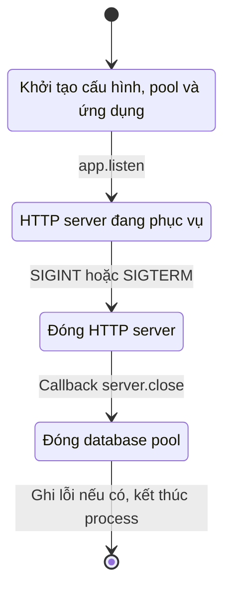
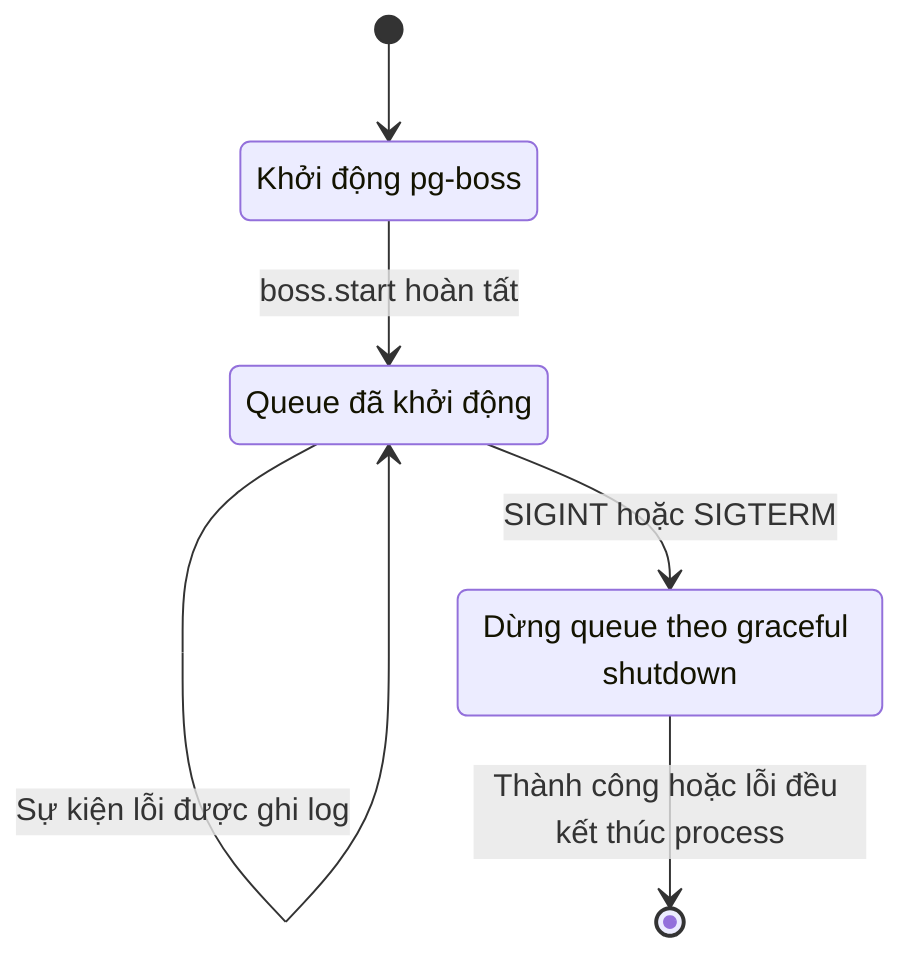
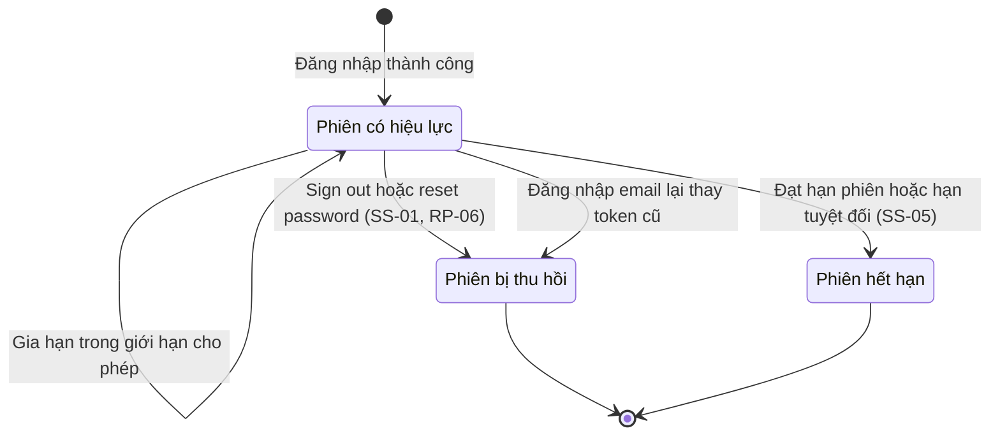

# System States & Lifecycle

Đọc file này để biết process và đối tượng nào có vòng đời trong hệ thống, bên sở hữu trạng thái, các sự kiện chuyển trạng thái và cách kết thúc hoặc xử lý lỗi.

## Drivers

| Driver | Cơ chế đáp ứng |
| --- | --- |
| Thời hạn và thu hồi phiên (SS-01, SS-05, RP-06) | API quản lý hiệu lực session; Web nhận biết qua lần kiểm phiên [[1]](#ref-1) |
| Phân biệt chưa đăng nhập và không kiểm được phiên (SS-03, SS-07) | Trạng thái truy cập workspace tách khỏi trạng thái session trong DB |
| Job lỗi có thể được theo dõi (QA-07), quan sát loop (QA-08) | Chưa có state machine nghiệp vụ Job/Search; Worker mới có vòng đời process và queue bootstrap [[2]](#ref-2) |

## Đối tượng và bên sở hữu trạng thái

| Đối tượng | Bên sở hữu, representation | Sự kiện chuyển trạng thái |
| --- | --- | --- |
| Process API | Node.js process; HTTP server và database pool | Khởi động, nhận `SIGINT`/`SIGTERM`, đóng server rồi pool |
| Process Worker | Node.js process; PgBoss instance | Khởi động queue, nhận tín hiệu dừng, `boss.stop({ graceful: true })` |
| Phiên | API/Better Auth; bản ghi `session` cùng thời hạn và cookie | Tạo, gia hạn, thu hồi, hết hạn |
| Quyền truy cập workspace tại Web | Router context và kết quả kiểm phiên; không lưu enum trong DB | Điều hướng, tab hiện lại, API trả session/null hoặc lỗi |
| Reset token | API/Better Auth; bản ghi `verification` | Tạo, hết hạn, bị tiêu thụ hoặc bị vô hiệu sau đổi password |
| Job/Search | Chưa có representation trạng thái nghiệp vụ trong code | Chưa đăng ký handler hoặc transition của domain |

Nguồn cho vòng đời process là bootstrap API/Worker [[3]](#ref-3); representation dữ liệu nằm trong Database [[4]](#ref-4). Vòng đời session và token được API kiểm, không phụ thuộc việc Web đang mở hay đã đóng.

## Trạng thái

### Process API

API chỉ đóng pool sau callback đóng HTTP server. Lỗi đóng pool được log; exit code hiện dựa trên lỗi của HTTP server, không dựa trên lỗi đóng pool [[3]](#ref-3).

### Process Worker

Worker log lỗi từ sự kiện `error` của pg-boss. Khi `boss.stop` thành công, Worker kết thúc process với exit code thành công. Khi `boss.stop` lỗi, Worker ghi log lỗi và kết thúc process với exit code lỗi. Trạng thái queue đã khởi động không đồng nghĩa một loại job nghiệp vụ đã được đăng ký [[3]](#ref-3).

### Phiên ở API

Phiên hết hạn có thể còn bản ghi cho tới khi được kiểm hoặc dọn; trạng thái logic không đồng nghĩa bản ghi đã bị xóa ngay tại mốc hết hạn. Hook kiểm hạn và chặn gia hạn nằm trong `createAuth` [[5]](#ref-5).

### Đồng bộ trạng thái tại Web

Web không giữ một bản sao bền của trạng thái session. Middleware đọc API khi điều hướng; khi tab hiện lại, `visibilitychange` gọi revalidation. Kết quả `null` mở màn chặn; request lỗi mở lỗi tải có nút thử lại. Cơ chế hiển thị cụ thể thuộc ADR về màn chặn workspace [[6, ADR-001]](#ref-6).

Web chỉ xóa QueryClient cache và điều hướng sau khi request Sign out thành công. Khi request lỗi, Web không chạy nhánh xóa cache. Đây là chuyển trạng thái phía client sau response, không phải transaction chung với việc xóa session ở DB. Cơ chế và rủi ro thu hồi session nằm trong Security [[7]](#ref-7).

## Quyết định

| Hạng mục | Quyết định |
| --- | --- |
| Trạng thái process và domain | Process phục vụ HTTP hoặc queue có vòng đời riêng, không dùng thay trạng thái session hoặc job |
| Trạng thái logic và persistence | Hiệu lực session tính từ dữ liệu và thời gian; không cần cột enum cho mỗi trạng thái |
| Trạng thái chưa triển khai | Không coi các trạng thái Job/Search trong yêu cầu sản phẩm là transition đã có ở Worker |

## Rủi ro

- Phiên kết thúc ở tab hoặc thiết bị khác không được đẩy bằng WebSocket tới workspace; màn hình đang hiển thị chỉ đổi sau lần kiểm phiên tiếp theo.
- Chưa có trạng thái nghiệp vụ Job/Search để theo dõi retry, hủy hoặc phục hồi sau lỗi; các yêu cầu Reliability/Observability tương ứng chưa có cơ chế triển khai [[2]](#ref-2).

## References

1. [Authentication](../UCs/authentication.md)
2. [Quality Attributes](../UCs/quality-attributes.md)
3. [API bootstrap](../../apps/api/src/index.ts) và [Worker bootstrap](../../apps/worker/src/index.ts)
4. [Data Model & Persistence](21-database.md)
5. [Auth config](../../apps/api/src/configs/auth.ts)
6. [Architectural Decisions](30-decisions.md)
7. [Security](23-security.md), [Workspace layout](../../apps/web/app/routes/workspace-layout.tsx), [Revalidation hook](../../apps/web/app/hooks/useRevalidateOnVisible.ts) và [Auth hooks](../../apps/web/app/hooks/useAuth.ts)
