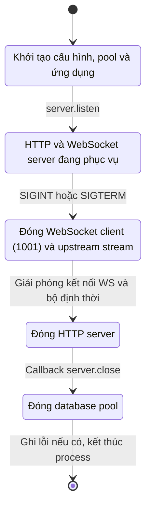
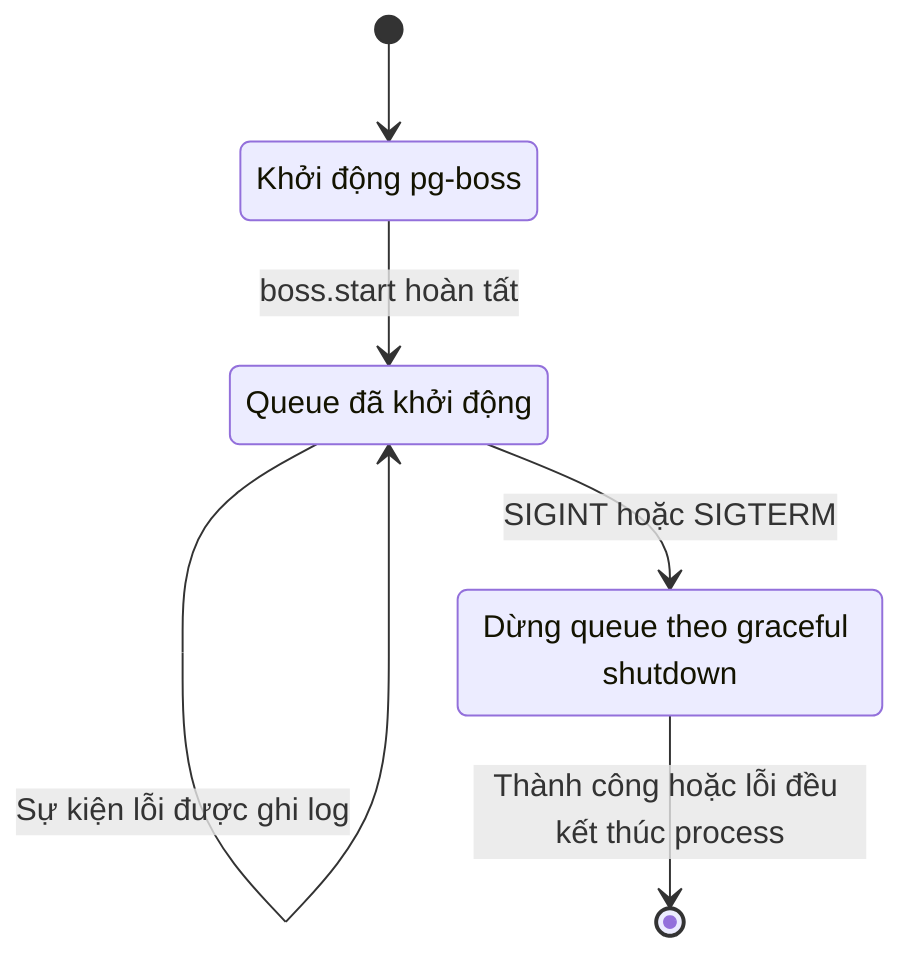
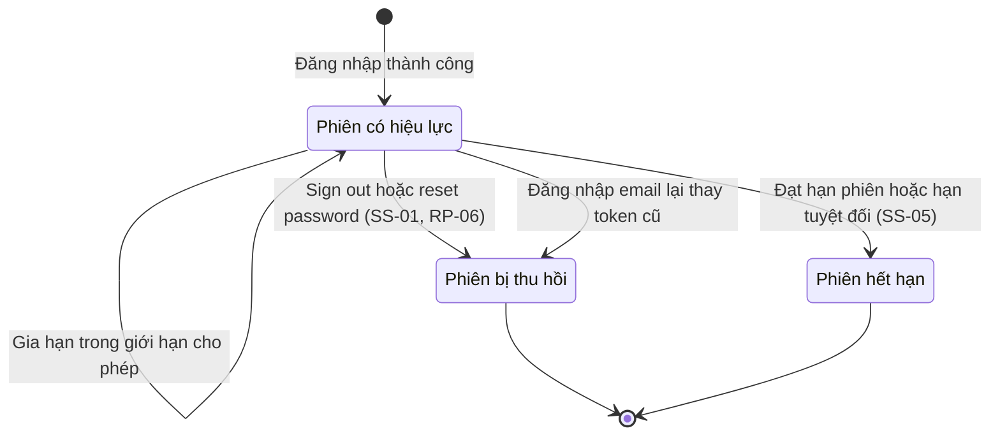
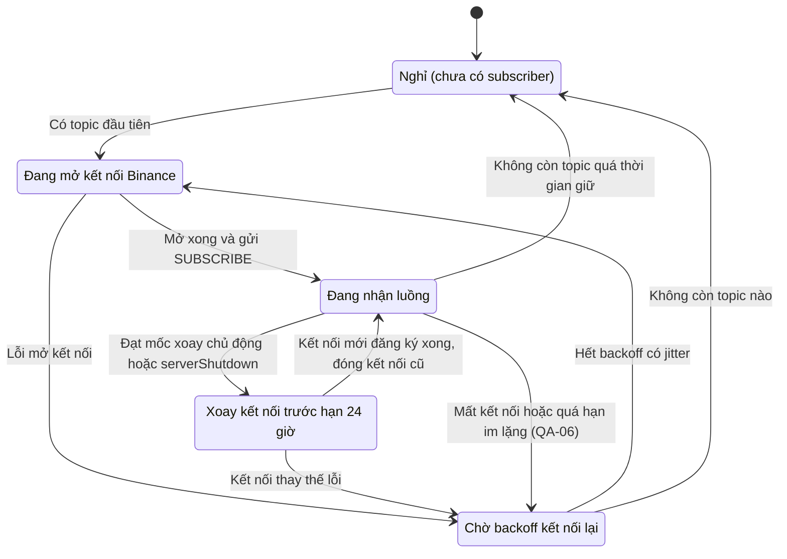
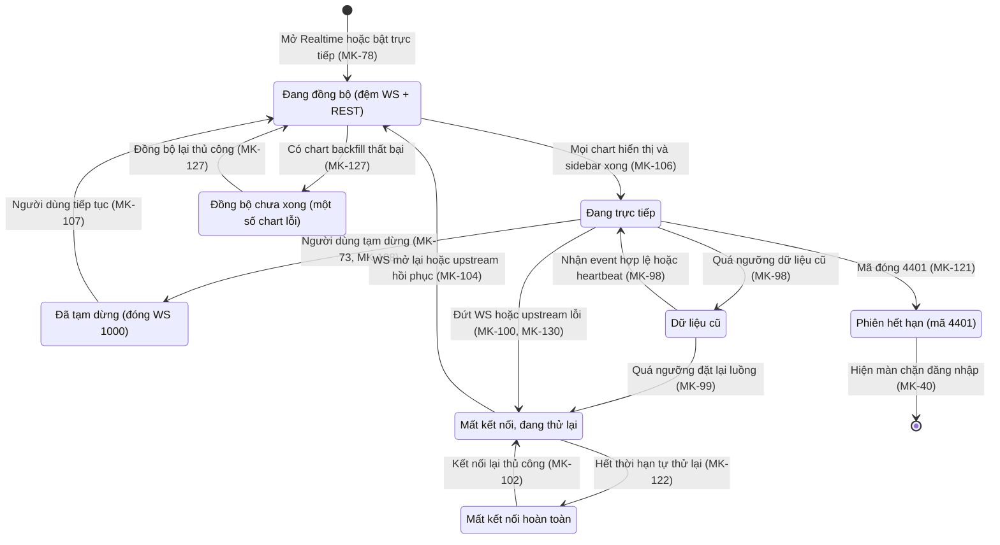

# System States & Lifecycle

Đọc file này để biết process và đối tượng nào có vòng đời trong hệ thống, bên sở hữu trạng thái, các sự kiện chuyển trạng thái và cách kết thúc hoặc xử lý lỗi.

## Drivers

| Driver | Cơ chế đáp ứng |
| --- | --- |
| Thời hạn và thu hồi phiên (SS-01, SS-05, RP-06) | API quản lý hiệu lực session; Web nhận biết qua lần kiểm phiên [[1]](#ref-1) |
| Phân biệt chưa đăng nhập và không kiểm được phiên (SS-03, SS-07) | Trạng thái truy cập workspace tách khỏi trạng thái session trong DB |
| Phục hồi khi kết nối Binance bị đóng và đồng bộ lại sau gián đoạn (QA-06, QA-16, MK-98 đến MK-108, MK-122, MK-126 đến MK-130) | Vòng đời kết nối upstream Binance WebSocket, vòng đời kết nối WebSocket của client và máy trạng thái đồng bộ Realtime tại Web (ADR-009 đến ADR-011) [[8]](#ref-8) [[9]](#ref-9) |
| Dừng cập nhật trực tiếp trên mọi tab khi phiên hết hạn hoặc bị thu hồi (MK-121, MK-129) | Hook thu hồi trong API kết hợp kiểm phiên theo lô đóng mọi kết nối WebSocket liên quan bằng mã `4401` (ADR-010) [[6]](#ref-6) |
| Job lỗi có thể được theo dõi (QA-07), quan sát loop (QA-08) | Chưa có state machine nghiệp vụ Job/Search; Worker mới có vòng đời process và queue bootstrap [[2]](#ref-2) |

## Đối tượng và bên sở hữu trạng thái

| Đối tượng | Bên sở hữu, representation | Sự kiện chuyển trạng thái |
| --- | --- | --- |
| Process API | Node.js process; HTTP server, WebSocket server và database pool | Khởi động, nhận `SIGINT`/`SIGTERM`, đóng WebSocket server (`1001`) và upstream stream, đóng HTTP server rồi đóng pool |
| Process Worker | Node.js process; PgBoss instance | Khởi động queue, nhận tín hiệu dừng, `boss.stop({ graceful: true })` |
| Phiên | API/Better Auth; bản ghi `session` cùng thời hạn và cookie | Tạo, gia hạn, thu hồi, hết hạn |
| Quyền truy cập workspace tại Web | Router context và kết quả kiểm phiên; không lưu enum trong DB | Điều hướng, tab hiện lại, nhận `401`/`4401` từ Market Data, API trả session/null hoặc lỗi |
| Reset token | API/Better Auth; bản ghi `verification` | Tạo, hết hạn, bị tiêu thụ hoặc bị vô hiệu sau đổi password |
| Kết nối upstream Binance WebSocket | `BinanceStreamProvider` trong process API; trạng thái trong bộ nhớ | Có subscriber đầu tiên, kết nối mở, ping/pong, xoay trước 24 giờ, ngắt kết nối, backoff kết nối lại, hết subscriber quá thời gian giữ |
| Kết nối client WebSocket | `MarketDataWsGateway` trong process API; bảng ánh xạ socket ↔ `(sessionId, userId, channels)` | Upgrade hợp lệ, subscribe/unsubscribe, kiểm phiên theo lô, vượt ngưỡng đệm `SLOW_CONSUMER`, thu hồi phiên (`4401`), client đóng (`1000`), server shutdown (`1001`) |
| Trạng thái kết nối và đồng bộ Realtime | `useRealtimeWorkspace` và WS client tại Web; tách biệt giữa màn hình và từng slot chart | Tải xong lịch sử đầu, tạm dừng/tiếp tục, quá ngưỡng dữ liệu cũ/đặt lại luồng, mất kết nối, backoff, hết hạn tự thử lại, mở lại kết nối, đồng bộ REST thành công hoặc lỗi từng chart, phiên hết hạn |
| Job/Search | Chưa có representation trạng thái nghiệp vụ trong code | Chưa đăng ký handler hoặc transition của domain |

Nguồn cho vòng đời process hiện tại là bootstrap API/Worker [[3]](#ref-3); representation dữ liệu nằm trong Database [[4]](#ref-4). Vòng đời session và token được API kiểm, không phụ thuộc việc Web đang mở hay đã đóng.

## Trạng thái

### Process API

Khi nhận `SIGINT` hoặc `SIGTERM`, API thực hiện bước `DongWS` trước: `wsGateway.close()` đóng mọi kết nối WebSocket đang mở bằng mã `1001`, dừng timer heartbeat và timer kiểm phiên, sau đó `streamHub.close()` đóng kết nối upstream Binance trước khi gọi `server.close` rồi đóng `pool` [[3]](#ref-3). Nhờ vậy `server.close` không bị treo do socket WebSocket còn mở.

### Process Worker

Worker log lỗi từ sự kiện `error` của pg-boss. Khi `boss.stop` thành công, Worker kết thúc process với exit code thành công. Khi `boss.stop` lỗi, Worker ghi log lỗi và kết thúc process với exit code lỗi. Trạng thái queue đã khởi động không đồng nghĩa một loại job nghiệp vụ đã được đăng ký [[3]](#ref-3).

### Phiên ở API

Phiên hết hạn có thể còn bản ghi cho tới khi được kiểm hoặc dọn; trạng thái logic không đồng nghĩa bản ghi đã bị xóa ngay tại mốc hết hạn. Hook kiểm hạn và chặn gia hạn nằm trong `createAuth` [[5]](#ref-5). Theo thiết kế xác thực và cưỡng chế phiên WebSocket (ADR-010), khi phiên chuyển sang `ThuHoi` trong process API, hook Auth thông báo ngay cho `MarketDataWsGateway` đóng các kết nối WebSocket thuộc phiên đó; khi phiên chuyển sang `HetHan` hoặc bị xóa ngoài process, vòng kiểm phiên theo lô phát hiện và đóng trong thời hạn cưỡng chế phiên (MK-121) [[6]](#ref-6).

### Kết nối upstream Binance WebSocket

Trạng thái thuộc sở hữu của `BinanceStreamProvider` trong process API [[8]](#ref-8):

Khi chuyển từ `DangNhan` sang `ChoThuLai`, Stream Hub phát khung `status` với `upstream: "unavailable"` tới mọi client đang kết nối (MK-130). Khi quay lại `DangNhan` sau gián đoạn (không phải sau bước `Xoay` thành công liên tục), Hub phát `status` với `upstream: "available", resyncRequired: true` để các client chạy REST backfill bù nến đóng bị thiếu (QA-06, MK-104, MK-105).

### Kết nối WebSocket và đồng bộ Realtime

Trạng thái tách rõ hai tầng trên Web để đồng bộ chính xác từng chart (MK-104, MK-127) mà vẫn hiển thị một trạng thái tổng quan cho màn hình Realtime [[9]](#ref-9):

Nhận mã đóng `4401` hoặc HTTP `401` ở bất kỳ trạng thái nào cũng chuyển ngay sang `PhienHetHan`, dừng mọi timer tự kết nối lại (MK-121) và gọi revalidation để hiển thị màn chặn workspace (MK-40, MK-129). Nhận mã `4429` (`CONNECTION_LIMIT_EXCEEDED` hoặc `RATE_LIMITED`) dừng tự kết nối lại và giữ trạng thái cảnh báo kèm dữ liệu đã tải. Ở cấp từng chart, mỗi slot chart giữ trạng thái riêng (`loading_initial`, `initial_error`, `syncing`, `live`, `sync_failed`) nên một chart ở `initial_error` (MK-131) hoặc `sync_failed` (MK-127) không chặn các chart khác nhận cập nhật trực tiếp.

### Đồng bộ trạng thái tại Web

Web không giữ một bản sao bền của trạng thái session. Middleware đọc API khi điều hướng; khi tab hiện lại, `visibilitychange` gọi revalidation. Kết quả `null` mở màn chặn; request lỗi mở lỗi tải có nút thử lại. Cơ chế hiển thị cụ thể thuộc ADR về màn chặn workspace [[6, ADR-001]](#ref-6).

Web chỉ xóa QueryClient cache và điều hướng sau khi request Sign out thành công. Khi request lỗi, Web không chạy nhánh xóa cache. Đây là chuyển trạng thái phía client sau response, không phải transaction chung với việc xóa session ở DB. Cơ chế và rủi ro thu hồi session nằm trong Security [[7]](#ref-7).

## Quyết định

| Hạng mục | Quyết định |
| --- | --- |
| Trạng thái process và domain | Process phục vụ HTTP/WS hoặc queue có vòng đời riêng, không dùng thay trạng thái session hoặc job |
| Trạng thái logic và persistence | Hiệu lực session tính từ dữ liệu và thời gian; trạng thái kết nối WebSocket chỉ giữ trong bộ nhớ runtime |
| Phân tầng trạng thái Realtime | Tách trạng thái kết nối cấp tab với trạng thái đồng bộ cấp từng chart để xử lý độc lập lỗi khởi tạo (MK-131) và lỗi đồng bộ từng phần (MK-127) |
| Trạng thái chưa triển khai | Không coi trạng thái Job/Search là transition đã có trong code cho tới khi triển khai |

## Rủi ro

- Với các màn hình workspace không mở WebSocket (ví dụ Strategy, Backtest hiện tại), phiên kết thúc ở tab hoặc thiết bị khác vẫn chỉ đổi sau lần kiểm phiên tiếp theo. Riêng màn hình Realtime đang mở WebSocket nhận tín hiệu đóng `4401` trong thời hạn cưỡng chế phiên (MK-121, ADR-010).
- Chưa có trạng thái nghiệp vụ Job/Search để theo dõi retry, hủy hoặc phục hồi sau lỗi; các yêu cầu Reliability/Observability tương ứng chưa có cơ chế triển khai [[2]](#ref-2).

## References

1. [Authentication](../UCs/authentication.md)
2. [Quality Attributes](../UCs/quality-attributes.md)
3. [API bootstrap](../../apps/api/src/index.ts) và [Worker bootstrap](../../apps/worker/src/index.ts)
4. [Data Model & Persistence](21-database.md)
5. [Auth config](../../apps/api/src/configs/auth.ts)
6. [Architectural Decisions](30-decisions.md)
7. [Security](23-security.md), [Workspace layout](../../apps/web/app/routes/workspace-layout.tsx), [Revalidation hook](../../apps/web/app/hooks/useRevalidateOnVisible.ts) và [Auth hooks](../../apps/web/app/hooks/useAuth.ts)
8. [Market Data & Realtime Updates](10-market-data.md)
9. [Market Data](../UCs/market-data.md)
