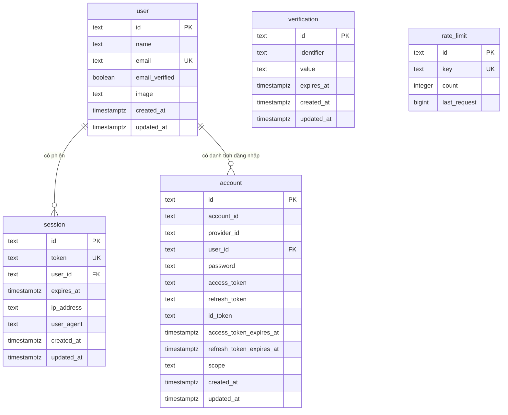

# Data Model & Persistence

Đọc file này để biết hệ thống lưu những dữ liệu nào, quan hệ giữa các entity, quyền sở hữu dữ liệu và cách bảo đảm tính toàn vẹn qua persistence và migration.

## Drivers

| Driver | Cơ chế đáp ứng |
| --- | --- |
| Danh tính và dữ liệu phiên của tài khoản | `user` sở hữu quan hệ với `account`, `session` qua foreign key [[1]](#ref-1) |
| Link reset chỉ dùng một lần (RP-04), thu hồi phiên khi đổi password (RP-06) | Dữ liệu tạm `verification` và bản ghi `session`; logic tiêu thụ/thu hồi thuộc Auth |
| Bộ đếm giới hạn không mất khi khởi động lại (SEC-04) | Rate limiter lưu bảng `rate_limit` |
| Bù nến đóng bị thiếu sau gián đoạn kết nối và dừng kênh trực tiếp khi phiên hết hạn hoặc bị thu hồi (MK-105, MK-121, QA-16) | Đã xem lại ở vòng WebSocket: không thêm bảng lưu nến trong PostgreSQL (backfill đọc qua Binance REST và cache ngắn hạn, ADR-008, ADR-009); bổ sung truy vấn đọc theo lô lên bảng `session` qua `SessionRepository` *(thiết kế đã duyệt ngày 2026-11-23, chưa triển khai, ADR-010)* [[8]](#ref-8) [[9]](#ref-9) |

## Phạm vi dữ liệu và quyền sở hữu

| Nhóm dữ liệu | Nơi lưu và bên quản lý | Hiện trạng |
| --- | --- | --- |
| Tài khoản, danh tính đăng nhập, phiên và dữ liệu xác thực tạm | PostgreSQL; schema/migration do API sở hữu, Better Auth thao tác qua Drizzle adapter; `SessionRepository` *(thiết kế)* chỉ đọc bảng `session` theo lô cho WebSocket | Có trong migration ứng dụng |
| Bộ đếm giới hạn request | PostgreSQL; rate limiter của Better Auth | Có bảng `rate_limit`, tồn tại qua lần khởi động process |
| Hạ tầng queue | PostgreSQL; pg-boss quản lý schema nội bộ, Worker khởi động queue | Không thuộc ERD bảng ứng dụng |
| Market Data (nến, summary và trạng thái subscription WebSocket) | Không lưu bền trong PostgreSQL; cache REST ngắn hạn và sổ đăng ký subscription nằm trong bộ nhớ process API [[8, ADR-008]](#ref-8) [[8, ADR-009]](#ref-8) | Không có bảng và không có migration ở cả vòng REST lẫn vòng WebSocket |
| Dữ liệu trình duyệt | Router context, TanStack Query cache và bộ đệm tạm thời lúc đồng bộ WebSocket | Không phải bản lưu bền của dữ liệu server |

Database ứng dụng hiện có các bảng trong ERD dưới đây. Đã xem lại nhu cầu lưu trữ cho vòng WebSocket (tải tối đa cửa sổ hiển thị MK-33 và bù nến đóng MK-105): mọi khoảng gián đoạn ngắn hoặc dài hơn giới hạn cửa sổ hiển thị đều phục hồi đầy đủ qua Binance REST `klines` (tối đa 519 nến mỗi lần gọi) kết hợp cache single-flight, nên không cần tạo bảng nến hoặc migration mới ở Bước 10 [[8, ADR-009]](#ref-8). Chưa có schema cho Strategy Version, Experiment, lịch sử nến dài hạn cho backtest hay kết quả backtest trong migration; mô hình domain của chúng được xác định khi triển khai module tương ứng [[2]](#ref-2) [[3]](#ref-3).

`createDatabase` tạo `pg.Pool` và Drizzle client; Better Auth truy cập các bảng qua Drizzle adapter. Tên property TypeScript dùng camelCase, tên cột PostgreSQL dùng snake_case ở cả runtime và drizzle-kit [[2]](#ref-2).

### ERD

ERD dùng tên bảng và cột vật lý từ schema và migration `0000_auth.sql` [[3]](#ref-3). `timestamptz` biểu diễn `timestamp with time zone`; các cột không có PK/FK/UK vẫn có thể là NOT NULL, chi tiết ở bảng ràng buộc bên dưới.

`verification` và `rate_limit` không có foreign key tới `user`. Với bản ghi reset password, `verification.value` là user ID và `identifier` chứa loại token; đây là liên kết logic do ứng dụng quản lý, không được DB bảo vệ bằng FK [[4]](#ref-4).

### Ràng buộc và index

| Bảng | Ràng buộc và ý nghĩa |
| --- | --- |
| `user` | Mọi cột bắt buộc trừ `image`; `email` UNIQUE; `email_verified` mặc định false |
| `session` | Mọi cột bắt buộc trừ `ip_address`, `user_agent`; `token` UNIQUE; khóa chính `id` phục vụ truy vấn theo lô `WHERE id IN (...)` của WebSocket *(thiết kế, ADR-010)* mà không cần thêm index mới; index `user_id`; FK `user_id` xóa cascade |
| `account` | Bắt buộc `id`, `account_id`, `provider_id`, `user_id`, timestamps; password, token, hạn token và scope nullable; index `user_id`; FK `user_id` xóa cascade |
| `verification` | Mọi cột bắt buộc; index `identifier`, không có UNIQUE cho `identifier` |
| `rate_limit` | Mọi cột bắt buộc; `key` UNIQUE; `last_request` là bigint ánh xạ thành number trong Drizzle |

Các bảng có `created_at`, `updated_at` dùng mặc định DB `now()`; cập nhật `updated_at` dùng `$onUpdate` của Drizzle, không có SQL trigger trong migration. ID do Better Auth sinh. Schema không khai báo composite UNIQUE cho `account(provider_id, account_id)` [[3]](#ref-3).

## Persistence và migration

PostgreSQL chạy qua Docker Compose với named volume `postgres-data`; dừng container không đồng nghĩa xóa volume. API dùng connection pool qua `createDatabase`, nhận địa chỉ kết nối từ `DATABASE_URL`; hiện `apps/api/src/database/client.ts` khởi tạo `new pg.Pool({ connectionString })` chưa cấu hình `max` (mặc định 10 kết nối) [[2]](#ref-2). Phân tích baseline REST polling cho thấy pool 10 kết nối bão hòa dưới đợt kiểm phiên đồng thời ở mức tải cao nhất trên host local [[10]](#ref-10); khi triển khai vòng WebSocket, truy vấn kiểm phiên ở trạng thái ổn định giảm xuống một câu đọc theo lô định kỳ (quyết định xác thực WebSocket ADR-010, chu kỳ nằm trong [Security](23-security.md#quyết-định)), đồng thời bổ sung biến môi trường `DATABASE_POOL_MAX` với mặc định **20 kết nối** (product owner duyệt ngày 2026-11-23; gấp đôi mặc định 10 của `pg.Pool` để hấp thụ đợt REST backfill đồng loạt khi nhiều client cùng reconnect mà vẫn thấp xa giới hạn mặc định `max_connections = 100` của PostgreSQL; tác động: tăng tối đa 10 kết nối DB mở thêm khi có tải đỉnh). Worker tạo kết nối pg-boss riêng. API và Worker có trách nhiệm đóng kết nối của mình khi shutdown [[5]](#ref-5).

Schema TypeScript được export từ `apps/api/src/database/schema/index.ts`; drizzle-kit sinh SQL vào `apps/api/drizzle/`. Runtime và generator cùng dùng snake_case. Từ repository root, `pnpm db:generate` sinh migration, `pnpm db:migrate` áp dụng migration vào database cấu hình. Các lệnh này là thao tác quản lý schema riêng, không nằm trong bootstrap API [[2]](#ref-2) [[5]](#ref-5).

FK, UNIQUE và NOT NULL được PostgreSQL bảo vệ. Thời hạn, tiêu thụ token và thu hồi phiên là bất biến do Auth adapter/hook thực hiện, không phải CHECK constraint hoặc trigger của DB. Chi tiết cơ chế bảo mật nằm trong Security [[6]](#ref-6). ERD và migration mô tả schema của codebase, không chứng minh một database đang chạy đã áp dụng migration.

## Quyết định

| Hạng mục | Quyết định |
| --- | --- |
| Schema sở hữu bởi ứng dụng | `apps/api/src/database/schema/index.ts` export schema Auth; migration nằm trong `apps/api/drizzle/` |
| Toàn vẹn dữ liệu | Quan hệ bắt buộc dùng FK; dữ liệu tạm không có FK cần logic ứng dụng quản lý vòng đời |
| Queue | Worker khởi động pg-boss trên cùng `DATABASE_URL`; pg-boss quản lý schema nội bộ riêng. ERD trên chỉ bao gồm bảng trong migration của ứng dụng, không phải bảng nội bộ của queue [[7]](#ref-7) |
| Market Data vòng REST và vòng WebSocket | Không lưu nến vào PostgreSQL và không thêm migration mới; backfill dùng Binance REST và cache ngắn hạn, xem lại khi Backtest cần lịch sử dài hạn [[8, ADR-008]](#ref-8) [[8, ADR-009]](#ref-8) |
| Truy vấn phiên theo lô cho WebSocket *(chưa triển khai)* | Dùng `SessionRepository` chỉ đọc trên khóa chính `session.id`, không đổi schema bảng `session` [[8, ADR-010]](#ref-8) |

## Rủi ro

- Dữ liệu `account` và `session` có credential/token nhạy cảm; không đưa nội dung các cột này vào log hoặc response tùy ý.
- Xóa cascade chỉ áp dụng cho `account` và `session`; tác vụ xóa tài khoản sau này phải xét riêng dữ liệu `verification` không có FK.
- Migration hiện chỉ định nghĩa Auth. Strategy Version, Experiment và kết quả backtest cần schema riêng khi triển khai flow Strategy → Backtest; không có bảng cho các domain này trong ERD hiện tại [[3]](#ref-3).
- Cấu hình mặc định 10 kết nối của `pg.Pool` có thể tạo hàng đợi khi hàng chục client cùng gọi REST backfill sau một đợt mất mạng diện rộng nếu chưa điều chỉnh `DATABASE_POOL_MAX` [[10]](#ref-10).

## References

1. [Authentication](../UCs/authentication.md)
2. [Database client](../../apps/api/src/database/client.ts) và [Drizzle config](../../apps/api/drizzle.config.ts)
3. [Auth schema](../../apps/api/src/database/schema/auth.ts) và [Auth migration](../../apps/api/drizzle/0000_auth.sql)
4. Better Auth cài trong workspace: `apps/api/node_modules/better-auth/dist/api/routes/password.mjs`.
5. [Docker Compose](../../docker-compose.yml), [API bootstrap](../../apps/api/src/index.ts) và [Workspace commands](../../package.json)
6. [Security](23-security.md)
7. [Worker bootstrap](../../apps/worker/src/index.ts)
8. [Architectural Decisions](30-decisions.md)
9. [Market Data](../UCs/market-data.md)
10. [Bottleneck thật sự của REST polling qua số đo baseline](../knowledge/261123-market-data-rest-polling/market-data-rest-polling.polling-bottlenecks.md)
