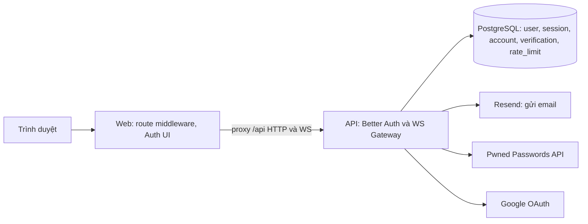
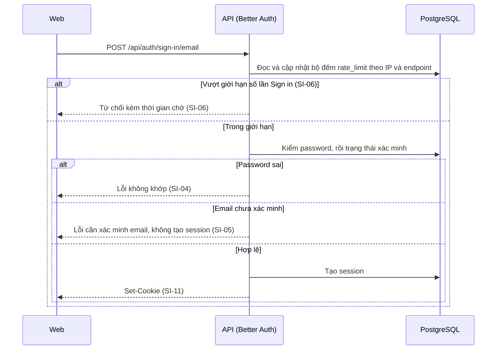
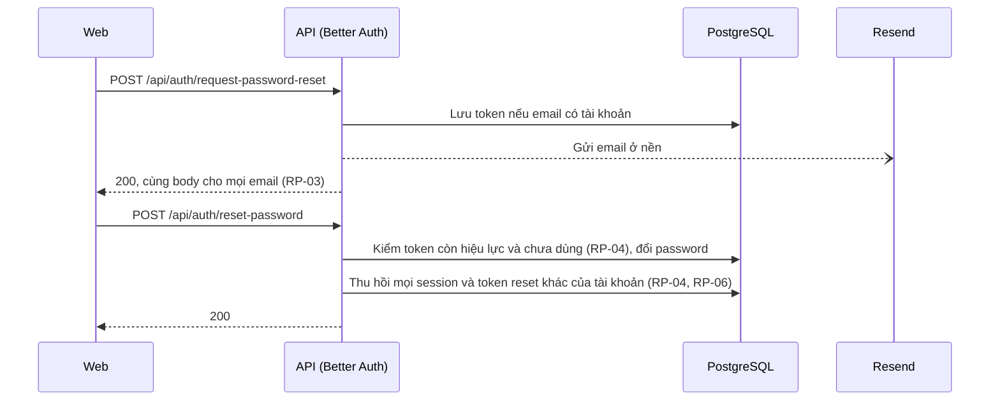
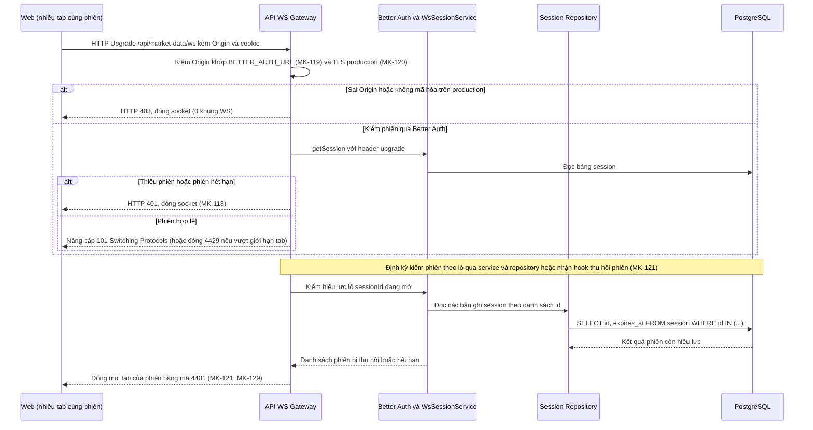

# Security

Đọc file này để biết tài sản và trust boundary của hệ thống được bảo vệ bằng cơ chế nào, cơ chế đặt ở đâu và còn những gap hoặc rủi ro nào.

## Drivers

Hành vi và số đo nằm trong Authentication [[1]](#ref-1) và Market Data [[13]](#ref-13). Bảng dưới chỉ nói cơ chế nào đáp ứng chúng.

| Driver | Cơ chế đáp ứng |
| --- | --- |
| Sign in, Create account, Verify email, Reset password, Continue with Google | Better Auth mount tại `/api/auth/*` trong API; dữ liệu trong PostgreSQL qua Drizzle adapter [[2, Tech Stack]](#ref-2) |
| Thời hạn phiên khi bật và tắt Keep me signed in (SI-09, SI-10), thời hạn tuyệt đối (SS-05) | Cấu hình session của Better Auth; API từ chối session quá thời hạn tuyệt đối |
| Giới hạn số lần Sign in, Google và gửi email (SI-06, GO-08, SEC-07); bộ đếm không mất khi khởi động lại (SEC-04) | Rate limiter của Better Auth, storage là bảng `rate_limit` trong PostgreSQL |
| Từ chối password phổ biến hoặc đã bị lộ (CA-14) | Danh sách password phổ biến từ SecLists và lời gọi API Pwned Passwords trong `apps/api/src/services/password-check.service.ts` |
| Không lộ email đã đăng ký (CA-04, RP-03, SEC-03, SEC-09) | Response giống nhau; email gửi ở nền; lỗi gửi chỉ ghi log |
| Header bảo mật (SEC-08), origin và callback (SEC-02), đích sau đăng nhập chỉ là đường dẫn nội bộ (RD-06) | Header trên response của API, origin check của Better Auth, kiểm tham số `next` ở Web |
| Màn chặn workspace và lỗi khi không kiểm được phiên (SS-03, SS-04, SS-07) | Route middleware ở Web [[3, ADR-001]](#ref-3) |
| Mức bảo mật OWASP ASVS 5.0 L1 cộng một số mục L2 cho Auth/Session | Quyết định mức bảo mật [[3, ADR-002]](#ref-3) |
| Từ chối mở mới kênh trực tiếp thiếu phiên, kiểm `Origin`, mã hóa `WSS` trên production và dừng cập nhật khi phiên hết hạn hoặc bị thu hồi (MK-118 đến MK-121, MK-129; mở rộng sang OWASP ASVS 5.0 V4.4.1–4.4.2) | Kiểm `Origin`, `WSS` và cookie phiên lúc HTTP upgrade `/api/market-data/ws`; thu hồi qua hook auth trong process kết hợp kiểm tra phiên theo lô (ADR-010) [[14]](#ref-14) |
| Không lộ chi tiết kỹ thuật upstream và loại bỏ dữ liệu trực tiếp sai định dạng (MK-39, MK-128, MK-130) | Schema Zod strict cho khung vào/ra, thông điệp lỗi chung, không ghi payload upstream ra client hoặc log |
| Bảo vệ tài nguyên máy chủ và giới hạn số tab đồng thời trên kênh WebSocket (QA-15, MK-142) | Giới hạn số kết nối mỗi tài khoản, giới hạn số kênh subscribe, kích thước khung tối đa, tốc độ thông điệp và ngắt client chậm vượt ngưỡng đệm (ADR-011) |

## Thành phần

### Tài sản và trust boundary

| Tài sản hoặc boundary | Cơ chế hiện có | Giới hạn |
| --- | --- | --- |
| Trình duyệt → API (HTTP) | Cookie session, kiểm origin/callback trong Better Auth, middleware `requireSession` trên `/api/market-data/*`, kiểm đích điều hướng ở Web | Lớp chặn Web chỉ là UI; các endpoint nghiệp vụ tương lai (Strategy, Backtest) cần tự kiểm quyền sở hữu tài nguyên khi triển khai |
| Trình duyệt ↔ API (WebSocket `/api/market-data/ws`) | Kiểm `Origin` khớp `BETTER_AUTH_URL`, bắt buộc `WSS` trên production, xác thực cookie phiên lúc upgrade, cưỡng chế thu hồi qua hook + kiểm phiên theo lô, validate khung Zod strict, giới hạn kết nối/kênh/kích thước/tốc độ và backpressure | Yêu cầu deploy cùng origin qua reverse proxy truyền đúng `X-Forwarded-Proto` |
| API → PostgreSQL | Drizzle adapter; API giữ connection string, không chuyển cho Web | Token và credential trong DB là dữ liệu nhạy cảm; ERD không thể hiện biện pháp bảo mật của môi trường deploy |
| API → Binance (REST và WebSocket) | API giữ kết nối ra ngoài, không để trình duyệt gọi Binance; kiểm dữ liệu trước khi phát ra ngoài; chỉ gửi thông điệp lỗi chung về Web | Dữ liệu thị trường là công khai, nhưng lộ hoặc lạm dụng kênh này sẽ tiêu hết quota IP của server |
| API → Google | OAuth redirect, kiểm state và xác định danh tính provider | Không đồng nhất phiên Google với phiên Crypto Force |
| API → dịch vụ email | Mailer giữ credential Resend; link dùng origin cấu hình | Email có token; chế độ console trong development là ngoại lệ log có chủ đích |
| API → Pwned Passwords | Gửi prefix hash, không gửi nguyên password; timeout và fallback danh sách cục bộ | Khi dịch vụ lỗi, chỉ còn danh sách password phổ biến |
| Log của API | Pino redact cookie, authorization và Set-Cookie. Log HTTP chỉ ghi nguyên path tĩnh của router ứng dụng; path dưới `/api/auth/` ghi dạng `/api/auth/{*splat}`, path khác ghi `/unmatched`, nên token trong path của link reset password không vào log. Không ghi query | Redaction theo trường đã cấu hình, không bảo đảm che mọi chuỗi token trong log tùy ý; khi thêm `/api/market-data/ws` phải giữ nguyên nguyên tắc không log cookie và query |
| Worker → PostgreSQL | Worker có kết nối queue riêng | Chưa có handler và contract nghiệp vụ để mô tả authorization theo job |

Các boundary hiện có được xác định từ API bootstrap, cấu hình Auth, password-check service và logger [[4]](#ref-4).

### Cơ chế Auth trong các boundary

Web gọi API qua proxy `/api`, nên cookie thuộc cùng origin với Web; `BETTER_AUTH_URL` là origin của Web.

## Kịch bản chính

Sign in với giới hạn số lần Sign in (SI-06):

Reset password:

Bắt tay và cưỡng chế thu hồi phiên trên WebSocket Market Data (ADR-010):

## Quyết định

| Hạng mục | Quyết định |
| --- | --- |
| Cookie session | Thuộc tính cookie phiên (SEC-01) cấu hình trong Better Auth; thuộc tính `Secure` bật theo `NODE_ENV=production`. Thời hạn phiên khi tắt Keep me signed in (SI-10) là mặc định của Better Auth cho phiên `dontRememberMe` |
| Thời hạn phiên tuyệt đối | Con số của thời hạn tuyệt đối (SS-05) theo mức tái xác thực tối đa cho AAL1 của NIST SP 800-63B [[5]](#ref-5); idle timeout không áp dụng [[3, ADR-002]](#ref-3) |
| Password | Danh sách password phổ biến (CA-14) lấy các dòng đầu của `Passwords/Common-Credentials/10-million-password-list-top-10000.txt` trong SecLists [[6]](#ref-6), lưu trong `apps/api/src/services/common-passwords.ts`; code ghi commit của SecLists đã dùng. `password-check.service.ts` gọi API Pwned Passwords; khi API lỗi hoặc quá thời gian chờ, service chỉ kiểm danh sách password phổ biến và ghi log cảnh báo (CA-14) |
| Header bảo mật | Middleware API đặt `X-Content-Type-Options`, `Referrer-Policy` và CSP `frame-ancestors`. `get-session` được Better Auth đặt `Cache-Control: no-store`; các response Auth khác chưa được middleware ứng dụng đặt header này. `Strict-Transport-Security` đặt ở reverse proxy khi deploy. Trang Choose a new password dùng `Referrer-Policy: no-referrer` qua header HTTP hoặc thẻ `<meta name="referrer" content="no-referrer">` [[7, V3.4.5]](#ref-7) |
| Origin và callback URL | Chỉ chấp nhận request và callback URL thuộc `BETTER_AUTH_URL`. Origin check luôn bật, kể cả khi `NODE_ENV=test` (Better Auth mặc định tắt check này trong test). Link trong email luôn dùng origin của `BETTER_AUTH_URL` (SEC-02) |
| Đích sau đăng nhập | Web kiểm tham số `next` trước khi chuyển tiếp, theo quy tắc đích nội bộ (RD-06), để `next` không thành open redirect |
| Email chưa xác minh | API kiểm password trước, trạng thái xác minh sau, để password sai luôn trả lỗi không khớp (SI-04, SI-05) |
| Link xác minh khi đang có phiên tài khoản khác | Không tạo session mới cho tài khoản vừa xác minh; giữ session hiện tại (SS-06) |
| Google | Request bắt đầu Continue with Google (`/api/auth/sign-in/social`) dùng cùng giới hạn với `/api/auth/sign-in/email` nhưng bộ đếm riêng (GO-08). Cấu hình provider dùng `prompt: 'select_account'` để mở lựa chọn tài khoản (GO-06). Callback chỉ tạo session khi tham số `state` khớp với request đã bắt đầu ở cùng trình duyệt [[8, §10.12]](#ref-8); thiếu hoặc không khớp thì không tạo session và không liên kết tài khoản (GO-04). Luồng Google dùng redirect, không dùng popup hay `postMessage` |
| Sign out | Web gọi `POST /api/auth/sign-out`; Better Auth xóa session trong database và xóa cookie; sau đó Web xóa cache dữ liệu của tài khoản (SS-01). Request thất bại thì Web giữ trạng thái đăng nhập (SS-02) |
| Màn hình workspace | Màn chặn chỉ là lớp hiển thị; API tự kiểm session ở mọi endpoint REST và kênh WebSocket cần đăng nhập |
| Lấy IP cho rate limit | Better Auth lấy IP từ `X-Forwarded-For` và chỉ tin header có đúng một địa chỉ. Ở development và test, Better Auth dùng `127.0.0.1` khi không có header |
| Email trong development | Khi không có `RESEND_API_KEY` và `EMAIL_FROM`, API in nội dung email ra console bằng `console`, không qua `pino` (SEC-06). Đây là ngoại lệ có chủ đích với quy tắc không log token [[9, Backend: responsibilities]](#ref-9). API kiểm hai biến này lúc khởi động ở `NODE_ENV=production` (SEC-06) |
| Xác thực, `Origin` và `WSS` của WebSocket | Tái sử dụng cookie phiên Better Auth cùng origin lúc HTTP upgrade; đã đọc nguyên văn OWASP ASVS 5.0 V4.4.3–4.4.4 ngày 2026-11-23 xác nhận dùng phiên HTTPS chuẩn không phát sinh yêu cầu tạo token WebSocket riêng. Luôn kiểm header `Origin` khớp chính xác `BETTER_AUTH_URL` kể cả khi `NODE_ENV=test` (MK-119, V4.4.2). Trên `NODE_ENV=production`, yêu cầu kết nối mã hóa `WSS` thông qua kiểm tra giao thức từ reverse proxy (`X-Forwarded-Proto: https`, MK-120, V4.4.1) [[3, ADR-010]](#ref-3) [[14]](#ref-14) |
| Cưỡng chế thu hồi phiên trên WebSocket | Kết hợp hai lớp: (1) hook `databaseHooks.session.delete.after` trong `createAuth` đóng ngay kết nối WebSocket thuộc phiên bị thu hồi trên cùng instance; (2) `WsSessionService` kiểm mốc `expiresAt` trong bộ nhớ mỗi **1 giây** (chi phí CPU không đáng kể, không chạm DB, đóng ngay phiên hết hạn tự nhiên trước hạn MK-121) và gọi `SessionRepository` chạy một truy vấn đọc theo lô lên bảng `session` mỗi **3 giây** cho toàn bộ `sessionId` đang mở (ngắn hơn thời hạn cưỡng chế MK-121 để chừa biên 2 giây cho truy vấn DB và khung đóng `4401`; cố định tối đa 1 truy vấn nhẹ mỗi 3 giây thay vì tăng theo số client) [[3, ADR-010]](#ref-3) |
| Bảo vệ tài nguyên WebSocket | Áp đặt năm ngưỡng cấu hình được (product owner duyệt ngày 2026-11-23): (1) giới hạn kết nối mỗi tài khoản theo quy tắc giới hạn số tab đồng thời (MK-142, cấu hình qua `WS_MAX_CONNECTIONS_PER_USER`, trả `error` `CONNECTION_LIMIT_EXCEEDED` và đóng `4429`, không ngắt tab cũ; tách khỏi bài đo tải bằng tài khoản riêng hoặc cấu hình môi trường test); (2) tối đa **10 kênh subscribe mỗi kết nối** (chừa biên lúc đổi kênh trên 4 chart cộng sidebar mà chặn đăng ký dư thừa); (3) kích thước khung tối đa **4 KB** (`maxPayload: 4096`; khung subscribe JSON nhỏ hơn 200 byte, chặn khung lớn gây tốn RAM); (4) tốc độ tối đa **20 thông điệp mỗi 10 giây mỗi kết nối** (đủ cho thao tác đổi nhanh liên tiếp của người dùng mà chặn spam `subscribe`/`unsubscribe`, vượt ngưỡng trả `RATE_LIMITED` và đóng `4429`); (5) ngắt client chậm bằng mã `4008` khi `bufferedAmount` vượt **64 KB** (chặn phình RAM server và buộc client đồng bộ bù nến qua REST thay vì rơi nến đóng) [[3, ADR-011]](#ref-3) |

## Rủi ro

- Yêu cầu không cache mọi response Auth (SEC-08) chưa được bao phủ đầy đủ trong code: `security-headers.middleware.ts` chỉ đặt các header chung, còn Better Auth đặt `no-store` cho `get-session`. Cần bổ sung bảo vệ các response Auth còn lại trước khi kết luận đáp ứng đầy đủ yêu cầu này [[10]](#ref-10).
- Xóa session trong database lỗi khi Sign out: Better Auth chỉ ghi log, vẫn xóa cookie và trả thành công. Token đã bị sao chép vẫn dùng được tới khi session hết hạn. Rủi ro chỉ xảy ra khi đồng thời mất token và database lỗi; xử lý phải can thiệp vào luồng nội bộ của Better Auth [[3, ADR-002]](#ref-3).
- Giới hạn Sign in tính theo IP: kẻ tấn công đổi IP liên tục vẫn thử được nhiều password cho một tài khoản [[3, ADR-002]](#ref-3).
- Ràng buộc deploy của giới hạn theo IP (SEC-05) và kiểm `WSS` (MK-120): API chỉ nhận request qua reverse proxy, và proxy phải ghi đè (không nối thêm) `X-Forwarded-For` cùng `X-Forwarded-Proto`. Client gọi thẳng API có thể giả mạo các header này.
- Giới hạn theo IP không ngăn gửi nhiều email vào hộp thư của một người từ nhiều IP, và không bảo vệ quota của Resend. Giới hạn bổ sung trước khi deploy public gồm giới hạn theo địa chỉ email, giới hạn tổng số email mỗi ngày và dọn tài khoản chưa xác minh (SEC-10).
- Password đã bị lộ nhưng không nằm trong danh sách password phổ biến được chấp nhận trong lúc API Pwned Passwords lỗi (CA-14).
- Các cơ chế bảo mật WebSocket (quyết định ADR-010, ADR-011) và giới hạn số tab đồng thời (MK-142) đã được triển khai và kiểm chứng bằng integration test (`ws-gateway.test.ts`), E2E (`websocket-live.spec.ts`) và mutation gate (`ws-mutations.mjs`), dựa trên các mục OWASP ASVS 5.0 V4.4 đọc nguyên văn ngày 2026-11-23 [[14]](#ref-14).
- Ngưỡng tốc độ thông điệp và số kết nối WebSocket nằm trong bộ nhớ process API; khi chạy nhiều instance API sau này, bộ đếm này không dùng chung giữa các instance.

ERD và cơ chế persistence nằm trong Database [[11]](#ref-11); contract endpoint và WebSocket nằm trong API Contracts [[12]](#ref-12). Các hook kiểm password, thời hạn, origin và cấu hình rate limiter được định nghĩa tại `apps/api/src/configs/auth.ts`; gửi email qua `services/auth-email.service.ts` và `services/mailer.ts`.

## References

1. [Authentication](../UCs/authentication.md)
2. [Project: Crypto Force](../../AGENTS.md)
3. [Architectural Decisions](30-decisions.md)
4. [API bootstrap](../../apps/api/src/index.ts), [Auth config](../../apps/api/src/configs/auth.ts), [Password check service](../../apps/api/src/services/password-check.service.ts) và [API logger](../../apps/api/src/configs/logger.ts)
5. [NIST SP 800-63B: Digital Identity Guidelines, Authentication and Lifecycle Management](https://pages.nist.gov/800-63-3/sp800-63b.html)
6. [SecLists](https://github.com/danielmiessler/SecLists)
7. OWASP ASVS 5.0, V3 Web Frontend Security. <https://raw.githubusercontent.com/OWASP/ASVS/master/5.0/en/0x12-V3-Web-Frontend-Security.md>
8. [RFC 6749: The OAuth 2.0 Authorization Framework](https://www.rfc-editor.org/rfc/rfc6749)
9. [Coding Guidelines](../conventions/code.md)
10. [Security headers middleware](../../apps/api/src/api/middlewares/security-headers.middleware.ts); handler session của Better Auth cài trong workspace tại `apps/api/node_modules/better-auth/dist/api/routes/session.mjs`.
11. [Data Model & Persistence](21-database.md)
12. [API & Realtime Communication Contracts](22-api-endpoints.md)
13. [Market Data](../UCs/market-data.md)
14. OWASP ASVS 5.0, V4 API and Web Service (V4.4 WebSocket), đọc nguyên văn file `0x13-V4-API-and-Web-Service.md` ngày 2026-11-23. <https://raw.githubusercontent.com/OWASP/ASVS/master/5.0/en/0x13-V4-API-and-Web-Service.md>
