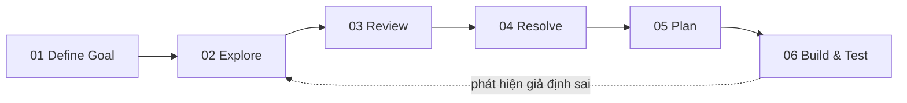

# Prototype → Implementation Roadmap

Đọc file này để biết việc chuyển prototype thành `apps/web` được chia thành những increment nào, làm theo thứ tự nào, và mỗi increment được phát triển ra sao.

## Đơn vị increment

Mỗi increment là **một flow ở một mức hoàn thiện**, không phải một màn hình. Một flow có thể đi qua nhiều màn hình, và một màn hình được xây dần qua nhiều increment: mỗi increment chỉ làm phần màn hình mà flow của nó cần.

| Mức hoàn thiện | Ý nghĩa |
| --- | --- |
| UI Integrated | Giao diện của flow chạy trong `apps/web`, dữ liệu từ stub |
| Flow Functional | Flow chạy với backend và Auth thật |
| Release Ready | Đạt tiêu chí phát hành, gồm accessibility và kiểm chứng tự động |

Ví dụ: màn hình Backtest không được làm trọn trong một lần. Increment "Strategy → Backtest" chỉ làm phần cấu hình, chạy và xem run mà flow này cần. Nhánh nhận strategy từ Discovery được làm trong increment Discovery.

## Thứ tự

Nguyên tắc sắp xếp:

- Foundation đi trước mọi increment.
- Flow ít dependency đi trước. Landing và 404 không cần backend hoặc session.
- Flow trong workspace yêu cầu đăng nhập [[1, Điều kiện đăng nhập]](#ref-1), nên đi sau flow Auth. App header và layout workspace được xây cùng increment workspace đầu tiên.
- Flow đi qua nhiều màn hình được làm hai lượt: UI Integrated với stub trước, Flow Functional khi backend sẵn sàng.

| # | Increment | Flow | Màn hình chạm tới | Mức | Phụ thuộc |
| --- | --- | --- | --- | --- | --- |
| 0 | Foundation | Tokens, fonts, base styles, breakpoints [[2, Nền chung]](#ref-2) | Toàn app | — | — |
| 1 | Public pages | Xem Landing, điều hướng tới các section, FAQ, trang 404 [[3]](#ref-3) | Landing, 404 | UI Integrated | 0 |
| 2 | Auth | Sign in, Create account, Verify email, Reset password, chuyển tiếp sau khi đăng nhập [[4]](#ref-4) | Auth | Flow Functional | 0; Better Auth, Resend [[5, Tech Stack]](#ref-5) |
| 3 | App shell | Điều kiện đăng nhập, App header, Sign out [[1]](#ref-1) | App header, layout workspace | Flow Functional | 2 |
| 4a | Strategy → Backtest | Tạo strategy, lưu vào library, chạy backtest, xem run [[6]](#ref-6) [[7]](#ref-7) | Strategy Engine, Strategy library, Backtest | UI Integrated | 3 |
| 4b | Strategy → Backtest | Như 4a, với dữ liệu và backtest thật | Như 4a | Flow Functional | 4a; API, `apps/worker` (pg-boss), `packages/engine` [[5, Tech Stack]](#ref-5) |
| 5 | Landing idea handoff | Landing → Auth → Strategy Engine với ý tưởng điền sẵn [[3, Thử một ý tưởng từ Landing]](#ref-3) | Landing, Auth, Strategy Engine | Flow Functional | 1, 2, 4a |

Các flow còn lại chưa được xếp thứ tự: Discovery [[8]](#ref-8), Realtime [[9]](#ref-9), News [[10]](#ref-10), Settings [[11]](#ref-11). Thứ tự giữa chúng được chọn theo dependency backend của từng flow, trước khi bắt đầu increment kế tiếp sau increment 5. Release Ready được lên kế hoạch sau khi công cụ testing được chốt ([OQ-069](../../open-questions.md#oq-069)).

### Action dẫn sang flow chưa làm

Các action dưới đây có trong prototype nhưng dẫn sang flow thuộc increment sau. Cách xử lý tạm thời (ẩn, disabled hoặc giữ link) được quyết định ở bước 04 của increment chứa action [[2, 04. Resolve]](#ref-2).

| Action | Có từ increment | Hoàn tất ở increment |
| --- | --- | --- |
| Landing: Backtest this idea [[3, Thử một ý tưởng từ Landing]](#ref-3) | 1 | 5 |
| 404: Go to Realtime, Try again [[3, Trang không tồn tại]](#ref-3) | 1 | Realtime |
| 404: link nhanh tới các tab workspace [[3, Trang không tồn tại]](#ref-3) | 1 | Increment của từng tab |
| Landing: thông báo sau khi xóa tài khoản [[3, Thông báo sau khi xóa tài khoản]](#ref-3) | 1 | Settings |
| App header: Search, Notifications [[1, App header]](#ref-1) | 3 | 4b |
| App header: chip "Backtest NN%"; hộp thoại "A backtest is still running" khi Sign out [[1, Sign out]](#ref-1) | 3 | 4b |
| App header: chỉ báo Market data [[1, App header]](#ref-1) | 3 | Realtime |
| Menu tài khoản: Profile, Settings; hộp thoại "Leave without saving?" [[1, Rời trang khi còn thay đổi chưa lưu]](#ref-1) | 3 | Settings |

Chiều ngược lại cũng cần theo dõi: các flow sau gửi dữ liệu vào màn hình của increment 4a, như Discovery (Re-test) và Realtime gửi strategy sang Backtest, News gửi điều kiện sentiment sang Strategy Engine [[1, Chuyển ngữ cảnh giữa các màn hình]](#ref-1). Màn hình đích phải nhận được các dữ liệu này khi increment của flow nguồn được làm.

## Phát triển một increment

Mỗi increment đi qua 6 bước; chi tiết từng bước nằm trong Workflow [[2]](#ref-2).

| Bước | Làm gì | Ra gì |
| --- | --- | --- |
| 01. Define Goal | Chốt flow, phạm vi và mức hoàn thiện | Scope + Definition of Done |
| 02. Explore | Chạy prototype, đọc file hành vi trong `prototype/docs/requirements/`, xem code hiện có | Inventory, điểm chưa xác định |
| 03. Review | So hiện trạng với tiêu chuẩn theo các góc nhìn phù hợp | Findings có bằng chứng |
| 04. Resolve | Phân loại findings: blocker, trước tích hợp, trước release, hoãn | Decisions, open questions |
| 05. Plan | Chọn route, render mode, component, nguồn dữ liệu, thứ tự slice | Implementation Plan |
| 06. Build & Test | Code và kiểm chứng từng vertical slice | Increment đạt Definition of Done |

Increment không đọc hoặc ghi dữ liệu server và không phụ thuộc session, như increment 1, đi theo track rút gọn: gộp bước 01–04 thành một lần review [[2, Track rút gọn]](#ref-2).

Điểm cần nhớ khi phát triển:

- **Prototype là reference, không phải spec.** Giữ ý đồ thiết kế, không sao chép pixel; hành vi sản phẩm lấy từ `docs/design/prototype/docs/requirements/` [[2, Mức độ bám prototype]](#ref-2).
- **Không mang `localStorage` của prototype sang.** Mỗi key `cf.*` có đích riêng: Better Auth, API + TanStack Query, route state hoặc trình duyệt [[2, State và dữ liệu]](#ref-2).
- **Thay component nhưng giữ hành vi.** Focus trong overlay, skip link, lỗi form, toast và bảng cuộn ngang phải hoạt động như prototype [[2, Hành vi dùng chung cần giữ]](#ref-2).
- **Không tự chốt.** Requirement và quyết định kiến trúc cần người dùng chấp thuận; câu hỏi mở ghi vào `docs/open-questions.md`.
- **Kiểm chứng không chỉ là build pass.** Khi chưa có công cụ test, mỗi slice cần typecheck, lint, build, so sánh với prototype ở các breakpoint và kiểm tra bàn phím [[2, Kiểm chứng tối thiểu]](#ref-2).

## Cập nhật file này

- Khi thêm, tách hoặc đổi thứ tự increment, cập nhật cột Phụ thuộc và bảng action tương ứng.
- Khi một action được hoàn tất, xóa dòng của action đó khỏi bảng action.

## References

1. [Workspace](../../design/prototype/docs/requirements/workspace.md)
2. [Prototype → Implementation Workflow](workflow.md)
3. [Public pages](../../design/prototype/docs/requirements/public-pages.md)
4. [Authentication](../../design/prototype/docs/requirements/authentication.md)
5. [Project: Crypto Force](../../../AGENTS.md)
6. [Strategy Engine và Strategy library](../../design/prototype/docs/requirements/strategy-engine.md)
7. [Backtest](../../design/prototype/docs/requirements/backtest.md)
8. [Discovery](../../design/prototype/docs/requirements/discovery.md)
9. [Realtime](../../design/prototype/docs/requirements/realtime.md)
10. [News](../../design/prototype/docs/requirements/news.md)
11. [Settings](../../design/prototype/docs/requirements/settings.md)
