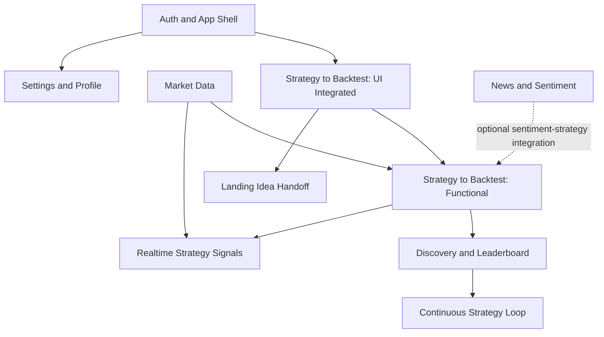

# Proposed Feature Build Order

> **Document date:** 2026-11-25  
> **Document status:** Proposed (not an approved implementation roadmap).  
> **Implementation status snapshot:** 2026-11-25, branch `feat/market-data/websocket`, inspected commit `098d2b54f05ced81324fef2d8a0a0591f068deca`.

## 1. Purpose & Scope

Recommend a dependency-aware order for building the feature flows after Market Data. This is a prioritization proposal, not a detailed implementation plan or permission to implement. A build increment is one **flow at a defined completeness level**, not an entire page. Follow the existing [roadmap](draft/implementation-plan/roadmap.md) definitions of UI Integrated, Flow Functional, and Release Ready. Independent flows may proceed in parallel.

## 2. Current Implementation Status

**As of 2026-11-25**, based on documents checked on the specified branch (not a fresh execution of tests):

| Area | Documented implementation status | Source |
| --- | --- | --- |
| Foundation, Landing, Auth, workspace shell | Implemented; authenticated workspace routing and UI shell exist. | [System architecture](../../architecture/00-system.md) |
| Market Data | [Tracker](market-data/implementation/tracker.md) records steps 01–12 completed: REST history, REST polling, WebSocket updates, shared subscriptions, and recovery. | [Market Data tracker](market-data/implementation/tracker.md) |
| Market Data verification | Step 12 records passing scoped automated tests and reduced benchmarks. Full isolated-machine `180s × 3` benchmark remains **Inconclusive**. | [Market Data tracker](market-data/implementation/tracker.md) |
| Strategy, Library, Backtest, Discovery, News | Workspace feature pages are placeholders; their functional flows are not implemented yet. | [System architecture](../../architecture/00-system.md) |
| Domain execution | `packages/engine` has no exported domain computation; worker has pg-boss lifecycle but no business job handlers. | [System architecture](../../architecture/00-system.md) |
| News sentiment | LLM integration is described as a future design, not an implemented integration. | [System architecture](../../architecture/00-system.md) |

**Evidence boundary:** These statements describe the repository's documented status at the date and commit above. “Completed” does not imply all release gates or full benchmarks passed. Revalidate status when planning a later flow.

## 3. Prioritization Criteria

1. **Dependencies:** establish executable foundations before downstream features.
2. **Core value:** market observation → strategy → backtest → evaluation → comparison → search.
3. **Vertical-slice verification:** prefer bounded user journeys with demonstrable tests.
4. **Architecture leverage:** reuse Market Data, deterministic engine contracts and background jobs.
5. **Decision readiness:** do not invent requirements or treat prototype behavior as approved.

**Proposed priorities:** P0 = first critical dependency; P1 = next product outcome; P2 = extension; P3 = supporting functionality. These are recommendations, not confirmed product decisions.

## 4. Proposed Build Order

| Order | Flow / increment | Level and priority | Rationale | Dependencies |
| --- | --- | --- | --- | --- |
| Complete | Market Data | Documented completed | REST and WebSocket market foundation is available. | Auth, shell, provider |
| 1 | Strategy → Backtest (4a) | UI Integrated, **P0** | Validate create → save → configure → run → inspect UX with stubs. | App shell, prototype flow |
| 2 | Strategy → Backtest (4b) | Flow Functional, **P0** | Implement real strategy contracts, library, engine, backtesting, evaluation and run results. | 4a; Market Data history; API, DB, worker and engine |
| 3 | Landing idea handoff (existing increment 5) | Flow Functional, **P1** | Complete landing → auth → prefilled strategy journey. May be advanced after 4a if scope permits. | Landing, Auth, strategy creation |
| 4 | Discovery & Leaderboard | Flow Functional, **P1** | Generate bounded candidates, reuse backtest results and rank candidates. | Functional backtest/evaluation; jobs |
| 5 | Continuous Strategy Loop | Flow Functional, **P2** | Extend Discovery with stop conditions, pause/resume, recovery and observability. | Functional Discovery and reliable job lifecycle |
| 6 | Realtime Strategy Signals | Flow Functional, **P2** | Compute and display actual BUY/SELL signals and overlays. | Strategy Engine, Market Data, signal decisions |
| 7 | News & Sentiment | UI Integrated then Flow Functional, **P2** | Build feed/crawl/sentiment; add sentiment strategies only after semantics are approved. Can run in parallel with Discovery. | News provider, worker, LLM adapter; Strategy Engine for integration |
| 8 | Settings & Profile completion | Incremental Flow Functional, **P3** | Complete secondary account flows; independent slices can move earlier. | Auth, persistence and per-setting decisions |
| Cross-cutting | Release Ready gates | Per increment | Verify accessibility, security, correctness, reliability and performance rather than deferring all checks. | Selected flow's requirements and testing |

The [existing roadmap](draft/implementation-plan/roadmap.md) orders 4a, 4b and increment 5, but leaves Discovery, Realtime, News and Settings unordered. The table preserves the previously defined increment dependencies; its new P0–P3 priorities and positions beyond increment 5 remain **Proposed**.

## 5. Feature Dependencies

The News integration edge is **optional for the initial Strategy → Backtest flow**. Orders 5–8 are not a strict serial dependency chain.

## 6. Recommended Next Flow

Start with **Strategy → Backtest, increment 4a (UI Integrated)**, then **4b (Flow Functional)**. First resolve the user journey using stubs; then design and verify domain contracts, deterministic engine behavior, historical input, persistence, pg-boss execution, evaluation and run output. Apply the [increment workflow](draft/implementation-plan/roadmap.md): Define Goal → Explore → Review → Resolve → Plan → Build & Test. Do not build a production Discovery pipeline before usable functional backtesting exists.

## 7. Open Decisions & Revisit Triggers

| Decision | Source | Affected flows |
| --- | --- | --- |
| Convert descriptions or links to strategy rules; blocking validation | [OQ-021, OQ-022](../../open-questions.md) | Strategy and Backtest |
| Rule editing and strategy versioning | [OQ-023, OQ-025](../../open-questions.md) | Library, reproducible runs |
| Backtest timing and concurrent-job targets | [OQ-066, OQ-067](../../open-questions.md) | Backtest and Discovery |
| Actual live chart signals and overlay selection | [OQ-031, OQ-033](../../open-questions.md) | Realtime Signals |
| Sentiment thresholds and 24-hour aggregation | [OQ-036, OQ-037](../../open-questions.md) | News and Sentiment |
| Time zone and research defaults | [OQ-049, OQ-055](../../open-questions.md) | Settings and Backtest |

Review this proposal when a dependency is completed, requirements are approved or changed, or new test evidence changes feasibility. Verify the live open-question statuses before planning implementation.

## 8. References

- [Existing Prototype to Implementation Roadmap](draft/implementation-plan/roadmap.md)
- [Market Data tracker](market-data/implementation/tracker.md)
- [System architecture](../../architecture/00-system.md)
- [Use Cases](../../UCs/README.md)
- [Project brief](../../UCs/sources/project-brief.md)
- [System description](../../UCs/sources/system-description.md)
- [Prototype behavior index](../../design/prototype/docs/requirements/README.md)
- [Open questions](../../open-questions.md)
