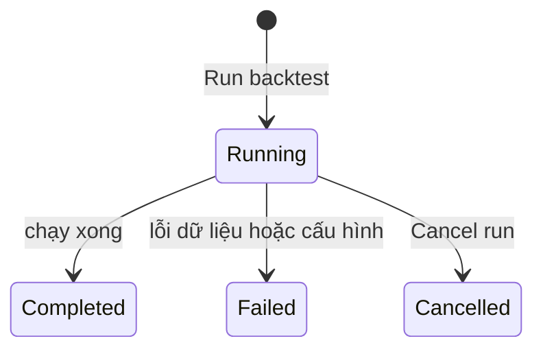

# Backtest

Đọc file này để biết cách cấu hình và chạy một backtest thủ công, theo dõi run đang chạy, và xem lại kết quả của từng run.

Backtest có hai view: **Set up & run** và **Runs (N)**. Chi tiết của một run nằm trong view Runs, không phải một tab riêng (**Confirmed**). Tab Set up & run hiện kết quả của run Completed gần nhất ngay dưới form.

## Cấu hình một lần chạy

| Trường | Quy tắc |
| --- | --- |
| Pair | BTCUSDT, ETHUSDT, SOLUSDT |
| Timeframe | 1m, 5m, 15m, 1h, 4h |
| From, To | Bắt buộc; To phải sau From; To không được ở tương lai |
| Capital (USD) | Số, tối thiểu 1 |
| Strategy | Xem [Chọn strategy để backtest](#chọn-strategy-để-backtest) |
| Fee (%) | Số từ 0 đến 1; tính trên mỗi lần vào và mỗi lần ra lệnh |
| Slippage (bps) | Số nguyên từ 0 đến 100; 1 bps = 0,01% |

Lỗi hiện ngay dưới từng trường, kèm dòng tổng "Fix N field(s) above to run the backtest". Run backtest bị vô hiệu khi còn lỗi.

## Chọn strategy để backtest

Ô Strategy liệt kê MA Crossover (built-in) cùng toàn bộ item trong Strategy library.

Khi người dùng mở Backtest từ màn hình khác ([workspace.md](workspace.md#chuyển-ngữ-cảnh-giữa-các-màn-hình)), strategy được chọn sẵn và có dòng ghi chú nguồn, ví dụ "Loaded {tên} from your library".

Nếu strategy được chuyển sang không có trong Library, ví dụ một composite chưa lưu hoặc một candidate của Discovery:

- Ô chọn có thêm lựa chọn "{tên} (unsaved)".
- Ghi chú nói rõ strategy chưa có trong Library.
- Run sẽ dùng rules đi kèm khi chuyển sang.

## Chạy backtest

1. Người dùng chọn **Run backtest**.
2. Nếu đang có một backtest thủ công khác chạy, hệ thống mở hộp thoại thay vì chạy ([bên dưới](#khi-đã-có-backtest-đang-chạy)).
3. Nếu không, hệ thống tạo run mới với mã tăng dần (`R-1043`, …), trạng thái Running, và hiện toast báo người dùng có thể làm việc ở tab khác.
4. Dưới form hiện thẻ trạng thái của run: thanh tiến trình, phần trăm và **Cancel run**.

## Khi đã có backtest đang chạy

Mỗi thời điểm chỉ một backtest thủ công được chạy; không có hàng đợi (**Confirmed**). Bấm Run backtest khi đang có run khác chạy sẽ mở hộp thoại "A backtest is already running", ghi run nào đang chạy và đã được bao nhiêu phần trăm.

| Lựa chọn | Kết quả |
| --- | --- |
| View running run | Mở chi tiết run đang chạy |
| Cancel it and run the new one | Hủy run cũ. Chỉ khi hủy xong mới bắt đầu run mới với cấu hình vừa nhập. Trong lúc hủy, các nút bị vô hiệu và hiện "Cancelling…" |
| Close | Đóng hộp thoại, giữ nguyên cấu hình vừa nhập |

Không có lựa chọn "Đợi", vì lựa chọn đó dễ khiến người dùng nghĩ run đã được xếp hàng (**Confirmed**).

Giới hạn này chỉ áp dụng cho backtest thủ công. Các lượt backtest bên trong Discovery không tính ([discovery.md](discovery.md)).

## Theo dõi backtest đang chạy

Backtest tiếp tục chạy khi người dùng chuyển sang tab khác trong workspace (**Confirmed**).

- App header hiện chip "Backtest NN%" ở mọi màn hình workspace. Chọn chip mở chi tiết run ([workspace.md](workspace.md#app-header)).
- Khi run kết thúc, hệ thống thêm thông báo "Backtest finished" hoặc "Backtest failed"; chọn thông báo mở đúng run đó.
- Nếu người dùng đang ở Backtest, hệ thống hiện thêm toast kèm link **View run**.
- Sign out khi run đang chạy phải xác nhận, và không dừng run ([workspace.md](workspace.md#sign-out)).

## Trạng thái của một run

| Trạng thái | Hiển thị | Action |
| --- | --- | --- |
| Running | Tiến trình theo phần trăm | Cancel run |
| Completed | Kết quả tóm tắt (return, max drawdown); metrics, chart và trades đầy đủ | View run details, Run again with these settings |
| Failed | Lý do lỗi | Retry with these settings |
| Cancelled | "Cancelled before it finished. Nothing was kept from this run." | Run again with these settings |

Cancel cần một khoảng ngắn để dừng hẳn. Run bị hủy không giữ kết quả nào.

Trong prototype, run luôn kéo dài khoảng 12 giây. Run Failed khi ngày bắt đầu sớm hơn ngày cặp được niêm yết trên Binance; lý do lỗi ghi rõ ngày niêm yết.

## Xem danh sách Runs

View Runs liệt kê các backtest thủ công, mới nhất trước. Mỗi dòng có tên strategy, pair, timeframe, khoảng thời gian, mã run, thời điểm bắt đầu, version của strategy, trạng thái và kết quả (hoặc phần trăm nếu đang chạy). **Open** mở chi tiết run.

Chưa có run nào: hiện "No runs yet" kèm **Set up a backtest**.

## Xem chi tiết một run

Chi tiết run có:

- Trạng thái, mã run, thời điểm bắt đầu và kết thúc.
- **Settings used**: strategy và version, pair, timeframe, khoảng thời gian, capital, fee, slippage.
- **Strategy rules at run time**.
- Với run Completed: toàn bộ kết quả ([Đọc kết quả](#đọc-kết-quả)).
- **Run again with these settings** hoặc **Retry with these settings** (với run Failed): nạp cấu hình vào form rồi chạy ngay.
- **Copy settings to a new backtest**: nạp cấu hình vào form, không chạy.

**All runs** quay về danh sách.

## Snapshot cấu hình của run

Mỗi run lưu bản sao cấu hình và rules của strategy tại thời điểm chạy. Sửa, đổi tên hoặc xóa strategy sau đó không làm thay đổi run cũ (**Confirmed**). Chi tiết run báo khi có khác biệt:

| Tình huống | Ghi chú trên chi tiết run |
| --- | --- |
| Strategy đã có version mới | "It is now at v{mới}; this run used v{cũ}, shown below." |
| Strategy đã đổi tên | "This strategy is now called {tên mới}." |
| Strategy đã bị xóa | Báo strategy không còn trong Library; cấu hình hiển thị là bản sao của run |

Khi chạy lại một run có strategy không còn trong Library, form dùng bản rules của run đó và ghi chú rõ nguồn.

## Đọc kết quả

| Phần | Nội dung |
| --- | --- |
| Tóm tắt | Net return, max drawdown, win rate, số trades, kết quả trung bình mỗi trade so với chi phí mỗi trade, so sánh với buy & hold, thanh return so với max drawdown |
| Account value and drawdown | Đường giá trị tài khoản, đường buy & hold, vùng sụt giảm từ đỉnh, đánh dấu đỉnh và đáy |
| Price and trades | Nến, MA(20), MA(50), support, resistance, điểm entry và exit, mức stop loss và take profit |
| Trades | Từng lệnh: thời điểm mở, chiều, entry, stop loss, take profit, exit, fee, slippage, thời gian giữ, P/L |
| Effect of trading costs | Gross P/L, fee, slippage, net P/L và tỷ lệ chi phí trên gross P/L |
| Assumptions | Các giả định của engine |

Tooltip giải thích Max drawdown, Win rate, Per trade và vs. buy & hold.

Chart Price and trades có **Full screen**: chart phủ toàn màn hình với chiều cao lớn hơn; bấm lại hoặc nhấn Esc để thoát.

Bảng Trades có phân trang: chọn 10, 25 hoặc 50 dòng mỗi trang; Previous và Next tự vô hiệu ở trang đầu và trang cuối; dòng đếm cập nhật theo trang. Đổi số dòng sẽ quay về trang 1.

Ở tab Set up & run, nếu người dùng đổi cấu hình sau run gần nhất, banner "Inputs changed since this run" xuất hiện và kết quả bị làm mờ. Banner có **Run again** và **Revert inputs** (đưa form về cấu hình của run đang hiển thị).

## Điểm UI chưa xác định

| Vấn đề | Điều đã biết | Cần quyết định |
| --- | --- | --- |
| Position size | Phần Assumptions ghi "[to confirm with the engine, e.g. full capital per trade]" | Mỗi lệnh dùng bao nhiêu vốn? Có cho mở nhiều lệnh cùng lúc không? |
| LONG và SHORT | Assumptions ghi "Both LONG and SHORT positions" | Áp dụng cho mọi strategy, hay theo rules của từng strategy? |
| Thời lượng và tiến trình | Prototype chạy cố định khoảng 12 giây | Phần trăm tiến trình được tính theo tiêu chí nào? |
| Các loại lỗi | Chỉ có lỗi ngày trước khi pair được niêm yết | Những lỗi khác (thiếu dữ liệu, timeout, rules không hợp lệ) hiển thị ra sao? Lỗi nào nên chặn ngay ở form? |
| Run có 0 trade | Chưa có trạng thái riêng | Hiển thị là Completed với cảnh báo, hay một trạng thái khác? |
| Cancel thất bại | Cancel luôn thành công sau khoảng ngắn | Nếu không hủy được thì báo thế nào, và run mới có được chạy không? |
| Run sau khi Sign out | Run tiếp tục; kết quả có khi đăng nhập lại | Run chạy ở phía server hay chỉ trong trình duyệt? (Kiến trúc chưa chốt) |
| Giữ Runs | Không giới hạn trong prototype | Giữ bao lâu, bao nhiêu run? Có cho xóa run không? |
| Kết quả theo cấu hình | Mọi run Completed dùng chung một bộ kết quả mẫu | Chỉ là dữ liệu minh họa (**Inferred**) |
| Ngày mặc định và "hôm nay" | Prototype cố định "hôm nay" là 14/11/2026 | "Hôm nay" tính theo time zone của người dùng hay UTC? |
| Xuất trades | Bảng chỉ xem được trên màn hình | Có cần xuất danh sách trades ra file không? |
