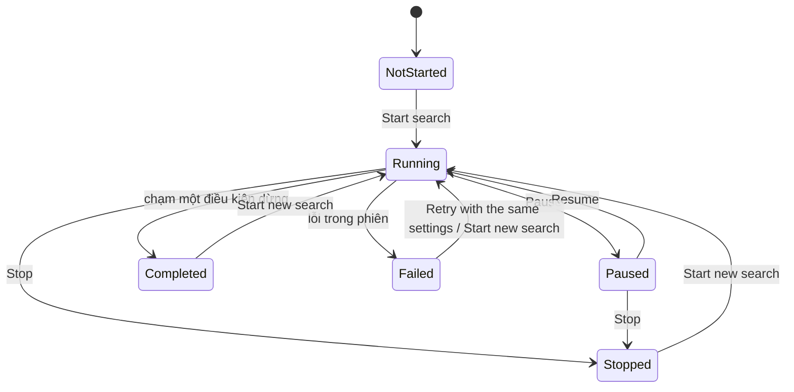

# Discovery

Đọc file này để biết cách cấu hình, điều khiển và đọc kết quả một phiên Search, cùng cách mở candidate để backtest lại.

Một phiên Search lặp lại vòng Generate candidates → Backtest → Evaluate → Rank cho tới khi chạm điều kiện dừng hoặc người dùng dừng. Các lượt backtest bên trong phiên Search không tạo run trong Backtest và không tạo thông báo riêng cho từng candidate (**Confirmed**).

Composite builder cũng nằm trên màn này; xem [strategy-engine.md](strategy-engine.md#tạo-và-sửa-composite).

## Cấu hình Search

Phần **Search settings** đóng/mở được. Khi đóng, một dòng tóm tắt hiện phương thức và các điều kiện dừng đang bật.

| Thiết lập | Quy tắc |
| --- | --- |
| Search method | Random, Domain-guided hoặc Genetic; mỗi lựa chọn có mô tả ngắn |
| Candidates evaluated | Bật/tắt; 10–10.000 |
| Search time | Bật/tắt; 1–1.440 phút |
| Rounds without a better candidate | Bật/tắt; 1–500 vòng liên tiếp |

Ba điều kiện dừng bật/tắt độc lập. Phiên kết thúc khi chạm **bất kỳ** điều kiện nào đang bật (**Confirmed**). Chưa có điều kiện ngưỡng score (**Confirmed**).

Validation:

- Giá trị nằm ngoài khoảng của một điều kiện đang bật: báo lỗi ngay dưới trường đó.
- Không bật điều kiện nào: báo "Turn on at least one stop condition so the search can end on its own."
- Bấm Start khi có lỗi: mở phần settings và hiện toast lỗi; phiên không bắt đầu.

Khi phiên đang chạy hoặc tạm dừng, phần settings bị khóa, kèm dòng nhắc phải Stop thì mới đổi được.

## Vòng đời một phiên Search

| Action | Có khi | Kết quả |
| --- | --- | --- |
| Start search | Chưa có phiên | Tạo phiên mới với cấu hình hiện tại; toast báo phiên sẽ tự dừng ở điều kiện đầu tiên chạm tới |
| Pause | Đang chạy | Giữ nguyên tiến độ; toast ghi số candidate đã đánh giá |
| Resume | Đang tạm dừng | Tiếp tục **cùng phiên**, tiến độ không bị đặt lại (**Confirmed**) |
| Stop | Đang chạy hoặc tạm dừng | Kết thúc với trạng thái Stopped by you; **giữ lại kết quả đã tìm được** (**Confirmed**) |
| Start new search | Phiên đã kết thúc | Bắt đầu phiên mới với cấu hình hiện tại |
| Retry with the same settings | Phiên Failed | Bắt đầu phiên mới với đúng cấu hình của phiên vừa lỗi |

Phiên được lưu lại: rời Discovery rồi quay lại vẫn thấy đúng trạng thái và tiến độ. Tiến độ tiếp tục tính cả trong lúc người dùng ở màn hình khác.

## Theo dõi tiến trình

Khi đã có phiên, Search activity hiện:

| Chỉ số | Ý nghĩa | Thanh tiến trình |
| --- | --- | --- |
| Candidates evaluated | Số candidate đã đánh giá và số vòng | Theo giới hạn candidate, nếu bật |
| Rounds without improvement | Số vòng liên tiếp chưa có candidate tốt hơn | Theo giới hạn vòng, nếu bật |
| Search time | Thời gian đã chạy | Theo giới hạn thời gian, nếu bật |
| Best so far | Candidate tốt nhất hiện tại: score, return, max drawdown | Không có |

Best so far kèm lưu ý cần re-test trên dữ liệu độc lập trước khi kết luận.

Trong prototype, tiến độ là mô phỏng: 1 giây trên màn hình ứng với 1 phút search, và mỗi vòng có 25 candidate.

## Khi phiên Search kết thúc

| Trạng thái | Banner hiển thị | Kết quả được giữ |
| --- | --- | --- |
| Completed | Điều kiện nào đã chạm, ví dụ "Reached 500 candidates evaluated." | Leaderboard giữ các candidate tốt nhất |
| Stopped by you | Số candidate đã đánh giá trước khi dừng | Có |
| Failed | Lý do lỗi, kèm Retry with the same settings | Kết quả trước lúc lỗi |

Khi phiên kết thúc, hệ thống hiện toast và thêm thông báo "Discovery search completed" hoặc "Discovery search failed" kèm candidate tốt nhất ([workspace.md](workspace.md#notifications)).

Trong prototype, trạng thái Failed xảy ra khi dùng Genetic với dưới 100 candidate. Đây là trigger demo, không phải quy tắc đã chốt.

## Xem và mở candidate

Leaderboard xếp hạng candidate theo **Return**, **Win rate**, **Max DD** hoặc **Score** (mặc định: Score). Chọn tiêu đề cột để đổi tiêu chí; cột đang dùng có `aria-sort`. Max DD xếp từ mức sụt giảm nhỏ nhất. Max DD và Score có tooltip giải thích; Score là điểm kết hợp return, max drawdown và win rate.

Mỗi candidate hiện return, win rate, max drawdown, score, số trades, cùng một thanh so sánh return với max drawdown. Candidate dưới 50 trades được đánh dấu "few".

**Re-test** mở Backtest với candidate đó được chọn sẵn; nếu Library có item cùng tên thì liên kết với item đó ([backtest.md](backtest.md#chọn-strategy-để-backtest)).
