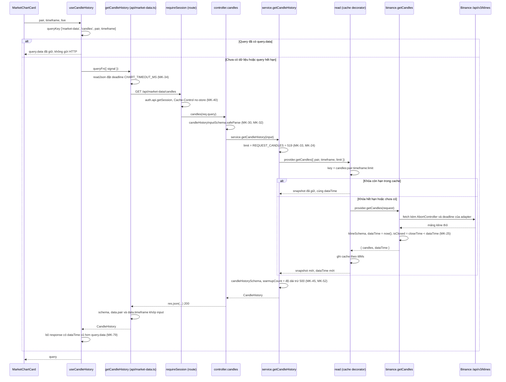
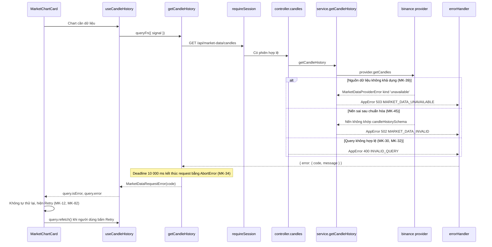

# Luồng lấy dữ liệu nến qua các layer

Đọc file này để biết một yêu cầu lấy nến đi từ `MarketChartCard` qua những hàm nào tới Binance, mỗi layer kiểm gì và lỗi được phân loại ở đâu.

Các mã yêu cầu dạng `MK-xx` trong file là requirement của [Market Data](../../UCs/market-data.md) [[1]](#ref-1).

## Tóm tắt

- Web gọi `getCandleHistory` trong [market-data.ts](../../../apps/web/app/api/market-data.ts) [[4]](#ref-4); API trả `CandleHistory` đã kiểm bằng schema của `packages/shared`, nên hai đầu nói cùng một contract.
- Phía API, yêu cầu đi Route → `requireSession` → Controller → Service → `MarketDataProvider` → Cache decorator → adapter Binance. Service chỉ import interface nên không phụ thuộc Binance [[2]](#ref-2), còn adapter là nơi duy nhất biết API của Binance [[7]](#ref-7).
- Cache decorator nằm giữa Service và adapter: khóa còn hạn thì trả snapshot đã giữ kèm `dataTime` cũ, hết hạn mới gọi Binance [[6]](#ref-6).
- Service xin `REQUEST_CANDLES = 500 + 20 - 1 = 519` nến, để Web vẽ 500 nến mà vẫn tính được MA(20) từ nến đầu tiên [[5]](#ref-5).
- Service phân loại lỗi thành `MARKET_DATA_UNAVAILABLE` (503) và `MARKET_DATA_INVALID` (502); Web chỉ nhận `code`, không nhận chi tiết của Binance và chỉ gọi lại khi người dùng bấm Retry [[8]](#ref-8).

## Luồng thành công

Mỗi layer chỉ nhận thứ lớp trước đưa, và mọi tên hàm trong diagram là tên thật trong source:

| Thành phần | Hàm hoặc biến | Việc làm |
| --- | --- | --- |
| Card | `useCandleHistory(pair, timeframe, live)` [[3]](#ref-3) | Tạo query theo lựa chọn của chart |
| Hook | `queryFn({ signal })` | Gọi API và so `dataTime` trước khi nhận |
| Web API | `getCandleHistory`, `readJson` [[4]](#ref-4) | Đặt deadline, đọc JSON, kiểm contract, trả `CandleHistory` |
| Route | `requireSession(auth)` [[9]](#ref-9) | Chặn request không có phiên |
| Controller | `candles(req, res)` | Kiểm query bằng schema, gọi service, `res.json` |
| Service | `getCandleHistory`, `run` [[5]](#ref-5) | Tính `limit`, gọi provider, kiểm nến, log và phân loại lỗi |
| Interface | `MarketDataProvider` [[2]](#ref-2) | Kiểu domain mà mọi provider phải trả |
| Cache | `read(entries, key, load)` [[6]](#ref-6) | Cache theo khóa, gộp request trùng, cache cả lỗi |
| Adapter | `request`, `getCandles` [[7]](#ref-7) | Gọi Binance, áp timeout và cooldown, chuẩn hóa sang kiểu domain |

Giá trị của các hằng số, tất cả đều là cấu hình chứ không phải hằng số rải trong code:

| Hằng số | Nơi khai báo | Giá trị | Ý nghĩa |
| --- | --- | --- | --- |
| `CHART_TIMEOUT_MS` | [market-data.ts](../../../apps/web/app/api/market-data.ts) | 10 000 ms | Deadline của request nến ở Web; hết hạn thì request kết thúc với `TIMEOUT` (MK-34) |
| `REQUEST_CANDLES` | [market-data.service.ts](../../../apps/api/src/services/market-data.service.ts) | 519 | Số nến xin từ provider: 500 để vẽ, 19 để MA(20) có giá trị ngay từ nến đầu |
| `DISPLAY_CANDLES`, `MA_PERIOD` | [market-data.service.ts](../../../apps/api/src/services/market-data.service.ts) | 500, 20 | Số nến hiển thị và chu kỳ MA; `warmupCount` bằng số nến vượt quá 500 |
| `timeoutMs` | [index.ts](../../../apps/api/src/index.ts) | 5000 ms | Deadline gọi Binance, ngắn hơn deadline của Web để API kịp trả lỗi đã phân loại |
| `ttlMs` | [index.ts](../../../apps/api/src/index.ts) | 5000 ms | Thời gian sống của một khóa cache, bằng chu kỳ làm mới của Web |

## Nhánh lỗi

Không có phiên hợp lệ thì `requireSession` dừng trước Controller bằng `AppError` mang `UNAUTHENTICATED`; Web đổi `code` đó thành lần kiểm phiên lại qua `useSessionGate` thay vì hiện lỗi của chart (MK-40). Thứ tự deadline cũng rõ: adapter gọi Binance tối đa 5000 ms, Web chờ tối đa 10 000 ms, nên lỗi đã phân loại tới được Web trước khi Web tự hết hạn.

## References

1. [Market Data](../../UCs/market-data.md)
2. [market-data-provider.ts](../../../apps/api/src/providers/market-data/market-data-provider.ts)
3. [useMarketData.ts](../../../apps/web/app/hooks/useMarketData.ts)
4. [market-data.ts (Web API)](../../../apps/web/app/api/market-data.ts)
5. [market-data.service.ts](../../../apps/api/src/services/market-data.service.ts)
6. [cached-market-data.provider.ts](../../../apps/api/src/providers/market-data/cached-market-data.provider.ts)
7. [binance.provider.ts](../../../apps/api/src/providers/market-data/binance.provider.ts)
8. [index.ts (composition root)](../../../apps/api/src/index.ts)
9. [session.middleware.ts](../../../apps/api/src/api/middlewares/session.middleware.ts)
