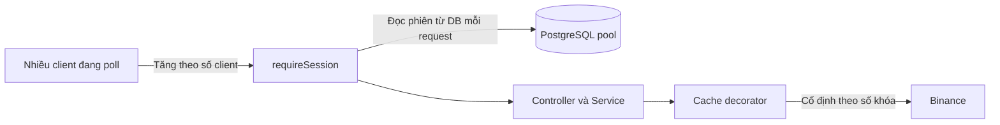

# Bottleneck thật sự của REST polling qua số đo baseline

Đọc file này để biết vì sao cache bảo vệ tốt Binance nhưng hệ thống vẫn nghẽn ở 50 client trong bài đo local, vì sao thao tác READ kiểm phiên vẫn có thể làm tắc PostgreSQL và lưu lượng thực đo chỉ ra giới hạn gì của mô hình polling.

## Tóm tắt

- Cache chỉ chặn được tải ở đoạn **API → Binance**, không giảm số lượng HTTP request từ browser gửi vào API (`5 request` mỗi 5 giây cho mỗi client) [[1, API và Binance]](#ref-1).
- Vì thế, khi số client tăng, tải ở đoạn trước cache (kiểm phiên trong PostgreSQL và gửi JSON về browser) vẫn tăng tuyến tính theo số client [[1, Rủi ro và giới hạn]](#ref-1).
- Trong bài đo `polling-v2` trên máy local, lượt 50 client bị dừng trước khi vào pha đo steady vì tắc hàng đợi kết nối PostgreSQL (`waiting` lên đỉnh `143`) và nghẽn event loop (`1325,4 ms`), dù Binance chỉ nhận vỏn vẹn `158` request upstream [[2, Kết quả baseline polling]](#ref-2).
- Ngoài bài toán kiểm phiên, mỗi client poll toàn bộ cửa sổ 519 nến chưa nén tiêu thụ `2,65–2,71 MB/phút`, cho thấy giới hạn băng thông rõ ràng của REST polling so với WebSocket [[2, Kết quả baseline polling]](#ref-2) [[3, ADR-007]](#ref-3).

## Cache chặn được đâu và không chặn được đâu?

Cache nằm ở **cuối chuỗi xử lý của API**. Nó giải quyết được bài toán sống còn là không để Binance khóa IP, nhưng mọi request từ browser vẫn phải đi qua toàn bộ phần phía trước: tiếp nhận HTTP, kiểm phiên trong PostgreSQL, rồi đóng gói lại 519 nến thành JSON gửi về client [[1, Thành phần và ranh giới]](#ref-1) [[4]](#ref-4).

## Tại sao kiểm phiên chỉ là thao tác READ mà vẫn làm tắc DB?

Thoạt nhìn, kiểm tra phiên đăng nhập chỉ là đọc bảng `session`, không ghi dữ liệu hay khóa bảng, nên dễ nghĩ là rất nhẹ. Trong thực tế của bài đo 50 client trên máy local, thao tác READ này vẫn gây nghẽn vì **ba yếu tố cộng hưởng**:

1. **Hàng đợi nhỏ ở Connection Pool (10 kết nối):** [client.ts](../../../apps/api/src/database/client.ts) khởi tạo `new pg.Pool({ connectionString })` mà không đặt `max`, nên pool chỉ giữ mặc định `10` kết nối tới PostgreSQL (khớp với `connections = 10` trong `resources.jsonl`) [[5]](#ref-5) [[2, Kết quả baseline polling]](#ref-2). Dù câu `SELECT` nhanh, tại một thời điểm tối đa chỉ có 10 request được chạy SQL; các request còn lại phải đứng xếp hàng chờ trống kết nối.
2. **Mỗi request chạm PostgreSQL hai lượt tuần tự:** Middleware `requireSession` gọi `auth.api.getSession` cho mọi request Market Data [[4]](#ref-4). Trong [auth.ts](../../../apps/api/src/configs/auth.ts), Better Auth không bật cookie cache (`session: { expiresIn: 7 * DAY, updateAge: DAY }`), và `hooks.before` còn gọi thêm `internalAdapter.findSession(token)` để tự kiểm tra hạn phiên trước khi vào xử lý chính của `getSession` [[6]](#ref-6) [[1, Rủi ro và giới hạn]](#ref-1). Một request đọc dữ liệu đã có sẵn trong RAM vẫn phát sinh ít nhất hai lượt truy vấn DB tuần tự (`Inferred` từ luồng `hooks.before` và `getSession` trong `auth.ts`).
3. **Hiệu ứng tuyết lở khi Event Loop bị chậm:** Bài đo local mở 50 trình duyệt Chromium thật trên cùng máy Windows với API và PostgreSQL [[2, Kết quả baseline polling]](#ref-2). Khi 50 trình duyệt giành CPU, Node event loop bị trễ tới `1325,4 ms` [[2, Kết quả baseline polling]](#ref-2). Một câu `SELECT` có thể xong trong vài millisecond, nhưng vì event loop bị chậm hơn 1 giây mới xử lý callback để **trả kết nối về pool**, mỗi kết nối bị giữ lâu gấp nhiều lần thời gian SQL thật (`Inferred` từ số đo `eventLoopP95Ms = 1325,4 ms` đi kèm `waiting = 143`). Hàng đợi kết nối vì thế phình rất nhanh và đẩy HTTP p95 lên `10 120 ms`, vượt thời hạn chờ của chart (MK-34) [[2, Kết quả baseline polling]](#ref-2).

**Tách rõ điều đã biết và điều chưa chắc:**
- **Đã biết:** Trên máy local chạy chung host, pool 10 kết nối bão hòa trước khi chạm giới hạn Binance, nên lượt 50 client dừng ở pha khởi tạo và kết quả mức 50 client (cũng như mục tiêu tải lên Binance QA-13) được ghi là `Inconclusive` [[2, Kết quả baseline polling]](#ref-2).
- **Chưa chắc (`Inferred`):** Nếu tách 50 client sang máy khác để API và PostgreSQL không bị 50 Chromium tranh CPU, mức `50 request/giây` có thể vẫn chạy ổn trên PostgreSQL. Tuy nhiên, kiến trúc đặt 2 lượt truy vấn DB lên hot path lặp mỗi 5 giây vẫn sẽ trở thành nút thắt sớm hơn rất nhiều so với cache trong RAM khi số client tiếp tục tăng.

## Con số thực đo từ baseline `polling-v2`

Ngữ cảnh đo: commit `2709f3b`, Windows local, Web production build, HTTP/1.1 loopback không nén, API + HTTP replay (độ trễ `50 ms`) + Docker PostgreSQL + Chromium chạy cùng host; mỗi lượt hoàn tất gồm 30 giây warm-up, 180 giây steady và 15 giây tail [[2, Kết quả baseline polling]](#ref-2).

| Mức tải (`polling-v2`) | Max weight / 60s lên Binance | Bytes / client / phút (steady) | Apply delay p95 | Điều rút ra ngay từ số đo |
| --- | --- | --- | --- | --- |
| 1 client, bình thường (3 lượt) | `120` | `2,70–2,71 MB` | `4917–5016 ms` | 0 lỗi; tải đầu chỉ `226.244 byte` (~`221 KB`) |
| 1 client, nguồn lỗi 503 (3 lượt) | `120` | `30,5–30,7 KB` | — | Cache giữ lỗi 503 nên weight không tăng |
| 10 client, bình thường (3 lượt) | `120` | `2,65–2,67 MB` | `6520–6794 ms` | Tăng 10 lần client nhưng tải lên Binance giữ nguyên `120` |
| 10 client, nguồn lỗi 503 (3 lượt) | `120` | `44,9–67,5 KB` | — | Tăng 10 lần client khi nguồn lỗi vẫn giữ nguyên `120` |
| 50 client, bình thường (`r1`) | Chưa vào steady (`158` req upstream) | Chưa vào steady | Chưa vào steady | Dừng sau `192,9 giây`; DB pool đỉnh `waiting = 143`, event loop p95 đỉnh `1325,4 ms`, HTTP p95 `10 120 ms` |

## Hai nút thắt dẫn thẳng tới thiết kế WebSocket

Số đo trên giải thích bằng con số cụ thể vì sao REST polling phù hợp làm baseline nhưng không phù hợp để mở rộng dài hạn:

- **Chi phí kiểm phiên lặp lại:** Ở HTTP polling không trạng thái, mỗi 5 giây một client lại gửi 5 request kèm cookie để API kiểm phiên lại từ đầu [[1, API và Binance]](#ref-1). Ở WebSocket, xác thực phiên chỉ cần làm khi mở kết nối (handshake) và kiểm lại khi cần, thay vì truy vấn PostgreSQL liên tục (`Inferred` từ mô hình kết nối dài hạn của WebSocket). Với các endpoint REST còn dùng tần suất cao, bật cookie cache ngắn hạn cho Better Auth là hướng giảm tải trực tiếp cho PostgreSQL (`Inferred` từ [[1, Rủi ro và giới hạn]](#ref-1)).
- **Lãng phí băng thông do gửi lại cả 519 nến:** Quyết định tải lại toàn bộ cửa sổ (ADR-007) giúp vòng REST tránh lỗi nối nến, nhưng mỗi response nến chưa nén dài khoảng `64 KB` (`63.992 byte` trong smoke Binance) nên 4 chart tạo ra hơn `2,6 MB/client/phút` [[3, ADR-007]](#ref-3) [[2, Kết quả baseline polling]](#ref-2). Khi WebSocket chỉ đẩy cập nhật của nến đang mở (hoặc khi bật nén HTTP), lưu lượng mỗi client sẽ giảm mạnh (`Inferred` từ kích thước 519 nến so với 1 nến).

## References

1. [Market Data & Realtime Updates](../../architecture/10-market-data.md)
2. [Kiểm chứng REST polling](../../testing/test-scopes/TS-002-market-data/rest-polling-verification.md)
3. [Architectural Decisions](../../architecture/30-decisions.md)
4. [session.middleware.ts](../../../apps/api/src/api/middlewares/session.middleware.ts)
5. [client.ts](../../../apps/api/src/database/client.ts)
6. [auth.ts](../../../apps/api/src/configs/auth.ts)
