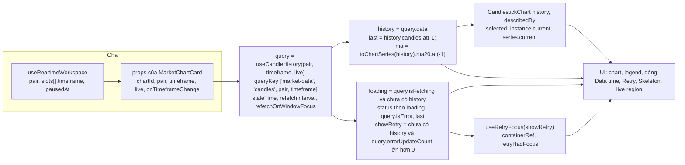
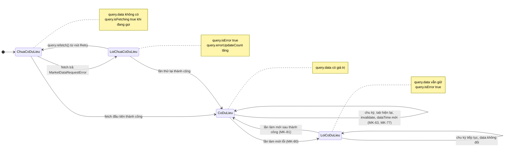
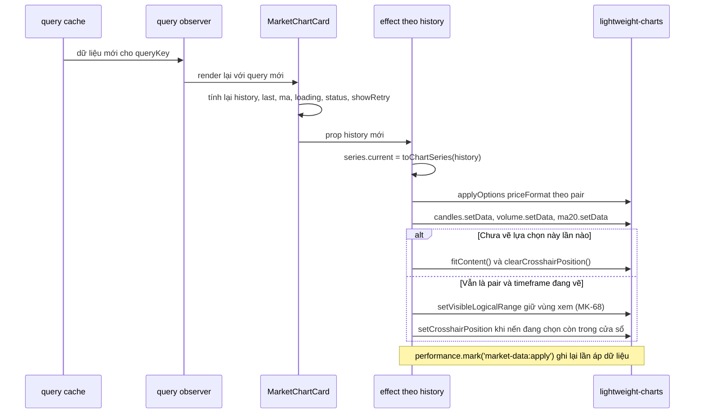

# Luồng dữ liệu trong UI của MarketChartCard

Đọc file này để biết `MarketChartCard` đọc state nào, state đó được cập nhật bằng cách nào và UI vẽ lại ra sao khi state đổi.

Các mã yêu cầu dạng `MK-xx` trong file là requirement của [Market Data](../../UCs/market-data.md) [[1]](#ref-1).

## Tóm tắt

- `MarketChartCard` không giữ state cho dữ liệu: nến nằm trong query của `useCandleHistory` [[2]](#ref-2), còn `history`, `last`, `ma`, `loading`, `status`, `showRetry` là giá trị tính lại mỗi lần render [[3]](#ref-3).
- Chu kỳ làm mới do option `refetchInterval` quyết định; timer do TanStack Query tạo, code của app không gọi `setInterval`.
- Ngoài lần tải đầu, query được gọi lại bởi chu kỳ, bởi tab hiện lại và bởi `invalidateQueries` khi người dùng tiếp tục cập nhật. Query chưa có dữ liệu chỉ được gọi lại bằng nút Retry (MK-82).
- Lần làm mới lỗi khi query đã có dữ liệu thì dữ liệu cũ được giữ, chỉ `isError` đổi nên card thêm thông báo lỗi làm mới cạnh dữ liệu cũ (MK-80, MK-81).
- Mỗi chart dựng instance lightweight-charts đúng một lần: instance, chuỗi dữ liệu và lựa chọn nến là `ref`, nên mỗi chu kỳ chỉ đặt lại dữ liệu chứ không tạo lại chart (MK-67, MK-68).

## UI đọc state nào

Ba nhóm state tách bạch như sau:

| Biến | Nguồn | Ghi chú |
| --- | --- | --- |
| `pair`, `timeframe`, `live` | `useRealtimeWorkspace`, truyền xuống qua props [[5]](#ref-5) | Card không sửa ba giá trị này; đổi timeframe thì gọi `onTimeframeChange` để cha đổi state |
| `query` | `useCandleHistory(pair, timeframe, live)` | Giữ `data`, `isFetching`, `isError`, `error`, `errorUpdateCount` của một queryKey |
| `history`, `last`, `ma` | `query.data` | `ma` tính lại bằng `toChartSeries` [[7]](#ref-7), không lưu ở đâu |
| `loading`, `status`, `showRetry` | `query` cộng `history` | Điều khiển Skeleton, live region và nút Retry |
| `containerRef`, `retryHadFocus` | `useRetryFocus(showRetry)` [[8]](#ref-8) | Chỉ để trả focus, không ảnh hưởng dữ liệu |
| `selected` | `useCandlestickChart(history)` [[6]](#ref-6) | Nến đang được trỏ hoặc chọn bằng bàn phím (MK-41) |
| `instance`, `series`, `selection`, `selectedTime` | `useCandlestickChart`, là `ref` | Không gây render; giữ chart và vùng xem qua các lần làm mới |

Đổi `pair` hoặc `timeframe` không sửa `query` đang có: React tạo một query mới với queryKey mới, nên chart đó bắt đầu lại từ `pending` và dữ liệu của lựa chọn cũ không còn được dùng (MK-06, MK-17).

## State được cập nhật bằng cách nào

| State | Điều kiện đọc từ code | UI thấy gì |
| --- | --- | --- |
| `ChuaCoDuLieu` | `query.data` không có, `query.status === 'pending'` | Skeleton và status "Loading candles…" |
| `LoiChuaCoDuLieu` | `query.data` không có, `query.isError` | Status "Cannot load candle history." và nút Retry |
| `CoDuLieu` | `query.data` có giá trị, không lỗi | Chart, legend và dòng `Data time` |
| `LoiCoDuLieu` | `query.data` có giá trị, `query.isError` | Chart và legend giữ nguyên, thêm thông báo lỗi làm mới |

Mỗi mũi tên ở trên tương ứng một dòng code; đây là toàn bộ nguồn gọi lại của query:

| Nguồn gọi lại | Option hoặc hàm | Điều kiện |
| --- | --- | --- |
| Chu kỳ 5 giây | `refetchInterval` trả `pollingIntervalMs` | `live` và query đã có `data` (MK-63) |
| Tab hiện lại | `refetchOnWindowFocus` trả `'always'` | `live` và query đã có `data` (MK-77) |
| Tiếp tục cập nhật | `client.invalidateQueries({ queryKey: ['market-data'] })` trong `toggleLive` | chỉ khi tab đang hiện (MK-75, MK-78) |
| Nút Retry | `query.refetch()` | `showRetry` đang true (MK-12) |
| Đổi timeframe hoặc pair | queryKey mới | luôn, vì key khác |
| Mount chart | `refetchOnMount: false` | chỉ gọi khi query chưa có `data` |
| Mất mạng rồi có lại | `refetchOnReconnect: false` | không gọi |
| Thử lại tự động sau lỗi | `retry: false` | không bao giờ |

Hệ quả của hai dòng cuối: chart đang lỗi và chưa có dữ liệu không tự tải lại, nên chỉ nút Retry đưa nó ra khỏi trạng thái lỗi (MK-82). `staleTime` bằng chu kỳ và `refetchOnMount: false` giữ cho chart mới cùng lựa chọn dùng lại dữ liệu đã có thay vì gọi thêm request.

Retry trên query chưa có dữ liệu đưa state về `pending` và xóa `error`, nên `showRetry` dựa vào `errorUpdateCount` thay vì `isError` mới giữ được nút trên màn hình [[9]](#ref-9). Deadline 10 000 ms của một request nến nằm ở `readJson` [[4]](#ref-4), không phải ở query, nên hết hạn đi vào query như một lỗi bình thường.

## UI vẽ lại khi state đổi

| State hoặc prop đổi | Nơi tiêu thụ | Hiệu ứng |
| --- | --- | --- |
| `query.data` | Render của card, prop `history` của `CandlestickChart`, effect `[history]` | `setData` ba series; làm mới thành công không đổi nội dung live region (MK-72) |
| `query.isFetching` khi chưa có `data` | `loading` | Hiện Skeleton và status "Loading candles…" (MK-48) |
| `query.isError` khi chưa có `data` | `status` | Status "Cannot load candle history." |
| `query.errorUpdateCount` | `showRetry` | Nút Retry xuất hiện và giữ tới khi có dữ liệu, kể cả lúc đang tải (MK-38, MK-46) |
| `live` | `refetchInterval`, `refetchOnWindowFocus`, `staleTime` | Chu kỳ làm mới bật hoặc tắt (MK-64) |
| `selected` | Legend nến đang chọn trong `CandlestickChart` | Legend hiện O, H, L, C, V và MA của nến đó (MK-41) |
| `showRetry` chuyển từ true sang false | `useRetryFocus` | Trả focus về `containerRef` nếu nút vừa giữ focus (MK-46) |
| `pair` của `CandleHistory` | `toChartSeries`, `formatPrice` | Số chữ số thập phân của giá đổi theo pair (ADR-005) |

Ba `ref` là lý do polling không làm chart giật: `instance.current` giữ chart và ba series, `series.current` giữ dữ liệu đã áp để tính độ dịch của cửa sổ nến, `selection.current` nhớ lựa chọn đang vẽ. Effect dựng chart có dependency rỗng nên chart chỉ được tạo khi container mount, còn effect áp dữ liệu chạy mỗi khi `history` đổi.

## References

1. [Market Data](../../UCs/market-data.md)
2. [useMarketData.ts](../../../apps/web/app/hooks/useMarketData.ts)
3. [MarketChartCard.tsx](../../../apps/web/app/pages/Realtime/components/MarketChartCard.tsx)
4. [market-data.ts (Web API)](../../../apps/web/app/api/market-data.ts)
5. [useRealtimeWorkspace.ts](../../../apps/web/app/hooks/useRealtimeWorkspace.ts)
6. [useCandlestickChart.ts](../../../apps/web/app/hooks/useCandlestickChart.ts)
7. [market-chart.ts](../../../apps/web/app/utils/market-chart.ts)
8. [useRetryFocus.ts](../../../apps/web/app/hooks/useRetryFocus.ts)
9. [Vòng đời fetch của TanStack Query v5](../tanstack-query-v5-fetch-lifecycle.md)
