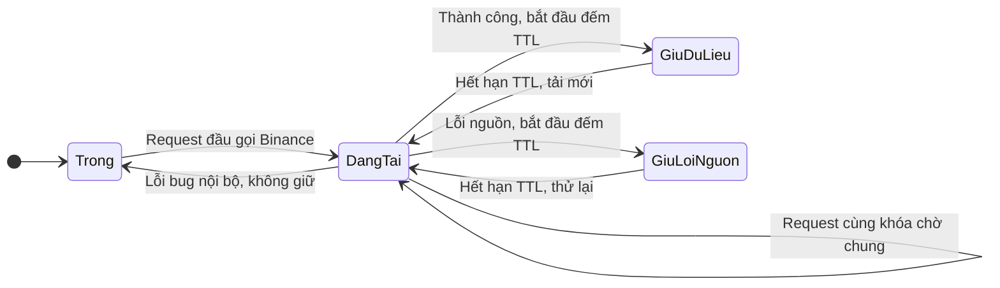

# Bảo vệ Binance trước tải polling bằng cache, gộp request và cooldown

Đọc file này để biết điều gì sẽ hỏng khi nhiều người dùng cùng poll Binance, cách bốn cơ chế trong API chặn từng lỗi đó và hậu quả khi mọi request dùng chung một trạng thái cache.

## Tóm tắt

- Cache dữ liệu thành công thôi là chưa đủ: khi 50 người dùng cùng poll mỗi 5 giây, hệ thống vẫn dễ gặp hai sự cố là *nhiều request cùng tràn ra Binance đúng lúc cache hết hạn* và *bão request khi Binance trả lỗi* [[1, ADR-008]](#ref-1).
- API ghép bốn cơ chế để chặn bốn kiểu lỗi khác nhau: **single-flight** (gộp request trùng), **negative caching** (giữ cả lỗi nguồn trong 5 giây), **cooldown theo `Retry-After`** (dừng gọi ngay khi dính 429/418) và **deadline layering** (timeout gọi Binance ngắn hơn timeout của Web) [[2, Cache và giới hạn request]](#ref-2) [[3]](#ref-3) [[4]](#ref-4).
- Nhờ bốn lớp này, một instance API chỉ gọi Binance tối đa `504 weight/phút` (khoảng 8% giới hạn IP `6000 weight/phút`), dù có bao nhiêu client đang mở và kể cả khi Binance đang lỗi [[2, Giới hạn request của Binance]](#ref-2).
- Dùng chung một cache state cho mọi request là con dao hai lưỡi: một request lỗi hoặc chậm của người này có thể kéo mọi người khác chậm hoặc lỗi theo trong cửa sổ 5 giây [[3]](#ref-3) [[2, Rủi ro và giới hạn]](#ref-2).

## Chuyện gì xảy ra nếu chỉ dùng cache thông thường?

Xét hai tình huống giả định khi có 50 người dùng cùng mở trang Realtime (mỗi người poll 4 chart và 1 sidebar mỗi 5 giây):

- **Tình huống 1 — Tràn request lúc hết hạn (cache stampede):** Đúng giây thứ 5, khóa `BTCUSDT:5m` hết hạn. Nếu trong 200 ms Binance đang trả lời có 15 người cùng gửi request tới API, cả 15 request đều thấy cache trống và cùng gọi thẳng sang Binance.
- **Tình huống 2 — Bão request khi Binance lỗi (retry storm):** Binance bị lỗi 503 trong 10 giây. Nếu cache chỉ lưu kết quả thành công mà bỏ qua lỗi, mọi đợt poll của 50 người dùng đều xuyên thẳng qua cache đập vào Binance. `Inferred` (từ phép tính trong quyết định giữ lỗi nguồn): 50 client × 5 query × 12 lần/phút tạo ra `3000` request/phút (`6000 weight/phút`), chạm đúng giới hạn IP ngay lúc Binance đang yếu [[1, ADR-008]](#ref-1). Nếu dính HTTP 429 mà API vẫn tiếp tục gửi, Binance có thể khóa IP từ 2 phút đến 3 ngày [[2, Giới hạn request của Binance]](#ref-2).

## Bốn cơ chế chặn từng vấn đề ra sao

| Vấn đề cần chặn | Cơ chế trong code | Cách hoạt động dễ hiểu |
| --- | --- | --- |
| 15 người cùng gọi đúng lúc cache vừa hết hạn | **Single-flight** trong `read()` của [cached-market-data.provider.ts](../../../apps/api/src/providers/market-data/cached-market-data.provider.ts) [[3]](#ref-3) | Người đầu tiên gọi Binance và gắn trạng thái `pending` lên khóa. 14 người đến sau thấy `pending` thì đứng chờ chung kết quả đó, không mở thêm request ra Binance. |
| Bão request xuyên qua cache khi Binance lỗi 5xx/timeout | **Negative caching** trong `read()` của [cached-market-data.provider.ts](../../../apps/api/src/providers/market-data/cached-market-data.provider.ts) [[3]](#ref-3) | Khi Binance trả lỗi nguồn (`MarketDataProviderError`), cache giữ luôn lỗi đó trong 5 giây theo quyết định giữ lỗi nguồn trong TTL (ADR-008) [[1, ADR-008]](#ref-1). Lỗi bug ngoài dự kiến thì xóa khóa ngay để không che giấu bug nội bộ. |
| Tiếp tục gọi sau 429/418 dẫn tới khóa IP | **Cooldown** qua `cooldownUntil` trong [binance.provider.ts](../../../apps/api/src/providers/market-data/binance.provider.ts) [[4]](#ref-4) | Khi nhận 429 hoặc 418, adapter đọc header `Retry-After` rồi khóa mọi lời gọi mới sang Binance cho tới hết thời gian đó, trả ngay `503` mà không tự thử lại [[2, Giới hạn request của Binance]](#ref-2). |
| Web tự cắt kết nối trước khi API kịp báo lỗi rõ ràng | **Deadline layering**: `timeoutMs` (`5000 ms`) ở [binance.provider.ts](../../../apps/api/src/providers/market-data/binance.provider.ts) [[4]](#ref-4) [[5]](#ref-5) < `CHART_TIMEOUT_MS` (`10 000 ms`) ở [market-data.ts](../../../apps/web/app/api/market-data.ts) [[6]](#ref-6) | Lớp dưới luôn có hạn chờ ngắn hơn lớp trên, giúp API kịp phân loại lỗi nguồn (`503`) và ghi log trước khi Web hết thời hạn chờ của chart (MK-34) [[2, Xử lý lỗi]](#ref-2). |

Một chi tiết tinh tế trong `read()` là **mốc tính TTL 5 giây bắt đầu khi Binance trả kết quả (resolve/reject), không phải lúc request đi vào API** [[3]](#ref-3) [[2, Cache và giới hạn request]](#ref-2). Ví dụ giả định: nếu Binance mất 3 giây mới trả nến, khóa vẫn được tái sử dụng trọn vẹn 5 giây sau đó thay vì chỉ còn 2 giây.

## Hậu quả khi mọi request cùng nhìn thấy một cache state

Cho mọi client dùng chung một trạng thái cache giúp giữ tải lên Binance thấp và ổn định, nhưng đi kèm bốn hậu quả trực tiếp:

1. **Lỗi lan sang tất cả mọi người (blast radius):** Ví dụ giả định: request của User A gặp lỗi mạng thoáng qua với Binance, cache lưu `{ error, expiresAt: now() + 5000 }` [[3]](#ref-3). Toàn bộ 49 người dùng khác poll cùng cặp và khung giờ trong 5 giây đó đều nhận lỗi `503` theo User A, kể cả khi Binance đã hồi phục sau 50 ms. Nếu User B bấm nút Retry trong 5 giây này, User B vẫn nhận lại lỗi cũ từ cache [[1, ADR-008]](#ref-1). Sau khi Binance phục hồi, chart có thể còn báo lỗi thêm tối đa một TTL cộng một chu kỳ poll [[2, Rủi ro và giới hạn]](#ref-2).
2. **Chậm lan sang tất cả mọi người (head-of-line blocking):** Ví dụ giả định: request của User A bị treo 4,9 giây (sát timeout `5000 ms`). User B đến ở giây thứ 1 sẽ join chung `entry.pending` của User A và phải đợi tới giây 4,9, thay vì tự mở một kết nối mới có thể chỉ mất 100 ms (`Inferred` từ cơ chế join trong `read()`) [[3]](#ref-3).
3. **Độ mới dữ liệu không đồng đều giữa các người dùng:** Mọi client trong cửa sổ 5 giây đều nhận cùng một snapshot với cùng `dataTime` [[2, Cache và giới hạn request]](#ref-2). Ví dụ giả định: người poll đúng lúc cache vừa làm mới thấy giá gần như tức thời, còn người poll ở giây thứ 4,9 nhận giá đã cũ gần 5 giây rồi phải chờ thêm 5 giây tới chu kỳ sau.
4. **Chỉ an toàn cho dữ liệu công khai:** Khóa cache là `candles:pair:timeframe:limit`, không chứa định danh người dùng [[3]](#ref-3). Điều này an toàn cho Market Data vì giá thị trường giống nhau với mọi người, nhưng nếu áp cùng cách lưu cache dùng chung cho dữ liệu riêng tư (như danh mục hay chiến lược của từng tài khoản) mà thiếu `userId` trong khóa sẽ gây rò rỉ dữ liệu giữa các người dùng (`Inferred` từ cấu trúc khóa trong `cached-market-data.provider.ts`).

## Giới hạn khi mở rộng hệ thống

- **Chạy nhiều instance API:** `Map` cache và `cooldownUntil` đều nằm trong RAM của một process Node.js [[3]](#ref-3) [[4]](#ref-4). Khi chạy 2 hoặc 3 instance API sau cùng một IP, mỗi instance có cache riêng nên mức trần weight lên Binance nhân theo số instance [[2, Rủi ro và giới hạn]](#ref-2). Ngoài ra, hai request liên tiếp của cùng một người dùng có thể rơi vào hai instance giữ hai snapshot có `dataTime` lệch nhau (`Inferred` từ kiến trúc cache trong process).
- **Mở rộng số lượng pair/timeframe:** Mức trần `504 weight/phút` chỉ đúng với đúng 3 pair (MK-32) và 6 timeframe (MK-30), tương ứng 21 khóa [[2, Giới hạn request của Binance]](#ref-2). Thêm pair hoặc timeframe sẽ làm trần weight tăng tuyến tính [[2, Rủi ro và giới hạn]](#ref-2).

## References

1. [Architectural Decisions](../../architecture/30-decisions.md)
2. [Market Data & Realtime Updates](../../architecture/10-market-data.md)
3. [cached-market-data.provider.ts](../../../apps/api/src/providers/market-data/cached-market-data.provider.ts)
4. [binance.provider.ts](../../../apps/api/src/providers/market-data/binance.provider.ts)
5. [index.ts](../../../apps/api/src/index.ts)
6. [market-data.ts](../../../apps/web/app/api/market-data.ts)
