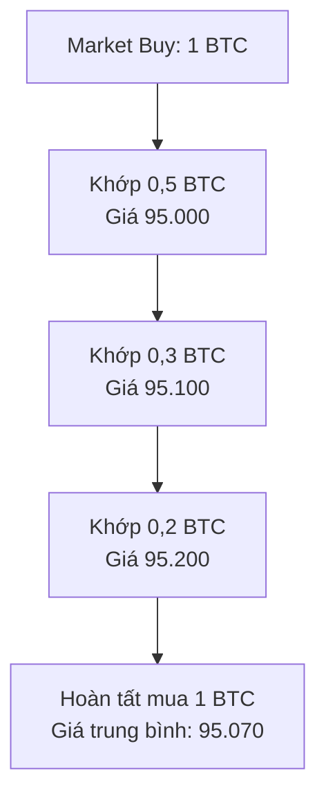
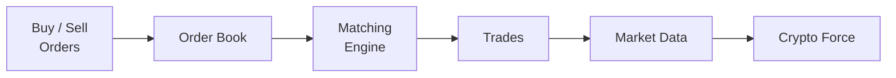

# Q05 - Người mua và người bán khớp lệnh như thế nào? Sàn xác định giá giao dịch ra sao?

Đọc file này để hiểu cách người mua và người bán đặt lệnh, điều kiện khớp lệnh, cách sàn xác định giá giao dịch và những nguyên tắc cần nhớ khi nghiên cứu Market Data.

## Tóm tắt

* **Buyer (Người mua):** Với Limit Buy, đặt mức giá tối đa sẵn sàng trả.
* **Seller (Người bán):** Với Limit Sell, đặt mức giá tối thiểu sẵn sàng nhận.
* **Điều kiện giá:** `Buy Price >= Sell Price` thì hai lệnh giới hạn có thể khớp.
* **Order Book (Sổ lệnh):** Chứa các lệnh mua và bán đang chờ khớp.
* **Matching Engine (Bộ máy khớp lệnh):** Xác định lệnh nào được khớp, khối lượng và giá khớp theo quy tắc của sàn.
* **Giá khớp không phải trung bình giá mua và bán.** Trong khớp lệnh liên tục trên HOSE, giá khớp là giá của lệnh đối ứng đang chờ [[1]](#ref-1).
* **Trade (Giao dịch đã khớp):** Kết quả giao dịch có giá, khối lượng và thời điểm. Đây là cơ sở để tạo dữ liệu giá và khối lượng.

---

## 1. Nguyên tắc cơ bản của giao dịch

Hai bên đưa ra mức giá mà mình chấp nhận:

| | Buyer | Seller |
|---|---|---|
| Mục tiêu | Mua với giá thấp | Bán với giá cao |
| Limit Price | Giá **tối đa** muốn trả | Giá **tối thiểu** muốn nhận |
| Giá tốt hơn | Thấp hơn giá đặt | Cao hơn giá đặt |

**Điều kiện tương thích về giá:**

```text
Buy Price >= Sell Price  → Có thể khớp
Buy Price <  Sell Price  → Không khớp
```

Ví dụ:

| Buyer | Seller | Kết quả |
|---|---|---|
| Mua ≤ 105 | Bán ≥ 100 | Có thể khớp |
| Mua ≤ 100 | Bán ≥ 105 | Không khớp |
| Mua ≤ 100 | Bán ≥ 100 | Có thể khớp |

Đây là cách hiểu đơn giản cho hai Limit Orders trong khớp lệnh liên tục. Việc thực hiện còn phụ thuộc khối lượng, thứ tự ưu tiên và quy định của sàn.

## 2. Trường hợp giá không giao nhau

Giả sử cổ phiếu ABC có hai lệnh:

```text
Buyer:  Mua tối đa 100
Seller: Bán tối thiểu 105

       100         105
        |-----------|
     Giá mua     Giá bán
         KHÔNG GIAO NHAU
```

* Người mua không muốn trả quá 100.
* Người bán không muốn bán dưới 105.
* Không có mức giá nào thỏa mãn cả hai bên.

**Kết quả:** Không phát sinh Trade giữa hai lệnh.

Nếu lệnh hợp lệ và được phép nằm chờ, chúng tiếp tục ở Order Book cho đến khi được khớp, bị hủy hoặc hết hiệu lực.

## 3. Khi giá giao nhau, giá nào được chọn?

Giả sử:

```text
Buyer:  Mua tối đa 105
Seller: Bán tối thiểu 100

       100=========105
         VÙNG GIÁ
         GIAO NHAU
```

Hai bên có thể giao dịch, nhưng **không có nghĩa giá khớp sẽ là 102, 5**.

Trong khớp lệnh liên tục trên HOSE, giá khớp là giá của lệnh đối ứng đang nằm chờ trên Order Book [[1]](#ref-1).

| Sequence (Thứ tự đặt lệnh) | Giá khớp | Lý do |
|---|---:|---|
| Seller bán 100 đang chờ → Buyer mua tối đa 105 | **100** | Giá của lệnh bán đang chờ |
| Buyer mua 105 đang chờ → Seller bán tối thiểu 100 | **105** | Giá của lệnh mua đang chờ |

**Nguyên tắc nhớ nhanh:**

> Giá giới hạn quyết định mức giá chấp nhận. Giá khớp thực tế do Matching Engine quyết định theo quy tắc giao dịch.

Cần phân biệt **giá của lệnh đặt vào** và **giá giao dịch thực tế**.

## 4. Order Book và thứ tự ưu tiên khớp lệnh

Order Book chứa những lệnh chưa được khớp hết.

Ví dụ giả định:

| Buy — Bid | Khối lượng | Sell — Ask | Khối lượng |
|---:|---:|---:|---:|
| 100 | 10 | 101 | 15 |
| 99 | 20 | 102 | 25 |
| 98 | 35 | 103 | 40 |

* **Best Bid:** 100 — giá mua cao nhất đang chờ.
* **Best Ask:** 101 — giá bán thấp nhất đang chờ.
* **Spread:** `101 - 100 = 1`.

HOSE áp dụng nguyên tắc **Price–Time Priority (ưu tiên giá, sau đó ưu tiên thời gian)** [[2]](#ref-2).

| Ưu tiên | Quy tắc |
|---|---|
| 1. Price | Mua giá cao hơn ưu tiên trước; bán giá thấp hơn ưu tiên trước |
| 2. Time | Cùng mức giá thì lệnh vào trước ưu tiên trước |

Ví dụ: Có hai người cùng đặt mua giá 100 thì người đặt lệnh trước thường được ưu tiên khớp trước.

**Điểm cần nhớ:** Bid/Ask là giá đặt lệnh. Last Traded Price là giá giao dịch đã khớp gần nhất. Ba giá trị này không nhất thiết bằng nhau.

## 5. Một lệnh có thể khớp nhiều mức giá

Giả sử Binance Spot có những lệnh bán đang chờ:

| Giá bán (USDT/BTC) | Khối lượng |
|---:|---:|
| 95.000 | 0, 5 BTC |
| 95.100 | 0, 3 BTC |
| 95.200 | 0, 7 BTC |

Buyer gửi Market Buy để mua `1 BTC` .



**Giá trung bình chưa tính phí:**

```text
(0,5 × 95.000 + 0,3 × 95.100 + 0,2 × 95.200) / 1
= 95.070 USDT/BTC
```

Mặc dù Best Ask ban đầu là 95.000, Buyer không mua đủ 1 BTC tại giá đó vì khối lượng đang bán chỉ có 0, 5 BTC.

Đây là một cơ chế tạo ra **Slippage (trượt giá)**: Giá thực hiện trung bình khác với giá tốt nhất được nhìn thấy trước khi đặt lệnh.

## 6. Không phải sàn lúc nào cũng khớp ngay

Cần phân biệt hai phương thức:

| | Continuous Matching | Periodic Call Auction |
|---|---|---|
| Tiếng Việt | Khớp lệnh liên tục | Khớp lệnh định kỳ |
| Khi nào khớp? | Khi lệnh mới tương thích với lệnh đang chờ | Tại thời điểm xác định |
| Cách xác định giá | Giá của lệnh đối ứng đang chờ, theo quy tắc HOSE | Chọn giá theo tập lệnh và các quy tắc ưu tiên |
| Ví dụ | Giao dịch liên tục trên HOSE | Phiên xác định giá mở cửa, đóng cửa |

Trong khớp lệnh định kỳ trên HOSE, nguyên tắc quan trọng là lựa chọn mức giá giúp đạt khối lượng giao dịch lớn nhất, sau đó áp dụng các tiêu chí bổ sung nếu có nhiều mức giá phù hợp [[1]](#ref-1).

**Không nên áp dụng máy móc quy tắc “giá lệnh chờ” cho mọi loại phiên giao dịch.**

## 7. Từ khớp lệnh đến Market Data trong Crypto Force



Mỗi Trade ghi nhận một giao dịch đã được khớp với thông tin như giá, khối lượng và thời điểm.

* **Last Traded Price:** Giá giao dịch khớp gần nhất.
* **Volume:** Khối lượng giao dịch.
* **Kline:** Tổng hợp giá và khối lượng trong một khung thời gian.
* **Ticker:** Thông tin tóm tắt thị trường, ví dụ giá gần nhất và mức thay đổi giá.

Crypto Force không tự khớp lệnh. Binance cung cấp Kline và Ticker, sau đó Backend chuẩn hóa chúng để Frontend hiển thị [[3]](#ref-3).

Chi tiết Kline, Ticker và vòng đời nến sẽ được nghiên cứu ở **Q06**.

---

## 8. Nguyên tắc nhớ nhanh

| # | Nguyên tắc | Ghi nhớ |
|---|---|---|
| 1 | Buyer đặt giá trần | Không muốn mua đắt hơn mức này |
| 2 | Seller đặt giá sàn | Không muốn bán rẻ hơn mức này |
| 3 | `Buy >= Sell` | Có thể khớp |
| 4 | `Buy < Sell` | Không khớp giữa hai Limit Orders |
| 5 | Giá khớp ≠ giá trung bình | Phụ thuộc quy tắc Matching Engine |
| 6 | Giá tốt hơn được ưu tiên | Buy cao hơn, Sell thấp hơn |
| 7 | Cùng giá → ưu tiên thời gian | Lệnh vào trước được ưu tiên trước |
| 8 | Giá và khối lượng là hai yếu tố khác nhau | Có thể chỉ khớp một phần |
| 9 | Market Order không bảo đảm giá cố định | Có thể khớp nhiều mức giá |
| 10 | Order ≠ Trade | Order là yêu cầu; Trade là giao dịch đã xảy ra |

**Mental Model:**

 `Buyer / Seller → Orders → Order Book → Matching Engine → Trades → Market Data`

**Kết luận:** Giá thị trường không được sàn tùy ý đặt ra. Giá giao dịch hình thành từ những lệnh mua và bán được khớp theo quy tắc của sàn. Những giao dịch đó tạo ra dữ liệu mà Crypto Force nhận từ Binance.

---

## References

1. <a id="ref-1"></a>[Quy định giao dịch cổ phiếu — SSI](https://www.ssi.com.vn/khach-hang-ca-nhan/quy-dinh-giao-dich/quy-dinh-giao-dich-co-phieu)
2. <a id="ref-2"></a>[Quy định giao dịch của HOSE — FPTS](https://www.fpts.com.vn/ho-tro-khach-hang/giao-dich-chung-khoan/huong-dan-giao-dich-co-phieu/quy-dinh-giao-dich/quy-dinh-giao-dich-cua-hose/)
3. <a id="ref-3"></a>[Market Data & Realtime Updates](../../architecture/10-market-data.md)
