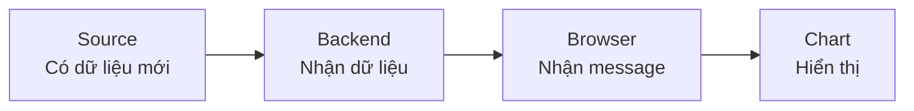
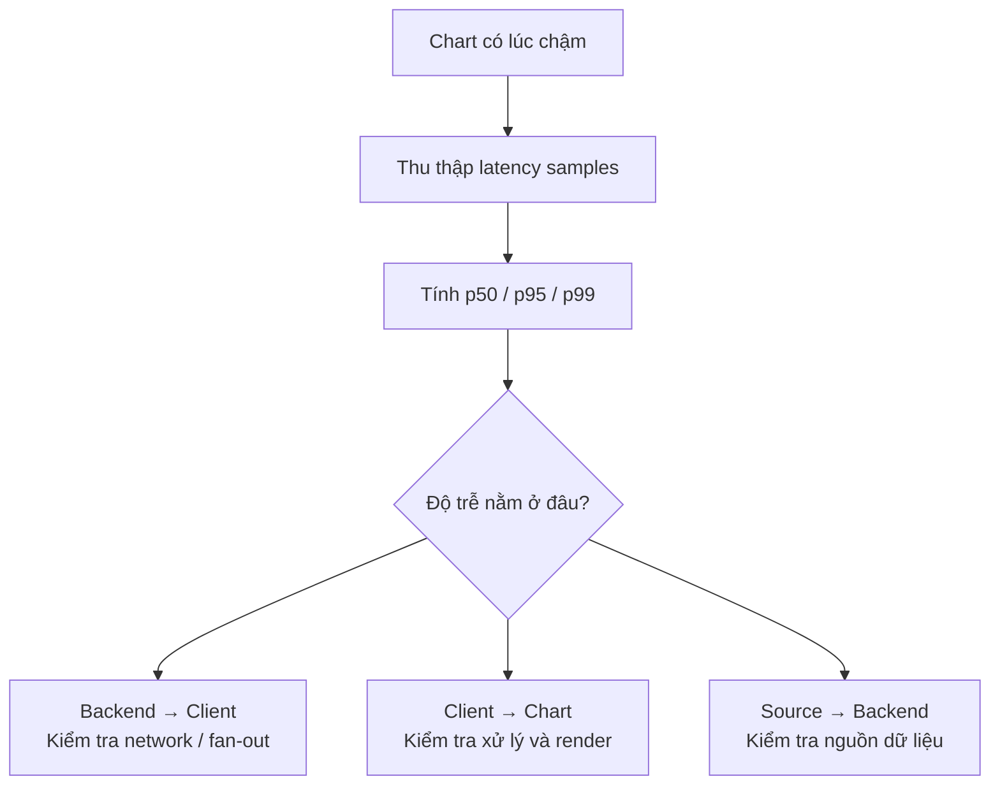

# Q07 - p50, p95, p99 latency là gì? Tại sao p95 thường hữu ích hơn average latency khi đánh giá realtime systems?

Đọc file này để hiểu cách đo độ trễ bằng Average và Percentiles, tại sao Tail Latency quan trọng, và cách diễn giải benchmark trong Crypto Force.

## Tóm tắt

* **Latency (Độ trễ):** Thời gian từ một mốc bắt đầu đến một mốc kết thúc của thao tác.
* **Average (Trung bình):** Tổng thời gian chia cho số mẫu. Dễ bị ảnh hưởng bởi các giá trị quá lớn.
* **p50 (Median):** Khoảng 50% số mẫu có độ trễ không vượt quá giá trị này.
* **p95:** Khoảng 95% số mẫu có độ trễ không vượt quá giá trị này; 5% mẫu có thể chậm hơn.
* **p99:** Khoảng 99% số mẫu có độ trễ không vượt quá giá trị này; giúp quan sát phần đuôi chậm hơn.
* **Tail Latency (Độ trễ phần đuôi):** Những lần xử lý chậm bất thường so với phần lớn các lần còn lại.
* **Kết luận:** p95 thường hữu ích hơn Average để đánh giá trải nghiệm realtime, nhưng không thay thế p50, p99 hoặc tỷ lệ lỗi.

---

## 1. Average và Percentile khác nhau như thế nào?

Giả sử hệ thống có 100 lần cập nhật Market Data:

| Số lần cập nhật | Latency |
|---:|---:|
| 90 | 20 ms |
| 8 | 200 ms |
| 1 | 500 ms |
| 1 | 2.000 ms |

Kết quả:

| Metric | Giá trị | Ý nghĩa |
|---|---:|---|
| **Average** | 59 ms | Độ trễ trung bình |
| **p50** | 20 ms | 50% mẫu không vượt quá 20 ms |
| **p95** | 200 ms | 95% mẫu không vượt quá 200 ms |
| **p99** | 500 ms | 99% mẫu không vượt quá 500 ms |
| **Max** | 2.000 ms | Lần chậm nhất |

*Dữ liệu giả định, tính percentile bằng phương pháp Nearest Rank (chọn phần tử tại thứ hạng tương ứng).*

```text
100 lần cập nhật (sắp xếp từ nhanh đến chậm)

  1 ─────────────── 90   91 ───── 98   99    100
  │     20 ms        │     200 ms   │500ms│2000ms
  └──────────────────┴──────────────┴─────┴──────
         p50                 p95       p99    Max
```

**Vấn đề của Average:** Giá trị 59 ms không thể hiện rõ rằng 10% các lần cập nhật mất từ 200 ms trở lên.

Ngược lại, p95 cho thấy một phần đáng kể các lần cập nhật chậm hơn mức thông thường.

## 2. Percentile được tính như thế nào?

Với cách tính Nearest Rank:

1. Thu thập các mẫu latency.
2. Sắp xếp từ nhỏ đến lớn.
3. Chọn phần tử tại vị trí `ceil(percentile × số mẫu)`.

Ví dụ có 100 mẫu:

| Percentile | Vị trí sau khi sắp xếp |
|---|---:|
| p50 | 50 |
| p95 | 95 |
| p99 | 99 |

**Lưu ý:**

* Percentile không phải phần trăm cải thiện hiệu năng.
* p95 = 200 ms không có nghĩa 95% request đều mất đúng 200 ms.
* Các thư viện thống kê có thể sử dụng phương pháp nội suy khác Nearest Rank.
* Với ít mẫu, p95 và p99 có thể bằng nhau và chưa phản ánh tốt Tail Latency.

## 3. Tại sao p95 hữu ích trong Realtime Systems?

Giả sử hai hệ thống cùng có Average = 50 ms:

| | System A | System B |
|---|---|---|
| Phân phối độ trễ | Hầu hết cập nhật gần 50 ms | Nhiều cập nhật nhanh, một số rất chậm |
| Average | 50 ms | 50 ms |
| Trải nghiệm | Tương đối ổn định | Thỉnh thoảng chart bị chậm |
| Average phát hiện khác biệt? | Không | Không |

Average chỉ mô tả trung bình, không phản ánh cách các mẫu phân bố.

**Với Realtime Market Data:**

* Người dùng quan tâm chart cập nhật nhanh và ổn định.
* Một số cập nhật chậm có thể khiến dữ liệu hiển thị kém mới.
* p95 giúp phát hiện những lần cập nhật chậm mà Average có thể che khuất.
* p99 giúp kiểm tra sâu hơn các trường hợp chậm hiếm gặp.

**Trade-off:**

| Metric | Ưu điểm | Hạn chế |
|---|---|---|
| Average | Đơn giản, dễ so sánh tổng thể | Che khuất phân phối và Tail Latency |
| p50 | Đại diện trải nghiệm thông thường | Bỏ qua 50% mẫu chậm hơn |
| p95 | Cân bằng giữa trải nghiệm thông thường và phần đuôi | Không thể hiện đầy đủ 5% chậm nhất |
| p99 | Nhạy với Tail Latency | Cần đủ mẫu để có ý nghĩa ổn định |
| Max | Phát hiện trường hợp tệ nhất đã quan sát | Rất nhạy với một mẫu bất thường |

**Nguyên tắc:** Không có một metric duy nhất mô tả toàn bộ hiệu năng hệ thống.

---

## 4. Crypto Force đo latency ở đâu?

Không phải mọi chỉ số latency đều đo cùng một quá trình.



| Metric | Điểm bắt đầu → Kết thúc | Phản ánh |
|---|---|---|
| `sourceToChartDelayMs` | Source có dữ liệu → Chart hiển thị | Độ mới của dữ liệu trên chart |
| `backendToClientMs` | Backend nhận → Client nhận frame | Độ trễ truyền từ Backend đến Client |
| `backendToChartMs` | Backend nhận → Chart hiển thị | Độ trễ đến giao diện người dùng |

Benchmark Crypto Force sử dụng các mốc thời gian và cách đo riêng cho từng metric [[1]](#ref-1).

**Không được so sánh hai giá trị p95 nếu chúng đo hai đoạn khác nhau của Data Flow.**

Ví dụ, Backend-to-client p95 thấp không chứng minh Chart Render p95 cũng thấp.

## 5. Benchmark thực tế trong Crypto Force

### REST Polling vs WebSocket

Kết quả so sánh với 10 Chromium clients:

| Metric | REST Polling | WebSocket B2 |
|---|---:|---:|
| Source-to-chart p50 | 3.730 ms | 36 ms |
| **Source-to-chart p95** | **4.642 ms** | **40 ms** |
| Source-to-chart p99 | 4.642 ms | 40 ms |

Nguồn: `comparisonA_restPollingVsWebSocket` trong benchmark summary [[2]](#ref-2).

**Diễn giải:**

* Trong lượt benchmark này, WebSocket cho độ trễ từ nguồn đến chart thấp hơn REST Polling.
* REST Polling phải chờ chu kỳ lấy dữ liệu nên có thể tăng độ trễ hiển thị.
* WebSocket có thể đẩy sự kiện ngay khi nhận được, không cần đợi chu kỳ polling.

Đây là kết quả của workload đã đo, không phải cam kết latency của mọi môi trường production.

### Shared Subscriptions và Tail Latency

Với 400 protocol clients chạy tải nền và một Chromium probe:

| Metric | B1 — Before Shared | B2 — After Shared |
|---|---:|---:|
| Backend-to-chart p50 | 123 ms | 50 ms |
| **Backend-to-chart p95** | **275 ms** | **135 ms** |
| Backend-to-chart p99 | 275 ms | 135 ms |
| Upstream WS Connections | 300 | 1 |
| API CPU | 77, 09% | 33, 01% |

Nguồn: `comparisonB_beforeVsAfterSharedSubscriptions` [[2]](#ref-2).

**Nhận định:**

* Trong benchmark này, B2 có p95 Backend-to-chart thấp hơn B1.
* Shared Subscriptions giảm số kết nối upstream và tài nguyên phải xử lý.
* Không thể kết luận p95 giảm hoàn toàn do CPU giảm nếu chưa tách và kiểm soát các nguyên nhân khác.
* 400 clients là mức tải đã kiểm chứng, không phải giới hạn tối đa của hệ thống.
* Chromium probe chỉ đại diện một trình duyệt đo giao diện dưới tải nền, không phải 400 trình duyệt render đồng thời.

## 6. Cách tự kiểm chứng một vấn đề latency

**Scenario (Ví dụ giả định):** Chart thỉnh thoảng cập nhật chậm dù Average latency vẫn thấp.



Quy trình kiểm tra:

1. Đo latency tại các mốc trong Data Flow.
2. Tính p50, p95, p99 trên cùng tập mẫu.
3. So sánh các metric có cùng định nghĩa và điều kiện đo.
4. Xem log, CPU, Event Loop Lag và Network để tìm nguyên nhân.
5. Chạy lại benchmark sau khi thay đổi implementation.

**Điểm cần nhớ:** Percentile phát hiện vấn đề hiệu năng. Nó không tự chỉ ra nguyên nhân.

Trong Crypto Force, tài liệu benchmark quy định cách xác nhận dữ liệu đã hiển thị trên chart bằng các mốc `applyAt` , `paintAt` và kiểm tra thay đổi pixel, thay vì chỉ tính thời điểm event được nhận [[1]](#ref-1).

---

## 7. Nguyên tắc nhớ nhanh

| # | Nguyên tắc |
|---|---|
| 1 | Average cho biết trung bình, không cho biết phân phối |
| 2 | p50 mô tả độ trễ thông thường |
| 3 | p95 cho thấy ngưỡng bao phủ khoảng 95% mẫu |
| 4 | p99 giúp nhìn sâu hơn vào Tail Latency |
| 5 | Percentile cao chưa chỉ ra nguyên nhân chậm |
| 6 | Phải so sánh cùng metric, workload và điều kiện đo |
| 7 | p95 tốt không chứng minh hệ thống không mất dữ liệu |
| 8 | Ít mẫu khiến percentile cao kém ổn định |

**Mental Model:**

* **Average:** Trung bình hệ thống nhanh đến đâu?
* **p50:** Một lần cập nhật thông thường nhanh đến đâu?
* **p95:** Phần lớn các lần cập nhật được hoàn thành nhanh đến đâu?
* **p99:** Những lần cập nhật thuộc phần đuôi chậm đến đâu?

**Kết luận:** Khi đánh giá Realtime Systems, p95 thường hữu ích hơn Average vì giúp nhìn thấy những lần cập nhật chậm mà giá trị trung bình có thể che khuất. Tuy nhiên, cần đọc p95 cùng p50, p99, số mẫu, tỷ lệ lỗi và điều kiện benchmark.

---

## References

1. <a id="ref-1"></a>[Kiểm chứng WebSocket cập nhật trực tiếp](../../testing/test-scopes/TS-002-market-data/websocket-verification.md)
2. <a id="ref-2"></a>[WebSocket Benchmark Summary](../../testing/evidence/market-data/ws-v1-benchmarks/summary.json)
3. <a id="ref-3"></a>[Market Data & Realtime Updates](../../architecture/10-market-data.md)
