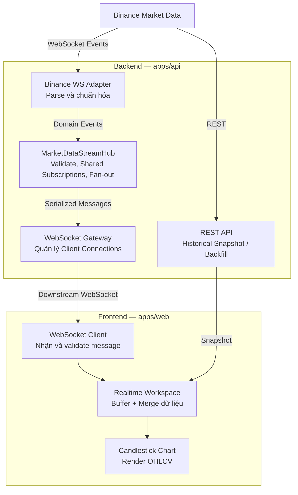
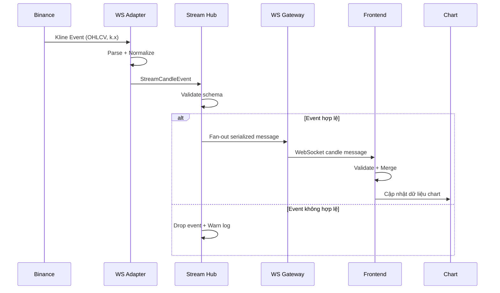
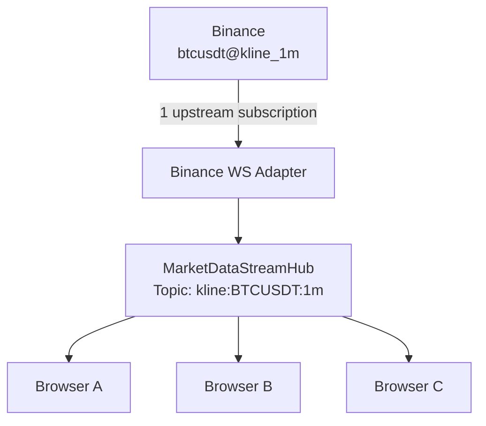
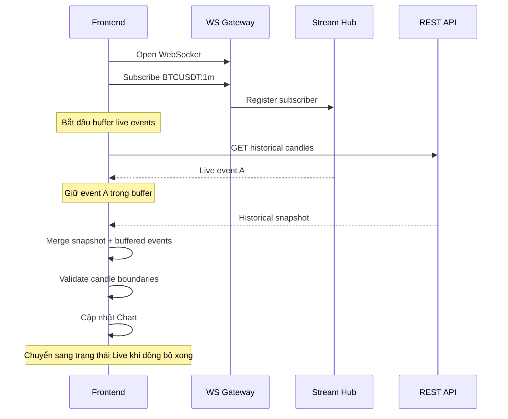

# Q06 - Dữ liệu Market Data đi qua những thành phần nào từ Binance đến chart của người dùng?

Đọc file này để hiểu đường đi của Market Data từ Binance đến Frontend, trách nhiệm của từng thành phần và cách REST phối hợp với WebSocket để chart hiển thị dữ liệu chính xác.

## Tóm tắt

* **Binance:** Nguồn cung cấp Market Data (Kline và Ticker).
* **Binance WS Adapter:** Nhận sự kiện từ Binance và chuẩn hóa thành dữ liệu của Crypto Force.
* **MarketDataStreamHub:** Quản lý Shared Subscriptions (đăng ký dùng chung), kiểm tra dữ liệu và phân phối sự kiện.
* **WebSocket Gateway:** Quản lý kết nối và chuyển sự kiện từ Backend đến Browser.
* **Frontend:** Nhận, hợp nhất dữ liệu và cập nhật biểu đồ.
* **REST:** Tải lịch sử và bù dữ liệu khi cần đồng bộ.
* **WebSocket:** Cung cấp các cập nhật trực tiếp mà không cần chờ chu kỳ polling [[1]](#ref-1).

---

## 1. Tổng quan Data Flow



**Hai đường dữ liệu:**

| Luồng | Mục đích |
|---|---|
| **REST: Binance → Backend → Frontend** | Lấy nến lịch sử hoặc bù dữ liệu bị bỏ lỡ |
| **WebSocket: Binance → Adapter → Hub → Gateway → Frontend** | Nhận cập nhật Kline/Ticker trực tiếp |

Hai luồng gặp nhau tại logic hợp nhất dữ liệu ở Frontend [[1]](#ref-1).

## 2. Trách nhiệm của từng thành phần

| Thành phần | Trách nhiệm chính | Code |
|---|---|---|
| Binance WS Adapter | Nhận Binance Events, parse và chuẩn hóa | `createBinanceStreamProvider` [[2]](#ref-2) |
| MarketDataStreamHub | Validate, chia sẻ subscription, fan-out | `createMarketDataStreamHub` [[3]](#ref-3) |
| WebSocket Gateway | Xác thực kết nối, subscribe/unsubscribe, gửi frame | `attachMarketDataWs` [[4]](#ref-4) |
| WS Client | Mở kết nối, nhận và validate message | `createMarketDataWsClient` [[5]](#ref-5) |
| Realtime Workspace | Quản lý đồng bộ REST/WS, buffer và trạng thái | `useRealtimeWorkspace` [[6]](#ref-6) |
| Candle Merge | Hợp nhất nến và từ chối cập nhật không hợp lệ | `mergeCandleEvent` , `reconcileSnapshotWithBuffer` [[7]](#ref-7) |

**Separation of Concerns (Tách trách nhiệm):**

* Adapter hiểu định dạng Binance, nhưng không quản lý Browser.
* Hub hiểu subscriber và domain events, nhưng không trực tiếp quản lý WebSocket connections.
* Gateway quản lý kết nối, nhưng không quyết định cách hợp nhất nến.
* Frontend quyết định khi nào dữ liệu đủ điều kiện để hiển thị.

## 3. Một Candle Event đi đến Chart như thế nào?

Ví dụ: Binance phát cập nhật nến `BTCUSDT` , timeframe `1m` .



**Các bước cần nhớ:**

1. Binance phát sự kiện Kline.
2. Adapter chuyển các trường Binance (`k.t`, `k.o`, `k.h`, `k.l`, `k.c`, `k.v`, `k.x`) thành `Candle`.
3. Hub kiểm tra sự kiện bằng `wsServerMessageSchema`.
4. Hub serialize message một lần rồi gửi đến các subscriber của topic tương ứng.
5. Gateway chuyển frame đến Browser.
6. Frontend validate và hợp nhất sự kiện vào dữ liệu chart hiện tại [[2]](#ref-2) [[3]](#ref-3) [[7]](#ref-7).

**Điểm quan trọng:** Backend không chuyển nguyên JSON Binance cho Frontend. Adapter chuẩn hóa nó thành Domain Model (mô hình dữ liệu chung) trước khi phân phối.

## 4. Shared Subscriptions giải quyết vấn đề gì?

Giả sử có 100 Browser cùng xem `BTCUSDT:1m` .

Nếu mỗi Browser tạo một subscription riêng tới Binance, Backend sẽ phải quản lý nhiều subscription giống nhau.

Crypto Force sử dụng một subscription upstream cho mỗi channel đang được sử dụng, sau đó chia sẻ dữ liệu đến nhiều Browser [[1]](#ref-1).



| Cơ chế | Vai trò |
|---|---|
| **Channel Key** | Xác định dữ liệu theo pair và timeframe |
| **Shared Subscription** | Nhiều client dùng chung một nguồn dữ liệu |
| **Subscriber Registry** | Theo dõi client nào cần channel nào |
| **Fan-out** | Gửi một sự kiện đến nhiều client |
| **Idle Unsubscribe** | Giữ subscription thêm 5 giây khi không còn subscriber trước khi hủy |

**Trade-off:**

* **Lợi ích:** Giảm số upstream connections/subscriptions và công việc trùng lặp.
* **Đánh đổi:** Hub phải quản lý trạng thái subscriber, thời điểm subscribe/unsubscribe và client chậm.
* **Giới hạn thiết kế:** Registry nằm trong bộ nhớ Backend process. Nếu triển khai nhiều Backend instances, cần xem xét cách chia sẻ dữ liệu và subscription giữa các instance. Đây là hệ quả kiến trúc, không phải khẳng định dự án hiện tại có kế hoạch scale như vậy.

## 5. Tại sao vừa có REST vừa có WebSocket?

WebSocket chỉ nhận những sự kiện được gửi trong lúc subscription hoạt động. Nó không tự cung cấp đầy đủ lịch sử mà Browser đã bỏ lỡ.

**Scenario:** Người dùng mở trang Realtime.



Quy trình của Crypto Force:

**Subscribe → Buffer → REST Snapshot → Merge → Live** [[1]](#ref-1).

| Bước | Lý do |
|---|---|
| Subscribe trước | Bắt đầu nhận các cập nhật mới |
| Buffer events | Không bỏ qua sự kiện trong lúc tải REST |
| REST Snapshot | Lấy dữ liệu lịch sử cần thiết |
| Merge | Kết hợp snapshot với cập nhật mới, tránh trùng/lùi dữ liệu |
| Live | Áp dụng cập nhật mới trực tiếp vào chart |

**Trade-off:** Phối hợp REST và WebSocket phức tạp hơn việc chỉ sử dụng một nguồn. Đổi lại, hệ thống có thể hiển thị lịch sử và tiếp tục nhận cập nhật mới trong cùng một chart.

## 6. Nếu nhận event bị thiếu hoặc sai thứ tự thì sao?

**Ví dụ giả định:**

* Frontend có nến `10:00`,   `isClosed = false`.
* Kết nối gián đoạn và Frontend bỏ lỡ event đóng nến `10:00`.
* Sau khi kết nối lại, Frontend nhận nến mới `10:01`.

Nếu append ngay nến `10:01` , dữ liệu có thể chứa nến `10:00` chưa được xác nhận đã đóng.

Trong `mergeCandleEvent` , khi event mới có `openTime` lớn hơn nến cuối nhưng nến cuối vẫn mở, hàm trả:

```ts
{
  kind: 'resync-required',
  history,
  reason: 'missing-closed-boundary'
}
```

Frontend cần đồng bộ lại thay vì nối nến mới qua khoảng dữ liệu chưa được xác minh [[7]](#ref-7).

| Tình huống | Xử lý trong Candle Merge |
|---|---|
| Event sai schema | Bỏ qua |
| Event có `dataTime` cũ hơn history | Bỏ qua |
| Cập nhật nến đang mở cùng `openTime` | Thay thế nến cuối |
| Nến cuối đã đóng, nhận nến mới | Append nến mới |
| Chưa nhận đóng nến cũ, đã có nến mới | Yêu cầu resync |

**Ý nghĩa:** Nhận được WebSocket message không đồng nghĩa có thể đưa message đó lên chart ngay. Dữ liệu cần vượt qua bước validation và merge.

## 7. Evidence từ benchmark

Trong phép so sánh REST Polling và WebSocket B2 với 10 Chromium clients, metric `sourceToChartDelayMs` có kết quả:

| Metric | REST Polling | WebSocket B2 |
|---|---:|---:|
| p50 | 3.730 ms | 36 ms |
| **p95** | **4.642 ms** | **40 ms** |
| p99 | 4.642 ms | 40 ms |

Kết quả được ghi trong benchmark summary của dự án [[8]](#ref-8).

**Phạm vi kết luận:**

* Với workload đã kiểm chứng, luồng WebSocket giúp dữ liệu xuất hiện trên chart sớm hơn REST Polling.
* Đây là số đo Source-to-chart, không phải chỉ thời gian truyền WebSocket từ Backend đến Browser.
* Không thể suy ra mọi môi trường hay mọi số lượng client đều đạt độ trễ tương tự.

## 8. Nguyên tắc nhớ nhanh

| # | Nguyên tắc |
|---|---|
| 1 | Binance là Data Source (nguồn dữ liệu), không phải nơi Frontend kết nối trực tiếp |
| 2 | Adapter chuyển dữ liệu Binance thành Domain Model |
| 3 | Hub quản lý ai cần dữ liệu nào và phân phối sự kiện |
| 4 | Gateway quản lý WebSocket connections với Browser |
| 5 | Frontend validate và merge trước khi cập nhật chart |
| 6 | REST cung cấp lịch sử, WebSocket cung cấp live updates |
| 7 | Shared Subscriptions tránh đăng ký trùng dữ liệu upstream |
| 8 | Mất event quan trọng có thể buộc chart phải resync |

**Mental Model:**

 `Binance → Adapter → Hub → Gateway → WS Client → Merge → Chart`

Đối với Historical Data:

 `Binance REST → Backend REST API → Snapshot → Merge → Chart`

**Kết luận:** Crypto Force tách rõ nơi lấy dữ liệu, nơi phân phối dữ liệu và nơi quyết định cách cập nhật chart. Sự tách biệt này giúp giảm phụ thuộc vào Binance, chia sẻ nguồn dữ liệu giữa nhiều client và xử lý các trường hợp dữ liệu đến muộn hoặc bị bỏ lỡ.

---

## References

1. <a id="ref-1"></a>[Market Data & Realtime Updates](../../architecture/10-market-data.md)
2. <a id="ref-2"></a>[binance-stream.provider.ts](../../../apps/api/src/providers/market-data/binance-stream.provider.ts)
3. <a id="ref-3"></a>[market-data-stream.service.ts](../../../apps/api/src/services/market-data-stream.service.ts)
4. <a id="ref-4"></a>[market-data.ws.ts](../../../apps/api/src/api/ws/market-data.ws.ts)
5. <a id="ref-5"></a>[market-data-ws.ts](../../../apps/web/app/api/market-data-ws.ts)
6. <a id="ref-6"></a>[useRealtimeWorkspace.ts](../../../apps/web/app/hooks/useRealtimeWorkspace.ts)
7. <a id="ref-7"></a>[market-candle-merge.ts](../../../apps/web/app/utils/market-candle-merge.ts)
8. <a id="ref-8"></a>[WebSocket Benchmark Summary](../../testing/evidence/market-data/ws-v1-benchmarks/summary.json)
