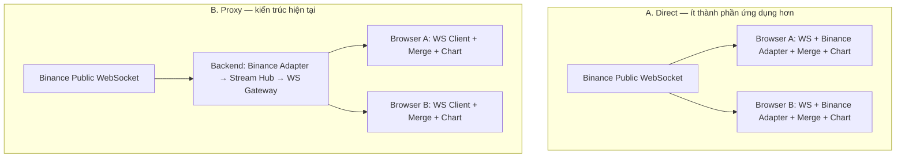
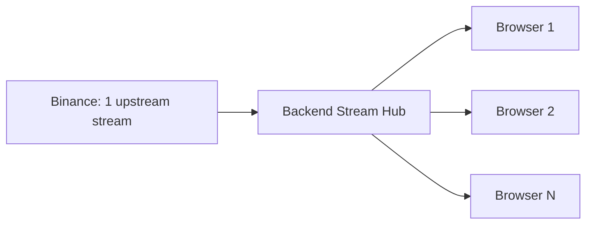
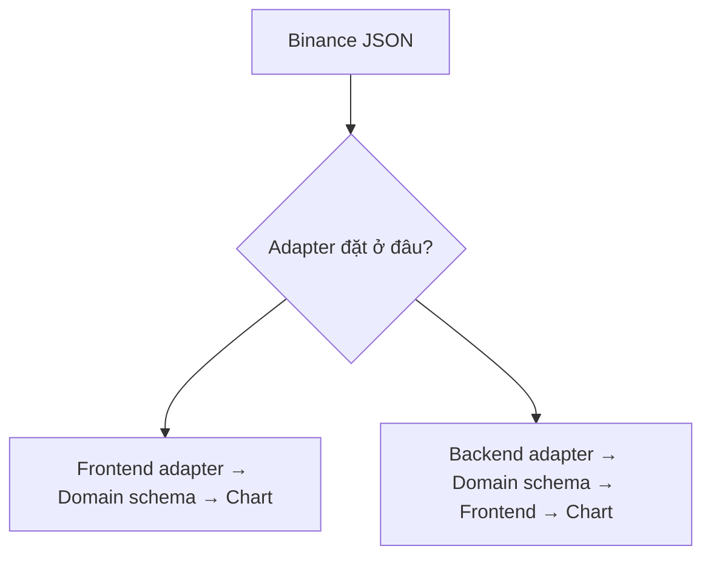

# Q09 - Có thực sự cần Backend Proxy cho Binance Public Market Data?

Đọc file này để đánh giá phản biện quyết định Browser → Backend → Binance của Crypto Force so với Browser → Binance trực tiếp: yêu cầu nào thực sự cần Backend, phần phức tạp nào có thể tránh, bằng chứng hiện tại chứng minh được gì và điều gì còn thiếu.

## Tóm tắt

- **Thừa nhận điểm yếu:** Crypto Force đã chọn kiến trúc **phức tạp hơn** phương án Browser → Binance trực tiếp: thêm WebSocket Gateway, Stream Hub, fan-out, vòng đời upstream/downstream, tài nguyên máy chủ và điểm lỗi trung gian [[1]](#ref-1) [[3]](#ref-3) [[5]](#ref-5).
- **Direct Connection là lựa chọn nghiêm túc, không phải phương án kém chất lượng:** Với Binance **Public Market Data** và mục tiêu chủ yếu là cập nhật chart, Browser có thể tự mở WebSocket, dùng frontend adapter, validate/merge và reconnect. Không có nhu cầu Backend Proxy tất yếu chỉ vì dữ liệu đến từ Binance.
- **Lập luận trước đây chưa chặt:** Shared Subscriptions, Provider Abstraction và Authentication là **khả năng của thiết kế đã chọn**, không tự chứng minh rằng phải chọn Backend. Adapter và schema cũng có thể nằm ở Frontend; xác thực ứng dụng không bắt buộc để truy cập dữ liệu công khai.
- **Circular reasoning trong ADR:** ADR-009 loại Direct Connection vì vi phạm QA-09 (Frontend không gọi Binance), nhưng QA-09 đã giả định trước ranh giới Backend Provider [[2]](#ref-2). Đây là ràng buộc thiết kế cần truy ngược về nhu cầu sản phẩm, không đủ làm bằng chứng độc lập để loại phương án đơn giản hơn.
- **Benchmark không so sánh hai kiến trúc:** B1/B2 xác nhận Shared Subscriptions hiệu quả hơn *trong Backend Proxy*, **không** xác nhận Backend Proxy nhanh hơn, rẻ hơn hoặc phù hợp hơn Direct Connection [[6]](#ref-6).

**Đánh giá hiện tại:** Có dấu hiệu **over-engineering** cho phạm vi chỉ hiển thị dữ liệu Binance công khai. Không thể khẳng định Backend Proxy là phương án tệ hơn về mọi mặt khi chưa có benchmark và requirement review công bằng; nhưng **chắc chắn nó có thêm complexity phải được biện minh**. Quyết định ADR-009 có thể được giữ vì chi phí chuyển đổi, song justification hiện tại cần được xem lại.

---

## 1. Đặt đúng câu hỏi kiến trúc

Câu hỏi không nên là *“Vì sao hệ thống đã đặt Binance qua Backend?”* rồi đi tìm lợi ích để hợp lý hóa thiết kế.

Câu hỏi cần trả lời là:

> Với workload hiện tại của Crypto Force, **Backend Proxy giải quyết yêu cầu nào mà Browser → Binance không thể giải quyết đủ tốt với chi phí thấp hơn?**

Phân biệt:

- **Product requirement:** Chart nhận Kline/Ticker kịp thời, dữ liệu hợp lệ, khôi phục sau gián đoạn.
- **Implementation option:** Client tự dùng Binance WebSocket hoặc Backend làm trung gian.
- **Architecture constraint:** QA-09 đã yêu cầu Frontend không gọi Binance; đây là ràng buộc được chấp nhận trong thiết kế, không phải bằng chứng rằng Direct Connection bất khả thi [[2]](#ref-2).

Không dùng chính một architecture constraint để chứng minh architecture ấy là tối ưu.

## 2. Hai luồng thực tế

| Tiêu chí | Browser → Binance | Browser → Backend → Binance |
|---|---|---|
| Components cho live data | Browser WS + adapter + merge | Browser WS + Gateway + Hub + Backend adapter + merge |
| Backend fan-out, CPU, băng thông live | Không cần | Cần; tăng theo subscribers |
| Network hop ứng dụng | Không qua API | Thêm API làm trung gian |
| Điểm lỗi chung | Chủ yếu nguồn và mạng của client | Thêm Backend outage/backpressure; một lỗi API có thể ảnh hưởng nhiều client |
| Binance quota/connection | Mỗi Browser tự kết nối; giới hạn theo IP có thể bị chia sẻ qua NAT | Backend có thể gom upstream, nhưng các request/kết nối của Backend tập trung tại IP Backend |
| Schema/adapter/provider abstraction | Làm được ở Frontend | Làm được ở Backend |
| Quản lý session ứng dụng cho kênh proxy | Không áp dụng cho Binance Public WS | Gateway có thể thực thi |
| Backend consumers cùng cần live events | Có thể phải xây thêm pipeline | Dễ tái sử dụng hơn trong cùng backend |
| Nhiều Backend instances | Không phát sinh Hub server cho live data | Hub in-memory không tự chia sẻ giữa processes [[1]](#ref-1) |

**[Inferred]** Với ứng dụng chỉ hiển thị Binance Public Market Data và chưa có consumer thực sự ở Backend cần cùng live events, Direct Connection là baseline hợp lý nhờ số thành phần ít hơn. Nó vẫn phải xử lý lỗi kết nối, dữ liệu và hạn mức của Binance; không phải “không cần engineering”.

---

## 3. Phản biện từng lý do từng dùng để chọn Backend

### A. Shared Subscriptions — tối ưu đúng một bài toán, nhưng chưa chứng minh cần Proxy

**Trong Backend Proxy:** Nếu 100 Browser cùng subscribe `BTCUSDT:1m`, Hub có thể chia sẻ một upstream subscription, sau đó fan-out event qua 100 downstream sockets [[3]](#ref-3).

- **Lợi ích có thật:** Backend tránh lặp upstream WS/subscriptions *giữa những clients đi qua Backend*.
- **Chi phí có thật:** Hub phải duy trì registry, quản lý ref count, slow consumers, serialize/fan-out, network egress và vận hành connection lifecycle.
- **Phản biện:** Khi mỗi Browser kết nối trực tiếp, API không có upstream traffic để tối ưu ngay từ đầu. Chuyển fan-out từ Binance sang Backend chưa mặc nhiên giảm **tổng** chi phí hệ thống; nó có thể chỉ chuyển gánh nặng sang hạ tầng của Crypto Force.
- **Giới hạn:** Shared Subscriptions hiện nằm trong một API process; khi scale nhiều instances, không có chia sẻ Hub tự động [[1]](#ref-1).

Không suy ra “100 Browser = 100 public IP riêng”: nhiều Browser có thể dùng chung public IP do mạng công ty hoặc CGNAT. Ngược lại, cũng không được mặc định tất cả Browser đều chịu quota của một Backend IP.

### B. Provider Abstraction — không bắt buộc ở Backend

Binance Kline Event có các trường như `k.t`, `k.o`, `k.c`, `k.x`. Crypto Force mapping chúng thành `openTime`, `open`, `close`, `isClosed` trong `BinanceStreamProvider` [[4]](#ref-4).

- Frontend **có thể tự parse, validate và chuẩn hóa JSON** mà không cần qua Backend.
- Nếu Binance đổi contract, **cả hai phương án đều phải cập nhật adapter**. Khác nhau ở nơi deploy, khả năng tương thích với các frontend phiên bản cũ và cách tổ chức consumers.
- Backend adapter có thể hợp lý khi nhiều clients hoặc backend consumers cần một contract chung, nhưng **chưa có bằng chứng trong note này rằng parsing ở Browser là bottleneck**.
- ADR-003 và QA-09 yêu cầu tách Frontend khỏi Binance, song điều đó xác nhận **thiết kế đã chọn**, không chứng minh Frontend Adapter không đáp ứng được yêu cầu [[2]](#ref-2).

### C. Authentication / Validation — kiểm soát dịch vụ, không phải quyền truy cập Binance Public Data

Gateway hiện có session authentication, Origin checks, rate/subscription limits, schema validation và xử lý slow consumers [[5]](#ref-5).

Đây là các biện pháp hợp lệ **nếu** Crypto Force cung cấp một dịch vụ WebSocket riêng qua Backend. Nhưng khi Browser lấy trực tiếp dữ liệu công khai:

- Không cần đăng nhập Crypto Force chỉ để gọi Binance Public WebSocket.
- Frontend vẫn có thể validate frame và giới hạn subscriptions của chính tab đó.
- Backend session chỉ kiểm soát ai được dùng **proxy của ứng dụng**, không ngăn họ truy cập cùng nguồn công khai ngoài ứng dụng.
- Nếu requirement thực sự là kiểm soát truy cập luồng dữ liệu độc quyền, ghi log tập trung tại server hay có downstream clients không được gọi provider, Backend trở nên đáng cân nhắc hơn. **Không được tự giả định các requirement này đang tồn tại.**

---

## 4. Evidence hiện có: chính xác chứng minh được điều gì?

Crypto Force benchmark hai thiết kế **đều qua Backend**:

- **B1:** Mỗi protocol client dùng upstream connection riêng.
- **B2:** Backend chia sẻ upstream connection/subscriptions và fan-out.

| Metric (400 protocol clients) | B1 | B2 |
|---|---:|---:|
| Upstream WS Connections | 300 | 1 |
| Upstream Subscriptions | 1.500 | 5 |
| Rejected Upstream Connections | 1.636 | 0 |
| API CPU | 77,09% | 33,01% |
| Backend-to-chart p95 (1 Chromium probe) | 275 ms | 135 ms |

Nguồn: `comparisonB_beforeVsAfterSharedSubscriptions` [[6]](#ref-6).

**Được chứng minh:** B2 ít upstream connections hơn và có CPU/p95 probe thấp hơn B1 trong workload đó. Shared Subscriptions là tối ưu có ý nghĩa **sau khi đã quyết định dùng Backend Proxy**.

**Không được chứng minh:**

1. Direct Browser → Binance không đáp ứng latency hoặc correctness.
2. Backend Proxy nhanh hơn Direct về source-to-chart latency.
3. Backend Proxy có tổng chi phí tài nguyên thấp hơn Direct.
4. 400 browser thật cùng render chart đều đạt 135 ms p95 (tải là protocol clients với một Chromium probe).
5. Capacity 400 clients đã được kiểm tra đầy đủ trong thời gian dài: benchmark này dùng cửa sổ đo rút gọn, không phải kết quả sustained 180 giây × 3 lượt.

Đặc biệt, benchmark REST Polling vs WS chứng minh **push WS nhanh hơn polling trong bài đo**, không chứng minh *proxy WS nhanh hơn direct WS* [[6]](#ref-6).

---

## 5. Điểm yếu trong Architecture Decision

ADR-009 ghi Direct Browser → Binance vào danh sách lựa chọn nhưng loại vì vi phạm QA-09, thiếu kiểm soát tập trung việc chuẩn hóa và thiếu thống nhất cách đo [[2]](#ref-2).

| Lý do trong ADR | Đánh giá phản biện |
|---|---|
| Direct vi phạm QA-09 | **Circular reasoning:** QA-09 đã quy định Frontend không gọi Binance. Cần chứng minh *vì sao* constraint này là product need độc lập. |
| Chuẩn hóa tập trung ở Backend | Frontend adapter và shared schema cũng chuẩn hóa được. Backend có lợi nếu nhiều consumers hoặc cần cập nhật adapter ở server không phụ thuộc frontend rollout. |
| Khó thống nhất đo lường | Browser telemetry có thể đo; Backend dễ quan sát pipeline mình kiểm soát hơn. Đây là trade-off về observability, không phải lý do đủ để loại Direct. |
| Shared upstream subscriptions | Đúng là tối ưu B1 → B2, nhưng đánh giá không công bằng nếu thiếu A = Direct Browser → Binance. |

### Thừa nhận thiếu sót

**[Inferred — đánh giá kỹ thuật]** Chúng ta đã **chọn và tối ưu một kiến trúc phức tạp trước khi chứng minh kiến trúc đơn giản hơn không đáp ứng yêu cầu**. Đây là **điểm yếu của quá trình ra decision**, không phủ nhận chất lượng implementation, những bug đã được giải quyết hay benchmark đã thực hiện.

Nếu chỉ xét mục tiêu hiện tại là đọc Binance Public Market Data để cập nhật chart, **Backend Proxy có khả năng over-engineered**: thêm thành phần và chi phí mà lợi ích cần thiết chưa được chứng minh đủ. Không được đổi nhận định đó thành khẳng định “Direct chắc chắn nhanh hơn” khi chưa đo đối chứng.

---

## 6. Khi nào Backend Proxy thực sự đáng chi phí?

Backend có thể đáng chọn khi có **requirement thực tế và được kiểm chứng**, chẳng hạn:

- Backend Strategy Engine/Worker cũng tiêu thụ cùng live market stream và cần thống nhất logic dữ liệu.
- Nhiều backend consumers hoặc nhiều ứng dụng client cần cùng chính sách và contract, có bài toán quản lý version rõ ràng.
- Crypto Force phân phối dữ liệu có kiểm soát truy cập theo quyền riêng, thay vì chỉ chuyển Binance Public Data.
- Có nhu cầu giám sát/tổng hợp/capture tập trung tại server mà client telemetry không đáp ứng được.
- Có evidence trực tiếp rằng Direct Connection chạm quota, lỗi kết nối hoặc giới hạn vận hành trong các mạng người dùng mục tiêu.

Đây là **điều kiện biện minh có thể xảy ra**, không phải những nhu cầu mặc nhiên đã có trong phạm vi hiện tại.

## 7. Cách đánh giá lại công bằng

**[Agent đề xuất]** Trước khi thay đổi ADR-009 hoặc quyết định giữ lâu dài, thực hiện prototype nhỏ Browser → Binance WebSocket với cùng pair/timeframe, schema, reconnect, REST snapshot/backfill và quy tắc merge.

So sánh **Direct WS** với **Proxy WS** trong điều kiện có thể đối chiếu:

| Metric | Điều cần xác minh |
|---|---|
| Source-to-chart p50/p95/p99 | Event từ nguồn tới lúc chart vẽ, không trộn với backend-to-chart |
| Missing / duplicate / invalid candles | Correctness qua reconnect, chuyển timeframe, gián đoạn |
| Browser CPU/memory | Chi phí đưa adapter và WS lifecycle về client |
| Backend CPU/bandwidth | Chi phí riêng của proxy và fan-out |
| Connection quota/error | Public IP khác nhau, mạng dùng NAT, burst reconnect |
| Recovery duration | REST backfill và resync sau gián đoạn |
| Operation & maintenance complexity | Số components, deploy, monitoring, failure domains |

Ghi rõ limitations: cùng máy khác với nhiều máy thật; source live có biến động; replay có thể dùng để kiểm logic nhưng không thay thế kiểm network trực tiếp. Chỉ quyết định lại sau khi có evidence hoặc một requirement độc lập thực sự cần Backend.

**Không cần đổi kiến trúc ngay chỉ vì nhận ra thiếu sót:** chi phí migration và yêu cầu tương lai là input hợp lệ. Nhưng việc giữ thiết kế hiện có phải được giải thích bằng chi phí/benefit hiện tại, **không hồi tố biến QA-09 thành bằng chứng Direct là sai**.

---

## 8. Nguyên tắc nhớ nhanh

1. **Direct Browser → Binance là baseline kiến trúc hợp lệ** cho Public Market Data.
2. **Ít tầng hơn chưa chắc nhanh hơn**, nhưng ít components hơn là lợi thế complexity có thật.
3. **Provider Abstraction không bắt buộc nằm ở Backend.**
4. **Shared Subscriptions chỉ chứng minh tối ưu bên trong Proxy**, không chứng minh Proxy cần tồn tại.
5. **Quota không độc lập hoàn toàn theo Browser**: có giới hạn theo connection và theo public IP/NAT.
6. **Authentication của Proxy không biến Public Market Data thành private data.**
7. **B1 vs B2 không phải Direct vs Proxy.** Benchmark phải đúng câu hỏi decision.
8. **Thừa nhận over-engineering và sửa cách ra decision** quan trọng hơn cố bảo vệ architecture cũ.

**Mental model:** `Independent requirements → Competing designs → Comparable evidence → Trade-offs → Decision`.

**Kết luận:** Crypto Force đã chọn phương án **phức tạp hơn** và phần rationale trong ADR-009 **chưa chứng minh đủ vì sao cần trả thêm complexity** so với Browser kết nối Binance trực tiếp. Backend Proxy có lợi ích kỹ thuật thực, nhưng với phạm vi Public Market Data hiện tại, các lợi ích đó không tự động thắng phương án Direct. Đây là điểm yếu thiết kế cần ghi nhận và kiểm chứng, không phải điều cần hợp lý hóa.

---

## References

1. [Market Data & Realtime Updates](../../architecture/10-market-data.md)
2. [Architecture Decision Records](../../architecture/30-decisions.md)
3. [market-data-stream.service.ts](../../../apps/api/src/services/market-data-stream.service.ts)
4. [binance-stream.provider.ts](../../../apps/api/src/providers/market-data/binance-stream.provider.ts)
5. [market-data.ws.ts](../../../apps/api/src/api/ws/market-data.ws.ts)
6. [WebSocket Benchmark Summary](../../testing/evidence/market-data/ws-v1-benchmarks/summary.json)
